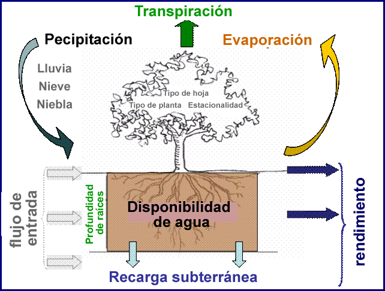

.. _annual_water_yield:

*************************
Rendimiento hídrico anual
*************************

Resumen
=======

La energía hidroeléctrica representa el veinte por ciento de la producción mundial de energía, y la mayor parte se genera mediante sistemas de embalses. InVEST estima la cantidad y el valor promedio anual de la energía hidroeléctrica producida por los embalses, e identifica cuánta producción o valor hídrico aporta anualmente cada parte del paisaje a la generación hidroeléctrica. El modelo tiene tres componentes: rendimiento hídrico, consumo de agua y valoración hidroeléctrica. Los modelos biofísicos no consideran las interacciones entre las aguas superficiales y subterráneas ni la dimensión temporal del suministro de agua. El modelo de valoración supone que los precios de la energía permanecen constantes a lo largo del tiempo.

Introducción
============

El suministro de agua dulce es un servicio ecosistémico que contribuye al bienestar de la sociedad de muchas maneras, entre ellas mediante la producción de energía hidroeléctrica, la forma de energía renovable más utilizada en el mundo. La mayor parte de la producción hidroeléctrica proviene de sistemas de embalses alimentados por cuencas hidrográficas, que generalmente proporcionan energía de manera constante y predecible. Estos sistemas están diseñados para considerar la variabilidad anual del volumen de agua, de acuerdo con los niveles probables de una cuenca determinada, pero son vulnerables a las variaciones extremas provocadas por los cambios en el uso y la cobertura del suelo (LULC). Los cambios en el LULC pueden alterar los ciclos hidrológicos, afectar los patrones de evapotranspiración, infiltración y retención de agua, y modificar el momento y el volumen del agua disponible para la producción hidroeléctrica (World Commission on Dams 2000; Ennaanay 2006).

Los cambios en el paisaje que afectan el rendimiento hídrico anual promedio aguas arriba de las instalaciones hidroeléctricas pueden aumentar o reducir la capacidad de producción hidroeléctrica. Los mapas que muestran dónde se produce el agua utilizada para la generación hidroeléctrica pueden ayudar a evitar impactos no deseados en esa producción o a orientar decisiones de uso del suelo que busquen mantenerla, al tiempo que equilibran otros usos, como la conservación o la agricultura. Estos mapas también pueden servir para orientar inversiones en restauración o manejo que realizan los actores aguas abajo, como las empresas hidroeléctricas, con la expectativa de mejorar o mantener el rendimiento hídrico de este importante servicio ecosistémico. En cuencas hidrográficas grandes con varios embalses para la generación hidroeléctrica, las áreas situadas aguas arriba de las centrales que venden energía a mercados de mayor valor tendrán un valor más alto para este servicio. Los mapas que muestran cuánto valor aporta cada parcela a la generación hidroeléctrica pueden ayudar a los gestores a evitar desarrollos en las áreas de mayor valor hidroeléctrico, comprender cuánto valor se perderá o ganará como consecuencia de distintas opciones de manejo, o identificar qué productores hidroeléctricos tienen mayor interés en mantener el rendimiento hídrico en el paisaje.

El modelo
=========

El modelo de Rendimiento Hídrico de InVEST estima las contribuciones relativas de agua de distintas partes del paisaje y permite comprender cómo los cambios en los patrones de uso del suelo afectan el rendimiento hídrico superficial anual y la producción hidroeléctrica.

Modelar las conexiones entre los cambios del paisaje y los procesos hidrológicos no es sencillo. Los modelos sofisticados de estas conexiones y de los procesos asociados (como el modelo WEAP) requieren muchos recursos y datos, además de conocimientos especializados. Para adaptarse a un mayor número de contextos en los que se dispone de datos de fácil acceso, InVEST cartografía y modela el rendimiento hídrico anual promedio de un paisaje utilizado para la producción hidroeléctrica, en lugar de abordar directamente el efecto de los cambios en el LULC sobre la generación hidroeléctrica, ya que este proceso está estrechamente vinculado con la variación de los caudales de entrada en escalas temporales de días a meses. En su lugar, InVEST calcula la contribución relativa de cada parcela de terreno a la producción hidroeléctrica anual promedio y el valor de esta contribución en términos de generación de energía. También puede calcularse el valor presente neto de la producción hidroeléctrica durante la vida útil del embalse mediante la suma de los ingresos anuales descontados.

Cómo funciona
-------------

El modelo funciona con un mapa cuadriculado. Estima la cantidad y el valor del agua utilizada para la producción hidroeléctrica en cada subcuenca del área de interés. Tiene tres componentes que se ejecutan secuencialmente. Primero, determina la cantidad de agua que escurre de cada píxel, calculada como la precipitación menos la fracción de agua que experimenta evapotranspiración. El modelo no diferencia entre flujo superficial, subsuperficial y flujo base, sino que supone que toda el agua producida por un píxel llega al punto de interés a través de una de estas vías. Luego, suma y promedia el rendimiento hídrico a escala de subcuenca. Los cálculos a escala de píxel permiten representar la heterogeneidad de los factores clave que determinan el rendimiento hídrico, como el tipo de suelo, la precipitación y el tipo de vegetación. Sin embargo, la teoría que sirve de fundamento a este conjunto de modelos se desarrolló a escala de subcuenca y cuenca hidrográfica. Solo tenemos confianza en la interpretación de estos modelos a escala de subcuenca, por lo que todas las salidas se suman o promedian a esa escala. Seguimos proporcionando representaciones de algunos resultados a escala de píxel únicamente para fines de calibración y comprobación del modelo. **Estos mapas a escala de píxel no deben interpretarse para comprender los procesos hidrológicos ni utilizarse para tomar decisiones de ningún tipo.**

En segundo lugar, además de la escorrentía anual promedio, calcula la proporción de agua superficial disponible para la producción hidroeléctrica, restando el agua superficial que se consume para otros usos. En tercer lugar, estima la energía producida por el agua que llega al embalse hidroeléctrico y el valor de esa energía durante la vida útil del embalse.

|

Figura 1. Diagrama conceptual del método simplificado de balance hídrico utilizado en el modelo de rendimiento hídrico anual. Los componentes del balance hídrico que aparecen en color están incluidos en el modelo; los que aparecen en gris no lo están.

Modelo de rendimiento hídrico
^^^^^^^^^^^^^^^^^^^^^^^^^^^^^

El modelo de rendimiento hídrico se basa en la curva de Budyko y en la precipitación anual promedio. Determinamos el rendimiento hídrico anual :math:`Y(x)` para cada píxel del paisaje :math:`x` de la siguiente manera:

.. math:: Y(x) = \left(1-\frac{AET(x)}{P(x)}\right)\cdot P(x)

donde :math:`AET(x)` es la evapotranspiración real anual del píxel :math:`x` y :math:`P(x)` es la precipitación anual sobre ese píxel.

Para los tipos de uso y cobertura del suelo (LULC) con vegetación, la fracción de evapotranspiración del balance hídrico, :math:`\frac{AET(x)}{P(x)}`, se basa en una expresión de la curva de Budyko propuesta por Fu (1981) y Zhang et al. (2004):

.. math:: \frac{AET(x)}{P(x)} = 1+\frac{PET(x)}{P(x)} - \left[1+\left(\frac{PET(x)}{P(x)}\right)^\omega\right]^{1/\omega}
	:label: aet_vegetated

donde :math:`PET(x)` es la evapotranspiración potencial y :math:`\omega(x)` es un parámetro no físico que caracteriza las propiedades naturales del clima y del suelo, ambos descritos a continuación.

La evapotranspiración potencial :math:`PET(x)` se define como:

.. math:: PET(x) = K_c(\ell_x)\cdot ET_0(x)

donde :math:`ET_0(x)` es la evapotranspiración de referencia del píxel :math:`x` y :math:`K_c(\ell_x)` es el coeficiente de evapotranspiración de la planta (vegetación) asociado con el LULC :math:`\ell_x` del píxel :math:`x`. :math:`ET_0(x)` refleja las condiciones climáticas locales, sobre la base de la evapotranspiración de una vegetación de referencia, como pasto o alfalfa, cultivada en ese lugar. :math:`K_c(\ell_x)` está determinado en gran medida por las características de la vegetación del uso y cobertura del suelo presente en ese píxel (Allen et al. 1998). :math:`K_c` ajusta los valores de :math:`ET_0` al tipo de cultivo o vegetación de cada píxel del mapa de uso y cobertura del suelo.

:math:`\omega(x)` es un parámetro empírico que puede expresarse como una función lineal de :math:`\frac{AWC*N}{P}`, donde N es el número de eventos de lluvia por año y AWC es el contenido volumétrico de agua disponible para las plantas (véase el Apéndice 1 para más detalles). Mientras se realizan nuevas investigaciones para determinar la función que mejor describe los datos mundiales, en el modelo InVEST utilizamos la expresión propuesta por Donohue et al. (2012) y, por tanto, definimos:

.. math:: \omega(x) = Z\frac{AWC(x)}{P(x)} + 1.25
   :label: omega

donde:

+ :math:`AWC(x)` es el contenido volumétrico (mm) de agua disponible para las plantas. La textura del suelo y la profundidad efectiva de las raíces definen :math:`AWC(x)`, que determina la cantidad de agua que puede almacenarse y liberarse en el suelo para uso de las plantas. Se estima como el producto de la capacidad de agua disponible para las plantas (PAWC) y el mínimo entre la profundidad de la capa que restringe las raíces y la profundidad de enraizamiento de la vegetación:

	.. math:: AWC(x)= Min(Rest.layer.depth, root.depth)\cdot PAWC

  La profundidad de la capa que restringe las raíces es la profundidad del suelo a la que la penetración de las raíces se ve limitada por características físicas o químicas. La profundidad de enraizamiento de la vegetación suele definirse como aquella en la que se encuentra el 95 % de la biomasa radicular de un tipo de vegetación. PAWC es la capacidad de agua disponible para las plantas, es decir, la diferencia entre la capacidad de campo y el punto de marchitez permanente.

+ :math:`Z` es una constante empírica, a veces denominada «factor de estacionalidad», que representa el patrón local de precipitación y otras características hidrogeológicas. Está correlacionada positivamente con N, el número de eventos de lluvia por año. El término 1.25 es el valor mínimo de :math:`\omega(x)`, que puede considerarse un valor para el suelo desnudo (cuando la profundidad de las raíces es 0), como explican Donohue et al. (2012). De acuerdo con la literatura (Yang et al., 2008; Donohue et al. 2012), los valores de :math:`\omega(x)` se limitan a un máximo de 5.

Para otros tipos de LULC (agua abierta, áreas urbanas y humedales), la evapotranspiración real se calcula directamente a partir de la evapotranspiración de referencia :math:`ET_0(x)` y tiene un límite superior definido por la precipitación:

.. math:: AET(x) = Min(K_c(\ell_x)\cdot ET_0(x),P(x))
	:label: aet_non_vegetated

donde :math:`ET_0(x)` es la evapotranspiración de referencia y :math:`K_c(\ell_x)` es el factor de evaporación para cada LULC.

El modelo de rendimiento hídrico genera y presenta el rendimiento hídrico total y promedio a escala de subcuenca.

Suministro efectivo
^^^^^^^^^^^^^^^^^^^

La opción Suministro efectivo del modelo (denominada Escasez de agua en la interfaz de la herramienta) calcula el caudal de entrada de agua a un embalse a partir del rendimiento hídrico calculado y del uso consuntivo de agua en la(s) cuenca(s) de interés. El usuario introduce, en formato de tabla, la cantidad de agua consumida por cada tipo de uso y cobertura del suelo. Entre los ejemplos de uso consuntivo se encuentran las extracciones municipales o industriales que no se devuelven al cauce aguas arriba de la salida de la cuenca. Esta opción también puede utilizarse para representar transferencias de agua fuera de la cuenca de estudio hacia otras cuencas.

Por ejemplo, en un área urbana, el uso consuntivo puede calcularse como el producto de la densidad de población por el uso consuntivo per cápita. Estos valores basados en el uso del suelo se refieren únicamente a la parte consuntiva de la demanda; algunos usos del agua no son consuntivos, como el agua utilizada en procesos industriales o las aguas residuales que se devuelven al cauce después de su uso, aguas arriba de la salida de la cuenca. Por tanto, las estimaciones del uso consuntivo deben considerar los flujos de retorno al cauce por encima de la salida de la cuenca:

.. math:: C = \frac{W-R}{n}

donde :math:`C` = uso consuntivo (:math:`m^3/yr/pixel`), :math:`W` = extracciones (:math:`m^3/yr`), :math:`R` = flujos de retorno (:math:`m^3/yr`) y :math:`n` = número de píxeles de una determinada cobertura del suelo.

Por simplicidad, cada píxel de la cuenca es un píxel «contribuyente», que aporta a la producción hidroeléctrica, o un píxel de «uso», que utiliza agua para otros fines consuntivos. Este supuesto implica que los usos del suelo asociados con usos consuntivos no contribuirán con rendimiento hídrico para los usos aguas abajo. La cantidad de agua que realmente llega al embalse de la presa :math:`d` (denominada suministro efectivo) se define como la diferencia entre el rendimiento hídrico total de la cuenca y el uso consuntivo total en ella:

.. math:: V_{in} = Y-u_d

donde :math:`V_{in}` es el suministro efectivo (volumen de entrada a un embalse), :math:`u_d` es el volumen total de agua consumida en la cuenca aguas arriba de la presa :math:`d` y :math:`Y` es el rendimiento hídrico total de la cuenca aguas arriba de la presa :math:`d`.

Tenga en cuenta que aquí solo se consideran los usos antropogénicos, ya que la evapotranspiración (incluido el uso consuntivo de agua por parte de los cultivos) se contabiliza mediante el parámetro :math:`K_c` en el modelo de rendimiento hídrico. Los usuarios deben tener presente que el modelo supone que toda el agua disponible para la evapotranspiración procede del interior de la cuenca (como lluvia). Este supuesto se cumple cuando la agricultura depende de la lluvia o cuando la fuente de agua para riego se encuentra dentro de la cuenca de estudio (no procede de transferencias entre cuencas ni de un acuífero profundo desconectado). Consulte la sección Limitaciones para obtener más información sobre la aplicación del modelo en cuencas con agricultura de regadío.

Si se dispone de datos observados de los caudales anuales reales de entrada al embalse de la presa :math:`d`, estos pueden compararse con :math:`V_{in}`.

Producción y valoración hidroeléctrica
^^^^^^^^^^^^^^^^^^^^^^^^^^^^^^^^^^^^^^

La opción Valoración del modelo estima tanto la cantidad de energía producida a partir del suministro efectivo de agua calculado para la generación hidroeléctrica como el valor de esa energía. Se obtiene una estimación monetaria del valor presente para toda la vida útil restante del embalse. El valor presente neto puede calcularse si se dispone de datos sobre los costos de producción hidroeléctrica. Luego, la energía producida y los ingresos se redistribuyen en el paisaje según la contribución proporcional de cada subcuenca a la producción de energía. Los mapas de resultados finales muestran cuánta producción de energía y cuánto valor hidroeléctrico pueden atribuirse al rendimiento hídrico de cada subcuenca durante la vida útil del embalse.

Es importante señalar que la asignación de un valor monetario a cualquier servicio solo debe realizarse sobre resultados del modelo que hayan sido calibrados y validados. De lo contrario, se desconoce en qué medida el modelo representa el área de interés, lo que puede conducir a una representación errónea del valor exacto. Si el modelo no ha sido calibrado, deben utilizarse únicamente resultados relativos (como un aumento del 10 %) y no valores absolutos (como 1.523 metros cúbicos o 42.900 dólares).

En la presa :math:`d`, la potencia se calcula mediante la siguiente ecuación:

.. math:: p_d = \rho\cdot q_d \cdot g \cdot h_d

donde :math:`p_d` es la potencia en vatios, :math:`\rho` es la densidad del agua (1000 Kg/m\ :sup:`3`\ ), :math:`q_d` es el caudal (m\ :sup:`3`\ /s), :math:`g` es la constante gravitacional (9.81 m/s\ :sup:`2`\ ) y :math:`h_d` es la altura del agua detrás de la presa, a la altura de la turbina (m). En este modelo suponemos que el volumen total anual de agua que entra se libera de manera uniforme y continua a lo largo de cada año.

La ecuación de producción de potencia se vincula con el modelo de rendimiento hídrico al convertir el volumen anual de entrada ajustado por el consumo (:math:`V_{in}`) en una tasa por segundo. Como la energía eléctrica normalmente se mide en kilovatios-hora, la potencia :math:`p_d` se multiplica por el número de horas de un año. Todos los embalses hidroeléctricos se construyen para producir una cantidad máxima de electricidad. Esta se denomina capacidad nominal de producción de energía y representa la cantidad de energía que podría producirse si las turbinas fueran 100 % eficientes y toda el agua que entra al embalse se utilizara para generar electricidad. En el mundo real, las turbinas tienen pérdidas de eficiencia y el agua del embalse puede extraerse para otros usos, como el riego; retenerse para otros fines, como la recreación; o liberarse para usos no relacionados con la generación eléctrica, como el mantenimiento de caudales ambientales aguas abajo. Para considerar estas ineficiencias y los ajustes de las unidades de caudal y potencia, la producción anual promedio de energía :math:`\varepsilon_d` en la presa :math:`d` se calcula de la siguiente manera:

.. math:: \varepsilon_d= 0.00272\cdot \beta \cdot \gamma_d \cdot h_d \cdot V_{in}

donde :math:`\varepsilon_d` es la producción de energía hidroeléctrica (KWH), :math:`\beta` es el coeficiente de eficiencia de la turbina (%) y :math:`\gamma_d` es el porcentaje del volumen de agua que entra al embalse de la presa :math:`d` y que se utilizará para generar energía.

Para convertir :math:`\varepsilon_d`, la energía anual generada por la presa :math:`d`, en un valor presente neto (NPV) de la energía producida (valor en el punto de consumo), utilizamos la siguiente expresión:

.. math:: NPVH_d=(p_e\varepsilon_d-TC_d)\times \sum^{T-1}_{t=0}\frac{1}{(1+r)^t}
   :label: net_present_value

donde :math:`TC_d` es el total de los costos operativos anuales de la presa :math:`d`, :math:`p_e` es el valor de mercado de la electricidad (por kilovatio-hora) suministrada por la central hidroeléctrica de la presa :math:`d`, :math:`T_d` indica el número de años durante los cuales se espera que persistan las condiciones actuales del paisaje o la vida útil restante prevista de la central de la presa :math:`d` (se debe establecer :math:`T` en el menor de los dos valores si difieren), y :math:`r` es la tasa de descuento del mercado. La ecuación anterior supone que :math:`TC_d`, :math:`p_e` y :math:`\varepsilon_d` permanecen constantes a lo largo del tiempo. Puede utilizarse cualquier moneda, siempre que sea coherente en las distintas entradas.

El modelo no realiza los siguientes cálculos, pero la producción de energía durante la vida útil de la presa :math:`d` puede atribuirse a cada subcuenca de la siguiente manera:

.. math:: \varepsilon_x = (T_d\varepsilon_d)\times(c_x / c_{tot})

donde el primer término entre paréntesis representa la producción de electricidad durante la vida útil de la presa :math:`d`. El segundo término representa la proporción del volumen de agua utilizado para la producción hidroeléctrica que procede de la subcuenca :math:`x` respecto del volumen total de agua de toda la cuenca. El valor de cada subcuenca para la producción hidroeléctrica durante la vida útil de la presa :math:`d` puede calcularse de manera similar:

.. math:: NPVH_x=NPVH_d\times (c_x/c_{tot})

Limitaciones y simplificaciones
===============================

El modelo presenta varias limitaciones. En primer lugar, no está diseñado para elaborar planes detallados de gestión del agua, sino para evaluar cómo y dónde los cambios en una cuenca pueden afectar la producción hidroeléctrica de los sistemas de embalses. Se basa en promedios anuales, que no consideran los eventos extremos ni las dimensiones temporales del suministro de agua y de la producción hidroeléctrica.

En segundo lugar, el modelo no considera la distribución espacial del uso y la cobertura del suelo. El modelo empírico utilizado para el balance hídrico (basado en la teoría de Budyko) se ha probado a escalas mayores que las dimensiones de píxel utilizadas en InVEST (Hamel y Guswa, en revisión). Los patrones complejos de uso del suelo o la geología subyacente, que pueden generar balances hídricos complejos, podrían no quedar bien representados por el modelo.

En tercer lugar, el modelo no considera los patrones intraanuales del momento en que se suministra el agua. El rendimiento hídrico es una función de provisión, pero los beneficios hidroeléctricos también dependen de la regulación del caudal. El momento en que se producen los caudales máximos y la disponibilidad de caudales mínimos operativos durante el año determinan la tasa de producción hidroeléctrica y los ingresos anuales. Es probable que los cambios en los escenarios del paisaje afecten tanto al momento en que se producen los caudales como al rendimiento hídrico anual, lo que resulta especialmente importante al considerar factores como el cambio climático. La modelización de los patrones temporales de la escorrentía superficial requiere datos detallados que no son adecuados para nuestro enfoque. Aun así, este modelo proporciona una evaluación inicial útil de cómo los escenarios del paisaje pueden afectar el suministro anual de agua para la producción hidroeléctrica.

En cuarto lugar, el modelo simplifica considerablemente la demanda consuntiva. Para cada LULC se utiliza una sola variable (:math:`\gamma_d`) para representar múltiples aspectos de la asignación de los recursos hídricos, lo que puede representar de manera inadecuada la compleja distribución del agua entre usos y a lo largo del tiempo. En realidad, la demanda de agua puede diferir mucho entre parcelas de una misma clase LULC. Gran parte de la demanda de agua también puede provenir de grandes captaciones puntuales que no están representadas por ninguna clase LULC. El modelo simplifica la demanda de agua distribuyéndola en el paisaje. Por ejemplo, la demanda de agua puede ser elevada en un área urbana, y el modelo representa esta demanda distribuyéndola en la clase LULC urbana. Sin embargo, la captación real de agua probablemente se encuentre más arriba, en una zona rural. La diferencia espacial entre los puntos reales y modelados de demanda puede provocar una representación incorrecta de la cuadrícula de suministro efectivo. La distribución del consumo también se simplifica al reasignar la producción de energía y el valor hidroeléctrico, ya que se supone que el agua consumida a lo largo de las rutas de flujo se extrae por igual de cada píxel aguas arriba. Como resultado, la escasez de agua, los patrones de producción de energía y los valores hidroeléctricos pueden estimarse de manera incorrecta.

En quinto lugar, las transferencias de agua para riego, ya sea entre subcuencas o entre estaciones, no quedan bien representadas por el modelo. Al aplicar el enfoque empírico a las tierras de cultivo, deben considerarse los patrones de riego, que generalmente corresponden a uno de los siguientes casos:

1) Si no existe riego aparte del aporte directo de lluvia, puede suponerse que las tierras de cultivo responden a las condiciones climáticas de manera similar a la vegetación natural (es decir, se aplica la teoría que sustenta el modelo ecohidrológico utilizado en InVEST, que vincula el agua disponible para las plantas con las condiciones climáticas; véase Donohue et al. 2012).

2) Si pequeños embalses almacenan agua durante la estación lluviosa para regar los cultivos durante la estación seca, la AET debería ser igual a la PET durante la estación de riego. Sin embargo, el modelo predice AET menor que PET debido a la retención limitada de agua en cuencas no alteradas (donde no existe otro embalse aparte del almacenamiento en el suelo). Esto probablemente provoca una subestimación de la evapotranspiración y, por tanto, una sobreestimación del rendimiento hídrico. Para evitar este problema, puede utilizarse la ecuación alternativa para AET (ecuación 2), que establece AET directamente como función de ETo. (En ese caso, recuerde que AET está limitada por P para evitar la predicción de rendimientos hídricos negativos, lo que podría provocar una sobreestimación del rendimiento).

3) Si el área de estudio contiene tierras de cultivo regadas con agua procedente del exterior de la cuenca (ya sea mediante transferencias entre cuencas o bombeo desde una fuente de agua subterránea desconectada), AET también será igual a PET durante la estación de riego. Como el modelo supone que la evapotranspiración proviene de la precipitación, es probable que se sobreestime el rendimiento hídrico. Esta situación también puede representarse utilizando la ecuación alternativa para AET (ecuación 2). Si se supone que los cultivos se riegan de manera eficiente (es decir, que el volumen total de agua importada equivale al déficit hídrico, o PET – P, de los píxeles de cultivo), el volumen conocido de agua de riego puede añadirse al rendimiento hídrico modelado para obtener una mejor estimación del rendimiento real.

4) Dado que la estacionalidad puede desempeñar un papel importante en el uso del agua de riego, se debe tener cuidado al aplicar el modelo anual en cuencas con grandes extensiones de cultivos de regadío. Para las opciones no contempladas anteriormente, o cuando las transferencias complejas de agua puedan afectar considerablemente el balance hídrico, se recomienda utilizar modelos alternativos que representen mejor las transferencias espaciales y temporales de agua. En particular, se debe tener mucha precaución al calibrar el modelo sin datos adecuados sobre los distintos componentes del balance hídrico dentro del área de estudio (es decir, precipitación, caudal, tasas y momentos de riego).

Por último, el modelo supone que la producción hidroeléctrica y los precios se mantienen constantes a lo largo del tiempo. No considera la variación estacional de la producción de energía ni las fluctuaciones de los precios de la energía, que pueden afectar el valor de la generación hidroeléctrica. Sin embargo, aunque la producción intraanual o los precios de la energía cambien, el valor relativo entre parcelas de terreno dentro de una misma área de drenaje debería ser correcto.

Datos necesarios
================

.. note:: *Todas las entradas espaciales deben tener exactamente el mismo sistema de coordenadas proyectadas* (con unidades lineales en metros), *no* un sistema de coordenadas geográficas (con unidades en grados).

.. note:: Los rásteres de entrada pueden tener distintos tamaños de celda y se remuestrearán para que coincidan con el tamaño de celda del ráster de uso y cobertura del suelo. Por tanto, todos los resultados del modelo tendrán el mismo tamaño de celda que el ráster de uso y cobertura del suelo.

- :investspec:`annual_water_yield workspace_dir`

- :investspec:`annual_water_yield results_suffix`

- :investspec:`annual_water_yield precipitation_path` Se recomienda encarecidamente utilizar la misma capa de precipitación que se empleó para crear el ráster de entrada de evapotranspiración. Si se basan en fuentes diferentes de datos de precipitación, se introduce otra fuente de incertidumbre en los datos y la falta de correspondencia puede afectar los componentes del balance hídrico calculados por el modelo.

- :investspec:`annual_water_yield eto_path` Se recomienda encarecidamente que el ráster de entrada de evapotranspiración se base en los mismos datos de precipitación que se proporcionan al modelo. Si se basan en fuentes diferentes de datos de precipitación, se introduce otra fuente de incertidumbre en los datos y la falta de correspondencia puede afectar los componentes del balance hídrico calculados por el modelo.

- :investspec:`annual_water_yield depth_to_root_rest_layer_path`

- :investspec:`annual_water_yield pawc_path`

- :investspec:`annual_water_yield lulc_path`

- :investspec:`annual_water_yield watersheds_path`

  Campo:

  - :investspec:`annual_water_yield watersheds_path.fields.ws_id`

- :investspec:`annual_water_yield sub_watersheds_path`

  Campos:

  - :investspec:`annual_water_yield sub_watersheds_path.fields.subws_id`

- :investspec:`annual_water_yield biophysical_table_path`

  Columnas:

  - :investspec:`annual_water_yield biophysical_table_path.columns.lucode`

  - :investspec:`annual_water_yield biophysical_table_path.columns.lulc_veg` Las clases con valor 1 tendrán la AET calculada según la ec. :eq:`aet_vegetated`. Las clases con valor 0 tendrán la AET calculada según la ec. :eq:`aet_non_vegetated`.

  - :investspec:`annual_water_yield biophysical_table_path.columns.root_depth` Suele definirse como la profundidad a la que se encuentra el 95 % de la biomasa radicular de un tipo de vegetación. Para los usos del suelo en los que no se utiliza la curva genérica de Budyko (es decir, cuando la evapotranspiración se calcula mediante la ec. :eq:`aet_non_vegetated`), no se necesita la profundidad de las raíces. En estos casos, se ignora este campo y puede asignársele un valor como -1 para indicar que no se utiliza.

  - :investspec:`annual_water_yield biophysical_table_path.columns.kc` Se utiliza para calcular la evapotranspiración potencial y modificar la evapotranspiración de referencia.

- :investspec:`annual_water_yield seasonality_constant` Es :math:`Z` en la ec. :eq:`omega`. Consulte el Apéndice para obtener más información.

- :investspec:`annual_water_yield demand_table_path` El uso consuntivo de agua es la parte del agua utilizada que se incorpora a productos o cultivos, que consumen las personas o el ganado, o que se elimina de alguna otra manera del balance hídrico de la cuenca.

	Columnas:

	- :investspec:`annual_water_yield demand_table_path.columns.lucode`
	- :investspec:`annual_water_yield demand_table_path.columns.demand` Tenga en cuenta que es importante considerar la superficie de los píxeles, ya que los píxeles más grandes consumirán más agua para un mismo tipo de cobertura del suelo.

- :investspec:`annual_water_yield valuation_table_path`

 	Columnas:

 	- :investspec:`annual_water_yield valuation_table_path.columns.ws_id`
 	- :investspec:`annual_water_yield valuation_table_path.columns.efficiency` Puede obtenerse del administrador de la central hidroeléctrica. Los valores generalmente oscilan entre 0,7 y 0,9.
 	- :investspec:`annual_water_yield valuation_table_path.columns.fraction` Puede obtenerse del administrador de la central hidroeléctrica. Los administradores pueden liberar agua sin generar electricidad para satisfacer demandas de riego, agua potable o caudales ambientales.
 	- :investspec:`annual_water_yield valuation_table_path.columns.height`
 	- :investspec:`annual_water_yield valuation_table_path.columns.kw_price`
 	- :investspec:`annual_water_yield valuation_table_path.columns.cost`
 	- :investspec:`annual_water_yield valuation_table_path.columns.time_span` Es :math:`T` en la ecuación :eq:`net_present_value`.
 	- :investspec:`annual_water_yield valuation_table_path.columns.discount` Es :math:`r` en la ecuación :eq:`net_present_value`.

Interpretación de los resultados
================================

La resolución de los rásteres de salida será la misma que la del ráster de uso y cobertura del suelo proporcionado como entrada.

* **Registro de parámetros**: cada vez que se ejecuta el modelo, se crea un archivo de texto (.txt) en el espacio de trabajo. El archivo enumera los valores de los parámetros y los mensajes de salida de esa ejecución, y se nombra de acuerdo con el servicio, la fecha y la hora. Cuando se comunique con NatCap por errores en la ejecución de un modelo, incluya el registro de parámetros.

* **annual_water_yield_report_[Suffix].html:** resumen de la ejecución del modelo, que incluye visualizaciones de los resultados principales, tablas de los resultados calculados e información sobre las entradas del modelo. El informe puede consultarse en Workbench o abrirse con cualquier navegador web. Como ejemplo, consulte el `Informe de muestra de Rendimiento Hídrico Anual <https://storage.googleapis.com/releases.naturalcapitalproject.org/invest-reports/latest/annual_water_yield_report_gura.html>`_, generado al ejecutar el modelo AWY con los datos de muestra de AWY.

* Las salidas de la carpeta *per_pixel* pueden ser útiles para los cálculos intermedios, pero **NO** deben interpretarse a escala de píxel, ya que los supuestos del modelo se basan en procesos comprendidos a escala de subcuenca.

	* **output\\per_pixel\\fractp_[Suffix].tif** (fracción): fracción estimada de evapotranspiración real respecto de la precipitación por píxel (evapotranspiración real / precipitación). Es la fracción media de la precipitación que realmente se evapotranspira a escala de píxel.

	* **output\\per_pixel\\aet_[Suffix].tif** (mm): evapotranspiración real estimada por píxel.

	* **output\\per_pixel\\wyield_[Suffix].tif** (mm): rendimiento hídrico estimado por píxel.

* **output\\subwatershed_results_wyield_[Suffix].shp** y **output\\subwatershed_results_wyield_[Suffix].csv**: shapefile y tabla que contienen los valores de salida biofísicos por subcuenca, con los siguientes atributos:

	* *precip_mn* (mm): precipitación media por píxel en la subcuenca.

	* *PET_mn* (mm): evapotranspiración potencial media por píxel en la subcuenca.

	* *AET_mn* (mm): evapotranspiración real media por píxel en la subcuenca.

	* *wyield_mn* (mm): rendimiento hídrico medio por píxel en la subcuenca.

	* *wyield_vol* (m\ :sup:`3`\): volumen total del rendimiento hídrico en la subcuenca. Se calcula como **wyield_mn x superficie de la subcuenca / 1000**.

* **output\\watershed_results_wyield_[Suffix].shp** y **output\\watershed_results_wyield_[Suffix].csv**: shapefile y tabla que contienen los valores de salida por cuenca hidrográfica, con los siguientes atributos:

	* *precip_mn* (mm): precipitación media por píxel en la cuenca.

	* *PET_mn* (mm): evapotranspiración potencial media por píxel en la cuenca.

	* *AET_mn* (mm): evapotranspiración real media por píxel en la cuenca.

	* *wyield_mn* (mm): rendimiento hídrico medio por píxel en la cuenca.

	* *wyield_vol* (m\ :sup:`3`\): volumen total del rendimiento hídrico en la cuenca. Se calcula como **wyield_mn x superficie de la cuenca / 1000**.

	Si se ejecuta la opción Escasez de agua, también se incluirán los siguientes atributos para las cuencas y subcuencas:

	* **consum_vol** (m\ :sup:`3`\): consumo total de agua de cada cuenca.

	* **consum_mn** (m\ :sup:`3`\ /ha): volumen medio de agua consumida por píxel en cada cuenca.

	* **rsupply_vl** (m\ :sup:`3`\): volumen total del suministro efectivo de agua (rendimiento hídrico -- consumo) de cada cuenca.

	* **rsupply_mn** (m\ :sup:`3`\ /ha): volumen medio del suministro efectivo de agua (rendimiento hídrico -- consumo) por píxel en cada cuenca.

	Si se ejecuta la opción Valoración, también se incluirán los siguientes atributos para las cuencas, pero no para las subcuencas:

	* **hp_energy** (kWh): cantidad del servicio ecosistémico expresada en términos de producción de energía. Es la cantidad de energía producida anualmente por la central hidroeléctrica que puede atribuirse a cada cuenca según su contribución al rendimiento hídrico.

	* **hp_val** (moneda/período): cantidad del servicio ecosistémico expresada en términos económicos. Muestra el valor del paisaje por cuenca según su capacidad de producir agua para la generación hidroeléctrica durante el período especificado y considerando la tasa de descuento.

* **intermediate**: este directorio contiene datos que representan pasos intermedios de los cálculos de los datos finales de la carpeta de salida. También contiene subdirectorios que almacenan metadatos utilizados internamente para evitar volver a realizar cálculos.

La aplicación de estos resultados depende por completo del objetivo del ejercicio de modelización. Los usuarios pueden estar interesados en todos estos resultados o solo en uno o dos. Si no se dispone de información de valoración o esta no es de interés, puede ejecutarse simplemente el modelo de rendimiento hídrico y comparar los resultados biofísicos.

Los primeros resultados del modelo permiten comprender cómo se distribuye el agua en el paisaje. *aet_mn* describe la profundidad de la evapotranspiración real del ciclo hidrológico y muestra cuánta agua (precipitación) se pierde anualmente por evapotranspiración en toda la cuenca o subcuenca.

El campo *wyield_vol* contiene el volumen anual promedio estimado de agua que se «produce» en cada subcuenca de la cuenca de interés. Este valor permite determinar qué subcuencas son más importantes para el rendimiento hídrico anual total, aunque en esta etapa el usuario todavía no sabrá cuánta de esa agua beneficia a los usuarios aguas abajo. El campo de uso consuntivo (*consum_vol*) muestra luego cuánta agua se utiliza cada año para actividades consuntivas (como beber, embotellar, etc.) en el paisaje de cada cuenca. El campo de suministro efectivo (*rsupply_vl*) contiene la diferencia entre el rendimiento hídrico acumulado y el uso consuntivo acumulado. Este valor muestra dónde el suministro de agua para la producción hidroeléctrica es abundante y dónde es más escaso. Recuerde que el valor de uso consuntivo puede no representar el lugar donde realmente se capta el agua, sino únicamente dónde se demanda. Esto puede provocar una representación inexacta de la escasez en ciertos lugares, pero ofrece una idea general del balance hídrico y de si existe escasez o abundancia de agua en la cuenca de interés.

Los valores *hp_energy* y *hp_val* son los resultados más relevantes del modelo para priorizar el paisaje en inversiones destinadas a mantener el rendimiento hídrico para la producción hidroeléctrica. El campo *hp_val* contiene la información más completa para este propósito, ya que representa los ingresos atribuibles a cada cuenca durante la vida útil prevista de la central hidroeléctrica o durante el número de años que el usuario haya elegido modelar. Este valor considera que distintas centrales hidroeléctricas dentro de una gran cuenca fluvial pueden tener clientes diferentes que pagan tarifas distintas por la producción de energía. Si este es el caso, el resultado mostrará qué cuencas aportan el agua de mayor valor para la producción de energía. Si los valores de la energía no varían mucho en el paisaje, los resultados *hp_energy* pueden ser igualmente útiles para la planificación y la priorización. La comparación de cualquiera de estos valores entre escenarios de uso del suelo permite comprender cómo puede cambiar el papel del paisaje bajo distintos planes de manejo.

Calibración/comparación con datos observados
============================================

El capítulo :ref:`calibration_freshwater` de esta guía ofrece una descripción general de cómo realizar análisis de sensibilidad y calibración.

El modelo de rendimiento hídrico se basa en un balance hídrico sencillo, en el que se supone que toda el agua que excede las pérdidas por evaporación llega a la salida de la cuenca. El modelo es una herramienta de simulación con un paso temporal de promedio anual, aplicada a escala de píxel, pero cuyos resultados se presentan a escala de subcuenca. Si es posible, la calibración del modelo debe realizarse utilizando el caudal promedio a largo plazo. Como regla general, debe utilizarse un período de 10 años para captar cierta variabilidad climática, y este período de 10 años debe coincidir con la fecha del mapa LULC y de los mapas de precipitación/ET0. Las otras entradas —profundidad de la capa que restringe las raíces y contenido de agua disponible para las plantas— son menos susceptibles a la variabilidad temporal, por lo que pueden utilizarse los datos disponibles para estos parámetros.

Los datos de estaciones de aforo suelen proporcionarse en unidades de caudal (como m\ :sup:`3`\ /s). Como el modelo calcula el volumen de agua, los datos de caudal observados deben convertirse a unidades de m\ :sup:`3`\ /año.

Como ocurre con todos los modelos, la incertidumbre es inherente y debe considerarse al analizar los resultados para la toma de decisiones. Antes de iniciar el proceso de calibración, recomendamos encarecidamente realizar un análisis de sensibilidad. Este análisis permitirá identificar los parámetros que más influyen en los resultados del modelo. Véanse, por ejemplo, Hamel y Guswa (2015), Sánchez-Canales et al. (2012) y, en particular, Hamel y Bryant (2017), que ofrecen orientaciones más generales para evaluar la incertidumbre en los análisis de servicios ecosistémicos. La calibración puede centrarse entonces en los parámetros más sensibles.

Apéndice 1: Fuentes de datos
============================

:ref:`Precipitación <precipitation>`
------------------------------------

:ref:`Evapotranspiración de referencia <et0>`
---------------------------------------------

:ref:`Kc <kc>`
--------------

:ref:`Uso y cobertura del suelo <lulc>`
---------------------------------------

:ref:`Cuencas/subcuencas <watersheds>`
--------------------------------------

Profundidad de la capa que restringe las raíces
------------------------------------------------

La profundidad de la capa que restringe las raíces es la profundidad del suelo a la que la penetración de las raíces se ve fuertemente limitada por características físicas o químicas. Esta profundidad puede obtenerse de algunos mapas de suelos. Si no se dispone de la profundidad de la capa que restringe las raíces o de la profundidad enraizable por tipo de suelo, puede utilizarse la profundidad del suelo como aproximación. Si se detallan varios horizontes del suelo, la profundidad de la capa que restringe las raíces corresponde a la suma de las profundidades de los horizontes no restrictivos.

Los datos mundiales de suelos están disponibles en el Programa de la Base de Datos de Suelos y Terrenos (SOTER) (https://data.isric.org:443/geonetwork/srv/eng/catalog.search). Este programa ofrece algunas bases de datos de suelos específicas por área, así como SoilGrids a escala mundial. Escriba «depth» en su buscador para ver una lista de capas. En ISRIC SoilGrids 250m (versión 2017), puede utilizarse la profundidad hasta el lecho rocoso (horizonte R). Tenga en cuenta que los valores de profundidad hasta el lecho rocoso se expresan en centímetros, por lo que deberán convertirse a milímetros para utilizarlos en el modelo. SoilGrids versión 2.0 no incluye actualmente una capa de profundidad del suelo.

La FAO también ofrece datos mundiales de suelos en su Base de Datos Armonizada Mundial de Suelos: https://webarchive.iiasa.ac.at/Research/LUC/External-World-soil-database/HTML/, aunque su resolución es bastante gruesa.

En Estados Unidos se dispone gratuitamente de datos de suelos de las bases de datos gSSURGO, SSURGO y gNATSGO del Servicio de Conservación de Recursos Naturales (NRCS) del Departamento de Agricultura de Estados Unidos: https://www.nrcs.usda.gov/wps/portal/nrcs/main/soils/survey/geo/. También ofrecen herramientas de ArcGIS (Soil Data Viewer para SSURGO y Soil Data Development Toolbox para gNATSGO) que ayudan a procesar estas bases de datos y convertirlas en datos espaciales que puede utilizar el modelo. Soil Data Development Toolbox (disponible en https://www.nrcs.usda.gov/resources/data-and-reports/gridded-soil-survey-geographic-gssurgo-database) es la herramienta más fácil de utilizar y se recomienda especialmente si trabaja con ArcGIS y necesita procesar datos de suelos de Estados Unidos.

Contenido de agua disponible para las plantas (PAWC)
----------------------------------------------------

El contenido de agua disponible para las plantas es una fracción que se obtiene de algunos mapas de suelos estándar. Se define como la diferencia entre la fracción de capacidad de campo volumétrica y el punto de marchitez permanente. A menudo, el contenido de agua disponible para las plantas está disponible como un valor volumétrico (mm). Para obtener la fracción, divida ese valor por la profundidad del suelo.

En general, los datos de suelos suelen tener datos faltantes (huecos) donde hay cuerpos de agua. Si desea rellenar los huecos de los datos PAWC que corresponden a cuerpos de agua, se recomienda utilizar un valor de 1, que es el valor máximo de PAWC. Esto supone que no existe ninguna limitación en la cantidad de agua disponible en los suelos bajo el agua para que la utilicen las plantas. Probablemente haya muy poca vegetación en los cuerpos de agua abiertos, pero algunas áreas clasificadas como agua pueden tener vegetación emergente o ser humedales estacionales; por tanto, suponer que casi siempre están húmedas (una hipótesis razonable si están clasificadas como agua abierta) implica un PAWC máximo. Además, si la cantidad de agua evapotranspirada de cada píxel se calcula como una combinación de PAWC y Kc, y si Kc es relativamente alto para los cuerpos de agua, establecer PAWC en su valor máximo significaría que toda el agua está disponible para la evapotranspiración (o evaporación, si se trata de agua abierta), lo que corresponde a la realidad.

Datos AWC de ISRIC SoilGrids 2017
^^^^^^^^^^^^^^^^^^^^^^^^^^^^^^^^^^

ISRIC proporciona un ráster mundial de AWC como parte de su producto SoilGrids 2017, denominado SoilGrids250m 2017-03 - «Derived available soil water capacity (volumetric fraction) until wilting point» (https://data.isric.org/geonetwork/srv/eng/catalog.search#/metadata/e33e75c0-d9ab-46b5-a915-cb344345099c). Estas capas requieren un procesamiento adicional para convertir las unidades de porcentaje a fracción, utilizando la profundidad del suelo de cada capa. Si no dispone de datos PAWC más locales y vive fuera de Estados Unidos (que cuenta con una herramienta de procesamiento de datos espaciales de suelos, indicada más abajo), esta capa ISRIC 2017 probablemente sea la fuente de datos más sencilla. Tenga en cuenta que SoilGrids versión 2.0 no proporciona actualmente AWC; por tanto, si prefiere trabajar con la versión 2.0, deberá encontrar otro método que utilice las capas disponibles en esa versión. También puede buscar conjuntos de datos ISRIC más específicos para su región escribiendo «available water» en el buscador (https://data.isric.org:443/geonetwork/srv/eng/catalog.search).

**Si utiliza los datos mundiales AWC de SoilGrids 2017, a continuación se presenta una forma de procesarlos para obtener la entrada requerida por InVEST mediante un programa SIG.**

Puede encontrar un conjunto de datos PAWC preprocesado, creado siguiendo estas instrucciones, en el NatCap Data Hub: https://data.naturalcapitalalliance.stanford.edu/dataset/?_tags_limit=0&tags=PAWC

SoilGrids 2017 proporciona capas AWC para 7 intervalos de profundidad del suelo. Para utilizarlas en el modelo, deben descargarse y combinarse los 7 intervalos en una sola capa.

Cuando se descargan de ISRIC, los rásteres AWC originales tienen los siguientes nombres:

| Profundidad 0 cm: WWP_M_sl1_250m_ll.tif
| Profundidad 5 cm: WWP_M_sl2_250m_ll.tif
| Profundidad 15 cm: WWP_M_sl3_250m_ll.tif
| Profundidad 30 cm: WWP_M_sl4_250m_ll.tif
| Profundidad 60 cm: WWP_M_sl5_250m_ll.tif
| Profundidad 100 cm: WWP_M_sl6_250m_ll.tif
| Profundidad 200 cm: WWP_M_sl7_250m_ll.tif

Los valores de los rásteres se expresan como porcentajes enteros (por ejemplo, 25 significa un valor AWC del 25 %).

El método descrito aquí se presenta en el artículo científico de SoilGrids (Hengl 2017):

«Los promedios para intervalos de profundidad (estándar), por ejemplo, 0–5 cm o 0–30 cm, pueden obtenerse calculando un promedio ponderado de las predicciones dentro del intervalo de profundidad mediante integración numérica, como la regla trapezoidal:»

.. math:: (\frac{1}{(b-a)})(\frac{1}{2})\sum_{k=1}^{N-1}{(x_{k+1} - x_{k})(f(x_{k}) + f(x_{k+1}))}

«donde :math:`N` es el número de profundidades, :math:`x_{k}` es la profundidad k y :math:`f(x_{k})` es el valor de la variable objetivo (es decir, la propiedad del suelo) a la profundidad :math:`x_{k}`».

**Pasos**

1. Descargue todos los intervalos de profundidad disponibles en el sitio web de ISRIC. Los intervalos de profundidad van de 0 cm a 200 cm. Tenga en cuenta que cada ráster tiene un tamaño de 1,5 GB.
2. Utilice la herramienta SIG *Buffer* para crear un área de amortiguamiento alrededor de la cuenca/área de interés que está modelando. Como los datos de SoilGrids tienen una resolución de 250 m, establezca un área de amortiguamiento de 250 o 500 m de ancho. Esto garantiza que los datos de suelos cubran completamente la cuenca que está modelando y que no haya huecos en los bordes.
3. Utilice la cuenca con el área de amortiguamiento para recortar todos los rásteres AWC originales de ISRIC a su área de interés. En ArcGIS puede hacerlo con la herramienta Spatial Analyst *Extract by Mask*. En QGIS, la herramienta se denomina *Clip Raster by Mask Layer*. Para este ejemplo, llamaremos a las capas recortadas AWC_sl1_clip.tif, AWC_sl2_clip.tif … AWC_sl7_clip.tif.
4. Utilice la herramienta SIG *Raster Calculator* para calcular la capa AWC combinada. Al sustituir en la ecuación de Hengl anterior se obtiene:

(1/(200-0)) * (1/2) * ( ((5-0) * (AWC_sl1_clip.tif + AWC_sl2_clip.tif)) + ((15-5) * (AWC_sl2_clip.tif + AWC_sl3_clip.tif)) + ((30-15) * (AWC_sl3_clip.tif + AWC_sl4_clip.tif)) + ((60-30) * (AWC_sl4_clip.tif + AWC_sl5_clip.tif)) + ((100-60) * (AWC_sl5_clip.tif + AWC_sl6_clip.tif)) + ((200-100) * ( AWC_sl6_clip.tif + AWC_sl7_clip.tif)) )

Introduzca esta ecuación en *Raster Calculator* y ajuste los nombres de los archivos según sea necesario. **Nota para usuarios de ArcGIS Desktop:** en lugar de las fracciones iniciales «(1/(200-0)) * (1/2)», deberá introducir los valores decimales equivalentes, es decir, «(.005) * (0.5)»; de lo contrario, el resultado del cálculo será un ráster con todos los valores en 0. La ecuación con fracciones funciona como se espera en QGIS y ArcGIS Pro.

5. El ráster resultante debe contener valores entre 0 y 100, que representan porcentajes enteros. El modelo requiere que AWC se proporcione como fracción, por lo que debe dividir el ráster calculado en el paso 4 por 100.
6. Reproyecte la capa de fracción AWC para que tenga el mismo sistema de coordenadas proyectadas que las demás entradas del modelo. Este ráster ya puede utilizarse como entrada de contenido de agua disponible para el modelo.

Otras fuentes de datos
^^^^^^^^^^^^^^^^^^^^^^

En Estados Unidos se dispone gratuitamente de datos de suelos de las bases de datos gSSURGO, SSURGO y gNATSGO del NRCS: https://www.nrcs.usda.gov/wps/portal/nrcs/main/soils/survey/geo/. También ofrecen herramientas de ArcGIS (Soil Data Viewer para SSURGO y Soil Data Development Toolbox para gNATSGO) que ayudan a procesar estas bases de datos y convertirlas en datos espaciales que puede utilizar el modelo. Soil Data Development Toolbox (disponible en https://www.nrcs.usda.gov/resources/data-and-reports/gridded-soil-survey-geographic-gssurgo-database) es la herramienta más sencilla de utilizar y se recomienda especialmente si trabaja con ArcGIS Desktop (no funciona en ArcGIS Pro ni QGIS) y necesita procesar datos de suelos de Estados Unidos. Otra opción es SSURGO Portal (https://www.nrcs.usda.gov/resources/data-and-reports/ssurgo-portal), una nueva aplicación (beta) independiente de ArcGIS.

Otra herramienta que vale la pena mencionar es SPAW Soil Water Characteristics https://www.ars.usda.gov/research/software/download/?softwareid=492, que ayuda a estimar PAWC cuando se dispone de datos sobre la textura del suelo. Sin embargo, no admite directamente datos espaciales. Como mínimo, se introducen valores únicos de porcentaje de arena y porcentaje de arcilla, y la herramienta calcula un valor único de agua disponible. Si se dispone de datos adicionales sobre materia orgánica, grava, etc., también pueden introducirse para afinar el resultado. El valor de agua disponible calculado por la herramienta deberá aplicarse luego a la capa espacial de suelos. Si los datos de suelos son complejos, con muchas texturas diferentes o combinaciones de porcentajes de arena y arcilla, este método será muy laborioso y requerirá mucho tiempo. Pero si solo se dispone de unos pocos valores de textura, puede aplicarse con relativa facilidad.

Profundidad de las raíces
-------------------------

Schenk y Jackson (2002) realizaron una revisión valiosa de las profundidades de enraizamiento de las plantas. Los valores de profundidad de las raíces deben basarse en la profundidad a la que se encuentra el 90 % de la biomasa radicular, no en la profundidad máxima de la raíz pivotante más larga. En las directrices FAO 56 de Allen et al. (1998) pueden encontrarse otros valores de profundidad de enraizamiento para cultivos y algunas plantaciones forestales.

El modelo determina el mínimo entre la profundidad de la capa que restringe las raíces y la profundidad de enraizamiento para obtener el perfil de suelo accesible para el almacenamiento de agua. Los valores deben ser enteros y convertirse a milímetros. Para los LULC sin vegetación (por ejemplo, áreas urbanas), en los que se utiliza la ecuación 2 anterior, el modelo no utiliza el valor de profundidad de las raíces, por lo que puede introducirse cualquier valor en la tabla.

Uso consuntivo de agua
----------------------

El uso consuntivo de agua para cada clase de uso y cobertura del suelo es el agua que se retira del balance hídrico. Debe estimarse a partir del conocimiento de las transferencias locales de agua (por ejemplo, extracción de aguas subterráneas o superficiales para el abastecimiento urbano), en consulta con profesionales locales de estos ámbitos. El valor utilizado en la tabla es un promedio para cada tipo de uso del suelo. En las áreas agrícolas deben considerarse el agua utilizada por el ganado o en el procesamiento agrícola que no se devuelve a la cuenca. En las áreas urbanas, el uso de agua puede calcularse a partir de una estimación del consumo por persona, multiplicada por la población aproximada por celda ráster. También debe considerarse, cuando corresponda, el uso industrial del agua o las exportaciones de agua a otras cuencas. En todos estos cálculos se supone que la demanda de agua agrícola, la población, etc., se distribuyen uniformemente en cada clase de uso del suelo.

Información sobre las centrales hidroeléctricas
-----------------------------------------------

La información detallada sobre cada central hidroeléctrica puede estar disponible únicamente a través de su propietario o de la entidad que la administra. Parte de la información puede encontrarse en fuentes públicas y estar disponible en línea. En particular, si la central hidroeléctrica está ubicada en Estados Unidos, es posible que se encuentre información en internet.

Las ubicaciones exactas de estructuras específicas, como los embalses, deben obtenerse de la entidad administradora o pueden consultarse en la web:

 * Inventario Nacional de Presas de Estados Unidos: https://nid.sec.usace.army.mil/

 * Base de Datos Mundial de Embalses y Presas (GRanD): http://globaldamwatch.org/grand/

 * Base de datos de presas del Informe sobre el Desarrollo de los Recursos Hídricos en el Mundo II: https://wwdrii.sr.unh.edu/download.html

* *Calibración*: para la calibración se necesitan datos sobre la cantidad de agua que realmente llega a las salidas de las (sub)cuencas, que pueden corresponder a una central hidroeléctrica, en promedio anual. La entidad administradora de la central hidroeléctrica debería disponer de estos datos. Si no se obtiene información directamente de los operadores hidroeléctricos, puede haber datos de una estación de aforo situada justo aguas arriba de la central. En Estados Unidos, las estaciones de aforo pueden estar administradas por el USGS, la agencia estatal de pesca y vida silvestre, el departamento estatal de ecología o una universidad local.

* *Time_period*: la vida útil de diseño de cada central hidroeléctrica puede obtenerse de su propietario u operador. Puede haber fuentes alternativas disponibles en línea, como se describió anteriormente. Este valor también puede representar el período de tiempo de un escenario de interés, que debe ser igual o menor que la vida útil de la central.

* *Discount_rate*: esta tasa se define como la pérdida de valor de la moneda por año y refleja la preferencia de la sociedad por los beneficios inmediatos frente a los beneficios futuros.

Parámetro Z
-----------

Z es una constante empírica que representa el patrón local de precipitación y las características hidrogeológicas, con valores típicos que oscilan entre 1 y 30. Varios estudios han determinado :math:`\omega` empíricamente (por ejemplo, Xu et al. 2013, Fig. 3; Liang y Liu 2014; Donohue et al. 2012) y pueden utilizarse para estimar Z. La relación entre :math:`\omega` y Z es:

.. math:: Z = \frac{(\omega-1.25) P}{AWC}

donde P y AWC deben ser los valores promedio de precipitación y capacidad de agua disponible, respectivamente, en el área de estudio. :math:`AWC` es el contenido volumétrico (mm) de agua disponible para las plantas. La textura del suelo y la profundidad efectiva de las raíces definen :math:`AWC`, que determina la cantidad de agua que puede almacenarse y liberarse en el suelo para uso de las plantas. Se estima como el producto de la capacidad de agua disponible para las plantas (PAWC) y el mínimo entre la profundidad de la capa que restringe las raíces y la profundidad de enraizamiento de la vegetación:

.. math:: AWC = Min(Rest.layer.depth, root.depth)\times PAWC

La profundidad de la capa que restringe las raíces es la profundidad del suelo a la que la penetración de las raíces se ve limitada por características físicas o químicas. La profundidad de enraizamiento de la vegetación suele definirse como aquella en la que se encuentra el 95 % de la biomasa radicular de un tipo de vegetación. PAWC es la capacidad de agua disponible para las plantas, es decir, la diferencia entre la capacidad de campo y el punto de marchitez permanente.

Como alternativa, siguiendo un estudio de Donohue et al. (2012) que abarcó diversas condiciones climáticas de Australia, Z podría estimarse como 0,2*N, donde N es el número de eventos de lluvia por año. La definición de evento de lluvia es la utilizada por los autores del estudio y se caracteriza por un período mínimo de 6 horas entre dos tormentas.

La calibración del coeficiente Z también puede realizarse mediante la comparación de datos modelados y observados. Tenga en cuenta que la teoría de la curva de Budyko sugiere que la sensibilidad del modelo a Z es menor cuando los valores de Z son altos o en áreas con un índice de aridez muy bajo o muy alto (:math:`\frac{ET_0}{P}`; véase la Fig. 5 de Zhang et al. 2004).

Referencias
===========

Allen, R.G., Pereira, L.S., Raes, D. and Smith, M., 1998. "Crop evapotranspiration. Guidelines for computing crop water requirements." FAO Irrigation and Drainage Paper 56. Food and Agriculture Organization of the United Nations, Rome, Italy. Paper available at http://www.fao.org/3/x0490e/x0490e00.htm. Annex 2 available at: http://www.fao.org/3/X0490E/x0490e0j.htm.

Allen, R., Pruitt, W., Raes, D., Smith, M. and Pereira, L., 2005. "Estimating Evaporation from Bare Soil and the Crop Coefficient for the Initial Period Using Common Soils Information." Journal of Irrigation and Drainage Engineering, 131(1): 14-23.

Donohue, R. J., M. L. Roderick, and T. R. McVicar (2012), Roots, storms and soil pores: Incorporating key ecohydrological processes into Budyko’s hydrological model, Journal of Hydrology, 436-437, 35-50

Droogers, P. & Allen, R.G. 2002. "Estimating reference evapotranspiration under inaccurate data conditions." Irrigation and Drainage Systems, vol. 16, Issue 1, February 2002, pp. 33–45

Ennaanay, Driss. 2006. Impacts of Land Use Changes on the Hydrologic Regime in the Minnesota 	River Basin. Ph.D. thesis, graduate School, University of Minnesota.

Fu, B. P. (1981), On the calculation of the evaporation from land surface (in Chinese), Sci. Atmos. Sin., 5, 23– 31.

Hamel, P., & Guswa, A. (2015). Uncertainty analysis of a spatially-explicit annual water-balance model: case study of the Cape Fear catchment, NC. Hydrology and Earth System Sciences. doi:10.5194/hess-19-839-2015

Hamel, P. & Bryant, B. (2017). Uncertainty assessment in ecosystem services analyses: Seven challenges and practical responses. Ecosystem Services, Volume 24. https://doi.org/10.1016/j.ecoser.2016.12.008.

Hengl T, Mendes de Jesus J, Heuvelink GBM, Ruiperez Gonzalez M, Kilibarda M, Blagotić A, et al. (2017) SoilGrids250m: Global gridded soil information based on machine learning. PLoS ONE 12(2): e0169748. https://doi.org/10.1371/journal.pone.0169748

Liang, L., & Liu, Q. (2014). Streamflow sensitivity analysis to climate change for a large water-limited basin. Hydrological Processes, 28(4), 1767–1774. doi:10.1002/hyp.9720

Sánchez-Canales, M., López Benito, A., Passuello, A., Terrado, M., Ziv, G., Acuña, V., Elorza, F. J. (2012). Sensitivity analysis of ecosystem service valuation in a Mediterranean watershed. Science of the Total Environment, 440, 140–53. doi:10.1016/j.scitotenv.2012.07.071

Schenk, H. J., & Jackson, R. B. (2002). Rooting depths, lateral root spreads and below-ground/above-ground allometries of plants in water-limited ecosystems. Journal of Ecology, 90(3), 480–494. doi:10.1046/j.1365-2745.2002.00682.x

World Commission on Dams (2000). Dams and development: A new framework for decision-	making. The Report of the World Commission on Dams. Earthscan Publications LTD, 	London.

Xu, X., Liu, W., Scanlon, B. R., Zhang, L., & Pan, M. (2013). Local and global factors controlling water-energy balances within the Budyko framework. Geophysical Research Letters, 40(23), 6123–6129. doi:10.1002/2013GL058324

Yang, H., Yang, D., Lei, Z., & Sun, F. (2008). New analytical derivation of the mean annual water-energy balance equation. Water Resources Research, 44(3), n/a–n/a. doi:10.1029/2007WR006135

Zhang, L., Hickel, K., Dawes, W. R., Chiew, F. H. S., Western, A. W., Briggs, P. R. (2004) A rational function approach for estimating mean annual evapotranspiration. Water Resources Research. Vol. 40 (2)
