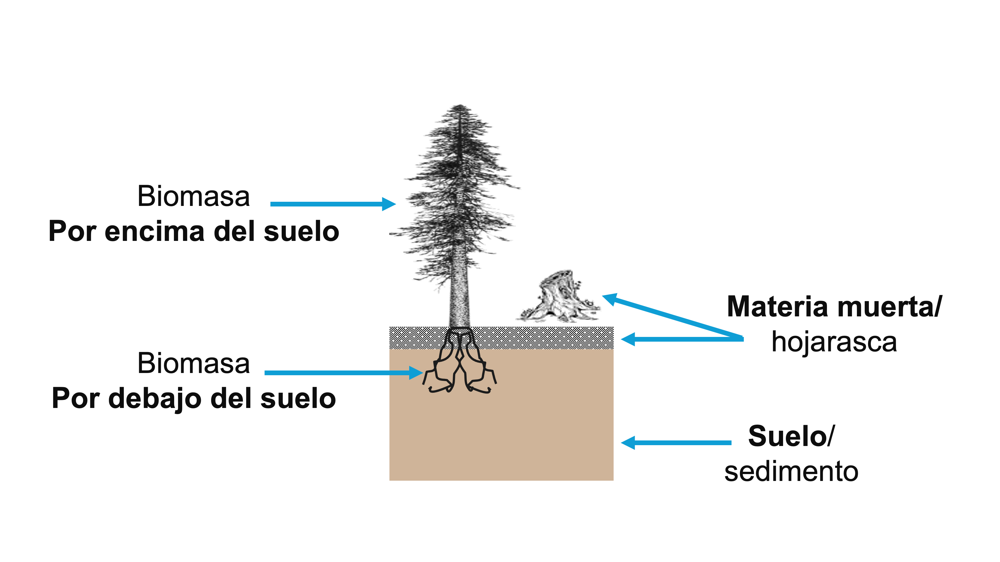
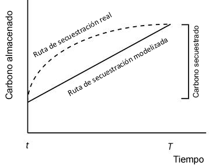

.. _carbonstorage:

*************************************
Almacenamiento y secuestro de carbono
*************************************

Resumen
=======

Los ecosistemas terrestres, que almacenan más carbono que la atmósfera, son fundamentales para influir en el cambio climático impulsado por el dióxido de carbono. El modelo de Almacenamiento y Secuestro de Carbono de InVEST utiliza mapas de uso del suelo, junto con las reservas de cuatro depósitos de carbono (biomasa aérea, biomasa subterránea, suelo y materia orgánica muerta), para estimar la cantidad de carbono almacenado en un paisaje en una situación de referencia o la cantidad de carbono secuestrado a lo largo del tiempo. De manera opcional, el valor de mercado o social del carbono secuestrado, su tasa anual de cambio y una tasa de descuento pueden utilizarse para estimar el valor de este servicio ecosistémico para la sociedad. Entre las limitaciones del modelo se encuentran la simplificación excesiva del ciclo del carbono, el supuesto de un cambio lineal del secuestro de carbono a lo largo del tiempo y las posibles imprecisiones de las tasas de descuento.

.. note:: Este modelo de carbono es extremadamente sencillo. Sus únicas entradas son cuatro depósitos de carbono y un mapa de cobertura del suelo. Ofrece una forma práctica de asignar los valores de esos depósitos de carbono a un mapa de cobertura del suelo, pero NO incluye complejidades ni dinámicas biofísicas, como el crecimiento de los árboles, la evolución de la química del suelo o la incorporación de los efectos de los cambios de temperatura o precipitación a lo largo del tiempo. Si necesita modelar algo más complejo que depósitos estáticos de carbono y mapas de cobertura del suelo, deberá utilizar otro modelo de carbono.

Introducción
============

Los ecosistemas regulan el clima de la Tierra al incorporar y retirar de la atmósfera gases de efecto invernadero (GEI), como el CO\ :sub:`2`. Los bosques, pastizales, turberas y otros ecosistemas terrestres almacenan, en conjunto, mucho más carbono que la atmósfera (Lal 2002). Al almacenar este carbono en la madera, otra biomasa y el suelo, los ecosistemas mantienen el CO\ :sub:`2` fuera de la atmósfera, donde contribuiría al cambio climático. Además de almacenar carbono, muchos sistemas también continúan acumulándolo en las plantas y el suelo a lo largo del tiempo, secuestrando así carbono adicional cada año. La alteración de estos sistemas por incendios, enfermedades o cambios en la vegetación (por ejemplo, conversiones del uso y la cobertura del suelo, LULC) puede liberar grandes cantidades de CO\ :sub:`2`. Otros cambios de manejo, como la restauración forestal o la adopción de prácticas agrícolas alternativas, pueden conducir al almacenamiento de grandes cantidades de CO\ :sub:`2`. Por tanto, la manera en que gestionamos los ecosistemas terrestres es fundamental para regular nuestro clima.

El secuestro y almacenamiento de carbono en ecosistemas terrestres es quizá el más reconocido de todos los servicios ecosistémicos (Stern 2007, IPCC 2006, Canadell y Raupach 2008, Capoor y Ambrosi 2008, Hamilton et al. 2008, Pagiola 2008). El valor social de una tonelada de carbono secuestrada equivale al daño social que se evita al no liberar esa tonelada de carbono a la atmósfera (Tol 2005, Stern 2007). Los cálculos del costo social son complejos y controvertidos (véanse Weitzman 2007 y Nordhaus 2007b), pero han dado lugar a estimaciones que oscilan entre USD 9,55 y USD 84,55 por tonelada métrica de CO\ :sub:`2` liberada a la atmósfera (Nordhaus 2007a y Stern 2007, respectivamente).

La gestión de los paisajes para el almacenamiento y el secuestro de carbono requiere información sobre cuánto carbono está almacenado y dónde, cuánto carbono se secuestra o se pierde a lo largo del tiempo y cómo los cambios en el uso del suelo afectan la cantidad de carbono almacenado y secuestrado. Dado que los gestores del territorio deben elegir entre sitios para su protección, aprovechamiento o desarrollo, los mapas de almacenamiento y secuestro de carbono son ideales para apoyar las decisiones que influyen en estos servicios ecosistémicos.

Estos mapas pueden respaldar diversas decisiones de gobiernos, organizaciones no gubernamentales y empresas. Por ejemplo, los gobiernos pueden utilizarlos para identificar oportunidades de obtener créditos por reducir las emisiones derivadas de la deforestación y la degradación (REDD). Conocer qué partes de un paisaje almacenan más carbono ayudaría a los gobiernos a orientar eficientemente los incentivos a los propietarios de tierras a cambio de la conservación de los bosques. Asimismo, una organización no gubernamental de conservación podría querer invertir en áreas donde coinciden altos niveles de biodiversidad y secuestro de carbono (Nelson et al. 2008). Una empresa maderera también podría querer maximizar sus beneficios tanto de la producción de madera como de los créditos de carbono REDD (Plantinga y Birdsey 1994).

El modelo
=========

El almacenamiento de carbono en una parcela depende, en gran medida, de las cantidades de carbono presentes en cuatro depósitos: biomasa aérea, biomasa subterránea, suelo y materia orgánica muerta. El modelo de Almacenamiento y Secuestro de Carbono de InVEST agrega la cantidad de carbono almacenado en estos depósitos de acuerdo con los mapas y las clasificaciones de uso del suelo proporcionados por el usuario. La biomasa aérea comprende todo el material vegetal vivo que se encuentra por encima del suelo (por ejemplo, corteza, troncos, ramas y hojas). La biomasa subterránea comprende los sistemas de raíces vivas de la biomasa aérea. La materia orgánica del suelo es el componente orgánico del suelo y representa el mayor depósito terrestre de carbono. La materia orgánica muerta incluye la hojarasca y la madera muerta, tanto caída como en pie.

Figura 1. Los cuatro depósitos de carbono incluidos en el modelo de Almacenamiento de Carbono de InVEST: biomasa aérea, biomasa subterránea, suelo y hojarasca.

Mediante mapas de las clases LULC y de la cantidad de carbono almacenado en los depósitos de carbono, este modelo estima la cantidad neta de carbono almacenado en una parcela a lo largo del tiempo y el valor de mercado del carbono secuestrado en las reservas remanentes. Entre las limitaciones del modelo se encuentran la simplificación excesiva del ciclo del carbono, el supuesto de un cambio lineal del secuestro de carbono a lo largo del tiempo y las posibles imprecisiones de las tasas de descuento. El modelo tampoco incluye condiciones biofísicas importantes para el secuestro de carbono, como las tasas de fotosíntesis y la presencia de organismos activos en el suelo.

Cómo funciona
-------------

El modelo asigna densidades de almacenamiento de carbono a los rásteres LULC, que pueden incluir clases como bosque, pastizal o terreno agrícola. El modelo resume los resultados en rásteres de almacenamiento, secuestro y valor, así como en totales agregados.

Para cada tipo de LULC, el modelo requiere una estimación de la cantidad de carbono presente en al menos uno de los cuatro depósitos fundamentales descritos anteriormente, expresada en toneladas métricas por hectárea (t/ha). Si dispone de datos para más de un depósito, los resultados del modelo serán más completos. El modelo simplemente aplica estas estimaciones al mapa LULC para producir un mapa del carbono almacenado en los depósitos incluidos.

Si proporciona tanto un mapa LULC de referencia como uno alternativo, se puede calcular el cambio neto en el almacenamiento de carbono a lo largo del tiempo (secuestro y pérdida), así como su valor social. Para estimar este cambio en el secuestro de carbono a lo largo del tiempo, el modelo se aplica al paisaje de referencia y a un paisaje alternativo real o proyectado, y se calcula la diferencia en el almacenamiento, píxel por píxel.

Los resultados del modelo se expresan en toneladas métricas (equivalentes a megagramos) de carbono por hectárea y, si se desea, en unidades monetarias por hectárea para el valor del secuestro. Recomendamos encarecidamente utilizar el valor social del secuestro de carbono si desea expresarlo en términos monetarios. El valor social de una tonelada de carbono secuestrada equivale al daño social que se evita al no liberar esa tonelada de carbono a la atmósfera.

El modelo de valoración estima el valor económico del secuestro o la pérdida (no del almacenamiento) en función de la cantidad de carbono secuestrado o perdido, el valor monetario de cada unidad de carbono, una tasa de descuento monetaria y el cambio en el valor del secuestro de carbono a lo largo del tiempo. Por tanto, la valoración solo puede realizarse en el modelo de carbono si se dispone de un escenario alternativo. La valoración se aplica al secuestro o a la pérdida, no al almacenamiento, porque los precios de mercado se relacionan únicamente con el secuestro de carbono o las emisiones. Las tasas de descuento son multiplicadores que, por lo general, reducen el valor del secuestro de carbono (o el costo de las emisiones) a lo largo del tiempo. El primer tipo de descuento, el procedimiento económico estándar de descuento financiero, refleja el hecho de que las personas suelen valorar más los beneficios inmediatos que los futuros, debido a la incertidumbre y a la inflación económica supuesta a lo largo del tiempo. La segunda tasa de descuento ajusta el valor social del secuestro de carbono o de las emisiones a lo largo del tiempo. Este valor cambiará a medida que cambie el impacto de las emisiones de carbono sobre los daños esperados relacionados con el cambio climático. Si esperamos que el carbono secuestrado hoy tenga un mayor impacto en la mitigación del cambio climático que el carbono secuestrado en el futuro, esta segunda tasa de descuento debería ser positiva. Por el contrario, si esperamos que el carbono secuestrado hoy tenga un impacto menor en la mitigación del cambio climático que el carbono secuestrado en el futuro, esta segunda tasa de descuento debería ser negativa.

El valor del secuestro de carbono a lo largo del tiempo para una parcela determinada *x* es:

.. math:: value\_seq_x=V\frac{s_x}{q-p}\sum^{q-p-1}_{t=0}\frac{1}{\left(1+\frac{r}{100}\right)^t\left(1+\frac{c}{100}\right)^t}
   :label: carbon_value

donde

* :math:`V` es el precio por tonelada métrica de carbono

* :math:`s_x` es la cantidad de carbono, en toneladas métricas, secuestrada en la parcela :math:`x`

* :math:`q` es el año alternativo

* :math:`p` es el año de referencia

* :math:`r` es la tasa anual de descuento de mercado para el precio del carbono

* :math:`c` es la tasa anual de cambio del precio del carbono

Limitaciones y simplificaciones
===============================

El modelo simplifica el ciclo del carbono, lo que le permite funcionar con relativamente poca información, pero también genera limitaciones importantes. Por ejemplo, el modelo supone que ninguno de los tipos de LULC del paisaje gana o pierde carbono a lo largo del tiempo. En cambio, se supone que todos los tipos de LULC se encuentran en un nivel fijo de almacenamiento, equivalente al promedio de los niveles medidos dentro de ese tipo de LULC. Según este supuesto, los únicos cambios en el almacenamiento de carbono a lo largo del tiempo se deben a las transiciones de un tipo de LULC a otro. Por tanto, cualquier píxel cuyo tipo de LULC no cambie tendrá un valor de secuestro igual a 0 a lo largo del tiempo. En realidad, muchas áreas se están recuperando de usos anteriores del suelo o atraviesan procesos de sucesión natural. Este problema puede abordarse dividiendo los tipos de LULC en clases de edad (lo que equivale, esencialmente, a añadir más tipos de LULC), por ejemplo, tres clases de edad de bosque. De este modo, las parcelas pueden pasar de una clase de edad a otra en los escenarios y cambiar, como resultado, sus valores de almacenamiento de carbono.

Una segunda limitación es que, dado que el modelo depende de estimaciones del almacenamiento de carbono para cada tipo de LULC, los resultados solo serán tan detallados y confiables como la clasificación LULC utilizada y los valores de los depósitos de carbono suministrados. Es evidente que el almacenamiento de carbono difiere entre los tipos de LULC (por ejemplo, bosque tropical frente a bosque abierto), pero a menudo también puede existir una variación considerable dentro de un mismo tipo de LULC. Por ejemplo, el almacenamiento de carbono en un «bosque húmedo tropical» está condicionado por la temperatura, la elevación, la precipitación y el número de años transcurridos desde una perturbación importante (por ejemplo, tala rasa o incendio forestal). La variedad de valores de almacenamiento de carbono dentro de tipos de LULC definidos de manera general puede recuperarse parcialmente mediante un sistema de clasificación LULC y una tabla de depósitos de carbono relacionada que subdividan esos tipos generales según variables ambientales y de manejo pertinentes. Por ejemplo, los tipos de LULC forestales pueden estratificarse por elevación, franjas climáticas o intervalos de tiempo desde una perturbación importante. Por supuesto, este enfoque más detallado requiere datos que describan la cantidad de carbono almacenado en cada uno de los depósitos para cada una de las clases LULC más específicas.

Otra limitación del modelo es que no representa el carbono que pasa de un depósito a otro. Por ejemplo, si los árboles de un bosque mueren debido a una enfermedad, gran parte del carbono almacenado en la biomasa aérea pasa a almacenarse en otra materia orgánica (muerta). Asimismo, cuando se cosechan árboles de un bosque, las ramas, los tallos, la corteza, etc., quedan en el suelo como residuos de aprovechamiento. El modelo supone que el carbono de esos residuos de madera pasa «instantáneamente» a la atmósfera.

Por último, aunque la mayor parte del secuestro sigue una trayectoria no lineal, de modo que el carbono se secuestra a una tasa mayor durante los primeros años y a una tasa menor en los años posteriores, la valoración del secuestro de carbono del modelo supone un cambio lineal del almacenamiento de carbono a lo largo del tiempo. Debido al descuento, el supuesto de una tasa de cambio constante tiende a subestimar el valor del carbono secuestrado, ya que una trayectoria no lineal de secuestro tiene mayor valor social que una trayectoria lineal (Figura 1).

*Figura 1: El modelo supone un cambio lineal del almacenamiento de carbono (la línea continua), mientras que la trayectoria real hasta el nivel de almacenamiento de carbono del año «T» puede ser no lineal (como la línea punteada). En este caso, «t» indica el año del paisaje de referencia y «T» el año del paisaje alternativo. Con una tasa de descuento positiva, el valor de la trayectoria modelada (la línea continua) es menor que el de la trayectoria real. Por tanto, si las trayectorias de secuestro tienden a seguir la línea punteada, el modelo subestimará el valor del carbono secuestrado.*

Datos necesarios
================

.. note:: Todas las entradas espaciales deben estar en el mismo sistema de coordenadas proyectadas y utilizar unidades lineales en metros.

.. note:: Si incluye un LULC alternativo, este ráster debe tener un tamaño de píxel *exactamente igual* al del ráster LULC de referencia.

.. note:: Todos los datos de carbono deben corresponder a carbono elemental, no a CO\ :sub:`2`.

- :investspec:`carbon lulc_bas_path`

- :investspec:`carbon lulc_bas_year`

- :investspec:`carbon calc_sequestration`

- :investspec:`carbon lulc_alt_path`

- :investspec:`carbon lulc_alt_year`

- :investspec:`carbon carbon_pools_path` Deben proporcionarse valores para todos los depósitos de carbono y para todas las clases LULC; no se puede dejar ninguno en blanco. Si no se dispone de información sobre algunos depósitos de carbono, sus valores pueden estimarse a partir de otros depósitos o pueden omitirse asignando el valor 0 a todas las clases de ese depósito.
   Columnas:

   - :investspec:`carbon carbon_pools_path.columns.lucode`
   - :investspec:`carbon carbon_pools_path.columns.c_above`
   - :investspec:`carbon carbon_pools_path.columns.c_below`
   - :investspec:`carbon carbon_pools_path.columns.c_soil`
   - :investspec:`carbon carbon_pools_path.columns.c_dead`

   *Ejemplo:* Estudio hipotético con cinco clases LULC. La clase 1 (bosque) contiene la mayor cantidad de carbono en todos los depósitos. En este ejemplo, el carbono almacenado en la biomasa aérea y subterránea difiere considerablemente entre las clases de uso del suelo, mientras que el carbono almacenado en el suelo varía menos. Los valores están expresados en toneladas métricas por hectárea (t/ha).

   ====== ================== ======= ======= ====== ======
   lucode LULC_name          C_above C_below C_soil C_dead
   ====== ================== ======= ======= ====== ======
   1      Bosque                140       70     35     12
   2      Café                   65       40     25      6
   3      Pastos/hierba          15       35     30      4
   4      matorral/maleza        30       30     30     13
   5      Abierto/urbano          5        5     15      2
   ====== ================== ======= ======= ====== ======

- :investspec:`carbon do_valuation`

- :investspec:`carbon price_per_metric_ton_of_c` Este es :math:`V` en la ecuación :eq:`carbon_value`. El precio se expresa en unidades monetarias (de cualquier moneda) por tonelada métrica de carbono elemental (no de CO\ :sub:`2`). Para las aplicaciones interesadas en estimar el valor total del secuestro de carbono, recomendamos estimaciones basadas en los costos de los daños asociados con la liberación de una tonelada adicional de carbono: el costo social del carbono (SCC). Stern (2007), Tol (2009) y Nordhaus (2007a) presentan estimaciones del SCC. Por ejemplo, dos estimaciones del SCC que hemos utilizado de Tol (2009) son USD 66 y USD 130 (en dólares estadounidenses de 2010) (Polasky et al. 2010).

- :investspec:`carbon discount_rate` Este es :math:`r` en la ecuación :eq:`carbon_value`. Un valor predeterminado es 7 % anual, una de las tasas de descuento de mercado recomendadas por el Gobierno de Estados Unidos para la evaluación de costo-beneficio de proyectos ambientales. Sin embargo, esta tasa dependerá del país y del paisaje evaluados, y debe seleccionarse de acuerdo con los requisitos locales. Se han planteado argumentos filosóficos a favor de utilizar una tasa de descuento menor al modelar dinámicas relacionadas con el cambio climático, opción que los usuarios pueden considerar. Si la tasa se establece en 0 %, los valores monetarios no se descuentan.

- :investspec:`carbon rate_change` Este es :math:`c` en la ecuación :eq:`carbon_value`. Ajusta el valor del carbono secuestrado a medida que cambia el impacto de las emisiones sobre los daños esperados relacionados con el cambio climático.

  Establecer esta tasa por encima de 0 % sugiere que el valor social del carbono secuestrado en el futuro es menor que el del carbono secuestrado en el presente. Se ha argumentado ampliamente que las emisiones de GEI deben reducirse de inmediato para evitar superar un umbral de concentración de GEI en la atmósfera que produciría un aumento de 3 grados Celsius o más en la temperatura media mundial para 2105. Algunos sostienen que un cambio de temperatura de esa magnitud provocaría importantes alteraciones en las economías de todo el mundo (Stern et al. 2006). Por tanto, cualquier mitigación de las emisiones de GEI que ocurra muchos años después podría no tener efecto alguno sobre el hecho de que se supere o no ese umbral crítico de concentración. Si este fuera el caso, el secuestro de carbono en un futuro lejano tendría un valor relativamente bajo y estaría justificada una tasa de descuento del carbono mayor que cero.

Interpretación de los resultados
================================

.. note:: A partir de InVEST 3.15.0, los resultados ráster del modelo de Carbono se expresan como valores *por hectárea*.

* Carpeta **[Workspace]**:

	* **Registro de parámetros**: Cada vez que se ejecuta el modelo, se crea un archivo de texto (.txt) en el espacio de trabajo. El archivo enumera los valores de los parámetros y los mensajes de salida de esa ejecución, y se denomina de acuerdo con el servicio, la fecha y la hora. Cuando se comunique con NatCap por errores en la ejecución de un modelo, incluya el registro de parámetros.

	* **carbon_report_[Suffix].html:** Resumen de una ejecución del modelo, que incluye visualizaciones de los resultados principales, tablas de los resultados calculados e información sobre las entradas del modelo. Se puede acceder al informe desde Workbench o abrirlo con cualquier navegador web. Para ver un ejemplo, consulte el `Informe de ejemplo de Carbono <https://storage.googleapis.com/releases.naturalcapitalproject.org/invest-reports/latest/carbon_report_willamette.html>`_, generado al ejecutar el modelo de Carbono con los datos de muestra de Carbono.

	* **c_storage_bas_[Suffix].tif/c_storage_alt_[Suffix].tif**: Rásteres que muestran la cantidad de carbono almacenado para los escenarios de referencia y alternativo. Corresponden a la suma de todos los depósitos de carbono proporcionados en la tabla biofísica. Las unidades son toneladas métricas por hectárea.

	* **c_change_bas_alt_[Suffix].tif**: Ráster que muestra la diferencia en el carbono almacenado entre el paisaje alternativo y el paisaje de referencia. Los valores están expresados en toneladas métricas por hectárea. En este mapa, algunos valores pueden ser negativos y otros positivos. Los valores positivos indican carbono secuestrado; los negativos, carbono perdido.

	* **npv_alt_[Suffix].tif**: Ráster que muestra el valor económico del carbono secuestrado entre las fechas del paisaje de referencia y del paisaje alternativo. Las unidades son monetarias por hectárea.

    * **raster_values_summary_[Suffix].csv**: Archivo CSV que resume los valores totales, las unidades y los nombres de archivo de los rásteres de salida.

* Carpeta **[Workspace]\\intermediate_outputs**:

	* **c_above_[Suffix].tif**: Ráster de los valores de carbono aéreo, asignados desde la tabla de depósitos de carbono al LULC. Las unidades son toneladas métricas por hectárea.
	* **c_below_[Suffix].tif**: Ráster de los valores de carbono subterráneo, asignados desde la tabla de depósitos de carbono al LULC. Las unidades son toneladas métricas por hectárea.
	* **c_dead_[Suffix].tif**: Ráster de los valores de carbono en la materia orgánica muerta, asignados desde la tabla de depósitos de carbono al LULC. Las unidades son toneladas métricas por hectárea.
	* **c_soil_[Suffix].tif**: Ráster de los valores de carbono del suelo, asignados desde la tabla de depósitos de carbono al LULC. Las unidades son toneladas métricas por hectárea.

Apéndice: Fuentes de datos
==========================

:ref:`Land Use/Land Cover <lulc>`
---------------------------------

:ref:`Carbon Pools <carbon_pools>`
----------------------------------

Precio del carbono y tasas de descuento
---------------------------------------

Estimaciones recientes sugieren que el costo social del carbono (SCC), o el daño marginal asociado con la liberación de una tonelada métrica adicional de carbono a la atmósfera, oscila entre USD 32 por tonelada métrica de carbono (Nordhaus 2007a) y USD 326 por tonelada métrica de carbono (Stern 2007), en dólares estadounidenses de 2010. El valor de este daño también puede considerarse el beneficio monetario de evitar una emisión. Tol (2009) presenta un análisis exhaustivo de las estimaciones del SCC y señala valores medianos de USD 66 y USD 130 por tonelada métrica en dólares estadounidenses de 2010 (los valores difieren debido a los distintos supuestos sobre el descuento temporal). Pueden encontrarse otras estimaciones en Murphy et al. (2004), Stainforth et al. (2005) y Hope (2006).

Un método alternativo para medir el costo de la emisión de una tonelada métrica de carbono consiste en igualarlo al costo de la alternativa menos costosa para secuestrar esa tonelada. La mejor alternativa disponible actualmente es capturar y almacenar el carbono emitido por las centrales eléctricas. Según Socolow (2005) y Socolow y Pacala (2007), el costo de esta tecnología por tonelada métrica capturada y almacenada es de aproximadamente USD 100.

Por último, aunque no recomendamos este enfoque, pueden utilizarse los precios de mercado para establecer el precio del carbono secuestrado. No recomendamos utilizar precios de mercado porque, por lo general, solo se aplican al secuestro de carbono «adicional», es decir, al secuestro que supera una tasa de referencia determinada. Además, los valores de los créditos de carbono de los mercados de carbono dependen en gran medida de las diversas normas y regulaciones de esos mercados y no reflejan necesariamente el beneficio que representa para la sociedad una tonelada de carbono secuestrada. Por tanto, el uso correcto de los precios de mercado exigiría estimar una tasa de referencia para el paisaje de interés, cartografiar el secuestro adicional y determinar qué secuestro adicional cumple los requisitos para recibir créditos de acuerdo con las normas y regulaciones del mercado.

Descontamos el valor de los pagos futuros por el secuestro de carbono para reflejar la preferencia de la sociedad por recibir los pagos antes que después. La Oficina de Administración y Presupuesto de Estados Unidos recomienda una tasa de descuento de mercado del 7 % anual para proyectos de ese país (OMB 1992). Las tasas de descuento varían en otras partes del mundo. Canadá y Nueva Zelanda recomiendan una tasa del 10 % para sus proyectos (Abusah y de Bruyn 2007). Lo más adecuado es consultar la tasa de descuento recomendada para cada país.

Algunos economistas consideran que una tasa de descuento de mercado o de consumo del 7 % al 12 % es demasiado alta para los análisis relacionados con el cambio climático. Dado que el cambio climático puede alterar gravemente las economías en el futuro, algunos consideran poco ético que la sociedad prefiera consumir hoy a costa tanto de la estabilidad climática futura como de las oportunidades económicas de las generaciones venideras (Cline 1992, Stern 2007). Según este argumento, los análisis de los efectos del cambio climático sobre la sociedad y las políticas diseñadas para reducirlo deberían utilizar tasas de descuento bajas, con el fin de fomentar una mayor mitigación de las emisiones de GEI y compensar así los daños potencialmente graves que sufrirán las generaciones futuras (por ejemplo, r = 0.014 en Stern (2007)). Las políticas gubernamentales recientes de varios países han respaldado el uso de tasas de descuento muy bajas para determinados proyectos de largo plazo (Abusah y de Bruyn 2007).

La tasa de descuento del carbono, que refleja el mayor impacto climático del carbono secuestrado inmediatamente frente al carbono secuestrado en el futuro, se analiza en Adams et al. (1999), Plantinga et al. (1999), Feng (2005) y Nelson et al. (2008).

Referencias
===========

Abusah, Sam and Bruyn, Clinton de. 2007. Getting Auckland on Track: Public Transport and New Zealand's Economic. Ministry of Economic Development Working Paper. Accessed at <http://s3.amazonaws.com/zanran_storage/www.med.govt.nz/ContentPages/4013253.pdf>.

Adams, DM, RJ Alig, BA McCarl, et al. 1999. Minimum cost strategies for sequestering carbon in forests. Land Econ 75: 360-374.

Anderson, JR, EE Hardy, JT Roach, RE Witmer. A Land Use and Land Cover Classification System for Use with Remote Sensor Data. Washington, DC: United States Government 	Printing Office; 1976. Geological Survey Professional Paper 964.

Antle, JM, and B. Diagana. 2003. Creating Incentives for the Adoption of Sustainable Agricultural Practices in Developing Countries: The Role of Soil Carbon Sequestration.	American Journal of Agricultural Economics 85:1178-1184.

Baer, SG, DJ Kitchen, JM Blair, and CW Rice. 2002. Changes in Ecosystem Structure and Function along a Chronosequence of Restored Grasslands. Ecological Applications 12:1688-1701.

Bernoux, M., MDS Carvalho, B. Volkoff, and CC Cerri. 2002. Brazil's soil carbon stocks. Soil Science Society of America Journal 66:888-896.

Brown, SL, PE Schroeder and JS Kern. Spatial distribution of biomass in forests of the eastern	USA.Forest Ecology and Management 123 (1999) 81-90.

Brown, S. 2002. Measuring carbon in forests: current status and future challenges. Environmental Pollution 116:363-372.

Brown, S. Estimating Biomass and Biomass Change of Tropical Forests: a Primer. FAO Forestry Department; 1997. Report for FAO Forestry Paper 134.

Brown, S. and PE Schroeder. 1999. Spatial patterns of aboveground production and mortality of woody biomass for eastern US forests. Ecological Applications 9:968-980.

Cairns, MA, PK Haggerty, R. Alvarez, BHJ De Jong, and I. Olmsted. 2000. Tropical Mexico's recent land-use change: A region's contribution to the global carbon cycle. Ecological Applications 10:1426-1441.

Cairns, MA, S. Brown, EH Helmer, and GA Baumgardner. 1997. Root biomass allocation in the world's upland forests. Oecologia 111:1-11.

Canadell, JG and MR Raupach. 2008. Managing Forests for Climate Change Mitigation. Science 320:1456-1457.

Cline, WR. 1992. The economics of global warming. Instuitute for International Economics, Washington, D.C.

Coomes, DA, RB Allen, NA Scott, C. Goulding, and P. Beets. 2002. Designing systems to monitor carbon stocks in forests and shrublands. Forest Ecology and Management 164:89-108.

Conte, MN and MJ Kotchen. 2010. Explaining the price of voluntary carbon offsets. Climate Change Economics 1 (2):93-111.

Capoor, K., and P. Ambrosi. State and Trends of the Carbon Market 2008. Washington, D.C.: World Bank Institute, 2008 May.

Delaney, M., S. Brown, AE Lugo, A. Torres-Lezama, and NB Quintero. 1998. The quantity and turnover of dead wood in permanent forest plots in six life zones of Venezuela. Biotropica 30:2-11.

Detwiler, RP. 1986. Land Use Change and the Global Carbon Cycle: The Role of Tropical Soils. Biogeochemistry 2:67-93.

Edinburgh Centre for Carbon Management. The Establishing Mechanisms for Payments for Carbon Environmental Services in the Eastern Arc Mountains, Tanzania; 2007 May 2007.

Fargione, J., J. Hill, D. Tilman, S. Polasky, and P. Hawthorne. 2008. Land Clearing and the Biofuel Carbon Debt. Science 319:1235-1238.

Feng, H. 2005. The dynamics of carbon sequestration and alternative carbon accounting, with an application to the upper Mississippi River Basin. Ecological Economics 54:23-35.

Gaston, G., S. Brown, M. Lorenzini, and KD Singh. 1998. State and change in carbon pools in the forests of tropical Africa. Global Change Biology 4:97-114.

Glenday, J. 2006. Carbon storage and emissions offset potential in an East African tropical rainforest. Forest Ecology and Management 235:72-83.

Grace, J., J. San Jose, P. Meir, HS Miranda, and RA Montes. 2006. Productivity and carbon fluxes of tropical savannas. Journal of Biogeography 33:387-400.

Gibbs, HK, S Brown, JO Niles, and JA Foley. 2007. Monitoring and estimating tropical forest carbon stocks: making REDD a reality. Environmental Research Letters 2:045023.

Hamilton, K., M Sjardin, T Marcello, and G Xu. Forging a Frontier: State of the Voluntary Carbon Markets 2008. Washington, D.C.: Ecosystem Marketplace and New Carbon Finance; 2008.

Hope, CW. 2006. The social cost of carbon: what does it actually depend on? Climate Policy 6: 565--572

Houghton, RA. 2005. Tropical deforestation as a source of greenhouse gas emissions. In: Tropical Deforestation and Climate Change, Moutinho and Schwartzman [eds.]. Instituto de Pesquisa Ambiental da Amazonia and Environmental Defense, Belem, Brazil.

Houghton, RA, and JL Hackler. 2006. Emissions of carbon from land use change in sub-Saharan Africa. Journal of Geophysical Research 111.

The Intergovernmental Panel on Climate Change (IPCC). 2006. 2006 IPCC Guidelines for National Greenhouse Gas Inventories, Volume 4: Agriculture, Forestry and Other Land Use. Prepared by the National Greenhouse Gas Inventories Programme, Eggleston, HS, L. Buendia, K. Miwa, T. Ngara, and K. Tanabe (eds). Institute for Global Environmental Strategies (IGES), Hayama, Japan. <https://www.ipcc-nggip.iges.or.jp/public/2006gl/vol4.html>.

Jenny, H. 1980. The Soil Resource. Springer, New York.

Lal, R. 2004. Soil Carbon Sequestration Impacts on Global Climate Change and Food Security. Science 304:1623-1627.

Mackey, B, Keith H, Berry S.L, Lindenmayer DB. Green carbon: the role of natural forests in carbon storage. Part 1, A green carbon account of Australia's Southeastern Eucalypt forest, and policy implications. Canberra, Australia: ANU E Press, 2008.

Makundi, WR. 2001. Carbon mitigation potential and costs in the forest sector in Tanzania. Mitigation and Adaptation Strategies for Global Change 6:335-353.

Malhi, Y., D. Wood, TR Baker, et al. 2006. The regional variation of aboveground live biomass in old-growth Amazonian forests. Global Change Biology 12:1107-1138.

Malimbwi, RE, B. Solberg, and E. Luoga. 1994. Estimation of biomass and volume in miombo woodland at Kitungalo Forest Reserve Tanzania. Journal of Tropical Forest Science 7:230-242.

McLauchlan, KK., SE Hobbie, and WM Post. 2006. Conversion From Agriculture To Grassland Builds Soil Organic Matter On Decadal Timescales. Ecological Applications 16:143-153.

Mollicone D., F. Achard, S. Federici, H. Eva, G. Grassi, G. Seufert, H. Stibig, G. M. Matteucci, and E. Schulze. 2007. An incentive mechanism for reducing emissions from conversion of intact and non-intact forests. Climatic Change 83:477-493.

Munishi, PKT and TH Shear. 2004. Carbon Storage in Afromontane Rain Forests of the Eastern Arc Mountains of Tanzania: their Net Contribution to Atmospheric Carbon. Journal of Tropical Forest Science 16:78-93.

Murphy, JM et al. 2004. Quantification of modelling uncertainties in a large ensemble of climate change simulations. Nature 430, 768-772.

Murray, B., B. Sohngen, and M. Ross. 2007. Economic consequences of consideration of permanence, leakage and additionality for soil carbon sequestration projects. Climatic Change 80:127-143.

Nascimento, HEM, and WF Laurance. 2002. Total aboveground biomass in central Amazonian rainforests: a landscape-scale study. Forest Ecology and Management 168:311-321.

Nelson, E., G. Mendoza, J. Regetz, S. Polasky, H. Tallis, D. Cameron, K. Chan, G. Daily, J. Goldstein, P. Kareiva, E. Lonsdorf, R. Naidoo, TH Ricketts, and R. Shaw. 2009. Modeling multiple ecosystem services, biodiversity conservation, commodity production, and tradeoffs at landscape scales. Frontiers in Ecology and the Environment.

Nordhaus, W. 2007a. Critical Assumptions in the Stern Review on Climate Change. Science 317 (5835): 201--202.

Nordhaus, W. 2007b. A Review of the Stern Review on the Economics of Global Warming. Journal of Economic Literature 45: 686-702.

Pagiola, S. 2008. Payments for environmental services in Costa Rica. Ecological Economics 65 (4): 712-724.

Plantinga, AJ, and RA Birdsey. 1994. Optimal Forest Stand Management When Benefits are Derived from Carbon. Natural Resource Modeling 8(4): 373-387.

Polasky, S, E Nelson, D Pennington, and K Johnson. 2010. The Impact of Land-Use Change on Ecosystem Services, Biodiversity and Returns to Landowners: A Case Study in the State of Minnesota. Environmental and Resource Economics 48:219-242

Post, WM, WR Emanuel, PJ Zinke, and AG Stangenberger. 1982. Soil carbon pools and world life zones. Nature 298:156-159.

Post, WM, KC Kwon. 2000. Soil carbon sequestration and land-use change: processes and potential. Global Change Biology 6:317-327.

Raich, JW, AE Russell, K. Kitayama, WJ Parton, and PM Vitousek. 2006. Temperature influences carbon accumulation in moist tropical forests. Ecology 87:76-87.

Ruesch A, and HK Gibbs. 2008. New IPCC tier-1 global biomass carbon map for the year 2000. Available at https://doi.org/10.15485/1463800

Schuman, GE, HH Janzen, and JE Herrick. 2002. Soil carbon dynamics and potential carbon sequestration by rangelands. Environmental Pollution, 116:391-396.

Sedjo, RA and B. Sohngen. Carbon Credits for Avoided Deforestation. Washington, DC: Resources for the Future; 2007 October 2007. Report for RFF DP 07-47.

Silver, WL, R. Ostertag, and AE Lugo. 2000. The potential for carbon sequestration through reforestation of abandoned tropical agricultural and pasture lands. Restoration Ecology 8:394-407.

Socolow, RH. 2005. Can We Bury Global Warming? Scientific American 293: 49-55.

Socolow, RH and SW Pacala. 2006. A Plan to Keep Carbon in Check. Scientific American 295: 50-57.

Sohngen, Brent, RH Beach, and Kenneth Andrasko. 2008. Avoided Deforestation as a Greenhouse Gas Mitigation Tool: Economic Issues. Journal of Environmental Quality 37: 1368-1375.

Stainforth, DA et al., 2005. Uncertainty in predictions of the climate response to rising levels of greenhouse gases. Nature 433, 403--406.

Stern, N. 2007. The Economics of Climate Change: The Stern Review. Cambridge and New York: Cambridge University Press.

Tiessen, H., C. Feller, EVSB Sampaio, and P. Garin. 1998. Carbon Sequestration and Turnover in Semiarid Savannas and Dry Forest. Climatic Change 40:105-117.

Tilman, D., J. Hill, and C. Lehman. 2006. Carbon-Negative Biofuels from Low-Input High-Diversity Grassland Biomass. Science 314:1598-1600.

Tol, RSJ. 2005. The marginal damage costs of carbon dioxide emissions: an assessment of the uncertainties. Energy Policy 33:2064-2074.

Tol, RSJ. 2009. The Economic Effects of Climate Change.Journal of Economic Perspectives 23:29-51.

USOMB (US Office of Management and Budget). 1992. Guidelines and Discount Rates for Benefit-Cost Analysis of Federal Programs Circular No. A-94 (Revised). Transmittal Memo No. 64. Washington DC: US Office of Management and Budget.

Vagen, TG, R Lal, and BR Singh. 2005. Soil carbon sequestration in sub-Saharan Africa: A review. Land Degradation & Development 16:53-71.

Weitzman, ML. 2007. A review of the Stern Review on the Economics of Climate Change. Journal of Economic Literature 45:703-724.

Zhang, Q, and CO Justice. 2001. Carbon Emissions and Sequestration Potential of Central African Ecosystems. AMBIO 30:351-355.
