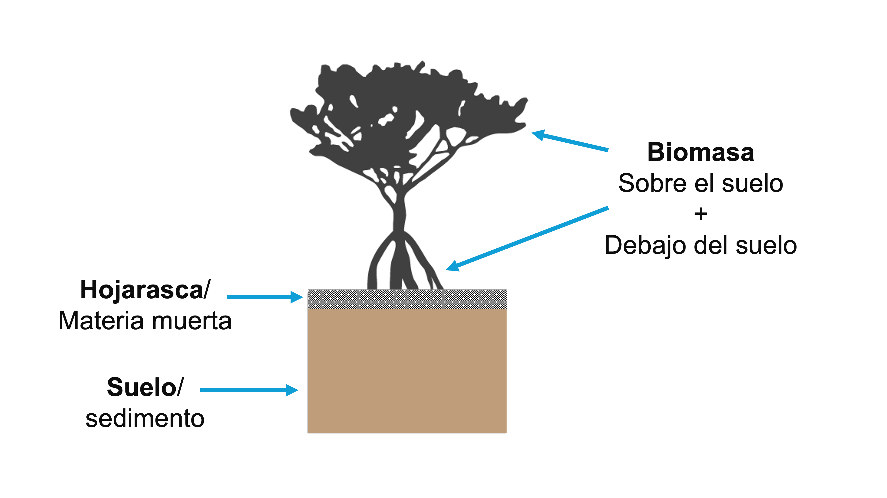
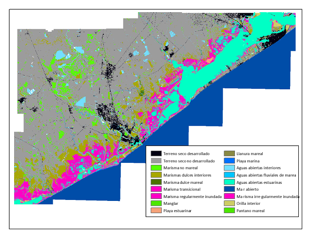
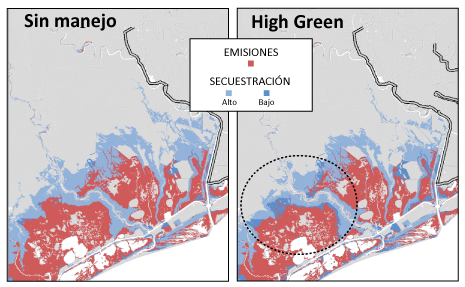

.. _coastal-blue-carbon:

********************
Carbono azul costero
********************

Resumen
=======

Los ecosistemas marinos y terrestres ayudan a regular el clima de la Tierra al añadir gases de efecto invernadero (GEI), como el dióxido de carbono (CO\ :sub:`2`), a la atmósfera y retirarlos de ella. En particular, las marismas costeras, los manglares y los pastos marinos almacenan grandes cantidades de carbono en sus sedimentos, hojas y otras formas de biomasa. Además de almacenar carbono, los ecosistemas marinos lo acumulan continuamente en sus sedimentos, creando grandes reservorios de carbono secuestrado a largo plazo. Al almacenar y secuestrar carbono, los ecosistemas marinos mantienen el CO\ :sub:`2` fuera de la atmósfera, donde de otro modo contribuiría al cambio climático.

Las actividades de manejo que modifican la cobertura de la vegetación costera, como la restauración de praderas de pastos marinos y la tala de bosques de manglar, cambian la capacidad de las áreas costeras y marinas para almacenar y secuestrar carbono.

El modelo de InVEST de Carbono azul costero intenta predecir la cantidad de carbono almacenado y secuestrado en una zona costera en momentos determinados, como resultado de los cambios en la cobertura del suelo. Mediante una estimación del valor social monetario o, cuando esté disponible, de un precio de mercado del carbono almacenado y secuestrado, el modelo de InVEST de Carbono azul costero también cuantifica el valor marginal del almacenamiento y el secuestro.

Los resultados del modelo de InVEST de Carbono azul costero pueden utilizarse para comparar escenarios actuales y futuros de reservas de carbono y secuestro neto, así como para identificar lugares del paisaje donde debe evitarse la degradación de los ecosistemas costeros y priorizarse su restauración, con el fin de preservar y mejorar estos servicios de almacenamiento y secuestro de carbono.

Introducción
============

Este modelo utiliza diversos tipos de información, entre ellos:

- La distribución y abundancia de la vegetación costera.
- Datos de reservas de carbono específicos de cada hábitat.
- Características del impacto de distintas perturbaciones de la cobertura del suelo sobre los reservorios de carbono de la biomasa y del suelo, para predecir las tasas de emisión de carbono.
- Tasas de acumulación de carbono para estimar las reservas de carbono, el secuestro neto y el valor en un paisaje terrestre o marino.
- Estimaciones del valor social monetario o del precio de mercado del carbono.

Para cuantificar el valor del almacenamiento y el secuestro de carbono, el modelo se centra en los cambios del dióxido de carbono atmosférico y de otros gases de efecto invernadero como resultado de las modificaciones causadas por actividades humanas que pueden afectar a los ecosistemas marinos que almacenan y secuestran carbono. Los cambios en la composición de la atmósfera tienen efectos de amplio alcance sobre los sistemas naturales, que pueden provocar cambios en la productividad agrícola, la calidad del aire, el nivel del mar y otros aspectos.

El modelo
=========

Consideraciones para el modelado
--------------------------------

La cartografía y el modelado de los cambios en el almacenamiento y el secuestro de carbono en hábitats costeros y marinos pueden presentar dificultades. Los tipos de entradas espaciales y la información disponible sobre el ciclo del carbono varían según el lugar. Algunas áreas de estudio disponen de datos de alta calidad para realizar análisis detallados, mientras que en otras no se cuenta con la información necesaria para modelar los cambios en la ubicación y función de la vegetación costera. Por ejemplo, las marismas salinas suelen estudiarse en el contexto de su migración debido al aumento del nivel del mar. Siempre que sea posible, la combinación de factores naturales (por ejemplo, el aumento del nivel del mar) y antropogénicos (por ejemplo, la migración de las marismas salinas bloqueada por carreteras) debe incluirse en los mapas de escenarios y en el modelado posterior del carbono. Al explorar escenarios futuros de cobertura del suelo, los resultados de los mapas de cobertura del suelo producidos por el modelo SLAMM (Sea Level Affecting Marshes Model, desarrollado por Warren Pinnacle) pueden ser entradas útiles para el modelo de InVEST de Carbono azul costero (Clougheet et al., 2010). Sin embargo, dado que no todos los sitios disponen de la información detallada sobre elevación y hábitats necesaria para ejecutar SLAMM, este modelo de InVEST ofrece un enfoque flexible que permite a los usuarios proporcionar mapas detallados de uso/cobertura del suelo o mapas que indiquen la presencia de vegetación costera y marina capaz de secuestrar carbono.

Cómo funciona
-------------

InVEST Carbono azul costero modela el ciclo del carbono mediante un enfoque de contabilidad (Houghton, 2003). Este enfoque simplifica el ciclo del carbono al contabilizar el almacenamiento en tres reservorios principales (biomasa, carbono de los sedimentos —es decir, del suelo— y carbono orgánico muerto en pie —es decir, hojarasca—; véase la Figura 1). La acumulación de carbono en los hábitats costeros ocurre principalmente en los sedimentos (Pendleton et al., 2012). El modelo requiere que los usuarios proporcionen mapas de los ecosistemas costeros que almacenan carbono, como manglares y pastos marinos. Los usuarios también deben proporcionar datos sobre la cantidad de carbono almacenado en los tres reservorios y la tasa anual de acumulación de carbono en la biomasa y los sedimentos. Si no se dispone de información local, los usuarios pueden recurrir a la base de datos mundial de valores de reservas y tasas de acumulación de carbono, procedentes de la bibliografía científica revisada por pares e incluida en el modelo. Si se dispone de datos de estudios de campo u otras fuentes locales, estos valores deben utilizarse en lugar de los de la base de datos mundial. El modelo requiere mapas de cobertura del suelo que representen los cambios en los patrones de uso humano de las áreas costeras o los cambios en el nivel del mar, para estimar la cantidad de carbono perdido o ganado durante un período determinado. El modelo cuantifica el almacenamiento de carbono en todo el paisaje terrestre o marino mediante la suma del carbono almacenado en estos tres reservorios.

Figura 1. Tres reservorios de carbono de los ecosistemas marinos incluidos en el modelo de carbono azul de InVEST: biomasa (aérea y subterránea), suelo y hojarasca.

.. note::
        Varios parámetros son compartidos por la mayoría de las ecuaciones del modelo:

        * :math:`t` es el intervalo temporal. Este modelo opera a escala anual, por lo que :math:`t` representa el año correspondiente al intervalo temporal.

          * :math:`t_{baseline}` representa el año de la cobertura del suelo de referencia.

        * :math:`s` es el año de referencia instantánea. Representa el año de cualquiera de las instantáneas de transición posteriores al año de referencia.
        * :math:`p` representa el reservorio de carbono, generalmente biomasa o suelo. El reservorio de hojarasca solo se considera en los cálculos de acumulación de carbono y no se ve afectado por las emisiones.

        El modelo considera cada celda de la cuadrícula :math:`x` de manera independiente y, por tanto, se ha omitido de las ecuaciones descritas a continuación.

.. note::
        Aunque este capítulo de la guía del usuario se refiere a unidades de megatoneladas de CO2 equivalente por hectárea, el modelo no realiza ninguna conversión de unidades. Por tanto, pueden utilizarse cualesquiera unidades que representen la tasa de acumulación o de emisiones específica de cada hábitat, siempre que sean coherentes en todas las entradas del modelo.

Almacenamiento de carbono
^^^^^^^^^^^^^^^^^^^^^^^^^

Los hábitats de carbono azul costero pueden indicar simplemente el tipo de vegetación dominante (por ejemplo, hierba marina, manglar, etc.) o basarse en detalles que afectan los valores de almacenamiento de los reservorios, como las especies vegetales, la densidad de la vegetación, el régimen de temperatura o la edad de la vegetación (por ejemplo, el tiempo transcurrido desde la restauración o desde la última perturbación importante).

Para estimar el almacenamiento de carbono, se supone que cada hábitat de carbono azul costero se encuentra en equilibrio de almacenamiento en cualquier momento (la acumulación de carbono se contabilizará en el componente de secuestro del modelo).

Las reservas de carbono :math:`S` para un año determinado :math:`t` y un reservorio :math:`p` se calculan sumando el secuestro neto de carbono del año :math:`t` a las reservas disponibles en el año anterior :math:`t-1`. Alternativamente, se utilizan los valores iniciales de las reservas de la tabla biofísica, :math:`S_{p,t_{baseline}}`.

.. math::
        S_{p,t} = \begin{Bmatrix}
                S_{p,t-1} + N_{p,t} & if & t > t_{baseline} \\
                S_{p,t_{baseline}} & if & t = t_{baseline}
        \end{Bmatrix}
        :label: cbc_stocks_pool

Las reservas de carbono del año :math:`t` representan las reservas de carbono al comienzo de ese año.

El secuestro neto :math:`N_{p,t}` se refiere a la cantidad de carbono ganada o perdida durante el año :math:`t`, y el estado de la transición más reciente determina si el carbono se está acumulando (secuestro neto positivo) o emitiendo (secuestro neto negativo). Una sola celda puede *acumular* o *emitir* carbono, pero no ambas cosas durante un mismo intervalo temporal. De este modo, el modelo supone que una celda de la cuadrícula pasa completamente de un tipo de hábitat a otro durante un evento de transición. La naturaleza del secuestro (acumulación o emisión) también se mantiene constante entre los años de transición en un píxel determinado.

Por tanto, :math:`N_{p,t}` será igual a una de las siguientes ecuaciones, según el estado de la transición más reciente:

.. math::
        N_{p,t} = \begin{Bmatrix}
                -1 \cdot E_{p,t} & if & carbon\ is\ emitting \\
                A_{p,t} & if & carbon\ is\ accumulating
        \end{Bmatrix}
        :label: cbc_net_sequestration

La tasa de acumulación :math:`A_{p,t}` la define el usuario en la tabla biofísica para cada clasificación de cobertura del suelo. Cuando una clase de cobertura del suelo pasa a un estado de acumulación, la tasa de acumulación corresponde a la clase de cobertura del suelo de destino.

Tenga en cuenta que las emisiones :math:`E_{p,t}` se calculan como un valor positivo, y que se necesita el factor :math:`-1` para representar una pérdida de carbono del reservorio.

Tenga en cuenta que lo anterior solo se aplica a los reservorios de biomasa y suelo. Las reservas de hojarasca no están sujetas a emisiones y, por tanto, solo pueden acumularse linealmente según la tasa definida por el usuario en la tabla biofísica:

.. math::
        S_{p_{litter},t} = S_{p_{litter},t_{baseline}} + (A_{p_{litter}} \cdot (t - t_{baseline}))
        :label: cbc_stocks_litter

Por tanto, el secuestro neto del reservorio de hojarasca, :math:`N_{p_{litter},t}`, equivale a :math:`A_{p_{litter}}`, que define el usuario en la tabla biofísica. La tasa de acumulación solo puede cambiar cuando la clase de cobertura del suelo pasa a
otra clase.

El modelo también calcula las reservas totales para cada año del intervalo temporal :math:`t`:

+ Para el año de referencia, las reservas totales son simplemente la suma de todas las reservas de carbono de los tres reservorios, según lo definido por el usuario en la tabla biofísica:

.. math:: S_{t,total} = S_{t,p_{soil}} + S_{t,p_{biomass}} + S_{t,p_{litter}}
        :label: cbc_stocks_total_base_year

+ Para cada año entre el año de referencia + 1 y la primera transición de instantánea, las reservas totales corresponden a las reservas del año anterior más la acumulación:

.. math:: S_{t,total} = S_{t-1} + A_{t-1->t}
	:label: cbc_stocks_total_pre_snapshot

+ Para los años posteriores a la primera transición de instantánea, las reservas totales corresponden a las reservas del año anterior más la acumulación durante ese año, menos las emisiones durante ese año causadas por la perturbación ocurrida durante la transición:

.. math:: S_{t,total} = S_{t-1} + A_{t-1->t} + E_{t-1->t}
	:label: cbc_stocks_total_post_snapshot

En la práctica, si la acumulación o la emisión ocurre, por ejemplo, en el año 2030, comenzará a aparecer en el resultado de reservas de carbono del año 2031, y no del año 2030, una vez transcurrido un año durante el cual el carbono pudo acumularse o emitirse.

Acumulación de carbono
^^^^^^^^^^^^^^^^^^^^^^

Modelamos la acumulación como la tasa de carbono retenido en el suelo en forma orgánica después del primer año de descomposición. En relación con el balance anual del ecosistema, este reservorio no se ha remineralizado y, por tanto, representa una acumulación neta. Este carbono suele proceder de la producción subterránea, y su tiempo de residencia puede variar entre décadas y milenios (Romero et al., 1994; Mateo et al., 1997). Esta acumulación contribuye al desarrollo de «reservorios» de carbono que se consideran prácticamente permanentes, salvo que se produzca una perturbación. Por tanto, incluso en ausencia de cambios en el uso o la cobertura del suelo, el carbono continúa secuestrándose de manera natural.

La pérdida de carbono del reservorio del suelo (sedimentos) como consecuencia de una perturbación es más compleja que el secuestro, porque distintos tipos de usos humanos o de condiciones de estabilidad pueden causar diferentes grados de alteración del suelo y del carbono almacenado debajo de la superficie. Por ejemplo, las actividades de alto impacto, como la tala de manglares para construir estanques camaroneros o el dragado de sedimentos, pueden provocar una perturbación del carbono del suelo mayor que otras actividades, como la pesca comercial o la exploración petrolera. Los impactos del desarrollo costero sobre el almacenamiento de carbono varían, ya que algunos tipos de desarrollo pueden implicar la pavimentación del suelo, que a menudo mantiene intacto un gran porcentaje del carbono almacenado. Por el contrario, el dragado podría eliminar los pastos marinos y alterar los sedimentos subyacentes, liberando carbono a la atmósfera.

Emisiones de carbono
^^^^^^^^^^^^^^^^^^^^^

Cuando los ecosistemas costeros se degradan por actividades humanas, el carbono almacenado en el material vegetal vivo (aéreo y subterráneo) y en el suelo puede emitirse a la atmósfera. La magnitud de la liberación de CO\ :sub:`2` después de la conversión depende del tipo de vegetación perturbada y del nivel de perturbación. El tipo de perturbación determina la cantidad de biomasa aérea perdida y la profundidad hasta la que se modifica el perfil del suelo. Cuanto más profundos sean los efectos de la perturbación, mayor será la cantidad de carbono del suelo expuesta al oxígeno, oxidada y, en consecuencia, emitida en forma de CO\ :sub:`2`. Algunas perturbaciones solo afectan las capas superiores del suelo, mientras que las capas más profundas permanecen inundadas y su carbono se mantiene intacto. Otras perturbaciones pueden afectar varios metros del perfil del suelo. Para estimar el alcance del impacto de las distintas perturbaciones, las clasificamos en tres categorías: alto, medio y bajo. Entre los ejemplos de perturbaciones de alto impacto se incluyen la conversión de manglares en granjas camaroneras y el drenaje o la construcción de diques en marismas salinas para convertirlas en tierras agrícolas. Entre los ejemplos de perturbaciones de bajo impacto se incluyen la navegación recreativa o las marinas de viviendas flotantes.

Las emisiones de carbono comienzan en el año de instantánea en que la clasificación de cobertura del suelo subyacente a la celda :math:`x` de la cuadrícula pasa a un estado de perturbación de impacto bajo, medio o alto. En los años posteriores, las emisiones continúan hasta que la celda :math:`x` experimenta otra transición o se alcanza el año de análisis.

El modelo utiliza una función de decaimiento exponencial basada en la semivida :math:`H_{p}` del reservorio de carbono correspondiente, definida por el usuario, así como en el volumen de carbono perturbado. En este caso, :math:`s` representa el año de la transición, y :math:`E_{p,t}` es el volumen de carbono emitido desde el reservorio :math:`p` en el año :math:`t`.

.. math:: E_{p,t} = D_{p,s} \cdot ({ 0.5 }^{ \frac { t-(s+1) }{ H_{p,s} } } - { 0.5 }^{ \frac { t-s }{ H_{p,s} } })
        :label: cbc_emissions

El volumen de carbono perturbado :math:`D_{p,s}` representa el volumen total de carbono que se liberará con el tiempo como consecuencia de la transición que ocurre en la celda :math:`x` de la cuadrícula durante el año de transición :math:`s`, a medida que el tiempo :math:`t \rightarrow \infty`. Esta cantidad está determinada por la magnitud de la perturbación :math:`M_{p,s}` (impacto bajo, medio o alto), las reservas :math:`S` presentes al comienzo del año :math:`s` y la transición de cobertura del suelo que ocurre en el año :math:`s`:

.. math:: D_{p,s} = S_{p,s} \cdot M_{p,s}
        :label: cbc_disturbance_volume

La magnitud de la perturbación está determinada por la matriz de transición (impacto bajo, medio o alto) y se especifica como un porcentaje del carbono perturbado en la Tabla biofísica. Cuando una clasificación de cobertura del suelo pasa a un estado de emisión, la magnitud de la perturbación se toma de la clase de cobertura del suelo de origen.

Magnitud y momento de la pérdida
""""""""""""""""""""""""""""""""

Modelamos la liberación de carbono de los reservorios de biomasa y suelo estimando la fracción de carbono perdida de las reservas totales de cada reservorio en el momento de la perturbación. La fracción de carbono perdida está determinada por el hábitat original de carbono azul costero y el nivel de impacto resultante de la perturbación (véase la Tabla 1).

El modelo de InVEST de Carbono azul costero permite a los usuarios proporcionar detalles sobre el nivel de perturbación que ocurre durante una transición de un hábitat de carbono azul costero a un hábitat que no es de carbono azul costero. Esta información puede proporcionarse al modelo mediante una herramienta de preprocesamiento y precisarse posteriormente con una tabla de transiciones de entrada.

En general, los reservorios de carbono emiten carbono a distintas tasas: la mayoría de las emisiones del reservorio de biomasa se producen durante el primer año, mientras que las emisiones del reservorio del suelo pueden tardar mucho más. El modelo asigna funciones de decaimiento exponencial y valores de semivida a los reservorios de carbono de biomasa y suelo de cada tipo de hábitat (Tabla 1; Murray et al., 2011).

..
  Esta tabla es muy difícil de editar manualmente. Si realmente necesita editarla a mano, busque el monitor más ancho que pueda y reduzca mucho el tamaño del texto.
  Además, tenga en cuenta que la sintaxis | | permite introducir saltos de línea dentro de una celda de la tabla.

..
  Esta tabla es muy difícil de editar manualmente. Si realmente necesita editarla a mano, busque el monitor más ancho que pueda y reduzca mucho el tamaño del texto.
  Además, tenga en cuenta que la sintaxis | | permite introducir saltos de línea dentro de una celda de la tabla.

.. list-table:: Tabla 1. Porcentaje de pérdida de carbono y tasas de decaimiento específicas de cada hábitat como resultado de actividades de impacto bajo (LI), medio (MI) y alto (HI).
   :header-rows: 1
   :widths: 22 25 25 25 20

   * - Rango
     - Marismas salinas
     - Manglares
     - Pastos marinos
     - Otra vegetación
   * - % de pérdida de carbono de biomasa
     - LI/MI: pérdida del 50 % de biomasa (1); HI: pérdida del 100 % de biomasa
     - LI/MI: pérdida del 50 % de biomasa (1); HI: pérdida del 100 % de biomasa
     - LI/MI: pérdida del 50 % de biomasa (1); HI: pérdida del 100 % de biomasa
     - Usar bibliografía/datos de campo
   * - % de pérdida de carbono del suelo
     - LI: pérdida del 30 % (1); MI/HI: pérdida del 100 % (3)
     - LI: pérdida del 30 % (1); MI: pérdida del 50 % (1); HI: pérdida del 66 % (hasta 1,5 m de profundidad) (1)
     - LI/MI: el 10 % superior se elimina por lavado y el 90 % inferior se descompone in situ (2); HI: el 50 % superior se elimina por lavado y el 50 % inferior se descompone in situ (2)
     - Usar bibliografía/datos de campo
   * - Tasa de decaimiento (durante 25 años)
     - Semivida de biomasa: 6 meses (2); semivida del suelo: 7,5 años (2)
     - Semivida de biomasa: 15 años, pero se supone que el 75 % se libera inmediatamente por combustión; semivida del suelo: 7,5 años (2)
     - Semivida de biomasa: 100 días (2); semivida del suelo: 1 año (2)
     - Usar bibliografía/datos de campo
   * - Emisiones de metano
     - 1,85 T CO2/ha/año (4)
     - 0,4 T CO2/ha/año
     - Despreciables
     - Usar bibliografía/datos de campo

Referencias (números entre paréntesis en la tabla anterior):

1. Donato, D. C., Kauffman, J. B., Murdiyarso, D., Kurnianto, S., Stidham, M., & Kanninen, M. (2011). Mangroves among the most carbon-rich forests in the tropics. Nature Geoscience, 4(5), 293-297.
2. Murray, B. C., Pendleton, L., Jenkins, W. A., & Sifleet, S. (2011). Green payments for blue carbon: Economic incentives for protecting threatened coastal habitats. Nicholas Institute for Environmental Policy Solutions, Report NI, 11, 04.
3. Crooks, S., Herr, D., Tamelander, J., Laffoley, D., & Vandever, J. (2011). Mitigating climate change through restoration and management of coastal wetlands and near-shore marine ecosystems: challenges and opportunities. Environment Department Paper, 121, 2011-009.
4. Krithika, K., Purvaja, R., & Ramesh, R. (2008). Fluxes of methane and nitrous oxide from an Indian mangrove. Current Science (00113891), 94(2).

Valoración del carbono secuestrado neto
^^^^^^^^^^^^^^^^^^^^^^^^^^^^^^^^^^^^^^^^

La opción de valoración del modelo de carbono azul estima el valor económico del secuestro (no del almacenamiento) en función de la cantidad de carbono secuestrado, el valor monetario de cada tonelada de carbono secuestrado, una tasa de descuento y el cambio en el valor del secuestro de carbono a lo largo del tiempo. El valor del carbono secuestrado depende de quién toma la decisión de modificar las emisiones de carbono y se divide en dos categorías: social y privada. Si los cambios en las emisiones de carbono se deben a políticas públicas, como la zonificación de áreas costeras para el desarrollo, quienes toman las decisiones deben ponderar los beneficios del desarrollo frente a las pérdidas sociales ocasionadas por las emisiones de carbono. Como las emisiones locales de carbono afectan a la atmósfera a escala mundial, el costo social del carbono (CSC) suele calcularse a escala global (USIWGSCC, 2010). Los esfuerzos para calcular el costo social del carbono se han basado en varios modelos integrados de evaluación, como FUND (http://www.fund-model.org/), PAGE (Hope, 2011), DICE y RICE (https://sites.google.com/site/williamdnordhaus/dice-rice). El Grupo de Trabajo Interinstitucional de Estados Unidos sobre el Costo Social del Carbono ha sintetizado los resultados de algunos de estos modelos y ofrece orientaciones sobre el CSC adecuado a lo largo del tiempo para tres tasas de descuento diferentes (USIWGSCC, 2010; 2013). Si las preguntas de su investigación conducen a adoptar un enfoque basado en el costo social del carbono, se recomienda encarecidamente consultar estas orientaciones. Las consideraciones más pertinentes para aplicar la valoración del CSC basada en el enfoque USIWGSCC en InVEST son las siguientes:

 * La tasa de descuento elegida para su aplicación debe ser una de las tres opciones del informe (2,5 %, 3 % o 5 %). En el contexto del análisis de políticas, las tasas de descuento reflejan las preferencias temporales de la sociedad. Para una introducción a las tasas de descuento sociales, véase Baumol (1968).
 * Dado que los daños ocasionados por las emisiones de carbono se producen después de la fecha de su liberación inicial a la atmósfera, los daños de las emisiones de cualquier período corresponden a la suma de los daños futuros, descontados a ese momento. Por ejemplo, para calcular el CSC de las emisiones de 2030, se necesita el valor presente (en 2030) de la suma de los daños futuros (desde 2030 en adelante). Esto significa que el CSC de cualquier período futuro es función de la tasa de descuento y, por tanto, debe utilizarse una tasa de descuento coherente durante todo el análisis. Existen distintos cronogramas de CSC (listas de precios) para distintas tasas de descuento. Por consiguiente, la elección de una tasa de descuento adecuada para su contexto determinará el cronograma de CSC apropiado.

Una alternativa al CSC es el enfoque basado en el valor de mercado de los créditos de carbono. Si quien toma la decisión es una entidad privada, como una persona o una empresa, puede monetizar sus decisiones sobre el uso del suelo mediante créditos de carbono. Actualmente existen mercados de carbono en varias regiones y están surgiendo nuevos mercados en Australia, California y Quebec (Banco Mundial, 2012). Estos mercados establecen un límite para las emisiones totales de carbono y exigen que los emisores compren créditos de carbono para compensar cualquier emisión. Los esfuerzos de conservación que aumentan el secuestro pueden aprovecharse como medio para compensar las emisiones de carbono y, por tanto, el carbono secuestrado puede monetizarse potencialmente al precio establecido en un mercado de créditos de carbono. Los medios para monetizar las compensaciones de carbono dependen fundamentalmente de las reglas específicas de cada mercado, por lo que es importante determinar si el contexto de su investigación permite vender créditos de secuestro en un mercado de carbono. También es importante señalar que las particularidades del diseño del mercado determinan los precios de los créditos de carbono observados en él y, por tanto, los precios no reflejan necesariamente los daños sociales causados por el carbono.

Para obtener más detalles y analizar el costo social del carbono, consulte https://www.carbonbrief.org/qa-social-cost-carbon.

El valor presente neto :math:`V` se calcula para cada año de instantánea :math:`s` posterior al año de referencia, hasta el año final de análisis.

.. math:: V = \sum_{t=0}^{T} \frac{p_t (S_t - S_{t-1})}{(1+d)^t}
        :label: cbc_net_present_value

donde:

 * :math:`V` es el valor presente neto del secuestro de carbono.
 * :math:`T` es el número de años entre :math:`t_{baseline}` y el año de instantánea :math:`s`. Si se proporciona un año de análisis posterior al último año de instantánea, este se utilizará además de los años de instantánea.
 * :math:`p_t` es el precio por tonelada de carbono en el intervalo temporal :math:`t`.
 * :math:`S_t` representa las reservas totales de carbono en el intervalo temporal :math:`t`, sumadas entre los reservorios de suelo y biomasa.
 * :math:`d` es la tasa de descuento.

.. note::
        La tabla de precios del carbono más reciente utilizada para la formulación de políticas federales en Estados Unidos puede encontrarse en https://www.epa.gov/sites/production/files/2016-12/documents/sc_co2_tsd_august_2016.pdf.
        Para analizar por qué estos métodos se utilizan actualmente en Estados Unidos y qué ha ocurrido desde 2016, véase https://www.gao.gov/assets/710/707776.pdf.

        Las tablas de precios de muestra que acompañan a la versión más reciente de InVEST se basan en las estimaciones de precios del carbono de 2016 de la Agencia de Protección Ambiental de Estados Unidos, publicadas en el documento de 2016 enlazado anteriormente. Estas tablas están expresadas en dólares estadounidenses del año 2007, en consonancia con las estimaciones de USIWGSCC.

        Puede utilizarse cualquier moneda.

Identificación de las transiciones de LULC con el preprocesador
^^^^^^^^^^^^^^^^^^^^^^^^^^^^^^^^^^^^^^^^^^^^^^^^^^^^^^^^^^^^^^^

Los mapas de uso/cobertura del suelo (LULC) proporcionan instantáneas de un paisaje cambiante y son las entradas que determinan la acumulación y las emisiones de carbono en el modelo. En primer lugar, el usuario debe producir un conjunto de mapas de hábitats costeros y marinos mediante un modelo de cambio del territorio (por ejemplo, SLAMM), una herramienta de evaluación de escenarios o un procesamiento manual en SIG. A continuación, debe introducir los mapas LULC en el modelo junto con el año correspondiente, de modo que puedan determinarse las transiciones de origen y destino adecuadas.

La herramienta de preprocesamiento compara las clases LULC entre los mapas para identificar el conjunto de todas las transiciones de LULC que ocurren. A continuación, genera una matriz de transición que indica si se produce una transición entre dos hábitats (por ejemplo, de marisma salina a terreno seco urbanizado) y si el carbono se acumula, se perturba o permanece sin cambios una vez que ocurre esa transición. La naturaleza de la acumulación o perturbación del carbono se determina según si la cobertura del suelo pasa a ser o deja de ser un hábitat de carbono azul costero:

- Otra clase de LULC :math:`\Rightarrow` Hábitat de carbono azul costero (*acumulación de carbono* en los años posteriores al evento de transición hasta el siguiente año límite).

- Hábitat de carbono azul costero :math:`\Rightarrow` Hábitat de carbono azul costero (*acumulación de carbono* en los años posteriores al evento de transición hasta el siguiente año límite).

- Hábitat de carbono azul costero :math:`\Rightarrow` Otra clase de LULC (*perturbación del carbono* en los años posteriores al evento de transición hasta el final de la serie temporal proyectada).

- Otra clase de LULC :math:`\Rightarrow` Otra clase de LULC (*sin cambios en el carbono* en los años posteriores al evento de transición hasta el siguiente año límite).

Esta matriz de transición, producida por el preprocesador de carbono azul costero y **editada posteriormente por el usuario**, permite al modelo identificar dónde las actividades humanas y los eventos naturales perturban el carbono almacenado por la vegetación. Si no se produce una transición de una clase LULC a otra durante ninguno de los intervalos temporales, la celda quedará en blanco. En las celdas de la matriz donde se producen transiciones, la herramienta introducirá «accum» cuando un hábitat que no es de carbono azul costero pase a ser un hábitat de carbono azul costero o cuando un hábitat de carbono azul costero pase a otro hábitat de carbono azul costero; «disturb» cuando un hábitat de carbono azul costero pase a un hábitat que no es de carbono azul costero; o «NCC» (por «no carbon change», sin cambios en el carbono) cuando un hábitat que no es de carbono azul costero pase a otro hábitat que tampoco lo es. Por ejemplo, si un píxel de marisma salina en :math:`s_{0}` se convierte en terreno seco urbanizado en :math:`s_{1}`, la celda se rellenará con «disturb». Por otra parte, si un manglar sigue siendo manglar durante ese mismo período, la celda correspondiente de la matriz se rellenará con «accum». Es probable que un manglar que permanece como manglar acumule carbono en el suelo y la biomasa.

A continuación, el usuario deberá modificar las celdas «disturb» con «low-impact-disturb», «med-impact-disturb» o «high-impact-disturb», según el nivel de perturbación que se produzca durante la transición entre los tipos de LULC. Esto ofrece al usuario un control más detallado sobre las emisiones debidas a la perturbación. Por ejemplo, en lugar de proporcionar un único tipo de desarrollo en un mapa LULC, el usuario puede separar ese tipo en dos tipos de desarrollo y actualizar la matriz de transición en consecuencia, de modo que el modelo pueda cuantificar y cartografiar con mayor precisión los cambios en el carbono como resultado de factores naturales y antropogénicos. De manera similar, distintas especies de manglar pueden acumular carbono en el suelo a tasas diferentes. Si se conoce esta información, la precisión del modelo puede mejorar al representar esta distinción entre especies (dos clases diferentes en los mapas LULC de entrada) e introducir las tasas de acumulación correspondientes en la Tabla biofísica.

Limitaciones y simplificaciones
===============================

En ausencia de conocimientos detallados sobre la dinámica del ciclo del carbono en los sistemas costeros y marinos, adoptamos el enfoque contable más sencillo y recurrimos a conjuntos de datos publicados sobre reservas de carbono de costas vecinas. Utilizamos estimaciones de carbono procedentes de los conjuntos de datos mundiales publicados más extensos y actualizados sobre almacenamiento de carbono y tasas de acumulación (por ejemplo, Fourqurean et al., 2012 y Sifleet et al., 2011).

 * Suponemos que todo el almacenamiento, la acumulación y la emisión significativos en caso de impacto ocurren en los reservorios de biomasa y suelo.
 * Ignoramos los aumentos de las reservas y de la acumulación asociados con el crecimiento y el envejecimiento de los hábitats.
 * Suponemos que el carbono se almacena y acumula linealmente a lo largo del tiempo entre transiciones.
 * Suponemos que, después de una perturbación, el carbono perturbado se emite con el tiempo a una tasa de decaimiento exponencial.
 * Suponemos que algunas actividades humanas que pueden degradar los ecosistemas costeros no perturban el carbono de los sedimentos.
 * Suponemos que las transiciones de cobertura del suelo ocurren de manera instantánea y completa en el primer momento del año en que se produce la transición.

Necesidades de datos y ejecución del modelo
===========================================

Como el modelo de Carbono azul costero depende de las transiciones específicas de una cobertura del suelo a otra, se ha proporcionado un preprocesador opcional para facilitar la identificación de las transiciones de cobertura del suelo que ocurren en el paisaje y de su naturaleza. Los resultados de este preprocesador, si se utiliza, deben ser editados por el usuario para indicar la magnitud de las perturbaciones antes de emplearse como entrada del modelo principal. A continuación se describen las entradas tanto del preprocesador como del modelo principal.

Paso 1. Preprocesamiento: preprocesador de carbono azul costero
---------------------------------------------------------------

La herramienta de preprocesamiento compara las clases LULC entre los años de instantánea en orden cronológico para identificar el conjunto de todas las transiciones LULC que ocurren. A partir de este conjunto, el preprocesador genera una matriz de transición que indica si se produce una transición entre dos hábitats (por ejemplo, de marisma salina a terreno seco urbanizado) y si el carbono se acumula, se perturba o permanece sin cambios una vez que ocurre esa transición. También produce una plantilla de tabla biofísica para que el usuario la complete con información que cuantifique el cambio de carbono debido a las transiciones LULC. El usuario debe editar esta tabla, y la tabla editada es una entrada obligatoria del modelo principal de Carbono azul costero. Véase la sección *Identificación de las transiciones de LULC con el preprocesador* anterior para obtener más información.

Entradas
^^^^^^^^

- :investspec:`coastal_blue_carbon.preprocessor workspace_dir`

- :investspec:`coastal_blue_carbon.preprocessor results_suffix`

- :investspec:`coastal_blue_carbon.preprocessor landcover_snapshot_csv`

  Columnas:

  - :investspec:`coastal_blue_carbon.preprocessor landcover_snapshot_csv.columns.snapshot_year`
  - :investspec:`coastal_blue_carbon.preprocessor landcover_snapshot_csv.columns.raster_path` Las rutas pueden ser absolutas o relativas a la ubicación de la propia tabla de instantáneas.

- :investspec:`coastal_blue_carbon.preprocessor lulc_lookup_table_path`

  Columnas:

  - :investspec:`coastal_blue_carbon.preprocessor lulc_lookup_table_path.columns.lucode`
  - :investspec:`coastal_blue_carbon.preprocessor lulc_lookup_table_path.columns.lulc-class`
  - :investspec:`coastal_blue_carbon.preprocessor lulc_lookup_table_path.columns.is_coastal_blue_carbon_habitat`

Salidas
^^^^^^^

Los archivos de salida del preprocesador se encuentran en la carpeta **Workspace/outputs_preprocessor**. «Suffix» en los siguientes nombres de archivo se refiere al sufijo opcional definido por el usuario como entrada del modelo.

- **Registro de parámetros**: cada vez que se ejecuta el modelo, se crea un archivo de texto (.txt) en la carpeta principal del espacio de trabajo. El archivo enumera los valores de los parámetros y los mensajes de salida de esa ejecución, y se denomina según el servicio, la fecha y la hora. Si se comunica con NatCap por errores durante la ejecución de un modelo, incluya este registro de parámetros.

- **transitions_[Suffix].csv**: tabla en formato CSV (.csv, valores separados por comas), que constituye una matriz de transición que indica si se produce una perturbación o acumulación durante la transición de una clase LULC a otra. Si la celda queda en blanco, no se produce ninguna transición de ese tipo entre los rásteres de uso/cobertura del suelo de entrada. La columna situada más a la izquierda (*lulc-class*) representa la clase LULC de origen, y la fila superior (<lulc1>, <lulc2>...) representa las clases LULC de destino. Según el tipo de transición, una celda se rellenará previamente con uno de los siguientes valores: vacía si no se produce esa transición; «NCC» (sin cambios en el carbono); «accum» (acumulación); o «disturb» (perturbación). Debe editar las celdas «disturb» para indicar el grado de perturbación que se produce debido al cambio de LULC. Para ello, cambie «disturb» por «low-impact-disturb», «med-impact-disturb» o «high-impact-disturb».

 La tabla editada se utiliza como entrada del modelo principal de Carbono azul costero como **Tabla de efectos de las transiciones LULC sobre el carbono**.

  ==========  ========  ========  ===
  lulc-class  <lulc1>   <lulc2>   ...
  ==========  ========  ========  ===
  <lulc1>     <string>  <string>  ...
  <lulc2>     <string>  <string>  ...
  ...         ...       ...       ...
  ==========  ========  ========  ===

- **carbon_pool_transient_template_[Suffix].csv**: tabla en formato CSV (.csv, valores separados por comas) que relaciona cada tipo de LULC con información sobre el impacto y la acumulación. Debe completar todas las columnas de esta tabla, excepto las columnas «lulc-class» y «lucode», que el modelo rellenará previamente. Véase *Paso 2. El modelo principal* para obtener más información. Las unidades de acumulación son megatoneladas de CO\ :sub:`2` e/ha-año; la semivida se expresa en años enteros y la perturbación, en porcentajes enteros.

 La tabla editada se utiliza como entrada del modelo principal de Carbono azul costero como **Tabla biofísica**.

  ==========  ==========  ===============  ============  ==============  =================  ==========================  ==========================  ===========================  ===========================  ==============  =======================  =======================  ========================  ========================  ==========================
  lucode      lulc-class  biomass-initial  soil-initial  litter-initial  biomass-half-life  biomass-low-impact-disturb  biomass-med-impact-disturb  biomass-high-impact-disturb  biomass-yearly-accumulation  soil-half-life  soil-low-impact-disturb  soil-med-impact-disturb  soil-high-impact-disturb  soil-yearly-accumulation  litter-yearly-accumulation
  ==========  ==========  ===============  ============  ==============  =================  ==========================  ==========================  ===========================  ===========================  ==============  =======================  =======================  ========================  ========================  ==========================
  <int>       <lulc1>
  <int>       <lulc2>
  ...         ...
  ==========  ==========  ===============  ============  ==============  =================  ==========================  ==========================  ===========================  ===========================  ==============  =======================  =======================  ========================  ========================  ==========================

- **aligned_lulc_[year]_[Suffix].tif**: rásteres resultantes de la alineación de todos los rásteres LULC de entrada entre sí. Todos los rásteres se remuestrean a la resolución mínima de los rásteres de entrada y se recortan a la intersección de sus cuadros delimitadores. Cualquier remuestreo necesario se realiza mediante interpolación de vecino más cercano. Por lo general, no es necesario hacer nada con estos archivos.

Paso 2. El modelo principal: Carbono azul costero
-------------------------------------------------

El modelo principal de Carbono azul costero calcula las reservas de carbono y el secuestro a lo largo del tiempo, a partir de la información sobre las transiciones y los reservorios de carbono generada por el preprocesador y editada por el usuario. También puede calcular el valor del secuestro si se proporcionan datos económicos.

Entradas
^^^^^^^^

- :investspec:`coastal_blue_carbon.coastal_blue_carbon workspace_dir`

- :investspec:`coastal_blue_carbon.coastal_blue_carbon results_suffix`

- :investspec:`coastal_blue_carbon.coastal_blue_carbon biophysical_table_path` El preprocesador (descrito anteriormente) genera una plantilla de esta tabla, que también se incluye en los datos de muestra del modelo.

  Columnas:

  - :investspec:`coastal_blue_carbon.coastal_blue_carbon biophysical_table_path.columns.lucode`
  - :investspec:`coastal_blue_carbon.coastal_blue_carbon biophysical_table_path.columns.lulc-class`
  - :investspec:`coastal_blue_carbon.coastal_blue_carbon biophysical_table_path.columns.biomass-initial`
  - :investspec:`coastal_blue_carbon.coastal_blue_carbon biophysical_table_path.columns.soil-initial`
  - :investspec:`coastal_blue_carbon.coastal_blue_carbon biophysical_table_path.columns.litter-initial`
  - :investspec:`coastal_blue_carbon.coastal_blue_carbon biophysical_table_path.columns.biomass-half-life`
  - :investspec:`coastal_blue_carbon.coastal_blue_carbon biophysical_table_path.columns.biomass-low-impact-disturb`
  - :investspec:`coastal_blue_carbon.coastal_blue_carbon biophysical_table_path.columns.biomass-med-impact-disturb`
  - :investspec:`coastal_blue_carbon.coastal_blue_carbon biophysical_table_path.columns.biomass-high-impact-disturb`
  - :investspec:`coastal_blue_carbon.coastal_blue_carbon biophysical_table_path.columns.biomass-yearly-accumulation`
  - :investspec:`coastal_blue_carbon.coastal_blue_carbon biophysical_table_path.columns.soil-half-life`
  - :investspec:`coastal_blue_carbon.coastal_blue_carbon biophysical_table_path.columns.soil-low-impact-disturb`
  - :investspec:`coastal_blue_carbon.coastal_blue_carbon biophysical_table_path.columns.soil-med-impact-disturb`
  - :investspec:`coastal_blue_carbon.coastal_blue_carbon biophysical_table_path.columns.soil-high-impact-disturb`
  - :investspec:`coastal_blue_carbon.coastal_blue_carbon biophysical_table_path.columns.soil-yearly-accumulation`
  - :investspec:`coastal_blue_carbon.coastal_blue_carbon biophysical_table_path.columns.litter-yearly-accumulation` Generalmente será ``0``, pero puede ajustarse si es necesario.

- :investspec:`coastal_blue_carbon.coastal_blue_carbon landcover_transitions_table`
  El preprocesador de Carbono azul costero permite crear esta tabla. Debe editar la salida del preprocesador ``transitions_[suffix].csv`` tal como se describe en *Salidas del paso 1: preprocesamiento* antes de utilizarla en el modelo principal.

  Columnas:

  - :investspec:`coastal_blue_carbon.coastal_blue_carbon landcover_transitions_table.columns.lulc-class`
  - :investspec:`coastal_blue_carbon.coastal_blue_carbon landcover_transitions_table.columns.[LULC CODE]`

- :investspec:`coastal_blue_carbon.coastal_blue_carbon landcover_snapshot_csv` El ráster correspondiente al año cronológico más antiguo se utilizará como ráster de referencia. Si los rásteres proporcionados en esta tabla tienen distintas extensiones o resoluciones, se remuestrearán a la resolución mínima del conjunto y se recortarán a la intersección de todos los cuadros delimitadores. Todos los rásteres proporcionados en esta tabla deben estar en un sistema de coordenadas proyectadas con unidades en metros.

  Columnas:

  - :investspec:`coastal_blue_carbon.coastal_blue_carbon landcover_snapshot_csv.columns.snapshot_year`
  - :investspec:`coastal_blue_carbon.coastal_blue_carbon landcover_snapshot_csv.columns.raster_path`

- :investspec:`coastal_blue_carbon.coastal_blue_carbon analysis_year`

- :investspec:`coastal_blue_carbon.coastal_blue_carbon do_economic_analysis`

El valor del secuestro de carbono a lo largo del tiempo se expresa mediante:

 * **Valor de una tonelada de carbono secuestrado**: esta guía del usuario supone que el carbono se mide en toneladas de CO\ :sub:`2`. Si dispone de precios expresados en toneladas de carbono elemental, deberá convertirlos a precios por tonelada de CO\ :sub:`2`. Para ello, divida el precio por un factor de 3,67, que refleja la diferencia entre la masa atómica del CO\ :sub:`2` y la del carbono elemental. Este valor puede introducirse mediante un cronograma de precios para el horizonte temporal correspondiente o proporcionando un precio del carbono para el año de referencia y una tasa anual de inflación. Puede utilizarse cualquier moneda, siempre que sea coherente en todas las entradas de valoración.

 * **Tasa de descuento**: (:math:`d` en la ecuación del valor presente neto), que refleja las preferencias temporales por los beneficios inmediatos frente a los beneficios futuros. Si la tasa se establece en 0 %, los valores monetarios no se descuentan.

Si se marca la casilla **Calcular el valor presente neto del carbono secuestrado**, también deberá proporcionar la siguiente información de valoración.

 - :investspec:`coastal_blue_carbon.coastal_blue_carbon use_price_table`

 - :investspec:`coastal_blue_carbon.coastal_blue_carbon price` Puede ser cualquier moneda, siempre que sea coherente en todas las entradas de valoración.

 - :investspec:`coastal_blue_carbon.coastal_blue_carbon inflation_rate`

 - :investspec:`coastal_blue_carbon.coastal_blue_carbon price_table_path` Esta tabla puede utilizarse en lugar de las entradas Precio y Tasa de interés.

  Columnas:

  - :investspec:`coastal_blue_carbon.coastal_blue_carbon price_table_path.columns.year`
  - :investspec:`coastal_blue_carbon.coastal_blue_carbon price_table_path.columns.price`

 - :investspec:`coastal_blue_carbon.coastal_blue_carbon discount_rate`

Salidas
^^^^^^^

- **Registro de parámetros**: cada vez que se ejecuta el modelo, se crea un archivo de texto (.txt) en la carpeta principal del espacio de trabajo. El archivo enumera los valores de los parámetros y los mensajes de salida de esa ejecución, y se denomina según el servicio, la fecha y la hora. Si se comunica con NatCap por errores durante la ejecución de un modelo, incluya este registro de parámetros.

**Workspace/outputs**

- **carbon-accumulation-between-[year]-and-[year][Suffix].tif**: cantidad de carbono acumulado entre los dos años especificados. Unidades: megatoneladas de CO\ :sub:`2` e por hectárea.

- **carbon-emissions-between-[year]-and-[year][Suffix].tif**: cantidad de carbono perdido por perturbación entre los dos años especificados. Unidades: megatoneladas de CO\ :sub:`2` e por hectárea.

- **carbon-stock-at-[year][Suffix].tif**: para el primer año de referencia, las reservas equivalen a la suma de los tres reservorios iniciales de carbono de la tabla biofísica. Para cada año entre el año de referencia + 1 y la primera transición de instantánea, las reservas equivalen a las reservas del año anterior más la acumulación del año especificado. Para los años posteriores a la primera transición de instantánea, las reservas equivalen a las reservas del año anterior más la acumulación menos las emisiones. Tenga en cuenta que las emisiones y la acumulación solo se reflejarán en el resultado del año posterior a aquel en que comienzan. Unidades: megatoneladas de CO\ :sub:`2` e por hectárea.

- **total-net-carbon-sequestion-between-[year]-and-[year][Suffix].tif**: secuestro total neto de carbono entre los dos años especificados, basado en la acumulación menos las emisiones durante ese período. Unidades: megatoneladas de CO\ :sub:`2` e por hectárea.

- **total-net-carbon-sequestration[Suffix].tif**: secuestro total neto de carbono durante todo el período comprendido entre el año de referencia y el último año de instantánea o el año de análisis, según corresponda, basado en la acumulación menos las emisiones. Unidades: megatoneladas de CO\ :sub:`2` e por hectárea.

- **net-present-value[Suffix].tif**: valor monetario del secuestro de carbono. Unidades: (moneda de los precios proporcionados) por hectárea.

**Workspace/intermediate**

Esta carpeta contiene rásteres de entrada que se han remuestreado y alineado con el mismo cuadro delimitador como pasos intermedios del proceso de modelado. Por lo general, no es necesario hacer nada con estos archivos.

- **stocks-[pool]-[year][suffix].tif**: reservas de carbono disponibles al comienzo del año indicado en el nombre del archivo. Unidades: megatoneladas de CO2e por hectárea.

- **accumulation-[pool]-[year][suffix].tif**: distribución espacial de las tasas de acumulación de carbono en el reservorio indicado y en el año correspondiente. Los años representan los años de instantánea en los que entra en vigor el ráster de acumulación. Unidades: megatoneladas de CO2e por hectárea.

- **halflife-[pool]-[year][suffix].tif**: ráster de la distribución espacial de las semividas del carbono en el reservorio indicado y en el año de instantánea correspondiente. Unidades: años.

- **disturbance-magnitude-[pool]-[year][suffix].tif**: magnitud de la perturbación en el reservorio indicado y en el año de instantánea correspondiente. Unidades: 0-1, porcentaje del carbono perturbado.

- **disturbance-volume-[pool]-[year][suffix].tif**: volumen de carbono perturbado en el año de instantánea. Es función de las reservas de carbono del año anterior y de la magnitud de la perturbación en el año de instantánea correspondiente. Véase :eq:`cbc_disturbance_volume`. Unidades: megatoneladas de CO2e por hectárea.

- **year-of-latest-disturbance-[pool]-[year][suffix].tif**: cada celda indica el año más reciente en que experimentó una transición de cobertura del suelo.

- **aligned-lulc-[snapshot type]-[year][suffix].tif**: ráster de cobertura del suelo de la instantánea del año indicado, alineado con la intersección de los cuadros delimitadores de todos los rásteres de instantáneas y con tamaños de celda uniformes. El tamaño de celda de los rásteres de cobertura del suelo alineados corresponde al mínimo de los tamaños de celda de entrada.

- **net-sequestration-[pool]-[year][suffix].tif**: secuestro neto en el reservorio indicado durante el año correspondiente. Véase :eq:`cbc_net_sequestration`. Unidades: megatoneladas de CO2e por hectárea.

- **total-carbon-stocks-[year][suffix].tif**: suma de las reservas presentes en los tres reservorios de carbono durante el año indicado. Unidades: megatoneladas de CO2e por hectárea.

Uso avanzado: parámetros biofísicos espacialmente explícitos
------------------------------------------------------------

Aunque las interfaces del preprocesador y del modelo principal de Carbono azul costero son útiles para la mayoría de los casos que pueden clasificarse en distintos tipos de cobertura del suelo, un usuario avanzado puede desear proporcionar al modelo mapas espacialmente explícitos de las semividas del carbono, las tasas de acumulación y otros parámetros biofísicos. Esto no es posible a través de la interfaz de usuario, pero está disponible mediante una función de Python que proporciona acceso de nivel inferior al análisis de series temporales del modelo. El uso de esta funcionalidad avanzada requiere una cantidad considerable de preprocesamiento de datos y tiene requisitos de datos mucho más complejos. Consulte el código fuente del modelo en GitHub para obtener más detalles:
https://github.com/natcap/invest/blob/main/src/natcap/invest/coastal_blue_carbon/coastal_blue_carbon.py

Ejemplo de aplicación
=====================

Freeport, Texas
---------------

Resumen
^^^^^^^

Durante los próximos 100 años, se ha identificado que la costa del golfo de Estados Unidos es susceptible al aumento del nivel del mar. El uso del modelo de carbono azul de InVEST permite identificar posibles cambios en las reservas de carbono existentes en la vegetación costera que secuestra carbono. Este enfoque en Freeport, Texas, fue posible gracias a la disponibilidad de conjuntos de datos detallados y de alta resolución sobre elevación y LULC. Utilizamos un MDE de 10 metros con una precisión vertical inferior a un metro para modelar la migración y pérdida de marismas a lo largo del tiempo como resultado del aumento del nivel del mar (SLR), mediante SLAMM (Sea Level Affected Marsh Model) de Warren Pinnacle. Los resultados de SLAMM se utilizan como entradas del modelo de InVEST de Carbono azul costero, que permite cartografiar, medir y valorar el secuestro y las emisiones de carbono resultantes de los cambios en la cobertura del suelo costero durante un período de 94 años.

El modelo Sea Level Affecting Marshes Model (SLAMM: http://www.warrenpinnacle.com/prof/SLAMM/) modela los cambios en la distribución de 27 tipos diferentes de hábitats de humedales costeros en respuesta al aumento del nivel del mar. El modelo se basa en la relación entre la elevación mareal y el tipo de hábitat de humedal costero, junto con información sobre la pendiente, el uso del suelo, la erosión y la acreción, para predecir los cambios o la pérdida de hábitat. SLAMM genera mapas de hábitats futuros para los intervalos temporales y escenarios de aumento del nivel del mar definidos por el usuario. Estos mapas futuros de hábitats pueden utilizarse con los modelos de servicios de InVEST para evaluar los cambios resultantes en los servicios ecosistémicos bajo distintos escenarios de aumento del nivel del mar (por ejemplo, un aumento de 1 metro para 2100).

Por ejemplo, se utilizó SLAMM para cuantificar las diferencias en el secuestro de carbono en distintos escenarios de proyección del aumento del nivel del mar en la bahía de Galveston, Texas, Estados Unidos. En primer lugar, se utilizó SLAMM para cartografiar los cambios en la distribución de los hábitats de humedales costeros a lo largo del tiempo, bajo distintas proyecciones de aumento del nivel del mar. Luego, se utilizó el modelo de InVEST de Carbono azul costero para evaluar los cambios en el secuestro de carbono asociados con los cambios previstos en los tipos de hábitat. Las 27 clases de cobertura del suelo modeladas por SLAMM se condensaron en un subconjunto pertinente para el secuestro de carbono y se convirtieron de formato ASCII a formato ráster para utilizarlas en InVEST. Los resultados de SLAMM produjeron mapas LULC de escenarios futuros alternativos en intervalos de 25 años, desde 2006 hasta 2100. La siguiente figura muestra la LULC de 2006 y una tabla con los tipos de clases del suelo desagregados.

Figura CS1. Mapa de LULC actual (2006) de Freeport, Texas.

El almacenamiento de carbono en los sedimentos (reservorio del «suelo») fue el objeto de este análisis. La gran mayoría del carbono es secuestrado en este reservorio por la vegetación costera y marina. Véase la sección sobre limitaciones del estudio de caso para obtener información adicional. Para producir mapas de almacenamiento de carbono en los distintos intervalos de 25 años, utilizamos el modelo para realizar una consulta sencilla («look-up») que permitiera determinar la cantidad de carbono por píxel de 10 × 10 metros, a partir de las tasas de almacenamiento conocidas mediante muestreos en el área de Freeport (Chmura et al., 2003).

A continuación, proporcionamos al modelo de InVEST una matriz de transición para identificar la cantidad de carbono ganada o perdida durante cada intervalo de 25 años. Las tasas anuales de acumulación en las marismas salinas también se obtuvieron de Chmura et al. (2003). Al analizar el período de 2025 a 2050, suponemos que :math:`t_{2}` = 2025 y :math:`t_{3}` = 2050. Identificamos todas las transiciones posibles que producirán acumulación o pérdida de carbono. El modelo compara los dos mapas LULC (:math:`t_{2}` y :math:`t_{3}`) para identificar las transiciones de píxeles de un tipo de cobertura del suelo a otro. Aplicamos estas transformaciones a las reservas de carbono existentes, que corresponden al registro acumulado de carbono en :math:`t_{2}` (2025). Una vez completados estos ajustes, obtenemos un nuevo mapa de las reservas de carbono existentes para :math:`t_{3}` (2050). Repetimos este paso para el siguiente período, donde :math:`t_{3}` = 2050 y :math:`t_{4}` = 2075. Este proceso se repitió hasta 2100. El modelo produce representaciones espacialmente explícitas del secuestro neto a lo largo del tiempo, así como resúmenes de la ganancia/emisión neta de carbono para los dos escenarios en cada intervalo de 25 años. Esta información se utilizó para determinar durante qué período, en cada escenario, el aumento del nivel del mar y la consiguiente migración de las marismas dieron lugar a emisiones netas en el sitio de estudio y en toda el área de Freeport.

.. list-table:: Tabla CS1. Secuestro y emisiones de carbono para cada período de 25 años en los dos escenarios de toda el área de estudio de Freeport.
   :header-rows: 1

   * - Período
     - Escenario 1: sin manejo
     - Escenario 2: mucho verde
   * - 2006-2025 (:math:`t_{1}`-:math:`t_{2}`)
     - +4,031,180
     - +4,172,370
   * - 2025-2050 (:math:`t_{2}`-:math:`t_{3}`)
     - -1,170,580
     - +684,276
   * - 2050-2075 (:math:`t_{3}`-:math:`t_{4}`)
     - -7,403,690
     - -5,525,100
   * - 2075-2100 (:math:`t_{4}`-:math:`t_{5}`)
     - -7,609,020
     - -8,663,600
   * - Total de 100 años
     - -12,152,100
     - -9,332,050

Figura CS2. Emisiones de carbono (rojo) y secuestro (azul) entre 2006 y 2100 para los dos escenarios y un subconjunto del área de estudio de Freeport.

La siguiente tabla resume las principales entradas, sus fuentes y la manera en que se utilizaron en el modelo:

.. list-table:: Tabla CS2. Resumen de las entradas para utilizar el modelo de carbono azul de InVEST en Freeport, Texas.
   :header-rows: 1
   :widths: 20 25 55

   * - Entrada
     - Fuente
     - Uso en el modelo de carbono azul de InVEST
   * - MDE
     - USGS
     - El MDE fue necesario para producir los mapas LULC futuros mediante la herramienta SLAMM.
   * - Uso/cobertura del suelo (LULC)
     - USGS/NOAA
     - Las marismas salinas almacenan carbono en la biomasa y los suelos. Utilizamos mapas que muestran la distribución actual de las marismas salinas para establecer una cobertura de referencia de las marismas, a partir de la cual estimamos la biomasa aérea y el carbono del suelo.
   * - Reservas de carbono en sistemas de marismas salinas
     - Revisión bibliográfica de Natural Capital Alliance
     - El almacenamiento de carbono se calculó sumando el carbono almacenado en la biomasa y los sedimentos. Las reservas de carbono se calcularon para todas las áreas de marisma salina funcional de la región de estudio (Chmura et al., 2003).
   * - Valor social del carbono en dólares estadounidenses de 2006
     - USIWGSCC 2010
     - El «costo social del carbono» (CSC) es una estimación de los daños monetizados asociados con un aumento incremental de las emisiones de carbono en un año determinado. Se pretende que incluya, entre otros aspectos, los cambios en la productividad agrícola neta, la salud humana, los daños a la propiedad por el aumento del riesgo de inundación y el valor de los servicios ecosistémicos. El costo social del carbono permite a las instituciones incorporar los beneficios sociales de reducir las emisiones de dióxido de carbono (CO\ :sub:`2`) en los análisis de costo-beneficio de las acciones de manejo que tienen impactos pequeños o «marginales» sobre las emisiones globales acumuladas.
   * - Tasa de descuento
     - USIWGSCC 2010
     - Esta tasa de descuento refleja las preferencias de la sociedad por el consumo a corto plazo frente al consumo a largo plazo. Como las emisiones de dióxido de carbono permanecen durante mucho tiempo, los daños posteriores se producen a lo largo de muchos años. Utilizamos la tasa de descuento para ajustar el flujo de daños futuros a su valor presente en el año en que cambiaron las emisiones.

Limitaciones
^^^^^^^^^^^^

* Este análisis no modeló los cambios en el carbono resultantes del crecimiento o la pérdida de biomasa aérea de la vegetación costera y marina.

* Aunque la resolución espacial de los mapas LULC producidos por SLAMM era muy alta (10 metros), la resolución temporal proporcionada por SLAMM era bastante gruesa (intervalos de 25 años). El ciclo del carbono es un proceso dinámico. Al analizar los cambios en períodos de 25 años, ignoramos cualquier cambio que no esté presente al comienzo y al final de cada intervalo.

.. _cbc-global-database:

Apéndice: Base de datos mundial de valores de carbono
=====================================================

Si no se dispone de información local sobre las reservas de carbono y las tasas de acumulación, los usuarios pueden recurrir a la base de datos mundial de valores de reservas de carbono y tasas de acumulación incluida en los datos de muestra del modelo CBC de InVEST, disponible para su descarga aquí:
https://bitbucket.org/natcap/invest-sample-data/src/master/CoastalBlueCarbon/inputs/BlueCarbon_GlobalDB.xls
Tenga en cuenta que, si se dispone de datos de estudios de campo u otras fuentes locales, estos valores deben utilizarse en lugar de los de esta base de datos mundial.

Esta hoja de cálculo de Excel incluye hojas con datos de reservas de carbono y tasas de acumulación para marismas salinas, pastos marinos y manglares, en los reservorios de biomasa y suelo, así como tasas de acumulación de carbono. Las reservas de carbono de la biomasa se proporcionan en unidades de toneladas de CO2e/ha, y las tasas de acumulación de carbono se proporcionan en unidades de toneladas de CO2e/ha por año.

Tenga en cuenta que, en la hoja ``SaltMarshSoil``, la columna ``T_CO2e_ha`` se calcula a partir de la columna ``gC_cm3`` (que representa gramos de carbono por centímetro cúbico) mediante la ecuación:

.. math::

   T\_CO2e\_ha = \frac{(gC\_cm^3) \cdot 10^6 \cdot 10^4 \cdot 44}{12*10^6}

Esta ecuación convierte gramos de carbono elemental por centímetro cúbico en toneladas de CO2 por hectárea.

Referencias
===========

Baumol, W. J. (1968). On the social rate of discount. The American Economic Review, 788-802.

Bouillon, S., Borges, A. V., Castañeda-Moya, E., Diele, K., Dittmar, T., Duke, N. C., ... & Twilley, R. R. (2008). Mangrove production and carbon sinks: a revision of global budget estimates. Global Biogeochemical Cycles, 22(2).

Chmura, G. L., Anisfeld, S. C., Cahoon, D. R., & Lynch, J. C. (2003). Global carbon sequestration in tidal, saline wetland soils. Global biogeochemical cycles, 17(4).

Clough, J. S., Park, R., and Fuller, R. (2010). "SLAMM 6 beta Technical Documentation." Available at http://warrenpinnacle.com/prof/SLAMM.

Fourqurean, J. W., Duarte, C. M., Kennedy, H., Marbà, N., Holmer, M., Mateo, M. A., ... & Serrano, O. (2012). Seagrass ecosystems as a globally significant carbon stock. Nature Geoscience, 5(7), 505-509.

Hope, Chris. (2011) "The PAGE09 Integrated Assessment Model: A Technical Description." Cambridge Judge Business School Working Paper No. 4/2011 (April). Available at https://www.jbs.cam.ac.uk/wp-content/uploads/2020/08/wp1104.pdf.

Houghton, R. A. (2003). Revised estimates of the annual net flux of carbon to the atmosphere from changes in land use and land management 1850–2000. Tellus B, 55(2), 378-390.

Pendleton, L., Donato, D. C., Murray, B. C., Crooks, S., Jenkins, W. A., Sifleet, S., ... & Baldera, A. (2012). Estimating global “blue carbon” emissions from conversion and degradation of vegetated coastal ecosystems. PLoS One, 7(9), e43542.

Rosenthal, A., Arkema, K., Verutes, G., Bood, N., Cantor, D., Fish, M., Griffin, R., and Panuncio, M. (In press). Identification and valuation of adaptation options in coastal-marine ecosystems: Test case from Placencia, Belize. Washington, DC: InterAmerican Development Bank. Technical Report.

Sifleet, S., Pendleton, L., and B. Murray. (2011). State of the Science on Coastal Blue Carbon. Nicholas Institute Report, 1-43.

United States, Interagency Working Group on Social Costs of Carbon. (2010) "Technical Support Document: Social Cost of Carbon for Regulatory Impact Analysis Under Executive Order 12866." Available at https://www.epa.gov/sites/production/files/2016-12/documents/scc_tsd_2010.pdf.

United States, Interagency Working Group on Social Costs of Carbon. (2013) "Technical Update of the Social Cost of Carbon for Regulatory Impact Analysis Under Executive Order 12866." Available at https://environblog.jenner.com/files/technical-update-of-the-social-cost-of-carbon-for-regulatory-impact-analysis-under-executive-order-12866.pdf.

World Bank. (2012). State and Trends of the Carbon Market 2012. Washington DC: The World Bank, 133.
