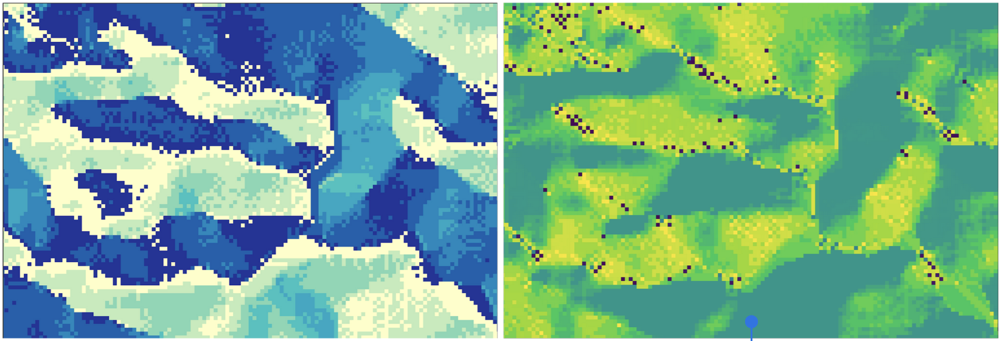
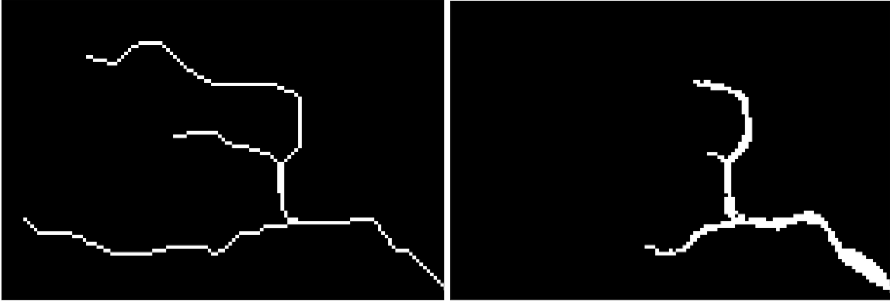

.. _data_sources:

****************
Fuentes de datos
****************

Esta es una recopilación de fuentes de datos y sugerencias para los datos de entrada habituales de los modelos. La lista no es exhaustiva y solo pretende servir como punto de partida. Se recomienda encarecidamente buscar datos más locales y precisos (de fuentes nacionales, estatales, universitarias, bibliográficas, de ONG y otras) y utilizar datos globales en los análisis finales únicamente cuando no haya información más local disponible. Si conoce alguna fuente de datos útil que no esté incluida en esta lista, compártala en el foro.

.. _dem:

Modelo digital de elevación
---------------------------
Un modelo digital de elevación (MDE) es un mapa ráster de elevación en el que el valor de cada píxel representa su altura sobre el nivel del mar (por lo general, en metros). Existen datos de MDE para cualquier zona del mundo, aunque con distintas resoluciones.

Se pueden obtener gratuitamente datos globales de MDE sin procesar en las siguientes fuentes:

 * World Wildlife Fund - https://www.worldwildlife.org/pages/hydrosheds
 * NASA: https://asterweb.jpl.nasa.gov/gdem.asp (resolución de 30 m); y acceso sencillo a los datos SRTM: http://dwtkns.com/srtm/
 * USGS: https://earthexplorer.usgs.gov/

También se pueden encontrar datos de MDE preparados para InVEST en NatCap Data Hub: https://data.naturalcapitalalliance.stanford.edu/dataset/?tags=DEM

La resolución del MDE puede ser un parámetro muy importante, según los objetivos del proyecto. Por ejemplo, si quienes toman las decisiones necesitan información sobre los impactos de las carreteras en los servicios ecosistémicos, se requiere una resolución fina. Los aspectos hidrológicos del MDE utilizado en el modelo deben ser correctos. La mayoría de los MDE sin procesar contienen errores, por lo que probablemente será necesario rellenarlos para eliminar las depresiones. Se han obtenido buenos resultados mediante varias ejecuciones de la herramienta Fill de ArcGIS o del algoritmo de relleno Wang y Liu de QGIS (biblioteca SAGA).

En los modelos hidrológicos que generan corrientes a partir del MDE, examine detenidamente el ráster de salida de la red de drenaje. Si las corrientes no son continuas y aparecen fragmentadas, el MDE todavía contiene depresiones que deben rellenarse. Si rellenarlas varias veces no produce una red de drenaje continua, pruebe con otro MDE. Si los resultados muestran un patrón de cuadrícula inesperado, esto puede deberse a que el MDE se reproyectó mediante el método de interpolación «vecino más cercano» en lugar de «bilineal» o «cúbico». En ese caso, vuelva a los datos originales del MDE y reproyéctelos con el método «bilineal» o «cúbico».

Consulte también la sección Trabajar con el MDE de esta Guía del usuario para obtener más detalles y orientaciones sobre el procesamiento de los MDE.

.. _lulc:

Uso/cobertura del suelo
-----------------------
El uso y la cobertura del suelo (LULC, por sus siglas en inglés) describen las propiedades físicas del terreno o la manera en que las personas lo utilizan (bosque, humedal, agua, superficie pavimentada, terreno agrícola, área natural protegida, etc.). Para representar los datos en formato ráster, cada categoría de LULC se asocia con un código entero (los códigos no tienen que ser consecutivos ni estar ordenados). Cuando sea posible, se deben aproximar los vacíos de información desconocida para evitar datos faltantes (huecos) en las capas de salida.

Existen varias fuentes de datos globales sobre uso del suelo, entre ellas:

 * NASA: https://lpdaac.usgs.gov/products/mcd12q1v006/ (datos MODIS plurianuales de cobertura global del suelo, disponibles en varias clasificaciones)
 * WorldCover de la Agencia Espacial Europea, con resolución de 10 m: https://esa-worldcover.org/
 * Iniciativa sobre Cambio Climático de la Agencia Espacial Europea, cobertura del suelo con resolución de 300 m: https://www.esa-landcover-cci.org/

Los datos de Estados Unidos son proporcionados por el USGS y el Departamento del Interior mediante la Base de Datos Nacional de Cobertura del Suelo: https://www.usgs.gov/centers/eros/science/national-land-cover-database

También se pueden encontrar datos de LULC preparados para InVEST en NatCap Data Hub: https://data.naturalcapitalalliance.stanford.edu/dataset/?_tags_limit=0&tags=LULC

Muchos países cuentan con mapas nacionales de LULC que pueden utilizarse; se recomienda buscarlos siempre que sea posible.

Es importante evaluar cualquier mapa de cobertura del suelo para determinar su precisión en el área de estudio. Los productos globales, en particular, suelen ser más precisos en unos lugares (o para algunos tipos de cobertura) que en otros.

En ocasiones resulta útil dividir una clase general de LULC en clases más detalladas. Por ejemplo, las clases de tierras agrícolas pueden subdividirse según los distintos tipos de cultivos. Los bosques pueden desglosarse por especies específicas o categorías de edad. Cuando se disponga de datos, los tipos de LULC pueden estratificarse según variables como precipitación, temperatura, elevación, etc., que se sabe que afectan las propiedades modeladas.

La categorización de los tipos de uso del suelo depende del modelo y de la cantidad de datos disponibles para cada tipo de terreno. Por lo general, la tabla biofísica de entrada asigna determinados parámetros biofísicos pertinentes a cada código de LULC. Solo se debe subdividir un tipo de LULC si ello permite mejorar la precisión del modelado. Por ejemplo, subdivida la categoría «cultivos» en distintos tipos de cultivo únicamente si dispone de información sobre las diferencias en los parámetros biofísicos relevantes.

*Esquema típico de clasificación de LULC; es probable que el suyo sea diferente*

  ====== ===========================
  lucode Uso/cobertura del suelo
  ====== ===========================
  1      Bosque siempreverde de coníferas
  2      Bosque siempreverde latifoliado
  3      Bosque caducifolio de coníferas
  4      Bosque caducifolio latifoliado
  5      Cobertura mixta
  6      Bosque abierto
  7      Mosaico arbolado de pastizal
  8      Matorral cerrado
  9      Matorral abierto
  10     Pastizal
  11     Tierras de cultivo (cultivos en hileras)
  12     Suelo desnudo
  13     Zonas urbanas y construidas
  14     Humedal
  15     Mezcla de especies siempreverdes
  16     Bosque mixto
  17     Huertos/viñedos
  18     Pastura
  ====== ===========================

.. _carbon_pools:

Reservorios de carbono
----------------------
Los datos de almacenamiento de carbono deben corresponder a los valores medios de almacenamiento de carbono de cada clase de LULC. La fuente de datos ideal para todas las reservas de carbono es un conjunto de estimaciones locales de campo en las que se haya medido directamente el carbono almacenado en todas las reservas pertinentes. Estos datos pueden resumirse según el mapa de LULC, incluida cualquier estratificación por edad u otra variable. Sin embargo, si estos datos no están disponibles, existen varias fuentes de datos generales que pueden utilizarse.

Tenga en cuenta que varias fuentes, incluido el IPCC (2006), presentan los datos en unidades de biomasa, mientras que InVEST utiliza la masa de carbono elemental. Para convertir toneladas métricas de biomasa en toneladas métricas de C, multiplique por un factor de conversión que suele variar entre 0,43 y 0,51. Los factores de conversión para los principales tipos de árboles y regiones climáticas se indican en la Tabla 4.3, página 4.48, del IPCC (2006).

.. _aboveground_carbon:

Carbono almacenado en la biomasa aérea
^^^^^^^^^^^^^^^^^^^^^^^^^^^^^^^^^^^^^^
Una fuente de datos buena, aunque muy general, sobre almacenamiento de carbono es la metodología de 2006 del Grupo Intergubernamental de Expertos sobre el Cambio Climático (IPCC) para elaborar inventarios de gases de efecto invernadero en el sector de Agricultura, Silvicultura y Otros Usos de la Tierra (AFOLU): https://www.ipcc-nggip.iges.or.jp/public/2006gl/vol4.html. Para utilizar esta información del IPCC, debe conocer el dominio climático y la región de su sitio; consulte los datos de la Tabla 4.1, página 4.46, y una copia digital del mapa de ecorregiones de la Organización de las Naciones Unidas para la Alimentación y la Agricultura (FAO) (http://www.fao.org/geonetwork/srv/en/main.home) para determinarlo. Las Tablas 5.1 a 5.3 (p. 5.9) del IPCC (2006) proporcionan estimaciones de biomasa aérea en tierras agrícolas con biomasa leñosa perenne (por ejemplo, huertos frutales, sistemas agroforestales, etc.). Las Tablas 4.7, 4.8 y 4.12 presentan estimaciones de biomasa aérea para tipos de bosques naturales y plantaciones.

Ruesch y Gibbs (2008) cartografiaron los datos de almacenamiento de carbono en la biomasa aérea del IPCC (2006) utilizando datos de cobertura del suelo del año 2000, disponibles aquí: https://data.ess-dive.lbl.gov/view/doi:10.15485/1463800. Lamentablemente, estos datos no están bien documentados, pero el archivo «lut.zip» contiene una tabla con los valores de carbono para cada ecorregión. La tabla no especifica explícitamente las unidades, aunque los archivos de metadatos .xml indican que los valores están expresados en toneladas de C por hectárea.

También pueden encontrarse otras fuentes generales de estimaciones de almacenamiento de carbono. Por ejemplo, Grace et al. (2006) estiman el almacenamiento medio de carbono aéreo (hojas + madera) de los principales ecosistemas de sabana del mundo (Tabla 1). Houghton (2005) presenta el almacenamiento de carbono aéreo para tipos de bosques naturales y plantaciones, por continente (Tablas 1 y 3). Brown et al. (1989) ofrecen estimaciones de biomasa aérea para bosques tropicales latifoliados en función del uso del suelo: sin intervención, aprovechados y no productivos (Tabla 7). También existen fuentes regionales de datos sobre almacenamiento de carbono. Entre las que hemos encontrado se incluyen:

* América Latina: Malhi et al. (2006) presentan volúmenes de biomasa aérea para 227 parcelas de bosques de tierras bajas de Bolivia, Brasil, Colombia, Ecuador, Guayana Francesa, Guyana, Panamá, Perú y Venezuela. Nascimento y Laurance (2002) estiman las reservas de carbono aéreo en veinte parcelas de 1 ha de bosque lluvioso amazónico. Tiessen et al. (1998) identifican las reservas de carbono aéreo de los tipos de sabana brasileña Caatingas y Cerrados.

* África: Zhang y Justice (2001) presentan las reservas de carbono aéreo para los principales tipos de LULC de bosques y matorrales de países de África central. Tiessen et al. (1998) estiman la biomasa aérea total de sabanas degradadas en Senegal. Makundi (2001) informa sobre el incremento medio anual de tres tipos de plantaciones forestales en Tanzania. Malimbwi et al. (1994) estiman las reservas de carbono aéreo en los bosques de miombo de la Reserva Forestal de Kitungalo, Tanzania. Munishi y Shear (2004) presentan las reservas de carbono aéreo de los bosques lluviosos afromontanos de las montañas del Arco Oriental de Tanzania. Glenday (2006) estima las reservas de carbono aéreo para tres tipos de bosque del Bosque Nacional de Kakamega, en el oeste de Kenia.

* América del Norte: Smith et al. (2006) estiman las reservas de carbono aéreo para todos los principales tipos de bosque de Estados Unidos.

* Carbon On Line Estimator (https://www.ncasi.org/resource/carbon-on-line-estimator-cole/) es una herramienta para calcular las características del carbono en los bosques de Estados Unidos, basada en los datos del Inventario y Análisis Forestal y de la Evaluación de Planificación de Recursos del Servicio Forestal del USDA. Esta herramienta permite examinar las características del carbono a escala de condado. En la pestaña de variables se pueden seleccionar los reservorios de carbono aéreo, subterráneo, del suelo o de la madera muerta.

* Coomes et al. (2002) estiman las reservas de carbono aéreo para tipos de matorral nativo y bosque de Nueva Zelanda.

La biomasa aérea (y, por tanto, las reservas de carbono) también puede calcularse a partir de inventarios madereros, que suelen realizar los ministerios forestales en un conjunto de parcelas. Utilice la siguiente fórmula para estimar las reservas de carbono aéreo en un rodal forestal cuyo volumen comercial haya sido inventariado, donde VOB es el volumen por hectárea de los árboles, en metros cúbicos, medido desde el tocón hasta el punto de inicio de la copa (la parte comercializable del árbol); WD es la densidad de la madera (biomasa seca por unidad de volumen del árbol); BEF es la relación entre la biomasa seca aérea total y la biomasa seca del volumen inventariado; y CF es la relación, en masa, entre el carbono elemental y la biomasa seca (Brown, 1997). El factor de expansión de biomasa (BEF) representa el carbono almacenado en todas las demás partes aéreas del árbol (por ejemplo, ramas, corteza, tallos, follaje, etc.; las partes no comercializables). En la mayoría de los casos, la WD de una parcela se aproxima utilizando los valores de las especies dominantes. Brown (1997) ofrece una tabla de valores de WD para numerosas especies arbóreas en el Apéndice 1 de la sección 3 y un método para calcular el BEF (Ecuación 3.1.4). Véase ECCM (2007) para una aplicación de este método de la FAO a datos de inventarios forestales del este de Tanzania. El IPCC (2006) también presenta estimaciones de ( ) en las que los valores de BEF para rodales de frondosas, pinos, coníferas y bosques naturales por ecorregión aparecen en la Tabla 4.5, mientras que los valores de WD para numerosas especies se encuentran en las Tablas 4.13 y 4.14. (Utilice los valores BCEF de la Tabla 4.5 que llevan el subíndice S). Por último, Brown et al. (1989) presentan valores de BEF para bosques tropicales latifoliados bajo tres usos del suelo: sin intervención, aprovechados y no productivos.

Brown (1997) señala varias salvedades respecto al uso de la ecuación anterior. En primer lugar, la ecuación está diseñada para rodales inventariados cerrados, en contraposición a los abiertos (bosques con una cobertura de dosel más dispersa, como las sabanas de robles). En segundo lugar, las estimaciones de VOB deben considerar todas las especies arbóreas presentes en el rodal, no solo las maderas de mayor valor económico. En tercer lugar, para que esta ecuación de carbono de la biomasa aérea sea lo más precisa posible, el inventario debe incluir árboles con diámetros de tan solo 10 centímetros a la altura del pecho (DAP = 10). Brown (2002) también señala que utilizar un único valor de BEF simplifica el proceso real de crecimiento de la biomasa.

Estas salvedades llevan a Brown (2002) a recomendar el uso de ecuaciones alométricas de biomasa para estimar la biomasa leñosa aérea, cuando estén disponibles. Estas ecuaciones expresan la relación estimada entre la distribución de los árboles de distintos tamaños en un rodal y la biomasa aérea de ese rodal. Brown (1997) y Brown y Schroeder (1999) proporcionan ecuaciones alométricas generales de biomasa aérea para todas las ecorregiones del mundo y para el este de Estados Unidos, respectivamente. Cairns et al. (2000) ofrecen ecuaciones alométricas de biomasa aérea para tipos de LULC del sur de México. Nascimento y Laurance (2002) estiman la biomasa aérea de los bosques lluviosos amazónicos mediante curvas alométricas. Para utilizar estas ecuaciones se necesita conocer la distribución de los tamaños de los árboles en un rodal determinado.

Algunos investigadores han facilitado un poco el uso de estas ecuaciones al relacionar primero la distribución de los árboles de distintos tamaños en un rodal con su edad y, después, cartografiar la relación entre la edad y la biomasa aérea (es decir, ). Por ejemplo, Silver et al. (2000) estimaron la biomasa aérea en función de la edad del rodal (es decir, los años transcurridos desde la forestación/reforestación) o del LULC anterior para tipos de bosque nativo de ecosistemas tropicales. Smith et al. (2006) llevan un paso más allá la transformación de las ecuaciones alométricas al relacionar directamente la edad con el carbono de la biomasa total (subterránea más aérea) para varios bosques de Estados Unidos.

Al utilizar datos del IPCC u otras fuentes generales similares, hay que considerar, por último, cómo afecta el nivel de perturbación antropogénica a las reservas de carbono. Es probable que las reservas de C aéreo de las zonas muy perturbadas sean inferiores a las de las zonas sin perturbación. No está claro qué niveles de perturbación presuponen el IPCC u otras fuentes similares al presentar estimaciones de biomasa aérea. Si la perturbación forestal es un factor relevante en el sitio de demostración, los tipos de LULC deben estratificarse según sus niveles de perturbación. Como ejemplo de esta estratificación, véase la Tabla 2.5, página 14, de ECCM (2007).

Por último, en general no consideramos el material herbáceo aéreo como un reservorio de carbono (por ejemplo, hierbas, flores, material no leñoso). Nuestra hipótesis de trabajo es que este material no constituye una fuente potencial de almacenamiento a largo plazo, como sí lo hacen la biomasa leñosa, la biomasa subterránea y el suelo. En general, el material herbáceo recicla su carbono demasiado rápido.

.. _belowground_biomass:

Carbono almacenado en la biomasa subterránea
^^^^^^^^^^^^^^^^^^^^^^^^^^^^^^^^^^^^^^^^^^^^^

Para las categorías de LULC dominadas por biomasa leñosa, la biomasa subterránea puede estimarse de manera aproximada mediante la relación raíz/parte aérea, es decir, la proporción entre la biomasa subterránea y la biomasa aérea. Las estimaciones predeterminadas de esta relación se presentan por ecorregión en la Tabla 4.4, página 4.49, del IPCC (2006). Brown (1997), en la sección 3.5, también ofrece estimaciones generales de esta relación.

Algunos tipos de LULC contienen poca biomasa leñosa o ninguna, pero poseen reservas considerables de carbono subterráneo (por ejemplo, pastizales naturales, pastizales manejados, estepas y zonas de matorral). En estos casos no se aplica la relación raíz/parte aérea descrita anteriormente. Lo mejor es estimar localmente la biomasa subterránea de estos tipos de LULC; sin embargo, si no se dispone de datos locales, pueden utilizarse algunas estimaciones globales. El IPCC (2006) presenta la biomasa total (aérea más subterránea) y la biomasa aérea para cada zona climática en la Tabla 6.4 (p. 6.27). La diferencia entre estas cifras constituye una estimación aproximada de la biomasa subterránea. Recientemente, Ruesch y Gibbs (2008) cartografiaron los datos de almacenamiento de carbono en la biomasa aérea del IPCC (2006) utilizando datos de cobertura del suelo del año 2000, disponibles aquí: https://cdiac.ess-dive.lbl.gov/epubs/ndp/global_carbon/carbon_documentation.html.

Varios estudios han recopilado estimaciones de biomasa subterránea o de relaciones raíz/parte aérea para distintos tipos de hábitat. Entre los que encontramos se incluyen:

* Grace et al. (2006) estiman la biomasa media total de raíces leñosas y herbáceas de los principales ecosistemas de sabana del mundo (Tabla 1). Baer et al. (2002) y Tilman et al. (2006) estiman el C almacenado en las raíces de parcelas restauradas con gramíneas nativas C4 en Nebraska y Minnesota, Estados Unidos, respectivamente, en función de los años transcurridos desde la restauración (véase la Tabla 2 de Baer et al. (2002) y la Figura 1D de Tilman et al. (2006)).

* Cairns et al. (1997) recopilan relaciones raíz/parte aérea para tipos de LULC de todo el mundo. Munishi y Shear (2004) utilizan una relación de 0,22 para los bosques afromontanos de los bosques del Arco Oriental de Tanzania. Malimbwi et al. (1994) utilizan 0,20 para los bosques de miombo de la misma región de Tanzania. Coomes et al. (2002) utilizan 0,25 para los matorrales de Nueva Zelanda. Gaston et al. (1998) presentan una relación raíz/parte aérea de 1 para las sabanas africanas de pastizal y matorral.

.. _soil_carbon:

Carbono almacenado en el suelo
^^^^^^^^^^^^^^^^^^^^^^^^^^^^^^

Si no se dispone de estimaciones locales o regionales de C del suelo, pueden consultarse los valores predeterminados del IPCC (2006) para tierras agrícolas, pasturas y pastizales manejados. La Tabla 2.3 del IPCC (2006) contiene estimaciones de las reservas de carbono del suelo por tipo de suelo, suponiendo que estas reservas se encuentran en equilibrio y que no existe un manejo activo del terreno. Para los tipos de LULC de tierras de cultivo y pastizales, esta estimación predeterminada puede multiplicarse por los factores de manejo que aparecen en las Tablas 5.5 y 6.2 del IPCC (2006). Para todos los demás tipos de LULC y sus correspondientes sistemas de manejo, el IPCC (2006) supone que no se aplican factores de manejo.

Existen otras fuentes globales de datos sobre carbono del suelo. Post et al. (1982) presentan las reservas de carbono en el primer metro de suelo según el Sistema de Clasificación de Zonas de Vida de Holdridge (se dispone de un mapa SIG de estas zonas en http://www.arcgis.com/home/item.html?id=f3ec7241777f4c56a69ae14d2a98e44b). Silver et al. (2000) estiman el carbono del suelo en función de los años transcurridos desde la forestación/reforestación para tipos de bosque nativo de ecosistemas tropicales. Grace et al. (2006) estiman el carbono del suelo para los principales tipos de sabana del mundo (Tabla 1). Detwiler (1986) presenta el carbono del suelo para suelos de bosques tropicales en la Tabla 2.

Los datos espaciales de carbono del suelo suelen proporcionarse como parte de los mapas de propiedades del suelo, como los de ISRIC SoilGrids (https://soilgrids.org/). Si dispone de una capa de este tipo, puede utilizar el modelo de Carbono para sumar únicamente los reservorios de carbono aéreo, subterráneo y de hojarasca (asignando c_soil = 0 a todas las clases de cobertura del suelo) y, posteriormente, añadir la capa de carbono del suelo a la salida del modelo de Almacenamiento de Carbono durante el posprocesamiento.

En Estados Unidos, el NRCS ofrece gratuitamente datos de suelos en las bases de datos gSSURGO, SSURGO y gNATSGO: https://www.nrcs.usda.gov/wps/portal/nrcs/main/soils/survey/geo/. También proporciona herramientas de ArcGIS (Soil Data Viewer para SSURGO y Soil Data Development Toolbox para gNATSGO) que ayudan a procesar estas bases de datos y convertirlas en datos espaciales que el modelo puede utilizar. Soil Data Development Toolbox (disponible en https://www.nrcs.usda.gov/resources/data-and-reports/gridded-soil-survey-geographic-gssurgo-database) es la herramienta más fácil de utilizar y se recomienda especialmente si trabaja con ArcGIS Desktop (no funciona en ArcGIS Pro ni en QGIS) y necesita procesar datos de suelos de Estados Unidos. Otra opción es SSURGO Portal (https://www.nrcs.usda.gov/resources/data-and-reports/ssurgo-portal), una nueva aplicación (beta) independiente de ArcGIS.

Varios estudios regionales también presentan reservas de carbono del suelo. Entre los que encontramos se incluyen:

* América del Norte: Smith et al. (2006) estiman el C del suelo para intervalos de cinco años, hasta 125 años desde la forestación/reforestación, para todos los principales tipos de bosque y prácticas de manejo forestal de cada región de Estados Unidos. Otros estudios incluyen McLauchlan et al. (2006); Tilman et al. (2006); Fargione et al. (2008); Schuman et al. (2002); y Lal (2002).

* África: Houghton y Hackler (2006) presentan el C del suelo para cinco tipos forestales de LULC (bosque lluvioso; bosque húmedo; bosque seco; matorral; y bosque montano) del África subsahariana que han conservado su cobertura natural, así como para zonas forestales convertidas en tierras de cultivo, agricultura itinerante y pasturas. Vagen et al. (2005) proporcionan estimaciones de C del suelo para diversos tipos de LULC del África subsahariana.

* América del Sur: Bernoux et al. (2002) estimaron las reservas de C del suelo hasta una profundidad de 30 cm para distintas asociaciones de tipos de suelo y vegetación en Brasil. Por ejemplo, las reservas de C del suelo en suelos HAC bajo 14 categorías diferentes de cobertura del suelo, incluidos el bosque amazónico y el Cerrado brasileño, oscilan entre 2 y 116 kg C m-2.

Nota importante: En la mayoría de las investigaciones que estiman el almacenamiento y las tasas de secuestro de carbono en un paisaje, las mediciones del reservorio del suelo incluyen únicamente el carbono orgánico del suelo (COS) en suelos minerales (Post y Kwon, 2000). Sin embargo, si el ecosistema modelado contiene muchos suelos orgánicos (por ejemplo, humedales o páramos), es fundamental añadir este componente al contenido de los suelos minerales. En paisajes donde es común convertir humedales a otros usos del suelo, también deben vigilarse de cerca las emisiones de carbono procedentes de los suelos orgánicos (IPCC, 2006).

.. _dead_carbon:

Carbono almacenado en la materia orgánica muerta
^^^^^^^^^^^^^^^^^^^^^^^^^^^^^^^^^^^^^^^^^^^^^^^^

Si no se dispone de estimaciones locales o regionales del carbono almacenado en la materia orgánica muerta, pueden asignarse los valores predeterminados del IPCC (2006). La Tabla 2.2 (p. 2.27) presenta las reservas de carbono predeterminadas de la hojarasca en los tipos de LULC forestales. En los tipos no forestales, la hojarasca se aproxima a cero. Grace et al. (2006) estiman el carbono medio almacenado en la hojarasca para los principales ecosistemas de sabana del mundo (Tabla 1). No está claro si sus estimaciones de «biomasa aérea» total incluyen o no la madera muerta. En general, las reservas de madera muerta son más difíciles de estimar y no hemos localizado fuentes de datos predeterminados.

Estimaciones regionales:

* Estados Unidos: Smith et al. (2006) estiman el almacenamiento de carbono en la hojarasca (denominado «C del suelo forestal» en el documento) y en la madera muerta (el agregado de reservorios de C denominados «árboles muertos en pie» y «madera muerta caída» en el documento) para todos los principales tipos de bosque y prácticas de manejo forestal de cada región de Estados Unidos, en función de la edad del rodal.

* América del Sur: Delaney et al. (1998) estiman el carbono almacenado en la madera muerta en pie y caída en seis bosques tropicales de Venezuela. Según los autores, la madera muerta suele representar una décima parte de la biomasa de la vegetación aérea.

Precipitación
-------------

.. _precipitation:

Precipitación anual y mensual
^^^^^^^^^^^^^^^^^^^^^^^^^^^^^
La precipitación puede interpolarse a partir de datos puntuales de pluviómetros recopilados durante largos períodos. Al utilizar datos de pluviómetros, asegúrese de que cubran adecuadamente el área de interés, sobre todo si existen grandes variaciones de elevación que provocan una distribución heterogénea de la precipitación dentro del área de estudio. Lo ideal es que los pluviómetros dispongan de al menos 10 años de datos continuos, sin grandes vacíos, correspondientes aproximadamente al mismo período que el mapa de uso/cobertura del suelo utilizado como entrada. Debe incluirse la precipitación en forma de nieve.

Los conjuntos de datos globales procedentes de modelos de teledetección pueden cubrir zonas remotas cuando no se dispone de datos de campo. Entre otras fuentes, se pueden utilizar los datos de baja resolución de los conjuntos globales gratuitos desarrollados por la Climatic Research Unit: http://www.cru.uea.ac.uk o WorldClim: https://www.worldclim.org/. Un sitio útil para buscar datos de precipitación es la Climate Data Guide de NCAR: https://climatedataguide.ucar.edu/climate-data.

Algunas fuentes (como WorldClim) proporcionan 12 rásteres de precipitación media mensual. Para utilizarlos en el modelo de Rendimiento Hídrico Anual, los rásteres mensuales deben sumarse para calcular un mapa de precipitación media anual.

En Estados Unidos, el grupo PRISM de la Universidad Estatal de Oregón ofrece gratuitamente datos de precipitación con una resolución de 30 segundos de arco. Consulte su sitio web en https://prism.oregonstate.edu/ y vaya a «800m Normals» para descargar los datos.

.. _rain_events:

Eventos de lluvia
^^^^^^^^^^^^^^^^^
El número medio de eventos de lluvia por mes puede obtenerse de las estadísticas climáticas locales (servicios meteorológicos) o de recursos en línea:

 * https://www.yr.no/
 * El Banco Mundial también ofrece mapas con estadísticas de precipitación: https://datahelpdesk.worldbank.org/knowledgebase/articles/902061-climate-data-api

Evapotranspiración
------------------

.. _et0:

Evapotranspiración de referencia
^^^^^^^^^^^^^^^^^^^^^^^^^^^^^^^^
La evapotranspiración de referencia, ET₀, mide la cantidad de agua que pasa de la superficie terrestre a la atmósfera en un período determinado. Es la suma de la evaporación (directamente desde el suelo, los cuerpos de agua y otras superficies) y la transpiración (a través de las plantas). Suele expresarse como una lámina de agua en milímetros por unidad de tiempo: :math:`mm/month` para valores mensuales y :math:`mm/year` para valores anuales. (Nota: al igual que la precipitación, se trata de la «profundidad» de agua que se evapotranspira en una región determinada; no es una cantidad «por» píxel, metro cuadrado ni ninguna otra unidad de superficie). Todos los modelos InVEST utilizan esta medida, pero algunas fuentes expresan la evapotranspiración como volumen o energía por unidad de superficie. Consulte http://www.fao.org/3/x0490e/x0490e04.htm para obtener más detalles.

CGIAR proporciona un mapa global de evapotranspiración potencial, basado en datos climáticos de WorldClim, que puede utilizarse como ET de referencia: https://cgiarcsi.community/data/global-aridity-and-pet-database/.

Un sitio útil para buscar datos de evapotranspiración (o datos de precipitación y temperatura que permitan calcular la ET) es la Climate Data Guide de NCAR: https://climatedataguide.ucar.edu/climate-data.

También se pueden encontrar datos de evapotranspiración preparados para InVEST en NatCap Data Hub: https://data.naturalcapitalalliance.stanford.edu/dataset/?_tags_limit=0&tags=EVAPOTRANSPIRATION

Si ejecuta un modelo que requiere tanto precipitación como evapotranspiración como datos de entrada, asegúrese de que los datos de ET se basen en los mismos datos de precipitación que se utilizan como entrada del modelo.

La evapotranspiración de referencia varía con la elevación, la latitud, la humedad y la orientación de la pendiente. Existen numerosas metodologías, con distintos requisitos de datos y niveles de precisión.

Puede calcular la ET de referencia elaborando cuadrículas de promedios mensuales de precipitación y de temperaturas máximas y mínimas. Estos datos pueden proceder de estaciones meteorológicas; en ese caso, siga el mismo procedimiento utilizado para elaborar la cuadrícula de precipitación media anual e incorpore los efectos de la elevación al interpolar entre estaciones. WorldClim y CRU también proporcionan datos mensuales de temperatura en formato de cuadrícula. Estas cuadrículas mensuales pueden utilizarse como entrada en las ecuaciones que se indican a continuación.

Otra descripción del procedimiento consiste en elaborar cuadrículas de promedios mensuales de precipitación y de temperaturas máximas y mínimas (también disponibles en WorldClim y CRU), incorporando los efectos de la elevación al interpolar a partir de las estaciones de observación. Los datos necesarios para elaborar estas cuadrículas mensuales de precipitación y temperatura se obtienen siguiendo el mismo procedimiento utilizado para desarrollar las cuadrículas de «Precipitación mensual».

Una forma sencilla de determinar la evapotranspiración de referencia es utilizar la ecuación de «Hargreaves modificada» (Droogers y Allen, 2002), que produce mejores resultados que la de Penman-Monteith cuando la información es incierta.

.. math:: ET_0 = 0.0013\times 0.408\times RA\times (T_{av}+17)\times (TD-0.0123 P)^{0.76}

El método de «Hargreaves modificada» utiliza la media de las temperaturas máximas y mínimas diarias medias de cada mes (`Tavg`, en grados Celsius), la diferencia entre las temperaturas máximas y mínimas diarias medias de cada mes (`TD`), la radiación extraterrestre (:math:`RA` en :math:`\mathrm{MJm^{-2}d^{-1}}`) y la precipitación media mensual (:math:`P`, en mm por mes). Todos estos datos pueden obtenerse con relativa facilidad.

Puede aplicar esta ecuación a datos ráster. Tenga en cuenta que calcula la ET₀ diaria media, por lo que el resultado debe multiplicarse por el número de días del mes al que corresponden los valores de entrada, y el cálculo debe ejecutarse una vez para cada mes. Los rásteres mensuales de ET₀ resultantes pueden utilizarse en el modelo de Rendimiento Hídrico Estacional. Para el modelo de Rendimiento Hídrico Anual, sume los rásteres mensuales de ET₀ para obtener la ET₀ media anual.

Los datos de temperatura y precipitación suelen estar disponibles en gráficos regionales, mediciones directas o conjuntos de datos nacionales o globales (como WorldClim). En cambio, medir directamente la radiación es mucho más costoso, aunque puede estimarse de manera fiable mediante herramientas en línea, tablas o ecuaciones. El documento 56 de la FAO, Irrigation and Drainage Paper 56 (Allen, 1998), proporciona datos mensuales de radiación en el Anexo 2; para utilizarlos, seleccione los valores correspondientes a la latitud más cercana a su área de estudio. Otra opción es utilizar una herramienta SIG para calcular la radiación solar de su área de estudio específica y emplear esa capa espacial como entrada para el cálculo de Hargreaves modificada.

La evapotranspiración de referencia también puede calcularse mensual y anualmente mediante la ecuación de Hamon (Hamon, 1961; Wolock y McCabe, 1999):

.. math:: PED_{Hamon} = 13.97 d D^2W_t

donde :math:`d` es el número de días de un mes, :math:`D` es el promedio mensual de horas de luz diurna calculado para cada año (en unidades de 12 horas) y :math:`W_t` es un término de densidad de vapor de agua saturado calculado mediante:

.. math:: W_t = \frac{4.95e^{0.062 T}}{100}

donde :math:`T` es la temperatura media mensual en grados Celsius. La evapotranspiración de referencia se establece en cero cuando la temperatura media mensual es inferior a cero. Luego, para cada año del período analizado, se suman los valores mensuales de PET calculados en cada celda de la cuadrícula para obtener un mapa de la PET anual de cada año.

Un último método para estimar la ETo, cuando se dispone de datos de evaporación en tanque, consiste en utilizar la siguiente ecuación:
:math:`ETo = pan ET *0.7` (Allen et al., 1998)

.. _kc:

Coeficiente de evapotranspiración de los cultivos
^^^^^^^^^^^^^^^^^^^^^^^^^^^^^^^^^^^^^^^^^^^^^^^^^
Los valores del coeficiente de evapotranspiración de los cultivos (:math:`K_c`) se encuentran fácilmente en manuales de riego y horticultura. La FAO ofrece un recurso en línea: http://www.fao.org/3/X0490E/x0490e0b.htm

Las tablas de la FAO presentan coeficientes según la etapa de crecimiento del cultivo (:math:`K_c` ini, :math:`K_c` mid, :math:`K_c` end), que deben convertirse en un valor medio anual o mensual de :math:`K_c` (según el modelo). Para ello se necesita conocer la fenología de la vegetación de la región de estudio (fechas medias de reverdecimiento y senescencia) y las etapas de crecimiento de los cultivos (fechas de siembra y cosecha de los cultivos anuales). El valor medio anual de :math:`K_c` puede estimarse en función de las características de la vegetación y de la evapotranspiración de referencia media mensual mediante la siguiente ecuación:

.. math:: K_c = \frac{\sum^{12}_{m=1}K_{cm}\times ET_{o_m}}{\sum^{12}_{m=1}ET_{o_m}}

donde :math:`K_{cm}` es el coeficiente medio del cultivo del mes :math:`m` (1-12) y :math:`ET_{o_m}` es la evapotranspiración de referencia correspondiente. Estos valores también pueden calcularse mediante la siguiente hoja de cálculo: https://github.com/natcap/invest.users-guide/raw/main/data-sources/kc_calculator.xlsx. Los valores de :math:`K_c` deben ser números decimales entre 0 y 1,5.

Los valores para otros tipos de vegetación pueden estimarse mediante relaciones con el índice de área foliar (LAI). El LAI caracteriza el área de hojas verdes por unidad de superficie del suelo y puede obtenerse a partir de productos de imágenes satelitales derivados del análisis del NDVI. Una relación típica entre LAI y :math:`K_c` es la siguiente (Allen et al., 1998, capítulo 6: http://www.fao.org/3/x0490e/x0490e0b.htm):

.. math:: K_c = \left\{\begin{array}{l}\frac{LAI}{3}\mathrm{\ when\ } LAI \leq 3\\ 1\end{array}\right.

Las estimaciones de :math:`K_c` para las categorías de LULC sin vegetación se basan en Allen et al. (1998). Tenga en cuenta que estos valores son solo aproximados, pero, a menos que el LULC represente una parte importante de la cuenca, el efecto de esta aproximación sobre los resultados del modelo debería ser mínimo.

* El Kc para aguas abiertas de menos de 2 m de profundidad puede aproximarse mediante Kc=1.
* El Kc para aguas abiertas de más de 5 m de profundidad se encuentra en el intervalo de 0,7 a 1,1.
* Para los humedales puede suponerse un Kc entre 1 y 1,2.
* El Kc para suelo desnudo varía entre 0,3 y 0,7, según el clima (en particular, la frecuencia de las lluvias). Puede estimarse en Kc=0,5 (véase Allen, 1998, capítulo 11). En Allen et al. (2005) se encuentra información adicional para determinar el Kc del suelo desnudo.
* El Kc para áreas construidas puede establecerse como f*0.1 +(1-f)*0.6, donde f es la fracción de cobertura impermeable del área. En este caso, se supone que la evapotranspiración de las superficies permeables de los entornos construidos equivale aproximadamente al 60 % de la evapotranspiración de referencia (es decir, el promedio entre césped y suelo desnudo). Además, se supone que la evaporación de las superficies impermeables equivale al 10 % de la PET. Si se dispone de datos locales, el usuario puede calcular una estimación media anual de Kc mediante el método descrito para los factores de cultivo.

Hidrología
----------

.. _watersheds:

Cuencas hidrográficas y cuencas de alcantarillado
^^^^^^^^^^^^^^^^^^^^^^^^^^^^^^^^^^^^^^^^^^^^^^^^^
Para delimitar cuencas hidrográficas, ofrecemos la herramienta DelineateIT de InVEST, que es relativamente sencilla y rápida, y tiene la ventaja de crear cuencas que pueden superponerse, como las cuencas que drenan hacia varias represas situadas en el mismo río. Consulte el capítulo de la Guía del usuario dedicado a DelineateIT para obtener más información sobre esta herramienta. Los programas SIG y algunos modelos hidrológicos también incluyen herramientas para crear cuencas. Se recomienda delimitar las cuencas utilizando el MDE con el que se ejecutará el modelo, de modo que los límites de las cuencas correspondan correctamente a la topografía.

Como alternativa, existen varios mapas de cuencas disponibles en línea; por ejemplo, HydroBASINS: https://hydrosheds.org/. Tenga en cuenta que, si los límites de las cuencas no se basan en el mismo MDE utilizado en el modelo, es probable que los resultados agregados para esas cuencas sean inexactos.

Las ubicaciones exactas de estructuras específicas, como las captaciones de instalaciones de agua potable o los embalses, deben obtenerse de la entidad administradora o pueden consultarse en la web:

 * Inventario Nacional de Represas de Estados Unidos: https://nid.sec.usace.army.mil/

 * Base de Datos Global de Embalses y Represas (GRanD): http://globaldamwatch.org/grand/

 * Base de datos de represas del Segundo Informe sobre el Desarrollo de los Recursos Hídricos en el Mundo: https://wwdrii.sr.unh.edu/download.html

Algunos de estos conjuntos de datos incluyen el área de captación que drena hacia cada represa; esta debe compararse con el área de la(s) cuenca(s) generada(s) por la herramienta de delimitación para evaluar la precisión.

Los datos de cuencas de alcantarillado pueden estar disponibles en los municipios locales.

.. _flow_direction_algorithms:

Algoritmos de dirección del flujo (D8 y MFD)
^^^^^^^^^^^^^^^^^^^^^^^^^^^^^^^^^^^^^^^^^^^^

Los modelos hidrológicos de InVEST admiten dos enfoques distintos para modelar el flujo de agua a través del paisaje. El modelado de la dirección del flujo se basa en el MDE. En la cuadrícula ráster del MDE, cada píxel tiene ocho píxeles vecinos (uno a cada lado y uno en cada diagonal).

D8
~~
Con el algoritmo D8, suponemos que toda el agua de un píxel fluye hacia uno solo de sus vecinos: aquel que se encuentra en la dirección de mayor pendiente descendente. Esto se determina calculando las diferencias entre los píxeles vecinos del MDE.

Indicamos los ocho píxeles vecinos mediante los números 0 a 7, en sentido contrario a las agujas del reloj desde la posición de las 3 en punto:

 3 2 1
 4 x 0
 5 6 7

Por tanto, el ráster de dirección del flujo resultante (una salida intermedia de cada modelo hidrológico) estará compuesto por valores de 0 a 7 que indican la dirección en la que fluye el agua desde cada píxel. Por ejemplo, en un píxel con valor 4, toda el agua fluye hacia la izquierda.

El método D8 tiende a producir corrientes más estrechas que MFD, porque todas las corrientes tienen solo un píxel de ancho.

Dirección de flujo múltiple (MFD)
~~~~~~~~~~~~~~~~~~~~~~~~~~~~~~~~~
Con el algoritmo MFD, suponemos que el agua de un píxel fluye hacia todos sus vecinos situados pendiente abajo. La proporción de agua que fluye hacia cada vecino depende de la inclinación de la pendiente descendente en esa dirección.

Por tanto, los datos MFD de un píxel constan de ocho valores: para cada uno de los ocho vecinos, ¿qué proporción de agua fluye en esa dirección? Cada uno de estos ocho valores se codifica en 4 bits y se concatena en un entero de 32 bits. El ráster de dirección del flujo resultante contiene estos valores enteros de 32 bits, que no pueden visualizarse ni interpretarse directamente.

El método MFD puede producir corrientes más anchas que D8, ya que pueden tener más de un píxel de ancho. En zonas relativamente planas, los resultados pueden ser excesivamente anchos y poco realistas.

   Dirección del flujo D8 (izquierda) y MFD (derecha)

   Corrientes D8 (izquierda) y MFD (derecha)

*Comparación de los resultados de D8 y MFD en la misma área. En el ráster de dirección del flujo D8 (arriba a la izquierda), pueden visualizarse las orientaciones de las pendientes. En el ráster de dirección del flujo MFD (arriba a la derecha), se observan patrones, pero no pueden interpretarse directamente debido a la forma en que se codifican los datos. En la red de drenaje D8 (abajo a la izquierda), las corrientes no tienen más de un píxel de ancho. En la red de drenaje MFD (abajo a la derecha), las corrientes pueden tener más de un píxel de ancho. Tenga en cuenta que estas redes de drenaje se generaron utilizando el mismo valor de acumulación de flujo umbral, que controla qué tan aguas arriba comienza una corriente. Es posible que deba ajustar el valor de acumulación de flujo umbral al utilizar D8 o MFD para obtener los resultados más precisos.*

.. _tfa:

Acumulación de flujo umbral
^^^^^^^^^^^^^^^^^^^^^^^^^^^
La acumulación de flujo umbral (TFA) es un parámetro del algoritmo de delimitación de corrientes que especifica el número de píxeles aguas arriba que deben drenar hacia un píxel antes de que este se clasifique como corriente. No existe un único valor «correcto» de TFA. El valor adecuado para su aplicación es aquel que hace que el modelo genere una capa de corrientes lo más parecida posible a la red de drenaje real de la cuenca. Compare el ráster de salida de la red de drenaje con un mapa de corrientes cuya exactitud conozca y ajuste el TFA según corresponda: los valores mayores de TFA generan redes con menos tributarios, mientras que los valores menores generan redes con más tributarios. Un buen valor inicial es 1000, pero tenga en cuenta que puede variar ampliamente según la resolución del MDE, el clima local y la topografía. En general, las corrientes delimitadas a partir de un MDE no coinciden exactamente con la realidad, por lo que se debe procurar la mayor aproximación posible. Si las corrientes modeladas son muy diferentes, considere probar con otro MDE.

Puede obtenerse una capa global de corrientes en HydroSHEDS: https://hydrosheds.org/, pero tenga en cuenta que, por lo general, incluye ríos principales y puede omitir los de su área de estudio, especialmente si se trata de tributarios pequeños. Si no hay mapas más localizados disponibles, también puede consultar las corrientes en Google Earth.

Consulte también la sección Trabajar con el MDE de esta Guía del usuario para obtener más información.

.. _soil_groups:

Grupos hidrológicos de suelos
^^^^^^^^^^^^^^^^^^^^^^^^^^^^^
Los grupos hidrológicos de suelos describen el potencial de escorrentía de los distintos tipos de suelo. Existen cuatro grupos: A, B, C y D; el grupo A tiene el menor potencial de escorrentía y el D, el mayor. Consulte la publicación del Servicio de Conservación de Recursos Naturales (NRCS) del Departamento de Agricultura de Estados Unidos (USDA) para obtener más información: https://directives.sc.egov.usda.gov/OpenNonWebContent.aspx?content=17757.wba

Existen dos capas globales de grupos hidrológicos de suelos disponibles: 1) FutureWater (https://www.futurewater.eu/2015/07/soil-hydraulic-properties/) y 2) HYSOGs250m de ORNL-DAAC (https://daac.ornl.gov/SOILS/guides/Global_Hydrologic_Soil_Group.html).

**El ráster de FutureWater** proporciona valores numéricos de grupo 1-4, 14, 24 y 34. El modelo de Rendimiento Hídrico Estacional solo admite los valores 1/2/3/4, por lo que debe convertir cualquier valor 14, 24 o 34 en uno de los valores permitidos (1-4).

**HYSOGs250m** proporciona valores numéricos de grupo 1-4 y 11-14. El modelo de Rendimiento Hídrico Estacional solo admite los valores 1/2/3/4, por lo que debe convertir cualquier valor 11, 12, 13 o 14 en uno de los valores permitidos (1-4).

La documentación de HiHydroSoil indica lo siguiente sobre los grupos hidrológicos dobles (14, 24 y 34), lo que también se aplica a los valores 11, 12, 13 y 14 de HYSOGs250m:

*"Grupos hidrológicos dobles de suelos: Los suelos que tienen un nivel freático a menos de 60 centímetros de la superficie se asignan al grupo D, aunque la conductividad hidráulica saturada pueda ser favorable para la transmisión del agua. Si estos suelos pueden drenarse adecuadamente, se asignan a grupos hidrológicos dobles (A/D, B/D y C/D) según su conductividad hidráulica saturada y la profundidad del nivel freático una vez drenados. La primera letra corresponde a la condición drenada y la segunda a la condición sin drenaje. En este contexto, se considera que un suelo está adecuadamente drenado cuando el nivel freático estacional máximo se mantiene al menos 60 centímetros por debajo de la superficie, mientras que en su estado natural estaría más cerca de ella."*

Por tanto, puede asignar estos valores de grupos hidrológicos dobles al primer grupo (A, B o C, que corresponden a los valores 1, 2 y 3 en el ráster de entrada del modelo) si sabe que estos suelos están drenados; de lo contrario, asígnelos al grupo D (valor 4 en el ráster de entrada del modelo).

En Estados Unidos, el NRCS ofrece gratuitamente datos de suelos en las bases de datos gSSURGO, SSURGO y gNATSGO: https://www.nrcs.usda.gov/wps/portal/nrcs/main/soils/survey/geo/. También proporciona herramientas de ArcGIS (Soil Data Viewer para SSURGO y Soil Data Development Toolbox para gNATSGO) que ayudan a procesar estas bases de datos y convertirlas en datos espaciales que el modelo puede utilizar. Soil Data Development Toolbox (disponible en https://www.nrcs.usda.gov/resources/data-and-reports/gridded-soil-survey-geographic-gssurgo-database) es la herramienta más fácil de utilizar y se recomienda especialmente si trabaja con ArcGIS Desktop (no funciona en ArcGIS Pro ni en QGIS) y necesita procesar datos de suelos de Estados Unidos. Otra opción es SSURGO Portal (https://www.nrcs.usda.gov/resources/data-and-reports/ssurgo-portal), una nueva aplicación (beta) independiente de ArcGIS.

**Nota sobre los valores de los grupos hidrológicos de suelos en zonas urbanas**

En ocasiones, como ocurre con los datos SSURGO de Estados Unidos, los mapas de grupos de suelos no contienen datos para las zonas urbanas. Si se sabe que estas zonas están compuestas principalmente por áreas urbanizadas y superficies impermeables, puede asignar a esos píxeles el valor 4 (D), que indica el mayor nivel de escorrentía de lluvia. También podría ajustar estos valores según si el mapa de uso/cobertura del suelo (LULC) indica desarrollo de intensidad baja, media o alta.

|

**Estimación de los grupos hidrológicos de suelos a partir de datos de arena y arcilla**

La documentación de HYSOGs250m y otras fuentes ofrecen correspondencias entre la información sobre textura del suelo y los grupos de suelos. A continuación se presenta una correspondencia sencilla, proporcionada por https://engineering.purdue.edu/mapserve/LTHIA7/lthianew/hsg.htm:

**Grupo A**: corresponde a suelos de arena, arena franca o franco arenosos. Tiene un bajo potencial de escorrentía y altas tasas de infiltración incluso cuando está completamente humedecido. Está constituido principalmente por arenas o gravas profundas, bien drenadas o excesivamente drenadas, y presenta una alta tasa de transmisión del agua.

**Grupo B**: corresponde a suelos franco limosos o francos. Tiene una tasa de infiltración moderada cuando está completamente humedecido y está constituido principalmente por suelos de profundidad moderada a profunda, moderadamente bien drenados a bien drenados, con texturas de moderadamente finas a moderadamente gruesas.

**Grupo C**: corresponde a suelos franco arcillo arenosos. Tiene tasas de infiltración bajas cuando está completamente humedecido y está constituido principalmente por suelos con una capa que dificulta el movimiento descendente del agua y por suelos con estructura moderadamente fina a fina.

**Grupo D**: corresponde a suelos franco arcillosos, franco arcillo limosos, arcillo arenosos, arcillo limosos o arcillosos. Este grupo hidrológico de suelos tiene el mayor potencial de escorrentía. Presenta tasas de infiltración muy bajas cuando está completamente humedecido y está constituido principalmente por suelos arcillosos con alto potencial de expansión, suelos con un nivel freático permanentemente alto, suelos con una capa de arcilla o un horizonte arcilloso en la superficie o cerca de ella, y suelos poco profundos sobre material casi impermeable.

Para una correspondencia más detallada, que incluya la profundidad hasta la capa impermeable y la profundidad hasta el nivel freático alto, consulte la tabla de la página 5 de este documento: http://nesoil.com/upload/RIHSGMethod_20150821.pdf.

|

**Estimación de los grupos hidrológicos de suelos a partir de la conductividad hidráulica y la profundidad del suelo**

Si lo desea, los grupos de suelos también pueden determinarse a partir de la conductividad hidráulica y la profundidad del suelo. El conjunto de datos de propiedades hidráulicas del suelo de FutureWater también contiene información sobre conductividad hidráulica, al igual que otras bases de datos de suelos. La Tabla 1 siguiente puede utilizarse para convertir la conductividad del suelo en grupos hidrológicos.

|

**Tabla 1: Criterios para la asignación de grupos hidrológicos de suelos (NRCS-USDA, 2007, cap. 7)**

+-----------------------------------------------------------------------------------------------------------------------------------------------------+-------------+----------------+----------------+----------------------------------------------------------------------------------+
|                                                                                                                                                     | Grupo A     | Grupo B        | Grupo C        | Grupo D                                                                          |
+=====================================================================================================================================================+=============+================+================+==================================================================================+
| Conductividad hidráulica saturada de la capa menos transmisiva cuando existe una capa impermeable al agua a una profundidad de entre 50 y 100 cm    | >40 μm/s    | [40;10] μm/s   | [10;1] μm/s    | <1 μm/s (o profundidad de la capa impermeable<50 cm o nivel freático<60 cm)      |
+-----------------------------------------------------------------------------------------------------------------------------------------------------+-------------+----------------+----------------+----------------------------------------------------------------------------------+
| Conductividad hidráulica saturada de la capa menos transmisiva cuando existe una capa impermeable al agua a una profundidad superior a 100 cm       | >10 μm/s    | [4;10] μm/s    | [0.4;4] μm/s   | <0.4 μm/s                                                                        |
+-----------------------------------------------------------------------------------------------------------------------------------------------------+-------------+----------------+----------------+----------------------------------------------------------------------------------+

Para obtener más detalles sobre este método, consulte también este capítulo del Manual Nacional de Ingeniería de Estados Unidos sobre Grupos Hidrológicos de Suelos: https://directives.nrcs.usda.gov/sites/default/files2/1712930597/11905.pdf.

.. _cn:

Número de curva
^^^^^^^^^^^^^^^
Se recomienda realizar una búsqueda bibliográfica para encontrar valores de CN específicos del área en la que está trabajando. Si no están disponibles, busque valores que correspondan lo más estrechamente posible a los mismos tipos de cobertura del suelo, suelo y clima. Si tampoco existen estos valores más locales, se recomiendan fuentes generales.

Los números de curva generales pueden obtenerse del informe del SCS (actualmente NRCS) *Urban hydrology for small watersheds* (NRCS TR-55, 1999). Este informe se conoce comúnmente como TR-55. Tenga en cuenta que fue elaborado en Estados Unidos, por lo que sus valores constituyen un buen punto de partida, pero se recomienda buscar valores más específicos para su área de estudio. Las tablas presentan estimaciones del número de curva (CN) en función del grupo hidrológico del suelo (HSG), el tipo de cobertura, el tratamiento, la condición hidrológica, la condición antecedente de escorrentía (ARC) y el área impermeable de la cuenca.

Para los cuerpos de agua y humedales conectados al cauce, el CN puede establecerse en 99 (es decir, se supone que esos píxeles conducen rápidamente el flujo rápido).

Cuando el objetivo sea evaluar los posibles efectos de las inundaciones, el CN puede seleccionarse para reflejar condiciones antecedentes húmedas de escorrentía: en ese caso, los valores de CN deben convertirse a condiciones ARC-III, de acuerdo con el capítulo 10 de las directrices NRCA-USDA (2007).

.. _bathymetry:

Batimetría
----------
La batimetría mide la profundidad del agua. El Centro Nacional de Datos Geofísicos (NGDC) de NOAA proporciona datos globales de batimetría con diversas resoluciones espaciales en https://www.ngdc.noaa.gov/mgg/bathymetry/relief.html.

ETOPO1 es un modelo global del relieve de la superficie terrestre con una resolución de 1 minuto de arco que integra la topografía terrestre y la batimetría oceánica. Se elaboró a partir de numerosos conjuntos de datos globales y regionales, y está disponible en las versiones «Ice Surface» (superficie de las capas de hielo de la Antártida y Groenlandia) y «Bedrock» (base de las capas de hielo). NGDC también proporciona conjuntos de datos regionales y otros conjuntos globales de batimetría.

GEBCO produce datos globales de batimetría en cuadrícula y de dominio público: https://www.gebco.net/data_and_products/gridded_bathymetry_data/

También se pueden encontrar datos de batimetría preparados para InVEST en NatCap Data Hub: https://data.naturalcapitalalliance.stanford.edu/dataset/?_tags_limit=0&tags=BATHYMETRY

.. _buildings:

Huella de edificaciones
-----------------------
Los mapas de infraestructura construida pueden obtenerse del municipio o de fuentes de datos abiertos, como OpenStreetMap: https://www.openstreetmap.org

Referencias
-----------

Allen, R.G., Pereira, L.S., Raes, D. and Smith, M., 1998. "Crop evapotranspiration. Guidelines for computing crop water requirements." FAO Irrigation and Drainage Paper 56. Food and Agriculture Organization of the United Nations, Rome, Italy. Paper available at http://www.fao.org/3/x0490e/x0490e00.htm. Annex 2 available at: http://www.fao.org/3/X0490E/x0490e0j.htm.

Baer, SG, DJ Kitchen, JM Blair, and CW Rice. 2002. Changes in Ecosystem Structure and Function along a Chronosequence of Restored Grasslands. Ecological Applications 12:1688-1701.

Bernoux, M., MDS Carvalho, B. Volkoff, and CC Cerri. 2002. Brazil's soil carbon stocks. Soil Science Society of America Journal 66:888-896.

Brown, S. Estimating Biomass and Biomass Change of Tropical Forests: a Primer. FAO Forestry Department; 1997. Report for FAO Forestry Paper 134.

Brown, SL, PE Schroeder and JS Kern. Spatial distribution of biomass in forests of the eastern USA.Forest Ecology and Management 123 (1999) 81-90.

Brown, S. 2002. Measuring carbon in forests: current status and future challenges. Environmental Pollution 116:363-372.

Cairns, MA, S. Brown, EH Helmer, and GA Baumgardner. 1997. Root biomass allocation in the world's upland forests. Oecologia 111:1-11.

Cairns, MA, PK Haggerty, R. Alvarez, BHJ De Jong, and I. Olmsted. 2000. Tropical Mexico's recent land-use change: A region's contribution to the global carbon cycle. Ecological Applications 10:1426-1441.

Coomes, DA, RB Allen, NA Scott, C. Goulding, and P. Beets. 2002. Designing systems to monitor carbon stocks in forests and shrublands. Forest Ecology and Management 164:89-108.

Delaney, M., S. Brown, AE Lugo, A. Torres-Lezama, and NB Quintero. 1998. The quantity and turnover of dead wood in permanent forest plots in six life zones of Venezuela. Biotropica 30:2-11.

Detwiler, RP. 1986. Land Use Change and the Global Carbon Cycle: The Role of Tropical Soils. Biogeochemistry 2:67-93.

Droogers, P. & Allen, R.G. 2002. "Estimating reference evapotranspiration under inaccurate data conditions." Irrigation and Drainage Systems, vol. 16, Issue 1, February 2002, pp. 33–45

Edinburgh Centre for Carbon Management. The Establishing Mechanisms for Payments for Carbon Environmental Services in the Eastern Arc Mountains, Tanzania; 2007 May 2007.

Gaston, G., S. Brown, M. Lorenzini, and KD Singh. 1998. State and change in carbon pools in the forests of tropical Africa. Global Change Biology 4:97-114.

Glenday, J. 2006. Carbon storage and emissions offset potential in an East African tropical rainforest. Forest Ecology and Management 235:72-83.

Grace, J., J. San Jose, P. Meir, HS Miranda, and RA Montes. 2006. Productivity and carbon fluxes of tropical savannas. Journal of Biogeography 33:387-400.

Hamon, W. R. (1961). Estimating potential evapotranspiration. Journal of the Hydraulics Division, 87(3), 107-120.

Houghton, RA. 2005. Tropical deforestation as a source of greenhouse gas emissions. In: Tropical Deforestation and Climate Change, Moutinho and Schwartzman [eds.]. Instituto de Pesquisa Ambiental da Amazonia and Environmental Defense, Belem, Brazil.

Houghton, RA, and JL Hackler. 2006. Emissions of carbon from land use change in sub-Saharan Africa. Journal of Geophysical Research 111.

"Hydrologic Soil Groups."National Engineering Handbook, United States Department of Agriculture, National Resources Conservation Service, 2007, www.nrcs.usda.gov/wps/portal/nrcs/detailfull/national/water/?cid=stelprdb1043063.

The Intergovernmental Panel on Climate Change (IPCC). 2006. 2006 IPCC Guidelines for National Greenhouse Gas Inventories, Volume 4: Agriculture, Forestry and Other Land Use. Prepared by the National Greenhouse Gas Inventories Programme, Eggleston, HS, L. Buendia, K. Miwa, T. Ngara, and K. Tanabe (eds). Institute for Global Environmental Strategies (IGES), Hayama, Japan. <https://www.ipcc-nggip.iges.or.jp/public/2006gl/vol4.html>.

Makundi, WR. 2001. Carbon mitigation potential and costs in the forest sector in Tanzania. Mitigation and Adaptation Strategies for Global Change 6:335-353.

Malhi, Y., D. Wood, TR Baker, et al. 2006. The regional variation of aboveground live biomass in old-growth Amazonian forests. Global Change Biology 12:1107-1138.

Malimbwi, RE, B. Solberg, and E. Luoga. 1994. Estimation of biomass and volume in miombo woodland at Kitungalo Forest Reserve Tanzania. Journal of Tropical Forest Science 7:230-242.

Munishi, PKT and TH Shear. 2004. Carbon Storage in Afromontane Rain Forests of the Eastern Arc Mountains of Tanzania: their Net Contribution to Atmospheric Carbon. Journal of Tropical Forest Science 16:78-93.

Nascimento, HEM, and WF Laurance. 2002. Total aboveground biomass in central Amazonian rainforests: a landscape-scale study. Forest Ecology and Management 168:311-321.

NRCS TR-55. 1999. Urban Hydrology for Small Watersheds. https://www.nrc.gov/docs/ML1421/ML14219A437.pdf. Extracted CN tables also at https://www.hec.usace.army.mil/confluence/hmsdocs/hmstrm/cn-tables.

Post, WM, WR Emanuel, PJ Zinke, and AG Stangenberger. 1982. Soil carbon pools and world life zones. Nature 298:156-159.

Post, WM, KC Kwon. 2000. Soil carbon sequestration and land-use change: processes and potential. Global Change Biology 6:317-327.

Ruesch A, and HK Gibbs. 2008. New IPCC tier-1 global biomass carbon map for the year 2000. Available:https://cdiac.ess-dive.lbl.gov/epubs/ndp/global_carbon/carbon_documentation.html.

Silver, WL, R. Ostertag, and AE Lugo. 2000. The potential for carbon sequestration through reforestation of abandoned tropical agricultural and pasture lands. Restoration Ecology 8:394-407.

Tiessen, H., C. Feller, EVSB Sampaio, and P. Garin. 1998. Carbon Sequestration and Turnover in Semiarid Savannas and Dry Forest. Climatic Change 40:105-117.

Tilman, D., J. Hill, and C. Lehman. 2006. Carbon-Negative Biofuels from Low-Input High-Diversity Grassland Biomass. Science 314:1598-1600.

Vagen, TG, R Lal, and BR Singh. 2005. Soil carbon sequestration in sub-Saharan Africa: A review. Land Degradation & Development 16:53-71.

Zhang, Q, and CO Justice. 2001. Carbon Emissions and Sequestration Potential of Central African Ecosystems. AMBIO 30:351-355.
