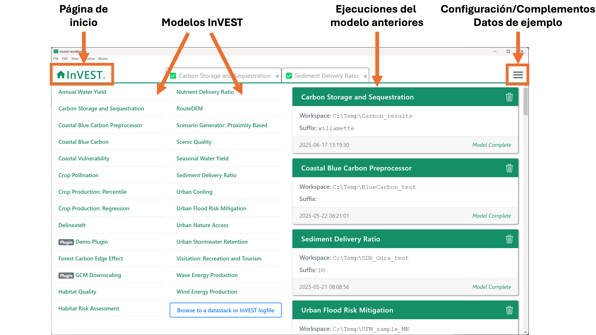
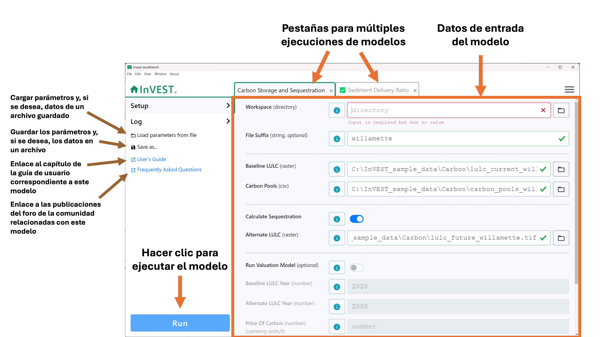
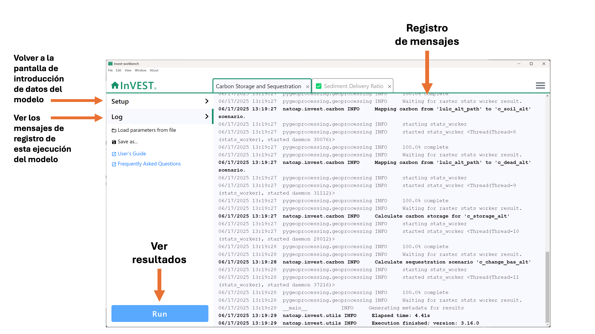
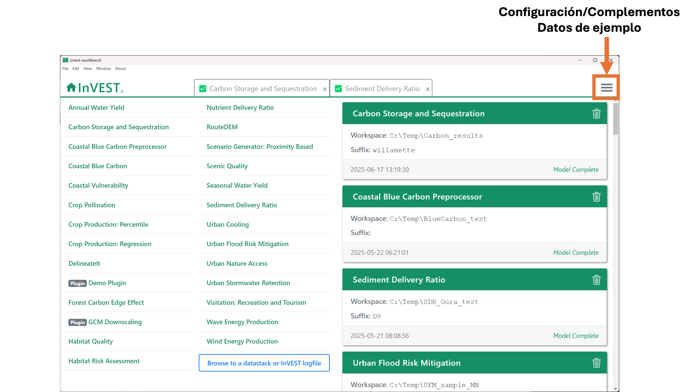

.. _getting-started:

**************
Primeros pasos
**************

Tutorial rápido de InVEST
=========================

Este tutorial de alto nivel ofrece una idea de las principales actividades que implica realizar un análisis de servicios ecosistémicos utilizando InVEST. No es un recurso técnico exhaustivo ni una guía paso a paso, pero sí proporciona pasos, consejos y una idea general del tiempo necesario para ejecutar un modelo de InVEST. Aunque los requisitos de tiempo varían considerablemente de un proyecto a otro, se ofrece una estimación general para cada paso: *Bajo* = generalmente requiere menos de un día; *Medio* = menos de una semana; *Alto* = una semana o más.

1. **Instalar InVEST Workbench**
   - Descargar InVEST Workbench e instalarlo según se detalla en las secciones :ref:`installing-on-win` o :ref:`installing-on-mac` de este capítulo.
   - También se recomienda instalar los datos de muestra. En InVEST Workbench, los datos de muestra pueden descargarse desde la ventana Configuración, haciendo clic en el icono de engranaje situado en la esquina superior derecha de la interfaz. Los enlaces a los datos de muestra también están disponibles en `la página web de InVEST <https://naturalcapitalalliance.stanford.edu/software/invest>`_. Consulte la sección :ref:`using-sample-data` de este capítulo para obtener más información.
   - Tiempo necesario para instalar InVEST: Bajo.
2. **Leer el capítulo de la Guía del usuario correspondiente a cada modelo de interés**
   - Para cada modelo, la Guía del usuario contiene información de contexto, ecuaciones, requisitos de datos, descripciones de resultados y recomendaciones sobre fuentes y métodos de datos globales.
   - Este es el primer lugar al que debe acudir si tiene preguntas sobre los modelos y sus requisitos de datos.
   - Tiempo necesario para leer un capítulo de modelo: Bajo.
3. **Examinar los datos de muestra del modelo**
   - Se proporcionan datos de muestra para todos los modelos, disponibles para su instalación desde Configuración de Workbench o para su descarga desde `la página web de InVEST <https://naturalcapitalalliance.stanford.edu/software/invest>`_.
   - Examine los datos espaciales mediante un programa SIG y los datos tabulares con una hoja de cálculo o un editor de texto.
   - Utilice estos datos para familiarizarse con las entradas y salidas y para ejecutar el modelo.
   - Utilícelos como ejemplo del formato que deben tener sus propios datos.
   - Consulte la sección :ref:`using-sample-data` de este capítulo para obtener más información.
   - Tiempo necesario para probar un modelo con datos de muestra: Bajo.
4. **Crear sus propios datos para el caso de referencia**
   - Recopile las entradas espaciales y no espaciales que requiere el modelo.
   - Procese los datos recopilados para su área de interés, de modo que cada entrada cumpla los requisitos de InVEST.
   - La mayor parte de este procesamiento se realizará con programas SIG.
   - Muchos modelos también requieren una búsqueda bibliográfica exhaustiva para determinados parámetros.
   - Consulte el capítulo de la Guía del usuario correspondiente al modelo y los datos de muestra para conocer los requisitos y ver ejemplos de cómo deben ser los conjuntos de datos.
   - Consulte también la sección :ref:`formatting-data` de este capítulo para obtener consejos generales.
   - La cantidad de procesamiento variará considerablemente según la entrada específica del modelo y el formato de la fuente original.
   - Es mejor buscar fuentes de datos más locales; si no están disponibles, generalmente se pueden utilizar capas y valores globales de menor resolución. El apéndice de la Guía del usuario de cada modelo ofrece indicaciones sobre algunas fuentes de datos globales.
   - Tiempo necesario para crear los datos de un modelo: Alto.
5. **Crear escenarios futuros**
   - El análisis de escenarios es opcional, aunque se realiza con frecuencia.
   - Los escenarios suelen basarse en la modificación del uso/cobertura del suelo, los hábitats o las prácticas de manejo del territorio para reflejar los impactos de una intervención propuesta o del cambio climático.
   - La creación de escenarios puede llevar mucho tiempo, por ejemplo, si se utiliza un proceso participativo con actores interesados o si se requiere modelar el clima.
   - Tiempo necesario para crear escenarios: de Medio a Alto.
6. **Ejecutar el modelo**
   - Utilice la interfaz de InVEST Workbench o scripts de línea de comandos para ejecutar el modelo con sus datos.
   - Asigne tiempo suficiente a este paso, por si necesita solucionar errores.
   - Consulte la sección :ref:`running-models` de este capítulo para obtener más información.
   - Tiempo necesario: de Bajo a Medio, según el tamaño y la complejidad de los datos de entrada y el modelo que se ejecute. Se requiere más tiempo cuando se utilizan datos de alta resolución y/o áreas de interés extensas.
7. **Examinar los resultados del modelo**
   - Examine críticamente los resultados mediante un programa SIG: ¿los patrones y valores tienen sentido? ¿Por qué?
   - Los patrones inexplicados o los valores anormalmente altos o bajos pueden indicar problemas con los datos de entrada.
   - Asigne tiempo suficiente a este paso, por si los resultados no parecen correctos y necesita solucionar algún problema.
   - Tiempo necesario: de Bajo a Medio.
8. **Calibrar el modelo**
   - Es opcional y no necesariamente se requiere para un análisis exploratorio de alto nivel y/o cuando no se dispone de datos de campo para la validación.
   - Sin embargo, es importante realizar la calibración si se van a valorar los resultados del modelo.
   - Recopile y procese datos observados que correspondan a la salida del modelo de InVEST que le interesa. Por ejemplo, la carga de sedimentos medida en una estación de monitoreo situada en la entrada de un embalse.
   - Ajuste las entradas del modelo para lograr concordancia entre los resultados modelados y los datos observados.
   - La calibración puede acompañarse de un análisis de sensibilidad para determinar qué parámetros tienen mayor efecto sobre los resultados. Los parámetros más sensibles son buenos candidatos para realizar ajustes de calibración.
   - Consulte la sección :ref:`calibration_freshwater` de esta Guía para obtener más información.
   - Tiempo necesario: de Medio a Alto.
9. **Incorporar a los beneficiarios**
   - Vincule los resultados del modelo con las personas u otros tipos de beneficiarios. Aquí es donde se convierten en un *servicio* ecosistémico.
   - Recopile y preprocese datos sobre la ubicación de las personas, la infraestructura u otros beneficiarios de interés.
   - Combine los resultados del modelo InVEST con los datos de los beneficiarios, generalmente mediante un programa SIG.
   - Tiempo necesario: Medio.
10. **Valoración**
    - La valoración de los servicios ecosistémicos, ya sea monetaria o no monetaria, suele ser compleja y depende del contexto. También es opcional.
    - Recopile datos económicos relacionados con el servicio y el beneficiario que está analizando.
    - Calibre los resultados del modelo antes de utilizarlos para la valoración.
    - Tiempo necesario: de Medio a Alto.
11. **Comunicar los resultados**
    - Una vez que tenga los resultados de InVEST, elaborará mapas, tablas, gráficos, etc., según lo que necesite para comunicar los resultados a su público.
    - También puede realizar un posprocesamiento de los resultados. Por ejemplo, puede mostrar un mapa de áreas protegidas superpuesto a un mapa de resultados de InVEST; combinar varios mapas de servicios ecosistémicos en un mapa de «puntos críticos» de mayor provisión conjunta de servicios; o agregar los resultados dentro de un área de interés.
    - Recuerde elegir colores y símbolos que sean fáciles de leer para un público amplio, intuitivos de interpretar y que representen los resultados con precisión.
    - Tiempo necesario: de Bajo a Medio, según la complejidad de las necesidades del proyecto.

.. _installing-on-win:

Instalación de InVEST Workbench en una computadora con Windows
==============================================================

Descargue el instalador de InVEST Workbench desde https://naturalcapitalalliance.stanford.edu/software/invest. El archivo ejecutable se llamará "InVEST_<version>_workbench_win32_x64.exe". Haga doble clic en este archivo .exe para ejecutar el instalador.

La primera pantalla le pedirá que confirme el Acuerdo de licencia; haga clic en **I Agree** para continuar.

Aparecerá la pantalla Opciones de instalación. Puede elegir instalar InVEST solo para usted o para todos los usuarios. Haga clic en **Next**.

A continuación, elija la carpeta donde se instalará Workbench. Haga clic en **Install**.

Hay algunos elementos de particular interés en la carpeta de instalación de Workbench:

+ Una carpeta **resources/documentation**, que contiene la Guía del usuario de InVEST en formato HTML en inglés, español y chino.
+ Una carpeta **resources/invest**, que contiene el código Python compilado que conforma el conjunto de herramientas de InVEST.
+ **InVEST <version> Workbench.exe**, que es el ejecutable principal utilizado para iniciar Workbench.
+ **Uninstall InVEST <version> Workbench.exe**, que desinstala Workbench.

Además, se añadirá un acceso directo al menú de inicio de Windows, en *All Programs -> InVEST <version> Workbench*.

También hay datos de muestra disponibles para todos los modelos. Para instalarlos, inicie Workbench y vaya a **Settings** (el icono de engranaje de la esquina superior derecha) **-> Download Sample Data**.

Instalación avanzada
--------------------

El instalador de InVEST para Windows ofrece varias opciones de instalación para distintos casos de uso, incluida la instalación silenciosa. Entre las opciones se incluyen:

* ``/S``: instalación silenciosa.
* ``/D=<directory>``: directorio de instalación.
* ``/allusers``: instalar para todos los usuarios.
* ``/currentuser``: instalar solo para el usuario actual.
* ``/NCRC``: desactivar la comprobación CRC.

.. code-block:: text

    .\InVEST_<version>_x64_Setup.exe /?

.. _installing-on-mac:

Instalación de InVEST Workbench en una computadora Mac
=======================================================
.. note::
    En Mac OS 10.13 "High Sierra", se requiere InVEST 3.4.0 o una versión posterior.

    En Mac OS 11 "Big Sur", se requiere InVEST 3.9.0 o una versión posterior.

    Los resultados numéricos de los binarios para Mac pueden diferir ligeramente (por lo general, dentro de 1e-4) de los resultados de los binarios para Windows. Por este motivo, consideramos que los binarios de InVEST son «inestables», aunque deberían proporcionar resultados razonables. Como siempre, si algo parece no funcionar correctamente, comuníquelo en los foros: https://community.naturalcapitalalliance.org/

Descargue el archivo de imagen de disco de InVEST desde https://naturalcapitalalliance.stanford.edu/software/invest. El archivo se llamará "InVEST-<version>.dmg". Contiene una copia del ejecutable de InVEST. Tenga en cuenta que, desde la versión 3.9.0, la Guía del usuario y el archivo HISTORY.rst ya no se incluyen en la distribución para Mac; acceda a estos recursos en línea.

Para instalar:

  1. Haga clic con el botón derecho en el archivo ``InVEST-<version>.dmg`` que descargó y, en el menú contextual, seleccione *Open*.
  2. En el cuadro de diálogo que aparece, haga clic nuevamente en *Open*. Acepte los términos del acuerdo de licencia.
  3. Se abrirá la imagen de disco y se le indicará que arrastre la aplicación InVEST a la carpeta Applications. Este paso es esencial para que InVEST funcione correctamente.
  4. Vaya a la carpeta Applications y abra desde allí la aplicación InVEST.
  5. La primera vez que abra la aplicación InVEST, deberá hacer lo siguiente:
       a. Haga clic con el botón derecho en ``InVEST`` y, en el menú contextual, seleccione *Open*.
       b. En el cuadro de diálogo que aparece, haga clic en *Done*.
  6. Abra la aplicación Configuración del sistema de su Mac y, en la columna de la izquierda, seleccione "Privacy & Security".
  7. En el panel Privacy & Security, desplácese hacia abajo hasta la sección "Security". Debería aparecer un mensaje que indica que "InVEST <version> Workbench" se bloqueó para proteger su Mac. Haga clic en el botón "Run Anyway".
  8. En el cuadro de diálogo que aparece, haga clic en "Run Anyway". A continuación, se le solicitarán su nombre de usuario y contraseña. Cuando pulse "OK", se iniciará InVEST Workbench.
  9. En el cuadro de diálogo del lanzador, seleccione el modelo que desea ejecutar y haga clic en *Launch*.

También hay datos de muestra disponibles para todos los modelos. Para instalarlos, inicie Workbench y vaya a **Settings -> Download Sample Data**.

A diferencia del instalador para Windows, la distribución para Mac no incluye la Guía del usuario. Esta puede consultarse en línea en https://naturalcapitalalliance.stanford.edu/software/invest.

Interfaz de Workbench
=====================

Al iniciar Workbench, la primera pantalla que aparece muestra una lista de todos los modelos de InVEST. Haga clic en uno de los modelos para abrir la interfaz de entrada correspondiente. Si ya ha ejecutado algún modelo, cada ejecución aparecerá en una lista a la derecha de la pantalla. Haga clic en una de las ejecuciones para abrir una ventana que contiene las entradas y los mensajes de registro de esa ejecución.

En cualquier pantalla de Workbench, al hacer clic en el enlace InVEST de la «Pantalla de inicio» volverá a la primera pantalla o pantalla principal de Workbench. En todas las pantallas también aparece, en la esquina superior derecha, un icono con tres barras que proporciona las siguientes funciones:

+ **Manage Plugins**: añadir o eliminar complementos de terceros para Workbench. (Para obtener información sobre los complementos, consulte la `Guía para desarrolladores de complementos <https://invest.readthedocs.io/en/latest/plugins.html>`_).
+ **Download Sample Data**: seleccionar los modelos para los que desea descargar datos y, a continuación, hacer clic en el botón "**Download**". Consulte la sección :ref:`using-sample-data` de este capítulo para obtener más información.
+ **Configure Metadata**: añadir información opcional de contacto y licencia a los archivos de metadatos YML que se crean con cada salida del modelo InVEST.
+ **View Changelog**: consultar las novedades de esta versión de Workbench.
+ **Settings**: elegir el idioma de la interfaz (inglés, español o chino) y cambiar los parámetros relacionados con el registro y Taskgraph.

Al hacer clic en un modelo determinado, se abre una pestaña que muestra las entradas específicas de ese modelo.

Consulte la sección :ref:`running-models` de este capítulo para obtener más información sobre cómo añadir datos a la interfaz.

Esta pantalla también permite guardar los parámetros (y, opcionalmente, los datos) en un archivo mediante el enlace "**Save as...**". Hay tres opciones disponibles:

+ **Parameters only**: guarda un archivo JSON que incluye las rutas a los datos de entrada, pero no guarda los datos en sí. Puede utilizar la opción "**Load parameters from file**" para cargar este archivo en InVEST, o arrastrar y soltar el archivo JSON en la interfaz del modelo para restaurar los parámetros.

+ **Parameters and data**: guarda tanto los parámetros como los datos en un archivo comprimido (.tgz). Este archivo contiene el mismo archivo JSON que produce la opción "**Parameters only**", además de los datos. Puede utilizar la opción "**Load parameters from file**" para cargar este archivo en InVEST, o arrastrar y soltar el archivo .tgz en la interfaz del modelo para restaurar los parámetros. Esta opción resulta útil para copiar todos los datos necesarios para ejecutar un modelo en otra ubicación. Por ejemplo, puede enviar el archivo a un colega para que reproduzca su ejecución. Si publica una pregunta en el Foro de la comunidad para solicitar ayuda con un problema, es posible que le pidan los datos de entrada; esta es la forma preferida de empaquetar los datos y parámetros de entrada.

+ **Python script**: guarda los parámetros en un script de Python. Incluye las rutas a los datos de entrada, pero no los datos en sí. Al ejecutar el script de Python, se ejecutará el modelo con los parámetros indicados. Utilícelo como punto de partida para crear scripts por lotes.

Si tiene una pila de parámetros guardada (archivo .tgz = parámetros + datos) que desea cargar en Workbench, puede arrastrarla y soltarla en la interfaz o utilizar la opción "**Load parameters from file**" y seleccionar el archivo .tgz. Después de soltar el archivo .tgz en la interfaz o seleccionarlo mediante la opción "**Load parameters from file**", aparecerá una ventana denominada "**Choose location to extract archive**". En el campo "**File name**", escriba el nombre de una carpeta nueva, que será donde se extraerá el contenido del archivo .tgz. Tenga en cuenta que actualmente no es posible seleccionar una carpeta que ya exista: debe crear una nueva utilizando únicamente el campo "**File name**".

El enlace "**User's Guide**" lleva al capítulo de la Guía del usuario correspondiente a ese modelo. El enlace "**Frequently Asked Questions**" lleva al Foro de la comunidad de Natural Capital Alliance (https://community.naturalcapitalalliance.org/) y muestra las publicaciones relacionadas con ese modelo.

Una vez que haya completado todos los datos de entrada obligatorios, haga clic en "**Run**" para ejecutar el modelo. Aparecerá una pantalla de registro.

Aparecerán numerosos mensajes de registro y, por lo general, no necesita preocuparse por ellos, a menos que el modelo no se ejecute. Si el modelo falla, revise los mensajes para encontrar algún error que pueda ayudar a explicar qué salió mal. Si el modelo se ejecuta correctamente, puede hacer clic en "**Open Workspace**" para ver los resultados. Para volver a la pantalla de entrada del modelo, haga clic en "**Setup**".

.. _using-sample-data:

Uso de los datos de muestra
===========================

InVEST incluye datos de muestra que sirven de guía para dar formato a sus datos y empezar a comprender cómo funcionan los modelos. Antes de iniciar su propio análisis, recomendamos encarecidamente descargar los datos de muestra de los modelos que le interesen, examinar las entradas en un SIG, ejecutar el modelo con esos datos y revisar las salidas en un SIG.

En InVEST Workbench, los datos de muestra pueden descargarse haciendo clic en el icono de tres barras situado en la esquina superior derecha de la interfaz y seleccionando **Download Sample Data**.

Los enlaces a los datos de muestra también están disponibles en `la página web de InVEST <https://naturalcapitalalliance.stanford.edu/software/invest>`_.

La carpeta de datos de muestra de cada modelo contiene un archivo .json que puede utilizarse para completar automáticamente la mayoría de las entradas del modelo. Para ello, arrastre y suelte el archivo .json en la pantalla de entrada del modelo en Workbench, o utilice la interfaz "Load parameters from file" para buscar el archivo .json.

En la mayoría de los modelos, es importante que los datos de muestra se utilicen únicamente para pruebas y como ejemplo. No utilice los datos espaciales ni los valores de las tablas en su propio análisis, porque su fuente y precisión no están documentadas. Algunos modelos marinos (como Vulnerabilidad costera) incluyen conjuntos de datos globales que pueden utilizarse en sus propias aplicaciones. Consulte los capítulos correspondientes de la Guía del usuario para obtener más información.

Para probar los modelos, puede crear una carpeta Workspace denominada "output" dentro de las carpetas de datos de muestra para guardar los resultados, o utilizar la estructura de organización de datos que le resulte más conveniente. Cuando comience a trabajar con sus propios datos, deberá crear un espacio de trabajo y carpetas de datos de entrada para almacenar sus entradas y resultados. También tendrá que redirigir la herramienta para que acceda a sus datos y a su espacio de trabajo.

.. _formatting-data:

Formato de los datos
====================

Antes de ejecutar InVEST, es necesario dar formato a los datos. Aunque los capítulos siguientes de esta guía describen cómo preparar los datos de entrada de cada modelo, existen varias pautas de formato comunes a todos los modelos:

+ Los nombres de los archivos de datos no deben contener espacios (por ejemplo, un archivo ráster debería llamarse 'landuse.tif' en lugar de 'land use.tif').

+ Para los datos ráster, se prefieren los archivos TIFF por su facilidad de uso, aunque también pueden utilizarse IMG o ESRI GRID.

+ Si utiliza rásteres en formato ESRI GRID, los nombres de sus conjuntos de datos no pueden tener más de 13 caracteres y el primer carácter no puede ser un número. Los rásteres TIFF e IMG no tienen esta limitación en la longitud del nombre del archivo. Al utilizar ESRI GRID como entrada en la interfaz del modelo, use el archivo "hdr.adf".

+ En la mayoría de los modelos de InVEST, los datos espaciales deben estar en un sistema de coordenadas proyectadas (como UTM, con unidades de distancia en metros), *no* en un sistema de coordenadas geográficas (como WGS84, con unidades de distancia en grados), y todos los datos de entrada de una misma ejecución del modelo deben utilizar el mismo sistema de coordenadas proyectadas. Si sus datos no están proyectados, InVEST generará errores o resultados incorrectos. (Hay excepciones, como el modelo de Vulnerabilidad costera; consulte el capítulo de la Guía del usuario correspondiente para conocer los requisitos específicos).

+ Todos los rásteres que se utilicen como entrada de los modelos InVEST deben tener asignado un valor numérico para el valor *NoData* del ráster. Este valor *NoData* no debe considerarse un dato válido para el modelo. Por ejemplo, el ráster de uso/cobertura del suelo puede tener códigos válidos del 1 al 30, por lo que podría elegir 9999 como valor *NoData*. El valor "nan" NO es un valor NoData válido y provocará un error al ejecutar los modelos. Puede comprobar el valor *NoData* consultando las Propiedades del ráster en un SIG.

+ Aunque los modelos de InVEST 3.0 son ahora muy eficientes en el uso de memoria, el tiempo de ejecución sigue dependiendo del tamaño de los conjuntos de datos de entrada. Si el área de interés es extensa y/o utiliza rásteres con celdas pequeñas, aumentarán tanto el uso de memoria como el tiempo necesario para ejecutar el modelo. Si los conjuntos de datos son demasiado grandes, se producirá un error de memoria. Si esto ocurre, intente reducir el tamaño del área de interés o utilizar datos de entrada de menor resolución.

+ De manera similar, la cantidad de espacio en disco que utiliza el modelo es proporcional a la resolución de los datos de entrada. Si el área de interés es extensa y/o utiliza rásteres con celdas pequeñas, aumentará el espacio en disco necesario para almacenar los resultados intermedios y finales del modelo. Si no hay suficiente espacio en disco, el modelo devolverá un error.

+ Ejecutar los modelos mientras los archivos de datos de entrada están abiertos en otro programa puede provocar errores. Asegúrese de que los archivos de datos no estén siendo utilizados por otro programa para evitar problemas de acceso.

+ Se recomienda almacenar las entradas y salidas del modelo en un disco duro local, no en un servicio de almacenamiento en la nube. Ejecutar los modelos con archivos de entrada a los que se accede en línea (y no desde una unidad local) puede provocar errores.

+ **Opciones regionales y de idioma:** algunos ajustes de idioma pueden provocar errores al ejecutar los modelos. Por ejemplo, los ajustes que utilizan una coma (,) como separador decimal en lugar de un punto (.) causan errores. Para solucionarlo, cambie la configuración regional de la computadora a inglés.

+ Durante la ejecución de los modelos puede ser necesario cambiar valores de las tablas de entrada. Esto suele hacerse con un programa de hojas de cálculo como Excel o un editor de texto como Notepad++. Las tablas de entrada deben estar en formato CSV. Si trabaja en Excel, asegúrese de guardar el archivo como CSV. Al guardar el archivo CSV, utilice una de las siguientes codificaciones: ASCII, UTF-8 o Signed UTF-8. Cualquier otra codificación (como Latin-1) provocará una visualización incorrecta del texto en los archivos de salida y podría hacer que los modelos fallen con un error.

+ Algunos modelos requieren pautas específicas para nombrar los archivos de datos (por ejemplo, el modelo de Calidad del hábitat) y los campos (nombres de columnas), que se definen en el capítulo de la Guía del usuario correspondiente a cada modelo. Sígalas cuidadosamente para asegurarse de que su conjunto de datos sea válido; de lo contrario, el modelo generará un error.

+ Recuerde *utilizar los conjuntos de datos de muestra como guía para dar formato a sus datos*.

.. _running-models:

Ejecución de los modelos
========================

Está listo para ejecutar un modelo de InVEST cuando haya preparado sus datos de acuerdo con las instrucciones del capítulo correspondiente y haya instalado la versión más reciente de InVEST.

Para comenzar:

+ Revise sus datos de entrada. Examine los datos espaciales en un SIG y asegúrese de que los valores sean correctos, de que no haya áreas sin datos donde deberían existir, de que todas las capas utilicen el mismo sistema de coordenadas proyectadas, etc. Examine los datos tabulares en una hoja de cálculo o en un editor de texto y asegúrese de que los valores sean correctos, los nombres de las columnas sean adecuados y el archivo esté guardado en formato CSV.

+ Inicie el modelo que desea ejecutar (por ejemplo, Carbono) y añada los datos de entrada en cada campo de la interfaz de usuario. Puede arrastrar y soltar las capas en el campo o hacer clic en el icono de archivo situado a la derecha de cada campo para buscar los datos.

+ Las entradas cuya ruta conduce a un archivo inexistente o a un archivo con formato incorrecto se marcarán con una "X" roja a la derecha del nombre de la entrada, y el cuadro de entrada aparecerá delineado en rojo. Debajo de la entrada se mostrará una breve descripción del problema. Por ejemplo, "Input is required but has no value" significa que la entrada es obligatoria, pero todavía no ha proporcionado información válida. El modelo no se ejecutará si hay alguna X roja.

+ Tenga en cuenta que cada herramienta dispone de un campo para introducir un sufijo (*Suffix*), es decir, una cadena de texto que se añadirá a los nombres de los archivos de salida como *<filename>_Suffix*. Añadir un sufijo único evita sobrescribir archivos generados en iteraciones anteriores. Esto resulta especialmente útil si ejecuta varios escenarios, ya que cada nombre de archivo puede indicar el escenario correspondiente.

+ Cuando haya completado todos los campos obligatorios y no aparezcan X rojas, haga clic en el botón **Run** de la interfaz.

+ El tiempo de procesamiento variará según el script, la resolución y la extensión de los conjuntos de datos de entrada. Cada modelo abrirá una ventana que muestra el progreso del script. Revise los mensajes de salida para identificar información útil y posibles errores. Esta información de progreso también se escribirá en un archivo del espacio de trabajo denominado *InVEST-natcap.invest.<model name>-log-<timestamp>.txt*. Si necesita ponerse en contacto con NatCap para solicitar ayuda con errores, envíe siempre este archivo de registro, ya que facilitará la depuración. Consulte también la sección :ref:`support-and-error-reporting` de este capítulo para obtener más información.

+ Los resultados del modelo se encuentran en la carpeta **Workspace**. Las salidas principales suelen estar en el nivel superior del espacio de trabajo. También hay una carpeta 'intermediate' que contiene algunos de los archivos adicionales generados durante los cálculos. Aunque normalmente no es necesario examinar los resultados intermedios, a veces resulta útil hacerlo cuando se intenta depurar un problema o comprender mejor cómo funciona el modelo. Leer el capítulo correspondiente del modelo y examinar los archivos intermedios puede ser una buena manera de comprender y evaluar críticamente los resultados. Cada capítulo de modelo de esta Guía del usuario describe estos archivos de salida.

Una vez que el script se haya ejecutado correctamente, podrá visualizar los resultados espaciales añadiéndolos a su SIG desde el espacio de trabajo. Es importante examinar los resultados con atención y sentido crítico. ¿Los valores tienen sentido? ¿Los patrones tienen sentido? ¿Comprende por qué algunos lugares presentan valores más altos y otros más bajos? ¿Cómo influyen las capas y los parámetros de entrada en los resultados? Si tiene dudas sobre los resultados y desea consultar el foro de usuarios, revise primero estas preguntas. Muy a menudo, los valores inesperadamente altos o bajos, o las áreas sin datos, pueden explicarse fácilmente al revisar las unidades, los valores o los datos faltantes en las capas de entrada.

Metadatos
=========

Los resultados de los modelos de InVEST también incluyen documentos de **metadatos** que describen cada conjunto de datos del espacio de trabajo de salida. Se trata de los archivos auxiliares *".yml"*, o YAML, que se encuentran en el espacio de trabajo de salida. Cada archivo de metadatos tiene el mismo nombre que el conjunto de datos que describe, más la extensión *".yml"*. Abra un archivo YAML en un editor de texto para leer los metadatos o incluso añadir información. Los metadatos incluyen gran parte de la misma información que aparece en la sección *Interpretación de los resultados* del capítulo de la Guía del usuario correspondiente al modelo. Esto incluye descripciones de los campos de las tablas, de las bandas de un ráster y otra información útil. Si tiene previsto compartir sus resultados de InVEST con otras personas, recomendamos encarecidamente compartir también los documentos de metadatos.

Algunas propiedades de los metadatos pueden configurarse desde el cuadro de diálogo *Settings* de Workbench. Puede guardar información sobre el autor de los datos (usted) y sobre la licencia de los datos. Estos detalles se incluyen en todos los documentos de metadatos creados por InVEST y GeoMetaMaker. Esta información es opcional, nunca sale de su computadora a menos que comparta sus datos y metadatos, y puede modificarla en Workbench en cualquier momento.

GeoMetaMaker es una biblioteca de Python que facilita la creación de metadatos para flujos de trabajo de datos geoespaciales.
https://github.com/natcap/geometamaker

Habilidades en SIG
==================

**Se requieren habilidades intermedias en sistemas de información geográfica (SIG) para muchos pasos de los análisis de InVEST, especialmente al crear los datos de entrada de los modelos y trabajar con sus resultados.**

Esta Guía del usuario supone que usted cuenta con las habilidades SIG necesarias; por lo general, no ofrece instrucciones sobre cómo visualizar o procesar datos mediante programas SIG. Puede utilizar cualquier software geoespacial con el que se sienta cómodo; QGIS y ArcGIS son los más comunes. Existen numerosos cursos y tutoriales para aprender a utilizar los SIG y sus programas, y recomendamos familiarizarse con estos conceptos y herramientas antes de comenzar a trabajar con InVEST.

A continuación se presentan algunos ejemplos de las tareas SIG que suelen formar parte de un análisis de InVEST. Esta no es una lista exhaustiva:

+ Visualizar y navegar por datos ráster, vectoriales y tabulares.

+ Simbolizar datos ráster y vectoriales.

+ Reproyectar capas de datos a un sistema de coordenadas común.

+ Recortar capas de datos a un área de interés.

+ Convertir datos vectoriales a ráster y datos ráster a vectoriales.

+ Crear nuevas capas de puntos, líneas o polígonos.

+ Editar tablas de atributos vectoriales.

+ Realizar distintos tipos de operaciones matemáticas con rásteres.

+ Reclasificar valores ráster.

+ Remuestrear rásteres.

Consulte también la sección :ref:`working-with-the-DEM` de este capítulo, que ofrece algunos detalles sobre el procesamiento SIG de modelos digitales de elevación (MDE) para utilizarlos en los modelos SDR, NDR, Rendimiento hídrico estacional, Calidad escénica y Vulnerabilidad costera.

.. _support-and-error-reporting:

Asistencia y notificación de errores
====================================

Si encuentra algún problema al ejecutar los modelos o tiene preguntas sobre su teoría, sus datos o su aplicación que no estén cubiertas por la Guía del usuario, visite el foro de asistencia a usuarios en https://community.naturalcapitalalliance.org/. *Primero, utilice la función de búsqueda para comprobar si ya se ha planteado una pregunta similar. Muchas veces, su pregunta o problema ya ha sido respondido.* Esto es especialmente cierto para los mensajes de error: puede buscar algunas palabras clave del mensaje y, a menudo, encontrará publicaciones que le ayudarán a solucionar el problema.

Si no encuentra publicaciones relacionadas con su pregunta o problema, o si no resuelven su inconveniente, puede iniciar sesión y crear una nueva publicación.

Si informa de un error al ejecutar un modelo, incluya la siguiente información en la publicación del foro:

+ El modelo de InVEST sobre el que consulta.

+ La versión de InVEST que está utilizando.

+ Lo que ya ha intentado para resolver el problema y no ha funcionado.

+ El archivo de registro completo generado por el modelo, ubicado en la carpeta Workspace de salida: *InVEST-natcap.invest.<model name>-log-<timestamp>.txt*.

Capacitación
------------

Cada año pueden ofrecerse varios talleres de capacitación sobre InVEST, sujetos a la disponibilidad de fondos y a la demanda. La información sobre estas capacitaciones se anunciará en la página de asistencia y podrá consultarse en el `sitio web de Natural Capital Alliance <https://naturalcapitalalliance.stanford.edu/>`_. Este sitio también es una buena fuente de información general sobre InVEST, publicaciones y casos de aplicación relacionados, y otras actividades de Natural Capital Alliance.

Está disponible un curso en línea masivo y abierto (MOOC) gratuito `en inglés <https://www.edx.org/course/introduction-to-the-natural-capital-project-approach/>`_ y `en español <https://www.edx.org/course/una-introduccion-al-enfoque-de-capital-natural-ver-2/>`_, que ofrece:

- Una introducción a los métodos de Natural Capital Alliance.

- Una introducción a InVEST.

- Presentaciones detalladas de los modelos SDR, Vulnerabilidad costera y Enfriamiento urbano (aunque todos están desactualizados debido a las actualizaciones recientes de estos modelos).

- Visiones generales de otros temas relacionados con el análisis de servicios ecosistémicos, incluidos los escenarios, los beneficiarios y las fuentes de datos.

- Varios estudios de caso.

También hay una `lista de reproducción de YouTube <https://www.youtube.com/playlist?list=PLSFk2iLV3UfNqRZGwfcgyoZZZqZDnj2V7/>`_ con tutoriales de capacitación en video, entre ellos:

- Serie de verano: Introducción a InVEST (breve introducción a InVEST, SDR, Vulnerabilidad costera y comunicación de resultados).

- Serie de verano: Calidad del agua dulce (se presentan con más detalle NDR y SDR).

- Serie de verano: InVEST urbano (se presenta con más detalle Enfriamiento urbano).

- Introducción a: Producción de pastizales.

- Introducción a: Calidad del hábitat.

- Introducción a: Almacenamiento de carbono.

- Introducción a: Rendimiento hídrico estacional.

- Introducción a: Mitigación del riesgo de inundación urbana.

También contamos con una `serie de videos sobre SIG para InVEST <https://naturalcapitalalliance.stanford.edu/software/virtual-training/gis-invest>`_ que ofrece instrucciones prácticas sobre algunas de las tareas SIG necesarias para trabajar con los modelos InVEST. Los materiales están disponibles tanto para QGIS como para ArcGIS.

Versiones anteriores de InVEST
==============================

Las versiones anteriores de InVEST pueden encontrarse en http://data.naturalcapitalalliance.org/invest-releases/deprecated_models.html. Tenga en cuenta que muchos modelos quedaron obsoletos debido a problemas científicos críticos aún no resueltos, por lo que recomendamos encarecidamente utilizar la versión más reciente de InVEST.

.. _working-with-the-DEM:

Trabajo con el MDE
==================

Para los modelos de agua dulce SDR, NDR y Rendimiento hídrico estacional, es fundamental disponer de un modelo digital de elevación (MDE) bien preparado. No debe contener datos faltantes (huecos con valores NoData) y debe representar correctamente los patrones de flujo de agua superficial en el área de interés para obtener resultados precisos.

Utilice el MDE de mayor calidad y resolución más fina que sea adecuado para su aplicación. Esto reducirá la probabilidad de que existan depresiones y datos faltantes, y representará con mayor precisión el flujo de agua superficial del terreno, proporcionando el nivel de detalle necesario para tomar decisiones informadas a la escala de interés.

Aunque cada fuente de MDE es diferente, al igual que la extensión de cada área de estudio y los requisitos de cada proyecto, hay varios pasos generales que normalmente deben realizarse para preparar un MDE para ejecutarlo en un modelo InVEST. Cada uno de estos pasos se describe a continuación, incluida información sobre el uso de funciones integradas de ArcGIS y QGIS. También existen otras opciones para procesar MDE, como ArcHydro, ArcSWAT, AGWA y BASINS, que no se abordan aquí. Esto pretende ser únicamente una breve descripción general de los problemas y métodos relacionados con la preparación de MDE, no un tutorial de SIG.

1. **Unir en mosaico los datos de MDE originales divididos en teselas**

   Si ha descargado datos de MDE para su área que se encuentran en varias teselas adyacentes, primero deberá unirlas en un mosaico para crear un único ráster MDE. En ArcToolbox, utilice Data Management Tools -> Raster -> Raster Dataset -> Mosaic to New Raster. Examine detenidamente el ráster de salida para asegurarse de que los valores sean correctos en los bordes donde se unieron las teselas. Si no lo son, pruebe distintos valores para el parámetro Mosaic Method de la herramienta Mosaic to New Raster.

   En QGIS, puede utilizar la función Raster -> Miscellaneous -> Merge para combinar las teselas.

2. **Reproyectar al sistema de coordenadas del proyecto**

   Al reproyectar un MDE en ArcGIS (herramienta Project Raster) o QGIS (herramienta Warp), es importante seleccionar BILINEAR o CUBIC para el parámetro "Resampling Technique" en ArcGIS o "Resampling method" en QGIS. Seleccionar NEAREST (o Near en QGIS) producirá un MDE con un patrón de cuadrícula incorrecto en el área de interés, que quizá solo sea evidente al acercar la imagen o después de ejecutar Flow Direction. Esto generará una red de drenaje y un patrón de flujo deficientes, y dará lugar a resultados incorrectos del modelo.

3. **Comprobar si hay datos faltantes**

   Examine detenidamente el ráster MDE para asegurarse de que no haya datos faltantes, representados por celdas NoData dentro del área de interés. Si hay celdas NoData, deben asignárseles valores.

   Para los huecos pequeños, una forma de hacerlo es utilizar la función Focal Mean de ArcGIS dentro de Raster Calculator (o Conditional -> CON). Por ejemplo, en ArcGIS 10.x::

       Con(IsNull("theDEM"),FocalStatistics("theDEM",NbrRectangle(3,3),"MEAN"),"theDEM")

   También puede utilizarse la interpolación, que puede funcionar mejor para huecos grandes. Convierta el MDE en puntos mediante Conversion Tools -> From Raster -> Raster to Point, interpole utilizando las herramientas de interpolación de Spatial Analyst y, a continuación, utilice CON para asignar los valores interpolados al MDE original::

       Con(isnull([theDEM]), [interpolated_grid], [theDEM])

   En QGIS, pruebe la herramienta Fill Nodata o la herramienta GRASS r.neighbors. r.neighbors ofrece distintos tipos de estadísticas, incluida la media.

4. **Identificar y rellenar las depresiones del MDE**

   Este paso casi siempre es necesario.

   Según la ayuda de ESRI sobre «How Sink works»: «Una depresión es una celda o un conjunto de celdas conectadas espacialmente cuya dirección del flujo no puede asignarse a uno de los ocho valores válidos de un ráster de dirección del flujo. Esto puede ocurrir cuando todas las celdas vecinas están a mayor altura que la celda procesada o cuando dos celdas fluyen una hacia la otra y crean un bucle de dos celdas».

   Las depresiones suelen deberse a errores en el MDE y pueden producir un ráster de dirección del flujo incorrecto. Esto puede ocasionar varios problemas durante el procesamiento hidrológico, incluida la creación de una red de drenaje discontinua. El relleno de las depresiones asigna nuevos valores a las celdas anómalas que se procesan, de modo que queden mejor alineadas con sus vecinas. Sin embargo, este proceso puede crear nuevas depresiones, por lo que podría ser necesario realizarlo de manera iterativa.

   Hemos comprobado que la herramienta Wang and Liu Fill de QGIS rellena bien las depresiones y la recomendamos incluso a quienes utilizan ArcGIS. También puede utilizar ArcGIS mediante la herramienta Hydrology -> Fill. Es posible que se necesiten varias ejecuciones de Fill.

5. **Verificar la red de drenaje**

   En este punto, el MDE debería estar listo para ser probado. Lo principal que debe comprobarse es qué tan bien se generan los cursos de agua; por tanto, necesitará un mapa de cursos de agua reales para compararlo. Puede ser geoespacial o no, siempre que permita realizar una comparación visual.

   La red de drenaje generada por el modelo a partir del MDE debería coincidir estrechamente con los cursos de agua de un mapa cuya precisión se conozca. Varios modelos hidrológicos de InVEST y la herramienta de apoyo RouteDEM generan una red de drenaje (generalmente denominada *stream.tif*). Estas herramientas crean los cursos de agua generando primero los rásteres de dirección y acumulación del flujo (que también debe revisar como parte de este paso) y, a continuación, aplicando el valor de entrada del usuario para la «acumulación de flujo umbral» (TFA), con el fin de seleccionar los píxeles que deben formar parte de la red de drenaje. Por ejemplo, si se proporciona un valor TFA de 1000, deben drenar 1000 píxeles hacia un píxel determinado para que este se considere parte de un curso de agua. Esto equivale a decir que los cursos de agua se definen por tener un valor de acumulación de flujo >= 1000.

   Utilice estas salidas *stream.tif* para evaluar qué tan bien coinciden los cursos de agua modelados con la realidad y ajuste en consecuencia la acumulación de flujo umbral. Los valores más altos de TFA producirán redes de drenaje más gruesas, con menos afluentes; los valores más bajos producirán más afluentes. No existe un valor TFA «correcto» único: será diferente para cada área de interés y cada MDE. Un buen valor inicial para las pruebas es 1000. Al comparar *stream.tif* con un mapa de cursos de agua reales, compruebe que la densidad de afluentes sea adecuada y asegúrese de que los cursos de agua de *stream.tif* sean continuos, y no tramos desconectados o píxeles individuales. Tenga en cuenta que los cursos de agua modelados rara vez, si acaso, coinciden exactamente con la realidad; por tanto, no se busca la perfección, sino una aproximación razonable. Si los cursos de agua modelados son discontinuos, intente ejecutar nuevamente Fill en el MDE y asegúrese de haber utilizado el método de remuestreo BILINEAR o CUBIC al reproyectarlo. Si un MDE no genera cursos de agua continuos, independientemente de lo que intente, recomendamos probar otra fuente de datos de elevación. Existen varias fuentes disponibles a escala mundial y su rendimiento varía según la región.

   Para crear mapas de acumulación de flujo y de cursos de agua sin tener que ejecutar un modelo hidrológico completo, puede utilizar la herramienta RouteDEM de InVEST, diseñada específicamente para procesar el MDE. Consulte la :ref:`página de RouteDEM <routedem>` para obtener más información.

6. **Crear cuencas hidrográficas**

   Se recomienda crear las cuencas hidrográficas a partir del MDE que se utilizará en el análisis. Si se obtiene de otra fuente una capa vectorial de cuencas, es posible que sus límites no coincidan correctamente con la hidrología generada a partir del MDE utilizado para el modelado, lo que puede producir resultados agregados incorrectos.

   Existen diversas herramientas para crear cuencas hidrográficas, entre ellas la herramienta Watershed de ArcGIS y Watershed basins o r.basins.fill de QGIS. InVEST también proporciona una herramienta denominada DelineateIt, que funciona bien, es sencilla de utilizar y se recomienda. Tiene la ventaja de poder crear cuencas superpuestas, por ejemplo, cuando hay varias represas a lo largo del mismo río. Consulte la :ref:`página de DelineateIt <delineateit>` para obtener más información.

   Una vez generadas las cuencas, verifique que representen correctamente las áreas de drenaje y que cada cuenca tenga asignado un identificador entero único en el campo "ws_id" (o "subws_id", según el modelo; consulte la sección Necesidades de datos del modelo hidrológico que esté utilizando para conocer los requisitos).

7. **Recortar el MDE al área de estudio**

   Por lo general, recomendamos recortar el MDE a un área ligeramente mayor que el área de interés (que suele ser una cuenca hidrográfica). Esto permite asegurar que se capture la hidrología alrededor del borde de la cuenca. Es especialmente importante si el MDE (y/o los demás datos de entrada del modelo) tiene una resolución gruesa, ya que recortarlo al polígono de la cuenca producirá grandes áreas sin datos alrededor del borde. Para hacerlo, cree un área de influencia alrededor del polígono de la cuenca y recorte el MDE a ese polígono ampliado. Asegúrese de que el área de influencia tenga al menos el ancho del tamaño de celda de la entrada más gruesa del modelo. Por ejemplo, si los datos de precipitación son los más gruesos y tienen una resolución de 1 km, cree un área de influencia alrededor del polígono de la cuenca de al menos 1 km de ancho y utilice esa cuenca ampliada para recortar todas las entradas del modelo, incluido el MDE. A continuación, utilice la cuenca sin ampliar como entrada del modelo.

