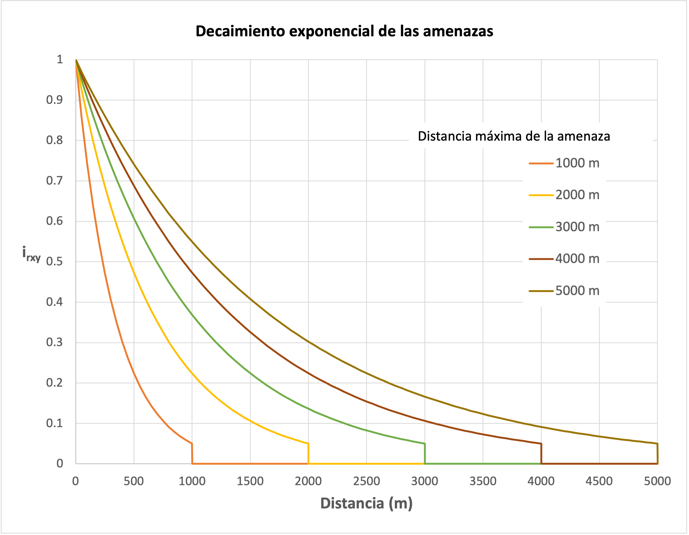

.. _habitat_quality:

*******************
Calidad del hábitat
*******************

Resumen
=======

La biodiversidad está estrechamente vinculada con la producción de servicios ecosistémicos. Los patrones de biodiversidad son inherentemente espaciales y, por tanto, pueden estimarse mediante el análisis de mapas de uso y cobertura del suelo (LULC) junto con las amenazas al hábitat de las especies. Los modelos de InVEST utilizan la calidad y la rareza del hábitat como indicadores indirectos de la biodiversidad y, en última instancia, estiman la extensión de los tipos de hábitat y vegetación en un paisaje, así como su estado de degradación. La calidad y la rareza del hábitat son función de cuatro factores: el impacto relativo de cada amenaza, la sensibilidad relativa de cada tipo de hábitat a cada amenaza, la distancia entre los hábitats y las fuentes de amenazas, y el grado en que el territorio está protegido legalmente. El modelo supone que la protección legal del territorio es eficaz y que todas las amenazas a un paisaje son aditivas.

Introducción
============

Un objetivo fundamental de la conservación es proteger la biodiversidad, incluida la variedad de genes, especies, poblaciones, hábitats y ecosistemas de un área de interés. Aunque algunas personas consideran la biodiversidad un servicio ecosistémico, aquí la tratamos como un atributo independiente de los sistemas naturales, con valor intrínseco propio (en este modelo no asignamos un valor monetario a la biodiversidad). Los gestores de recursos naturales, las empresas y las organizaciones de conservación tienen cada vez más interés en comprender cómo y dónde coinciden espacialmente la biodiversidad y los servicios ecosistémicos, y cómo las acciones de manejo afectan a ambos.

Las evidencias procedentes de numerosas fuentes muestran un panorama abrumador de disminución generalizada de la biodiversidad en todo el mundo (por ejemplo, Vitousek et al., 1997; Wilcove et al., 1998; Czech et al., 2000). Estas evidencias han impulsado una respuesta amplia tanto de los gobiernos como de la sociedad civil. Mediante el Convenio sobre la Diversidad Biológica de Río, 189 países se han comprometido a preservar la biodiversidad dentro de sus fronteras. Sin embargo, existen pocas investigaciones sobre la coincidencia entre las oportunidades de proteger la biodiversidad y las de mantener los servicios ecosistémicos, tan importantes para el bienestar económico de estos países. Este es precisamente el tipo de desafío para el que se diseñó InVEST.

Para que los gestores comprendan los patrones de distribución y riqueza en un paisaje, tanto individualmente como en conjunto, es necesario cartografiar la distribución o presencia de sus elementos (por ejemplo, especies, comunidades y hábitats). También debe evaluarse en qué medida el uso y manejo actuales del suelo afectan la persistencia de estos elementos, con el fin de diseñar estrategias de conservación adecuadas y promover una gestión de los recursos que maximice la biodiversidad en esas áreas.

Existen diversos enfoques para identificar prioridades de conservación, cada uno con distintas compensaciones entre objetivos. Estos enfoques se centran en diferentes aspectos de los atributos y la dinámica de la biodiversidad, entre ellos la representación basada en hábitats o tipos de vegetación (es decir, un filtro grueso); la maximización del número de especies «cubiertas» por una red de sitios conservados para un presupuesto de conservación determinado (Ando et al., 1998); la identificación de patrones de riqueza y endemismo (áreas críticas de Conservation International); y la conservación de procesos ecológicos. También existe un enfoque híbrido de filtros gruesos y finos, que incorpora selectivamente elementos de «filtro fino», como especies con requerimientos de hábitat únicos que podrían no estar adecuadamente protegidas mediante un enfoque basado únicamente en filtros gruesos (planificación ecorregional de The Nature Conservancy y World Wildlife Fund). El modelo de Calidad del hábitat de InVEST es más pertinente para los enfoques de «filtro grueso» o basados en hábitats.

Las razones para modelar la biodiversidad junto con los servicios ecosistémicos son sencillas y poderosas. Esto permite comparar los patrones espaciales de la biodiversidad y de los servicios ecosistémicos, e identificar áreas donde ambos objetivos se benefician (es decir, áreas donde la conservación puede favorecer tanto los sistemas naturales como las economías humanas), así como áreas donde estos objetivos no están alineados. Además, permite analizar las compensaciones entre la biodiversidad y los servicios ecosistémicos en distintos escenarios de cambio futuro del uso del suelo. Los patrones de uso/cobertura del suelo (LULC) que generan una mayor producción de servicios ecosistémicos no siempre conducen a una mayor conservación de la biodiversidad (Nelson et al., 2008), y modelar hoy las opciones futuras puede ayudar a identificar y evitar esas compensaciones.

El modelo
=========

El modelo de Calidad del hábitat de InVEST combina información sobre el uso/cobertura del suelo (LULC) y las amenazas a la biodiversidad para producir mapas de calidad del hábitat. Este enfoque genera dos conjuntos principales de información útiles para realizar una evaluación inicial de las necesidades de conservación: la extensión relativa y la degradación de los distintos tipos de hábitat de una región, y los cambios a lo largo del tiempo. También permite evaluar rápidamente el estado y los cambios del hábitat como indicador indirecto de medidas más detalladas del estado de la biodiversidad. Si los cambios del hábitat se consideran representativos de los cambios genéticos, de especies o de ecosistemas, el usuario supone que las áreas con hábitats de alta calidad sostendrán mejor todos los niveles de biodiversidad y que la disminución de la extensión y calidad del hábitat a lo largo del tiempo implica una reducción de la persistencia, resiliencia, amplitud y profundidad de la biodiversidad en el área afectada.

La parte del modelo dedicada a la rareza del hábitat indica la extensión y el patrón de los tipos naturales de cobertura del suelo en el paisaje actual o en uno potencialmente futuro, en comparación con la extensión de esos mismos tipos naturales de cobertura del suelo durante algún período de referencia. Los mapas de rareza permiten a los usuarios crear un mapa de los hábitats más raros del paisaje en relación con el período de referencia elegido para representar la combinación de hábitats del paisaje que resulta más adecuada para la biodiversidad nativa del área de estudio.

El modelo requiere datos básicos disponibles prácticamente en cualquier lugar del mundo, por lo que resulta útil en áreas donde los datos sobre la distribución de las especies son escasos o inexistentes. En muchos lugares puede haber abundantes datos de presencia (presencia/ausencia) para las condiciones actuales. Sin embargo, a menudo es imposible o inviable modelar los cambios en la presencia, persistencia o vulnerabilidad de múltiples especies bajo condiciones futuras. Aunque un enfoque basado en hábitats deja de lado los datos detallados sobre la presencia actual de especies, varios de sus componentes representan avances funcionales respecto de muchas herramientas existentes de planificación de la conservación de la biodiversidad. El más importante es la capacidad de caracterizar la sensibilidad de los tipos de hábitat a distintas amenazas. No todos los hábitats se ven afectados de la misma manera por todas las amenazas, y el modelo InVEST considera esta variabilidad. Además, el modelo permite a los usuarios estimar el impacto relativo de una amenaza frente a otra, de modo que las amenazas más perjudiciales para la persistencia de la biodiversidad en el paisaje puedan representarse como tales. Por ejemplo, los pastizales podrían ser especialmente sensibles a las amenazas generadas por las áreas urbanas, pero moderadamente sensibles a las amenazas generadas por las carreteras. Asimismo, el modelo incorpora la distancia a la que una amenaza degrada los sistemas naturales.

La evaluación del paisaje actual realizada por el modelo puede utilizarse como entrada para una evaluación de filtro grueso de las necesidades y oportunidades actuales de conservación. La evaluación de posibles escenarios futuros de LULC puede utilizarse para medir los cambios potenciales en la extensión, calidad y rareza del hábitat en un paisaje, así como las necesidades y oportunidades de conservación en el futuro.

Cómo funciona
-------------

Calidad del hábitat
^^^^^^^^^^^^^^^^^^^

Definimos el hábitat como «los recursos y las condiciones presentes en un área que permiten la ocupación —incluidas la supervivencia y la reproducción— por parte de un organismo determinado» (Hall et al., 1997:175). La calidad del hábitat se refiere a la capacidad del ecosistema para proporcionar condiciones adecuadas para la persistencia de individuos y poblaciones, y se considera una variable continua en el modelo, que va de baja a media y alta, según los recursos disponibles para la supervivencia, la reproducción y la persistencia de las poblaciones, respectivamente (Hall et al., 1997). Un hábitat de alta calidad está relativamente intacto y presenta una estructura y función dentro del rango de variabilidad histórica. La calidad del hábitat depende de la proximidad del hábitat a los usos humanos del suelo y de la intensidad de estos usos. En general, la calidad del hábitat se degrada a medida que aumenta la intensidad del uso del suelo en las áreas cercanas (Nelleman, 2001; McKinney, 2002; Forman et al., 2003).

El modelo funciona con datos ráster, en los que cada celda se asigna a una clase LULC, que puede ser una clase natural (sin manejo) o una clase manejada. Los tipos de LULC pueden definirse con cualquier nivel de detalle de clasificación. Por ejemplo, la categoría general de LULC «pastizal» puede subdividirse en pasturas, praderas restauradas y céspedes residenciales para proporcionar mucho más detalle en la clasificación de los hábitats. Aunque el usuario puede proporcionar hasta tres mapas ráster de LULC, uno para cada período de referencia, actual y futuro, como mínimo debe proporcionar el mapa ráster de LULC actual.

El usuario define qué tipos de LULC pueden proporcionar hábitat para el objetivo de conservación (por ejemplo, si el objetivo de conservación son las aves forestales que se reproducen en bosques, los bosques son hábitat y las coberturas no forestales no lo son). Sea :math:`H_j` la idoneidad como hábitat del tipo de LULC :math:`j`.

¿Qué tipos de LULC deben considerarse hábitat? Si se considera la biodiversidad en general o si faltan datos sobre relaciones específicas entre biodiversidad y hábitat, puede utilizarse un enfoque binario sencillo para asignar la condición de hábitat a los tipos de LULC. Un ejemplo clásico sería seguir un modelo de isla-océano y suponer que la matriz de terrenos manejados que rodea los parches remanentes de terrenos sin manejo es inutilizable desde la perspectiva de las especies (por ejemplo, MacArthur y Wilson, 1967). En este caso, se asignaría un 0 a los tipos de LULC manejados de la matriz (es decir, no hábitat) y un 1 a los tipos sin manejo (es decir, hábitat). Bajo este esquema de modelado, las puntuaciones de calidad del hábitat no dependen de la importancia, rareza o idoneidad del hábitat; todos los tipos de hábitat reciben el mismo tratamiento. Se supone que las entradas del modelo no son específicas de ninguna especie o gremio de especies en particular, sino que se aplican a la biodiversidad en general.
Investigaciones más recientes sugieren que la matriz de terrenos manejados que rodea los parches de terrenos sin manejo puede influir considerablemente en el «aislamiento efectivo» de los parches de hábitat, haciendo que estén más o menos aislados de lo que indicarían los modelos clásicos o las simples mediciones de distancia (Ricketts, 2001; Prugh et al., 2008). La modificación de la matriz puede ofrecer oportunidades para reducir el aislamiento de los parches y, por tanto, el riesgo de extinción de las poblaciones en paisajes fragmentados (Franklin y Lindenmayer, 2009). Para modelar esto, puede asignarse a un tipo de LULC una puntuación relativa de idoneidad del hábitat entre 0 y 1, donde 1 indica la mayor idoneidad. Una clasificación inferior a 1 indica un hábitat en el que una especie o un grupo funcional puede tener una menor probabilidad de supervivencia. La aplicación de este segundo enfoque amplía considerablemente la definición de hábitat, desde el enfoque binario, sencillo y a menudo artificial (por ejemplo, «natural» frente a «no natural»), hasta incluir un amplio espectro de tipos de LULC tanto manejados como no manejados. Al utilizar un continuo de idoneidad del hábitat entre los tipos de LULC, el usuario puede evaluar de manera integral la importancia del manejo del uso del suelo para la calidad del hábitat o considerar la posible importancia de los paisajes «productivos» (o manejados).

Si resulta pertinente utilizar un continuo de idoneidad del hábitat, deben aplicarse ponderaciones a la lista de tipos de LULC de un paisaje en referencia a un gremio o grupo particular de especies. Por ejemplo, las aves canoras de pastizales pueden preferir por encima de todos los demás tipos de hábitat una pradera nativa (la puntuación de hábitat para la LULC pradera (:math:`H_{prarie}`) es igual a 1), pero también pueden utilizar un campo de heno o una pastura manejados si la pradera no está disponible (la puntuación de hábitat para la LULC campo de heno (:math:`H_{hayfield}`) y pastura (:math:`H_{pasture}`) es igual a 0,5). Sin embargo, los mamíferos, como los puercoespines, consideran que la pradera no es adecuada para la reproducción ni la alimentación. Por tanto, si se utilizan datos específicos sobre las relaciones entre grupos de especies y hábitats, los resultados del modelo se referirán a la extensión y calidad del hábitat para las especies o grupos incluidos en el conjunto modelado.

Además de un mapa de LULC y de datos que relacionen la LULC con la idoneidad del hábitat, el modelo también requiere datos sobre la densidad de las amenazas al hábitat y sus efectos sobre la calidad del hábitat. En general, consideramos amenazas los tipos de LULC modificados por los seres humanos que provocan fragmentación del hábitat, efectos de borde y degradación en los hábitats vecinos. Por ejemplo, la conversión de una LULC de hábitat en una LULC que no es hábitat reduce el tamaño y la continuidad de los parches de hábitat vecinos. Los efectos de borde se refieren a los cambios en las condiciones biológicas y físicas que se producen en el límite de un parche y dentro de los parches adyacentes. Por ejemplo, las parcelas vecinas de LULC degradadas que no constituyen hábitat imponen «efectos de borde» sobre las parcelas de hábitat y pueden tener impactos negativos dentro de ellas, al facilitar, por ejemplo, la entrada de depredadores, competidores, especies invasoras, sustancias químicas tóxicas y otros contaminantes. Otro ejemplo: en muchos países en desarrollo, las carreteras constituyen una amenaza para la calidad del hábitat forestal del paisaje porque facilitan el acceso a quienes extraen madera y productos forestales no maderables.

Cada fuente de amenaza debe cartografiarse en una cuadrícula ráster. El valor de una celda de la cuadrícula en el mapa de una amenaza puede indicar la intensidad de la amenaza dentro de la celda (por ejemplo, la longitud de carreteras o el área cultivada en una celda) o simplemente un 1 si la celda contiene la amenaza (una carretera o un campo de cultivo) y 0 en caso contrario. Sea :math:`o_{ry}` la «puntuación» de la amenaza :math:`r` en la celda :math:`y`, donde :math:`r` = 1, 2, ..., :math:`R` indexa todas las fuentes de degradación modeladas.

Todas las amenazas cartografiadas deben medirse en la misma escala y métrica. Por ejemplo, si una amenaza se mide como densidad por celda de la cuadrícula, todas las fuentes de degradación deben medirse como densidad por celda, utilizando la misma unidad métrica (por ejemplo, m y m\ :sup:`2`\). O bien, si una amenaza se representa en su mapa mediante presencia/ausencia (1/0), todas las amenazas deben cartografiarse utilizando la escala de presencia/ausencia.

El impacto de las amenazas sobre el hábitat en una celda de la cuadrícula está mediado por cuatro factores.

1. El primer factor es **el impacto relativo de cada amenaza**. Algunas amenazas pueden ser más perjudiciales para el hábitat que otras, en igualdad de condiciones, y una puntuación de impacto relativo permite tenerlo en cuenta (véase en la Tabla 1 una lista de posibles amenazas). Por ejemplo, las áreas urbanas pueden considerarse dos veces más degradantes para los hábitats cercanos que las áreas agrícolas. La ponderación de una fuente de degradación, :math:`w_r`, indica el poder destructivo relativo de esa fuente sobre todos los hábitats. La ponderación :math:`w_r` puede adoptar cualquier valor entre 0 y 1. Por ejemplo, si el área urbana tiene una ponderación de amenaza de 1 y la ponderación de las carreteras se establece en 0,5, entonces el área urbana causa el doble de perturbación que las carreteras, en igualdad de condiciones, a todos los tipos de hábitat. Cabe reiterar que, si hemos asignado puntuaciones de idoneidad del hábitat específicas para cada grupo de especies a cada LULC, las amenazas y sus ponderaciones deben ser específicas del grupo de especies modelado.

Las ponderaciones de las amenazas se normalizan de modo que la suma de todas ellas sea igual a 1: (*valor normalizado = ponderación individual de la amenaza / suma de ponderaciones*), donde *suma de ponderaciones* es la suma de todas las ponderaciones individuales de la tabla de amenazas.

2. El segundo factor de mitigación es **la distancia entre el hábitat y la fuente de amenaza, y el impacto espacial de la amenaza**. En general, el impacto de una amenaza sobre el hábitat disminuye a medida que aumenta la distancia desde la fuente de degradación, de modo que las celdas de la cuadrícula más próximas a las amenazas experimentan impactos mayores. Por ejemplo, supongamos que una celda de la cuadrícula se encuentra a 2.000 m del borde de un área urbana y a 500 m de una autopista. El impacto de estas dos fuentes de amenaza sobre el hábitat de la celda dependerá en parte de la rapidez con que disminuyen, o se atenúan, en el espacio. El usuario puede elegir una función de decaimiento de la distancia euclidiana, lineal o exponencial, para describir cómo se atenúa una amenaza en el espacio. El impacto de la amenaza :math:`r` que se origina en la celda :math:`y`, :math:`r_y`, sobre el hábitat de la celda :math:`x` se representa mediante :math:`i_{rxy}` y se expresa con las siguientes ecuaciones:

.. math:: i_{rxy}=1-\left( \frac{d_{xy}}{d_{r\ \mathrm{max}}}\right)\ \mathrm{if\ linear}
	:label: (hq. 1)

.. math:: i_{rxy}=exp\left(-\left(\frac{2.99}{d_{r\ \mathrm{max}}}\right)d_{xy}\right)\mathrm{if\ exponential}
	:label: (hq. 2)

donde :math:`d_{xy}` es la distancia lineal entre las celdas :math:`x` e :math:`y`, y :math:`d_{r\ \mathrm{max}}` es la distancia efectiva máxima de alcance espacial de la amenaza :math:`r`. En el caso del decaimiento exponencial, la constante 2,99 reduce el impacto de la amenaza en un 95 % (hasta el 5 %) a la distancia efectiva máxima especificada. Esto se basa en el umbral tradicional del 95 % utilizado en estadística. El modelo establece en 0 el impacto de la amenaza más allá de la distancia efectiva máxima. La Figura 1 ilustra la relación exponencial entre la tasa de decaimiento de la distancia de una amenaza y su distancia efectiva máxima. Por ejemplo, si el usuario selecciona un decaimiento exponencial y la distancia máxima de impacto de una amenaza se establece en 1.000 m, el impacto de la amenaza sobre el hábitat de una celda de la cuadrícula disminuirá aproximadamente un 55 % cuando la celda se encuentre a 200 m de la fuente de :math:`r`. Si :math:`i_{rxy} > 0`, entonces la celda :math:`x` se encuentra en la zona de perturbación de la fuente de degradación :math:`ry`. (Si se utiliza la función exponencial para describir el impacto de la fuente de degradación :math:`r` sobre el paisaje, el modelo ignora los valores de :math:`i_{rxy}` muy próximos a 0 para acelerar el proceso de modelado). Cabe reiterar que, si hemos asignado puntuaciones de idoneidad del hábitat específicas para cada grupo de especies a cada LULC, el impacto espacial de las amenazas debe ser específico del grupo de especies modelado.

|

Figura 1. Ejemplo de la relación entre la tasa de decaimiento de la distancia de una amenaza y la distancia efectiva máxima de esa amenaza.

|

3. El tercer factor del paisaje que puede mitigar el impacto de las amenazas sobre el hábitat es **el nivel de protección legal/institucional/social/física frente a las perturbaciones en cada celda**. ¿Se encuentra la celda de la cuadrícula dentro de un área protegida formal? ¿O es inaccesible para las personas debido a su elevada altitud? ¿O está abierta a la extracción y otras formas de perturbación? El modelo supone que cuanto mayor es la protección legal/institucional/social/física de una celda frente a la degradación, menor será el efecto de las amenazas cercanas sobre ella, independientemente del tipo de amenaza. Sea :math:`\beta_x \in [0,1]` el nivel de accesibilidad de la celda :math:`x`, donde 1 indica accesibilidad completa. A medida que disminuye la accesibilidad, el impacto de todas las amenazas sobre la celda :math:`x` disminuye linealmente. Es importante señalar que, aunque las protecciones legales/institucionales/sociales/físicas suelen reducir el impacto de las actividades extractivas en hábitats, como la caza o la pesca, es poco probable que protejan contra otras fuentes de degradación, como la contaminación del aire o del agua, la fragmentación del hábitat o los efectos de borde. Si las amenazas consideradas no se ven mitigadas por propiedades legales/institucionales/sociales/físicas, debe ignorar esta entrada o establecer :math:`\beta_x = 1` para todas las celdas :math:`x`. Cabe reiterar que, si hemos asignado puntuaciones de idoneidad del hábitat específicas para cada grupo de especies a cada LULC, las ponderaciones de mitigación de las amenazas deben ser específicas del grupo de especies modelado.

4. **La sensibilidad relativa de cada tipo de hábitat a cada amenaza presente en el paisaje** es el último factor utilizado para generar la degradación total en una celda con hábitat. (En Kareiva et al. [2010], la sensibilidad del hábitat se denomina mediante su inverso, «resistencia»). Sea :math:`S_{jr} \in [0,1]` la sensibilidad de la LULC (tipo de hábitat) :math:`j` a la amenaza :math:`r`, donde los valores más cercanos a 1 indican una mayor sensibilidad. El modelo supone que cuanto más sensible sea un tipo de hábitat a una amenaza, mayor será su degradación por efecto de esa amenaza. La sensibilidad de un hábitat a las amenazas debe basarse en principios generales de la ecología del paisaje para la conservación de la biodiversidad (por ejemplo, Forman, 1995; Noss, 1997; Lindenmayer et al., 2008). Cabe reiterar que, si hemos asignado puntuaciones de idoneidad del hábitat específicas para cada grupo de especies a cada LULC, la sensibilidad del hábitat a las amenazas debe ser específica del grupo de especies modelado.
Por tanto, el nivel total de amenaza en la celda :math:`x` de la cuadrícula con LULC o tipo de hábitat :math:`j` se expresa como :math:`D_{xj}`:

.. math:: D_{xj}=\sum^R_{r=1}\sum^{Y_r}_{y=1}\left(\frac{w_r}{\sum^R_{r=1}w_r}\right)r_y i_{rxy} \beta_x S_{jr}
   :label: (hq. 3)

donde :math:`y` indexa todas las celdas de la cuadrícula del mapa ráster de :math:`r`, y :math:`Y_r` indica el conjunto de celdas de la cuadrícula del mapa ráster de :math:`r`. Tenga en cuenta que cada mapa de amenazas puede tener un número único de celdas debido a las variaciones en la resolución de los rásteres. Si :math:`S_{jr} = 0`, entonces :math:`D_{xj}` no es función de la amenaza :math:`r`. Tenga en cuenta también que las ponderaciones de las amenazas se normalizan de modo que la suma de todas ellas sea igual a 1.

Al normalizar las ponderaciones para que sumen 1, podemos interpretar :math:`D_{xj}` como el promedio ponderado de todos los niveles de amenaza en la celda :math:`x` de la cuadrícula. El mapa de :math:`D_{xj}` cambiará a medida que cambie el conjunto de ponderaciones utilizado. Tenga en cuenta que dos conjuntos de ponderaciones solo diferirán si cambian las diferencias relativas entre las ponderaciones de cada conjunto. Por ejemplo, un conjunto de ponderaciones de 0,1, 0,1 y 0,4 es equivalente al conjunto de ponderaciones 0,2, 0,2 y 0,8.

La puntuación de degradación de una celda de la cuadrícula se transforma en un valor de calidad del hábitat mediante una función de semisaturación, cuyo valor debe determinar el usuario. A medida que aumenta la puntuación de degradación de una celda, disminuye la calidad de su hábitat. Sea :math:`Q_{xj}` la calidad del hábitat de la parcela :math:`x` que pertenece a la LULC :math:`j`, donde:

.. math:: Q_{xj} = H_j\left(1-\left(\frac{D^z_{xj}}{D^z_{xj}+k^z}\right)\right)
   :label: (hq. 4)

y :math:`z` (fijamos :math:`z = 2.5`) y :math:`k` son parámetros de escala (o constantes). :math:`Q_{xj}` es igual a 0 si :math:`H_{j}` = 0. :math:`Q_{xj}` aumenta con :math:`H_{j}` y disminuye con :math:`D_{xj}`. :math:`Q_{xj}` nunca puede ser mayor que 1. La constante :math:`k` es la constante de semisaturación y la establece el usuario. El parámetro :math:`k` es igual al valor de :math:`D` para el cual :math:`1-\left(\frac{D^z_{xj}}{D^z_{xj}+k^z} = 0.5\right)`. Por ejemplo, si :math:`k = 5`, entonces :math:`1-\left(\frac{D^z_{xj}}{D^z_{xj}+k^z}\right) = 0.5` cuando :math:`D_{xj} = 5`. De manera predeterminada, puede establecer :math:`k = 0.05` (véase la nota en la sección Necesidades de datos). Si realiza análisis de escenarios, debe utilizar el mismo valor de :math:`k` que eligió para el primer paisaje en todos los escenarios alternativos de ese mismo paisaje. De manera similar, debe utilizar la misma resolución espacial que eligió la primera vez que ejecutó el modelo en un paisaje para todas las ejecuciones adicionales del modelo en ese mismo paisaje. Si desea cambiar el valor de :math:`k` o la resolución espacial en alguna ejecución del modelo, deberá cambiar los parámetros de todas las ejecuciones si está comparando varios escenarios del mismo paisaje.

|

.. csv-table::
   :file: ./habitat_quality/possible_threats.csv
   :header-rows: 1
   :widths: auto

Tabla 1. Posibles fuentes de degradación basadas en las causas de amenaza para las especies estadounidenses clasificadas como amenazadas o en peligro por el Servicio de Pesca y Vida Silvestre de Estados Unidos. Adaptado de Czech et al. (2000).

|

Rareza del hábitat
^^^^^^^^^^^^^^^^^^

Aunque la cartografía de la calidad del hábitat puede ayudar a identificar las áreas donde es probable que la biodiversidad esté más intacta o amenazada, también es fundamental evaluar la rareza relativa de los hábitats del paisaje, independientemente de su calidad. En muchos planes de conservación, los hábitats más raros reciben una prioridad mayor, simplemente porque las opciones y oportunidades para conservarlos son limitadas y, si se pierden todos esos hábitats, también se pierden las especies y los procesos asociados con ellos.

La rareza relativa de un tipo de LULC en un paisaje actual o proyectado se evalúa en relación con un patrón de LULC de referencia. Es poco probable que un tipo de LULC raro en un mapa actual o proyectado que también sea raro en algún estado ideal o de referencia del paisaje (la línea de base) corra un peligro crítico de desaparición; en cambio, un tipo de LULC raro en un mapa actual o proyectado que era abundante en el pasado (línea de base) está en riesgo.

En el primer paso del cálculo de la rareza, obtenemos la relación entre la extensión actual o proyectada y la extensión pasada (de referencia) de cada tipo de LULC :math:`j`. Al restar esta relación de uno, el modelo obtiene un índice que representa la rareza de esa clase de LULC en el paisaje de interés.

.. math:: R_j=1-\frac{N_j}{N_{j_\mathrm{baseline}}+N_j}
   :label: (hq. 5)

donde :math:`N_j` es el área de las celdas de la cuadrícula de LULC :math:`j` en el mapa actual o proyectado, y :math:`N_{j_\mathrm{baseline}}` representa el área de las celdas de la cuadrícula de LULC :math:`j` en el paisaje de referencia. En este sistema de puntuación, los valores de :math:`R` de una LULC se definen en un rango de 0 a 1, donde 0,5 indica que no ha habido cambios en la abundancia entre el mapa de referencia y el mapa actual o proyectado. Los valores entre 0 y 0,5 indican que una LULC es más abundante; cuanto más se acerca el valor a 0, menor es la probabilidad de que la conservación de ese tipo de LULC en el paisaje actual o futuro sea importante para la conservación de la biodiversidad. Los valores entre 0,5 y 1 indican que una LULC es menos abundante; cuanto más se acerca el valor a 1, mayor es la probabilidad de que la conservación de ese tipo de LULC en el paisaje actual o futuro sea importante para la conservación de la biodiversidad. Si la LULC :math:`j` no aparecía en el paisaje de referencia, establecemos :math:`R_j = 0`.

Una vez que disponemos de una medida :math:`R_j` para cada tipo de LULC, podemos cuantificar la rareza general del tipo de hábitat en la celda :math:`x` de la cuadrícula mediante:

.. math:: R_x=\sum^X_{x=1}\sigma_{xj}R_j
   :label: (hq. 6)

donde :math:`\sigma_{xj}= 1` si la celda :math:`x` de la cuadrícula pertenece a la LULC :math:`j` en un paisaje actual o proyectado, y es igual a 0 en caso contrario.

Limitaciones y simplificaciones
===============================

En este modelo, todas las amenazas presentes en el paisaje son aditivas, aunque existen evidencias de que, en algunos casos, el impacto conjunto de múltiples amenazas es mucho mayor que la suma de los niveles de amenaza individuales.

Como el paisaje de interés elegido suele estar contenido dentro de un paisaje más grande, es importante reconocer que el paisaje tiene un límite artificial en el que las amenazas al hábitat situadas inmediatamente fuera del límite del área de estudio se han recortado y se han ignorado. En consecuencia, la intensidad de las amenazas siempre será menor en los bordes de un paisaje determinado. Hay dos maneras de evitar este problema. Una consiste en elegir, para el modelado, un paisaje cuya extensión espacial supere considerablemente los límites del paisaje de interés. Luego, una vez generados los resultados, se pueden extraer únicamente los resultados del paisaje interior de interés. La otra consiste en limitar el análisis a paisajes donde las fuentes de degradación se concentren en la parte central.

Necesidades de datos
====================

.. note:: *Todas las entradas espaciales deben tener exactamente el mismo sistema de coordenadas proyectadas* (con unidades lineales en metros), *no* un sistema de coordenadas geográficas (con unidades en grados).

- :investspec:`habitat_quality workspace_dir`
- :investspec:`habitat_quality results_suffix`
- :investspec:`habitat_quality lulc_cur_path` Todas las entradas espaciales se reproyectan al sistema de coordenadas y al tamaño de píxel de este ráster, que se utiliza para definir las extensiones geoespaciales de los rásteres de amenazas correspondientes.

- :investspec:`habitat_quality lulc_fut_path` Si se proporciona, el modelo generará resultados de degradación, calidad del hábitat y rareza del hábitat (si se proporciona un mapa de referencia).

- :investspec:`habitat_quality lulc_bas_path` La LULC de referencia es necesaria para calcular la rareza del hábitat. Cuando se utiliza para calcular la rareza del hábitat, los rásteres de amenazas correspondientes son opcionales si también se desea calcular la calidad del hábitat para el escenario de referencia.

  Si es posible, el mapa de referencia debería corresponder a un período en el que el manejo intensivo del territorio fuera relativamente poco frecuente. Por ejemplo, un mapa de LULC de 1851 del valle de Willamette, en Oregón, Estados Unidos, representa el patrón de LULC del paisaje antes de que fuera modificado intensamente por la producción agrícola a gran escala. Cabe reconocer que este paisaje también había sido modificado por prácticas indígenas de desmonte, como las quemas controladas.

- :investspec:`habitat_quality threats_table_path`

.. note:: Las ubicaciones de los archivos del sistema para *cur_path*, *base_path* y *fut_path* son relativas a la ubicación de la **Tabla de amenazas**. Por ejemplo, si *cur_path* es "threat1.tif", significa que "threat.tif" se encuentra en la misma carpeta que la **Tabla de amenazas**. Si *cur_path* es "threat_folder/threat1.tif", significa que hay una carpeta "threat_folder" en la misma ubicación que la **Tabla de amenazas** y que "threat1.tif" se encuentra dentro de "threat_folder". También puede proporcionar rutas absolutas, como "C:/HabitatQuality/threat_folder/threat1.tif".

Columnas:

  - :investspec:`habitat_quality threats_table_path.columns.threat`
  - :investspec:`habitat_quality threats_table_path.columns.max_dist`
  - :investspec:`habitat_quality threats_table_path.columns.weight`
  - :investspec:`habitat_quality threats_table_path.columns.decay`
  - :investspec:`habitat_quality threats_table_path.columns.cur_path`
  - :investspec:`habitat_quality threats_table_path.columns.base_path`
  - :investspec:`habitat_quality threats_table_path.columns.fut_path`

  **Estudio de ejemplo**

  Estudio hipotético con tres amenazas para los escenarios actual y futuro. La agricultura (*Agric* en la tabla) degrada el hábitat a una distancia mayor que las carreteras y tiene una magnitud de impacto general más alta. Además, las carreteras pavimentadas (*Paved_rd*) atraen más tráfico que los caminos de tierra (*Dirt_rd*) y, por tanto, son más perjudiciales para el hábitat cercano que estos últimos. Las rutas de los archivos pueden ser absolutas o relativas a la tabla de datos de amenazas. En este caso, las amenazas actuales se encuentran en el mismo directorio que la tabla y las amenazas futuras se encuentran en un subdirectorio adyacente a la tabla de datos de amenazas denominado *future*. Las rutas de los archivos de amenazas de referencia se dejan en blanco porque no disponemos de rásteres de amenazas para ese escenario O porque no hemos incluido la LULC de referencia en la ejecución del modelo.
  ========   ========  ======  =========== ============ =================  =======================
  threat     max_dist  weight  decay       base_path    cur_path           fut_path
  ========   ========  ======  =========== ============ =================  =======================
  Dirt_rd    2         0.1     lineal                   dirt_rd.tif        future/dirt_rd_fut.tif
  Paved_rd   4         0.4     exponencial              paved_rd.tif       future/paved_rd_fut.tif
  Agric      8         1       lineal                   agric_rd.tif       future/agric_rd_fut.tif
  ========   ========  ======  =========== ============ =================  =======================

  **Información sobre los rásteres de amenazas**

  Archivos ráster SIG de la distribución e intensidad de cada amenaza individual, con valores entre 0 y 1. Habrá tantos mapas como amenazas haya, y la ruta del archivo ráster debe definirse en la tabla de **Datos de amenazas**. La extensión y la resolución de estos conjuntos de datos ráster no tienen que ser idénticas a las de los mapas LULC de entrada. Cuando las resoluciones de las amenazas y del mapa LULC sean diferentes, el modelo utilizará la resolución y la extensión del mapa LULC. Cada celda del ráster contiene un valor que indica la densidad o presencia de una amenaza en ella (por ejemplo, área agrícola, longitud de carreteras o simplemente un 1 si la celda corresponde a una carretera o un campo de cultivo, y 0 en caso contrario). Todas las amenazas deben medirse en la misma escala y con las mismas unidades (es decir, todas como densidad o todas como presencia/ausencia), y no mediante una combinación de métricas. No deje ninguna zona de los mapas de amenazas como «No Data». Si los píxeles no contienen esa amenaza, establezca su nivel de amenaza en 0.

  InVEST no solicitará estos rásteres en la interfaz de la herramienta, sino que buscará sus rutas de archivo en la tabla de **Datos de amenazas**, en las columnas correspondientes a cada escenario. Las rutas pueden ser absolutas o relativas a la ubicación de la tabla de **Datos de amenazas**.

  Por último, tenga en cuenta que suponemos que las ponderaciones relativas de las amenazas y la sensibilidad de los hábitats a ellas no cambian con el tiempo, por lo que solo se proporciona una tabla de Datos de amenazas y una tabla de Sensibilidad del hábitat. Si desea que estos valores cambien con el tiempo, deberá ejecutar el modelo varias veces.

  En los conjuntos de datos de muestra, los rásteres de amenazas se almacenan en el mismo directorio que la tabla de Datos de amenazas y se definen en ella bajo los nombres de columna correspondientes, de la siguiente manera: **CUR_PATH**: crops_c.tif; railroad_c.tif; urban_c.tif; timber_c.tif; roads1_c.tif; roads2_c.tif; roads3_c.tif; **FUT_PATH**: crops_f.tif; railroad_f.tif; urban_f.tif; timber_f.tif; roads1_f.tif; roads2_f.tif; roads3_f.tif. Al introducir los archivos LULC de los escenarios de referencia y futuro que se encuentran en el conjunto de datos de muestra, se ejecuta un análisis de calidad del hábitat para los mapas de escenarios LULC actual y futuro. No se generará un mapa de calidad del hábitat para el mapa de referencia porque no hemos proporcionado capas de amenazas para ese mapa y hemos dejado esas columnas en blanco en la tabla de Datos de amenazas. El nombre 'crops' se refiere a tierras de cultivo; 'railroad', a vías ferroviarias; 'urban', a áreas urbanas; 'timber', a silvicultura rotacional; 'roads1', a carreteras principales; 'roads2', a carreteras secundarias; y 'roads3', a caminos de menor categoría.

- :investspec:`habitat_quality sensitivity_table_path`

  Columnas:

  - :investspec:`habitat_quality sensitivity_table_path.columns.lucode`
  - :investspec:`habitat_quality sensitivity_table_path.columns.name`
  - :investspec:`habitat_quality sensitivity_table_path.columns.habitat` Es :math:`H_j` en las ecuaciones anteriores. Si desea clasificar simplemente cada LULC como hábitat o no hábitat, sin referencia a ningún grupo de especies en particular, utilice 0 y 1, donde 1 indica hábitat. De lo contrario, si dispone de información suficiente sobre las preferencias de hábitat de un grupo de especies, asigne a la LULC una puntuación relativa de idoneidad del hábitat entre 0 y 1, donde 1 indica la mayor idoneidad. Por ejemplo, un ave canora de pastizales puede preferir una pradera nativa por encima de todos los demás tipos de hábitat (a la pradera se le asigna una puntuación «HABITAT» de 1 para las aves de pastizal), pero también utilizará un campo de heno o una pastura manejados si la pradera no está disponible (al campo de heno y a la pastura manejados se les asigna una puntuación «HABITAT» de 0,5 para las aves de pastizal).

  - :investspec:`habitat_quality sensitivity_table_path.columns.[THREAT]` Aunque la LULC no se considere hábitat, no deje su sensibilidad a cada amenaza como Null o en blanco; introduzca 0.

  *Ejemplo:* estudio hipotético con cuatro tipos de LULC y tres amenazas. En este ejemplo, consideramos que Bosque cerrado y Mosaico forestal son hábitats (absolutos), y que Suelo desnudo y Cultivo no son hábitats (absolutos). El mosaico forestal es el tipo de hábitat más sensible (menos resistente) y es más sensible a los caminos de tierra (DIRT_RD, valor 0,9) que a las carreteras pavimentadas (PAVED_RD, valor 0,5) o a la agricultura (AGRIC, valor 0,8). Introducimos 0 para todas las amenazas en las dos coberturas de suelo desarrolladas, Suelo desnudo y Cultivo, ya que no son hábitat.

  ======    =============== ======= ======= ==========  =========
  lucode    name            habitat agric   paved_rd    dirt_rd
  ======    =============== ======= ======= ==========  =========
  1         Suelo desnudo   0       0       0           0
  2         Bosque cerrado  1       0.5     0.2         0.4
  3         Cultivo         0       0       0           0
  4         Bosque mosaico  1       0.8     0.8         0.5
  ======    =============== ======= ======= ==========  =========

- :investspec:`habitat_quality access_vector_path` A los polígonos con accesibilidad mínima (por ejemplo, reservas naturales estrictas y terrenos privados bien protegidos) se les asigna un valor inferior a 1, mientras que a los polígonos con accesibilidad máxima (por ejemplo, reservas extractivas) se les asigna un valor de 1. Estos polígonos pueden ser unidades de manejo del territorio o una cuadrícula regular de hexágonos o cuadrados.

  Campo:

  - :investspec:`habitat_quality access_vector_path.fields.access`

- :investspec:`habitat_quality half_saturation_constant` Es :math:`k` en la ecuación :eq:`(hq. 4)`. El valor predeterminado es 0,05. En general, conviene establecer :math:`k` en la mitad del valor de degradación más alto de una celda de la cuadrícula del paisaje. Para realizar esta calibración del modelo, deberá ejecutarlo una vez para encontrar el valor de degradación más alto y establecer :math:`k` para su paisaje. Por ejemplo, si una ejecución preliminar del modelo genera un mapa de degradación en el que el nivel más alto de degradación de una celda es 1, establecer :math:`k` en 0,5 producirá mapas de calidad del hábitat con la mayor variación en la escala de 0 a 1 (esto ayuda a representar visualmente la heterogeneidad de la calidad en todo el paisaje). Es importante señalar que el orden de clasificación de las celdas de la cuadrícula según la métrica de calidad del hábitat no cambia según el valor de :math:`k` elegido. La elección de :math:`k` solo determina la dispersión y la tendencia central de las puntuaciones de calidad del hábitat. Es importante utilizar el mismo valor de :math:`k` en todas las ejecuciones que correspondan al mismo paisaje. Si desea cambiar el valor de :math:`k` en alguna ejecución del modelo, deberá modificar los parámetros de todas las ejecuciones.

.. _hq-interpreting-results:

Interpretación de los resultados
================================

**Efectos de borde en la degradación y la calidad del hábitat**
  Los valores de calidad y degradación del hábitat cerca de los bordes de los rásteres de salida pueden estar sobreestimados porque no consideran las amenazas que podrían existir más allá de la extensión de los rásteres de cobertura del suelo. Todos los datos de amenazas de entrada se recortan a la extensión del ráster LULC, por lo que los usuarios deben limitar la interpretación de los resultados y descartar los valores que se encuentren a una distancia inferior a la distancia máxima de amenaza desde el borde de los rásteres de salida.

* Carpeta **[Workspace]**:

  * **Registro de parámetros**: Cada vez que se ejecuta el modelo, se crea un archivo de texto (.txt) en el espacio de trabajo. El archivo enumera los valores de los parámetros y los mensajes de salida de esa ejecución, y se denomina según el servicio, la fecha y la hora. Si se comunica con NatCap por errores durante la ejecución de un modelo, incluya el registro de parámetros.

  * **deg_sum_c_[Suffix].tif**: nivel relativo de degradación del hábitat en el paisaje actual. Una puntuación alta en una celda de la cuadrícula significa que la degradación del hábitat en esa celda es alta en relación con otras celdas. Las celdas con cobertura del suelo que no es hábitat (LULC con :math:`H_j` = 0) reciben una puntuación de degradación de 0. Este es un mapa de las puntuaciones de degradación calculadas mediante la ecuación :eq:`(hq. 3)`.

  * **deg_sum_f_[Suffix].tif**: nivel relativo de degradación del hábitat en el paisaje futuro. Una puntuación alta en una celda de la cuadrícula significa que la degradación del hábitat en esa celda es alta en relación con otras celdas. Este resultado solo se crea si se proporciona como entrada un mapa LULC futuro. Las celdas con cobertura del suelo que no es hábitat (LULC con :math:`H_j` = 0) reciben una puntuación de degradación de 0. Este es un mapa de las puntuaciones de degradación calculadas mediante la ecuación :eq:`(hq. 3)`.

  * **quality_c_[Suffix].tif**: nivel relativo de calidad del hábitat en el paisaje actual. Los números más altos indican una mejor calidad del hábitat en relación con la distribución de la calidad del hábitat en el resto del paisaje. Las áreas del paisaje que no son hábitat reciben una puntuación de calidad de 0. Esta puntuación de calidad no tiene unidades y no se refiere a ninguna medida particular de biodiversidad. Es un mapa de las puntuaciones de calidad del hábitat calculadas mediante la ecuación :eq:`(hq. 4)`.

  * **quality_f_[Suffix].tif**: nivel relativo de calidad del hábitat en el paisaje futuro. Los números más altos indican una mejor calidad del hábitat en relación con la distribución de la calidad del hábitat en el resto del paisaje. Este resultado solo se crea si se proporciona como entrada un mapa LULC futuro. Las áreas del paisaje que no son hábitat reciben una puntuación de calidad de 0. Esta puntuación de calidad no tiene unidades y no se refiere a ninguna medida particular de biodiversidad. Es un mapa de las puntuaciones de calidad del hábitat calculadas mediante la ecuación :eq:`(hq. 4)`.

  * **rarity_c_[Suffix].tif**: rareza relativa del hábitat en el paisaje actual en relación con el mapa de referencia. Este resultado solo se crea si se proporciona como entrada un mapa LULC de referencia. Este mapa asigna a cada celda de la cuadrícula el valor :math:`R_x` (véase la ecuación :eq:`(hq. 6)`). Los valores de las celdas se definen en un rango de 0 a 1, donde 0,5 indica que no ha habido cambios en la abundancia entre el mapa de referencia y el mapa actual o proyectado. Los valores entre 0 y 0,5 indican que un hábitat es más abundante; cuanto más se acerca el valor a 0, menor es la probabilidad de que la conservación de ese tipo de hábitat en el paisaje actual o futuro sea importante para la conservación de la biodiversidad. Los valores entre 0,5 y 1 indican que un hábitat es menos abundante; cuanto más se acerca el valor a 1, mayor es la probabilidad de que la conservación de ese tipo de hábitat en el paisaje actual o futuro sea importante para la conservación de la biodiversidad. Si el tipo de hábitat LULC no aparecía en el paisaje de referencia, el valor de la celda de la cuadrícula será 0.

  * **rarity_f_[Suffix].tif**: rareza relativa del hábitat en el paisaje futuro en relación con el mapa de referencia. Este resultado solo se crea si se proporcionan como entradas tanto el mapa LULC de referencia como el futuro. Este mapa asigna a cada celda de la cuadrícula el valor :math:`R_x` (véase la ecuación :eq:`(hq. 6)`). Los valores de las celdas se definen en un rango de 0 a 1, donde 0,5 indica que no ha habido cambios en la abundancia entre el mapa de referencia y el mapa actual o proyectado. Los valores entre 0 y 0,5 indican que un hábitat es más abundante; cuanto más se acerca el valor a 0, menor es la probabilidad de que la conservación de ese tipo de hábitat en el paisaje actual o futuro sea importante para la conservación de la biodiversidad. Los valores entre 0,5 y 1 indican que un hábitat es menos abundante; cuanto más se acerca el valor a 1, mayor es la probabilidad de que la conservación de ese tipo de hábitat en el paisaje actual o futuro sea importante para la conservación de la biodiversidad. Si el tipo de hábitat LULC no aparecía en el paisaje de referencia, el valor de la celda de la cuadrícula será 0.

  * **rarity_c_[Suffix].csv**: tabla de valores de rareza relativa del hábitat por código LULC en el paisaje actual, en relación con el mapa de referencia. Este resultado solo se crea si se proporciona como entrada un mapa LULC de referencia. Los valores de rareza se definen en un rango de 0 a 1, donde 0,5 indica que no ha habido cambios en la abundancia entre el mapa de referencia y el mapa actual o proyectado. Los valores entre 0 y 0,5 indican que un hábitat es más abundante; cuanto más se acerca el valor a 0, menor es la probabilidad de que la conservación de ese tipo de hábitat en el paisaje actual o futuro sea importante para la conservación de la biodiversidad. Los valores entre 0,5 y 1 indican que un hábitat es menos abundante; cuanto más se acerca el valor a 1, mayor es la probabilidad de que la conservación de ese tipo de hábitat en el paisaje actual o futuro sea importante para la conservación de la biodiversidad. Si el tipo de hábitat LULC no aparecía en el paisaje de referencia, el valor de rareza será 0.

  * **rarity_f_[Suffix].csv**: tabla de valores de rareza relativa del hábitat por código LULC en el paisaje futuro, en relación con el mapa de referencia. Este resultado solo se crea si se proporcionan como entradas tanto el mapa LULC de referencia como el futuro. Los valores de rareza se definen en un rango de 0 a 1, donde 0,5 indica que no ha habido cambios en la abundancia entre el mapa de referencia y el mapa actual o proyectado. Los valores entre 0 y 0,5 indican que un hábitat es más abundante; cuanto más se acerca el valor a 0, menor es la probabilidad de que la conservación de ese tipo de hábitat en el paisaje actual o futuro sea importante para la conservación de la biodiversidad. Los valores entre 0,5 y 1 indican que un hábitat es menos abundante; cuanto más se acerca el valor a 1, mayor es la probabilidad de que la conservación de ese tipo de hábitat en el paisaje actual o futuro sea importante para la conservación de la biodiversidad. Si el tipo de hábitat LULC no aparecía en el paisaje de referencia, el valor de rareza será 0.

* Carpeta **[Workspace]\\intermediate**:

  Esta carpeta contiene algunos de los archivos intermedios creados durante la ejecución del modelo. Por lo general, no es necesario trabajar con estos archivos, a menos que se intente comprender mejor cómo funciona el modelo o depurar una ejecución. Incluyen mapas de hábitats (**habitat__[b,c,f].tif**), capas de amenazas procesadas con los atributos de la tabla de Datos de amenazas (**[threat]_filtered_[b,c,f].tif**), la sensibilidad aplicada a distintas amenazas (**sens_[threat]_[b,c,f].tif**), una versión rasterizada de la entrada de Accesibilidad (**access_layer.tif**) y rásteres de degradación del hábitat para cada amenaza individual (**degradation_[threat]_[b,c,f].tif**).

Modificación de los resultados y creación de una puntuación de biodiversidad del paisaje
----------------------------------------------------------------------------------------

Los resultados del modelo no proporcionan puntuaciones de calidad y rareza a escala de paisaje para comparar los escenarios LULC de referencia, actual y futuro. En su lugar, el usuario debe resumir la extensión del hábitat y las puntuaciones de calidad y rareza para cada paisaje. En el nivel más sencillo, la puntuación de calidad del hábitat de un paisaje para un escenario LULC es simplemente la suma de todas las puntuaciones de las celdas de la cuadrícula correspondientes a ese escenario. En otras palabras, podemos sumar todas las puntuaciones de calidad a nivel de celda de los mapas *quality_out_c.tif*, *quality_out_b.tif* (si está disponible) y *quality_out_f.tif* (si está disponible), y luego comparar las puntuaciones. Un mapa puede tener una puntuación de calidad agregada más alta por varias razones. Una de ellas puede ser que simplemente tenga una mayor superficie de hábitat. Sin embargo, si la cantidad de hábitat en dos escenarios cualesquiera es aproximadamente la misma, una puntuación de calidad del paisaje más alta indica una mejor calidad general del hábitat.

También pueden compararse las puntuaciones de determinadas áreas de un paisaje. Por ejemplo, podríamos comparar las puntuaciones agregadas de calidad del hábitat en áreas del paisaje que se sabe que se encuentran dentro de las áreas de distribución geográfica de las especies de interés. Supongamos, por ejemplo, que disponemos de mapas de distribución geográfica de nueve especies y que hemos proporcionado al modelo de Calidad del hábitat mapas de escenarios LULC actuales y futuros. En este caso, determinaríamos 18 puntuaciones agregadas de calidad del hábitat, una para cada especie modelada en cada escenario (actual y futuro). Sea :math:`G_{s_{\mathrm{cur}}}` el conjunto de celdas de la cuadrícula del paisaje actual que se encuentran dentro del área de distribución de :math:`s`. Entonces, la puntuación promedio de calidad del hábitat dentro del área de distribución de la especie :math:`s` en el paisaje actual se expresa como:

.. math:: Q_{s_{\mathrm{cur}}}=\frac{\sum^{G^{s_{\mathrm{cur}}}}_{x=1}Q_{xj_{\mathrm{cur}}}}{G^{s_{\mathrm{cur}}}}
  :label: (hq. 9)

donde :math:`Q_{xj_{cur}}` indica la puntuación de calidad del hábitat en el píxel :math:`x` de la LULC :math:`j` en el paisaje actual, y :math:`Q_{xj_{cur}} = 0` si *quality_out.tif* para el píxel :math:`x` es «No Data». La puntuación promedio de calidad del hábitat normalizada por el área de distribución para las nueve especies en el paisaje actual se expresaría como:

.. math:: R_x = \sum^X_{x=1}\sigma_{xj}R_j
  :label: (hq. 10)

A continuación, repetiríamos el procedimiento para el paisaje futuro, utilizando las celdas de la cuadrícula del conjunto :math:`G_{s_{\mathrm{fut}}}` para cada especie :math:`s` y el conjunto de valores :math:`Q_{xj_{fut}}`.

Referencias
===========

Ando, A, J. Camm, S. Polasky, and A. Solow. 1998. Species distributions, land values, and efficient conservation. Science 279:2126-2128.

Czech, B., P. R. Krausman, and P. K. Devers. 2000. Economic Associations among Causes of Species Endangerment in the United States. Bioscience 50:593-601.

Forman, R. 1995. Land Mosaics: The Ecology of landscapes and regions. Cambridge Univ Press. New York.

Forman, R. 2003. Road ecology: science and solutions. Island Press. New York, New York.

Franklin, J.F. and D. B. Lindenmayer. 2009. Importance of matrix habitats in maintaining biological diversity. Proceedings of the National Academy of Sciences 106:349-350.

Hall, L.S., Krausman, P.R. and Morrison, M.L. 1997. The habitat concept and a plea for standard terminology. Wildlife Society Bulletin 25(1):173-182.

Lindenmayer, D., Hobbs, R., Montague-Drake, R., Alexandra, J., Bennett, A., Burgman, M., Cae, P., Calhoun, A., Cramer, V., Cullen, P. 2008. A checklist for ecological management of landscapes for conservation. Ecology Letters 11:78-91.

MacArthur, R., E. 0. Wilson. 1967. The theory of island biogeography. Princeton University Press, Princeton, NJ.

Mckinney, M.L. 2002. Urbanization, biodiversity, and conservation. BioScience 52:883-890.

Nelleman C, Kullered L, Vistnes I, Forbes B, Foresman T, Husby E, Kofinas G, Kaltenborn B, Rouaud J, Magomedova M, Bobiwash R, Lambrechts C, Schei P, Tveitdal S, Gron O, Larsen T. 2001. GLOBIO. Global methodology for mapping human impacts on the biosphere. UNEP/DEWA/TR.01-3.

Nelson, E., S. Polasky, D. J. Lewis, A. J. Plantinga, E. Lonsdorf, D. White, D. Bael & J. J. Lawler. 2008. Efficiency of incentives to jointly increase carbon sequestration and species conservation on a landscape. Proc. Nat. Acad. Sci. 105: 9471-9476.

Noss, R. F., M. A. Connell, and D. D. Murphy. 1997. The science of conservation planning: habitat conservation under the endangered species act. Island Press. Prugh, L., K. Hodges, A. Sinclair, and J. Brashares. 2008. Effect of habitat area and isolation on fragmented animal populations. Proceedings of the National Academy of Sciences 105:20770.

Ricketts, T. H. 2001. The Matrix Matters: Effective Isolation in Fragmented Landscapes. American Naturalist 158:87-99.

Vitousek, P. M., H. A. Mooney, J. Lubchenco, and J. M. Melillo. 1997. Human Domination of Earth's Ecosystems. Science 277:494.

Wilcove, D. S., D. Rothstein, J. Dubow, A. Phillips, and E. Losos. 1998. Quantifying Threats to Imperiled Species in the United States. Bioscience 48:607-615.
