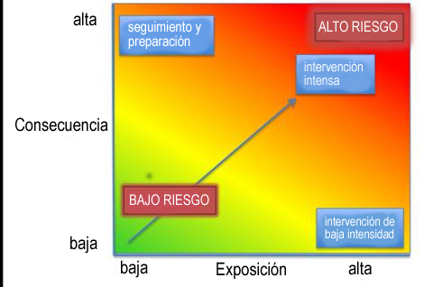
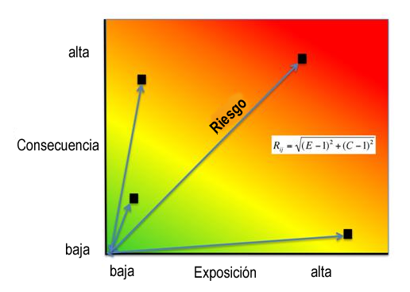
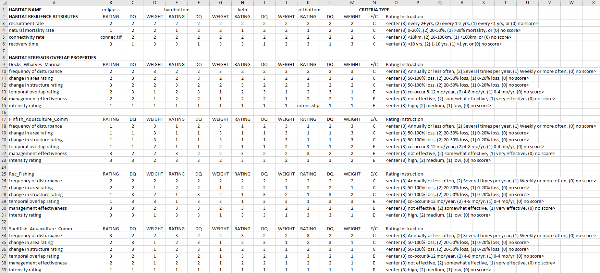

.. _habitat_risk_assessment:

***********************************
Evaluación del riesgo para hábitats
***********************************

Resumen
=======

El modelo de InVEST de Evaluación del riesgo para hábitats y especies (HRA/SRA, por sus siglas en inglés) permite evaluar el riesgo acumulado que las actividades humanas representan para los hábitats y las especies, y explorar las consecuencias para la provisión de servicios ecosistémicos y la biodiversidad. El estado de un hábitat es un factor determinante de los servicios ecosistémicos que puede proporcionar; por ejemplo, los manglares costeros degradados tienen menor capacidad para atenuar las olas y reducir la exposición costera. El riesgo para las especies puede indicar una menor sostenibilidad a lo largo del tiempo. A medida que los factores de presión antropogénicos se diversifican e intensifican, también aumenta la necesidad de contar con métodos rápidos, claros y reproducibles para evaluar los riesgos que enfrentan los hábitats y las especies, tanto en la actualidad como bajo escenarios futuros de manejo. HRA/SRA utiliza un marco de exposición-consecuencia ampliamente respaldado para evaluar la variación espacial del riesgo acumulado generado por múltiples actividades humanas en paisajes terrestres o marinos.

Entre las salidas del modelo se incluyen un mapa de riesgo para el ecosistema, mapas de riesgo para cada hábitat o especie individual, gráficos de riesgo que muestran la contribución de la exposición y la consecuencia al riesgo general, y tablas de resumen del riesgo por subregión y por hábitat o especie. Estas salidas pueden utilizarse para identificar las áreas con mayor riesgo relativo de degradación y las principales causas de riesgo dentro de una región de estudio y entre distintos escenarios futuros alternativos. Los resultados del modelo pueden ayudar a identificar áreas donde las actividades humanas podrían generar compensaciones entre servicios ecosistémicos, al plantear un riesgo suficientemente alto como para comprometer la estructura y función de los hábitats o la persistencia y recuperación de las especies. El modelo puede ayudar a priorizar áreas para la conservación, evaluar estrategias de manejo e informar el diseño y la configuración de planes espaciales en sistemas marinos y terrestres.

Introducción
============

Los hábitats y las especies proporcionan beneficios esenciales para las personas, incluidos servicios de regulación, materiales y no materiales (Pascual et al. 2017, Díaz et al. 2018). Por ejemplo, los hábitats cercanos a la costa, como los bosques de kelp y las praderas de pastos marinos, protegen las costas de las tormentas, proporcionan hábitats de crianza para las pesquerías y almacenan y secuestran carbono. Los hábitats terrestres, como los bosques ribereños, absorben el exceso de nutrientes y sedimentos, proporcionan hábitat para especies de peces de río y mitigan las inundaciones tierra adentro después de los eventos de lluvia. A medida que estos hábitats (o especies) se degradan por las actividades humanas, los servicios ecosistémicos que proporcionan se ven amenazados. Análisis mundiales recientes han revelado que casi ninguna zona de los océanos del mundo permanece intacta frente a los impactos humanos (Halpern et al. 2008). Por tanto, comprender la ubicación y la intensidad de los impactos humanos sobre los ecosistemas costeros es un componente esencial para una gestión terrestre, costera y oceánica informada y eficaz. El modelo HRA de InVEST permite evaluar las amenazas que las actividades humanas representan para la salud de estos ecosistemas y especies. El modelo se ha aplicado con éxito en numerosos lugares del mundo (por ejemplo, Arkema et al. 2014, Cabral et al. 2015, Chung et al. 2015, Duggan et al. 2015, Ma et al. 2016, Elliff et al. 2017, Wyatt et al. 2017).

El modelo HRA es un enfoque cuantitativo para evaluar la influencia acumulada de los factores de presión asociados con las actividades humanas sobre los hábitats y las especies (Arkema et al. 2014, Arkema et al. 2015). HRA utiliza un enfoque bien establecido en la bibliografía sobre riesgos, que se origina en las evaluaciones de vulnerabilidad de las pesquerías (Astles et al. 2006, Patrick et al. 2010, Hobday et al. 2011, Samhouri y Levin 2012).

El modelo incorpora dos dimensiones de información para calcular el riesgo o impacto sobre los componentes del ecosistema (Figura 1; Halpern et al. 2008, Patrick et al. 2010, Samhouri y Levin 2012, Arkema et al. 2014). Estas dimensiones son la *exposición* y la *consecuencia*.

**Exposición** es el grado en que un hábitat o una especie experimenta un factor de presión, teniendo en cuenta la eficacia de las prácticas de manejo.

**Consecuencia** es la respuesta específica del hábitat (o de la especie) a esa exposición. La consecuencia incorpora la *sensibilidad* de cada hábitat o especie a los efectos de un factor de presión, y la *resiliencia* del hábitat, es decir, su capacidad —o la de la especie— para resistir o recuperarse de un factor de presión al que está expuesto.

   Los hábitats con alta exposición a las actividades humanas y consecuencias elevadas de esa exposición presentan un riesgo alto. Representar gráficamente la exposición y la consecuencia de esta manera permite evaluar cuáles son los componentes más importantes del riesgo y revelar estrategias para reducirlo. Los riesgos impulsados por factores humanos exógenos (región superior derecha del espacio de riesgo) podrían mitigarse mediante intervenciones de manejo, mientras que los riesgos impulsados por factores endógenos específicos del hábitat (región superior izquierda del espacio de riesgo) podrían abordarse mejor mediante el monitoreo y la preparación. (Adaptado de Dawson et al. 2011).

Información para los procesos de toma de decisiones
---------------------------------------------------

Las salidas del modelo HRA permiten identificar áreas con alto riesgo para los ecosistemas, investigar qué hábitats o especies corren mayor riesgo y dónde, determinar las causas principales de ese riesgo y comprender cómo podría cambiar bajo escenarios futuros. Los resultados de HRA pueden utilizarse en diversos contextos de toma de decisiones:

* Las áreas de alto riesgo pueden utilizarse para priorizar los esfuerzos de manejo o restauración, como lo ha hecho la Oficina de Gestión Costera de NOAA en Great Bay, New Hampshire (NOAA OCM 2016).
* Las áreas de alto riesgo pueden utilizarse para restringir el espacio de decisión al ubicar nuevos usos (por ejemplo, dónde instalar energía eólica, como se muestra en Wyatt et al. 2017).
* Los gráficos de riesgo pueden ofrecer información sobre cuáles son las actividades que generan mayores impactos y qué tipos de estrategias de manejo serán más eficaces (por ejemplo, Duggan et al. 2015).
* Cuando se utiliza junto con modelos que estiman los cambios en los servicios ecosistémicos inducidos por los hábitats, como la protección frente a tormentas o los ingresos del turismo, HRA puede ayudar a evaluar las compensaciones entre las actividades humanas y los beneficios que los ecosistemas proporcionan a las personas (véase :ref:` Connecting Habitat Risk Assessment Results to InVEST Ecosystem Service Models`; Guerry et al. 2012, Clarke et al. 2016, Arkema et al. 2015).
* Las aplicaciones repetidas de HRA pueden utilizarse conjuntamente para evaluar y comparar escenarios alternativos (Arkema et al. 2014).

El modelo
=========

Cómo funciona
-------------

Para evaluar la exposición de los ecosistemas y de los hábitats o especies a las actividades humanas, así como las consecuencias de esa exposición, HRA sintetiza información sobre las interacciones entre múltiples actividades humanas (o «factores de presión») y múltiples hábitats o especies, utilizando datos espaciales y no espaciales procedentes de bibliografía científica revisada por pares, literatura gris y opiniones de expertos.

El modelo es espacialmente explícito: calcula puntuaciones de exposición, consecuencia y riesgo sobre una superficie ráster continua en toda el área de estudio, a una resolución espacial elegida por el usuario. Todos los datos geoespaciales de entrada se rasterizan a esta resolución y las operaciones descritas a continuación se realizan a escala de píxel.

Los usuarios proporcionan datos geoespaciales que incluyen la distribución de los hábitats o las especies, la extensión espacial de las actividades humanas o los factores de presión, y datos tabulares sobre la naturaleza de la interacción entre los hábitats o las especies y esos factores de presión. La información sobre estas interacciones se incluye mediante múltiples puntuaciones de criterios de exposición y consecuencia (normalmente de 1 a 3, donde 0 = sin puntuación). Los criterios específicos pueden ser definidos por el usuario o sugeridos por el modelo. Las puntuaciones son específicas de cada interacción entre hábitat (o especie) y factor de presión. Por ejemplo, se asignarían puntuaciones de 1 a 3 a cada uno de los siguientes criterios en cursiva, para cada par hábitat-factor de presión:

Los criterios de **exposición** podrían incluir el grado de *superposición geográfica* entre un hábitat y un factor de presión, la *duración del tiempo* durante el cual ambos se superponen, la *intensidad* del factor de presión y el grado en que las *estrategias de manejo* mitigan su impacto.

Los criterios de **consecuencia** podrían incluir el *grado de pérdida de hábitat* como resultado de la exposición a un factor de presión, el *cambio en la estructura del hábitat* y la *capacidad de los hábitats para recuperarse* de estos efectos (es decir, mediante características del ciclo de vida, como las tasas de reclutamiento y regeneración).

Para cada criterio, el usuario asigna una puntuación a la interacción, de baja a alta. El modelo es flexible y puede adaptarse tanto a situaciones con pocos datos como a situaciones con abundantes datos. La información puede proceder de una combinación de fuentes, desde datos revisados por pares a escala mundial hasta datos locales disponibles a escala detallada. Las entradas y los resultados del modelo pueden actualizarse a medida que se disponga de mejor información.

.. _hra-equations:

Riesgo acumulado para los hábitats o las especies debido a múltiples factores de presión
^^^^^^^^^^^^^^^^^^^^^^^^^^^^^^^^^^^^^^^^^^^^^^^^^^^^^^^^^^^^^^^^^^^^^^^^^^^^^^^^^^^^^^^^^

El riesgo que las actividades humanas representan para los hábitats o las especies se modela en cinco pasos.

1. Calcular las puntuaciones de exposición y consecuencia para cada par hábitat-factor de presión.
2. Combinar los valores de exposición y consecuencia en una puntuación de riesgo para cada par hábitat-factor de presión.
3. Acumular el riesgo de todos los factores de presión para cada hábitat o especie, en cada ubicación de píxel.
4. Clasificar el riesgo para cada hábitat o especie como bajo, medio o alto.
5. Resumir los resultados a escala de píxel en subregiones de mayor tamaño que sean de interés.

**Paso 1.** El primer paso consiste en determinar el grado de exposición del hábitat o la especie al factor de presión y las consecuencias de esa exposición. Tanto la exposición (E) como la consecuencia (C) se determinan asignando una calificación (normalmente de 1 a 3, donde 0 = sin puntuación) a un conjunto de criterios, como los descritos anteriormente, que se utilizan con frecuencia en la bibliografía científica. Sin embargo, pueden añadirse o eliminarse criterios. Las orientaciones para asignar puntuaciones al criterio predeterminado se resumen más adelante (:ref:`exposure-criteria-details` y :ref:`consequence-criteria-details`). Tenga en cuenta que la «superposición espacial» es un criterio especial de exposición que siempre se incluye y que el usuario no necesita definir ni puntuar como los demás criterios. Para cada celda de la cuadrícula del área de estudio, si un factor de presión y un hábitat o una especie están presentes simultáneamente, la superposición espacial = 1 y el modelo calcula E y C utilizando la información de los demás criterios y las ecuaciones siguientes. Si un factor de presión y un hábitat o una especie no se superponen en una celda determinada, la exposición, la consecuencia y el riesgo son 0 en esa celda. Las puntuaciones de todos los demás criterios son entradas que proporciona el usuario. Para cada puntuación asignada, también puede indicar la calidad de los datos utilizados para determinarla y la importancia ponderada del criterio en relación con los demás. Esto permite asignar mayor peso a los criterios cuya puntuación tiene mayor nivel de confianza o a los que contribuyen más al riesgo del sistema. Por tanto, las puntuaciones generales de exposición :math:`E` y consecuencia :math:`C` se calculan como promedios ponderados de los valores de exposición :math:`e_i` y consecuencia :math:`c_i` de cada criterio *i*, para el hábitat *j* y el factor de presión *k*.

.. math:: E_{jkl} = \frac{\sum^N_{i=1}\frac{e_{ijkl}}{d_{ijkl}\cdot w_{ijkl}}} {\sum^N_{i=1}\frac{1}{d_{ijkl} \cdot w_{ijkl}}}
   :label: exposure

.. math:: C_{jkl} = \frac{\sum^N_{i=1}\frac{c_{ijkl}}{d_{ijkl}\cdot w_{ijkl}}}{\sum^N_{i=1}\frac{1}{d_{ijkl} \cdot w_{ijkl}}}
   :label: consequence

donde :math:`E_{jkl}` es la puntuación de exposición específica del hábitat *j*, debida al factor de presión *k* en la ubicación *l*; :math:`C_{jkl}` es la puntuación de consecuencia; :math:`e_{ijkl}` es la calificación del criterio de exposición *i*, específica del hábitat *j*, el factor de presión *k* y la ubicación *l*; :math:`c_{ijkl}` es la calificación de consecuencia. :math:`d_{ijkl}` representa la calificación de calidad de los datos y :math:`w_{ijkl}` representa la ponderación de importancia del criterio. *N* es el número de criterios evaluados para cada hábitat.

**Paso 2.** El segundo paso combina los valores de exposición y respuesta para producir un valor de riesgo ponderado por la distancia para cada combinación de factor de presión-hábitat en cada celda de la cuadrícula. Hay dos opciones para calcular el riesgo y tres opciones para ponderarlo según la distancia.

Para el cálculo del riesgo euclidiano, el riesgo para el hábitat *j* causado por el factor de presión *k* en cada ubicación (es decir, celda) *l* se calcula como la distancia euclidiana desde el origen en el espacio exposición-consecuencia, donde la exposición promedio (:eq:`exposure`) se sitúa en un eje y la puntuación promedio de consecuencia (:eq:`consequence`) en el otro.

.. math:: R_{jkl} = \sqrt{(E_{jkl}-1)^2+(C_{jkl}-1)^2} \cdot D_{jkl}
   :label: euclidean_risk

El modelo cartografía esta puntuación de riesgo específica del hábitat y del factor de presión en los lugares donde ambos se superponen espacialmente.

Para el cálculo del riesgo multiplicativo, el riesgo para el hábitat *j* causado por el factor de presión *k* en la celda *l* se calcula como el producto de las puntuaciones de exposición (:eq:`exposure`) y consecuencia (:eq:`consequence`).

.. math:: R_{jkl} = E_{jkl} \cdot C_{jkl} \cdot D_{jkl}
   :label: multiplicative_risk

Tanto en los cálculos de riesgo euclidiano como multiplicativo, el decaimiento ponderado por la distancia :math:`D_{jkl}` representa la función de decaimiento elegida por el usuario entre las siguientes opciones:

Sin decaimiento ("None" en la interfaz):

.. math:: D_{jkl} = \begin{Bmatrix}
        1 & if &distance_{jkl} > bufferdist_k \\
        0 & & otherwise
        \end{Bmatrix}
   :label: hra-decay-none

Decaimiento lineal ("Linear" en la interfaz):

.. math:: D_{jkl} = \begin{Bmatrix}
        1 - \frac{distance_{jkl}}{bufferdist} & if & distance_{jkl} > bufferdist_k \\
        0 & & otherwise
        \end{Bmatrix}
   :label: hra-decay-linear

Decaimiento exponencial ("Exponential" en la interfaz):

.. math:: D_{jkl} = \begin{Bmatrix}
        1-e^{\frac{log_{10}(1e-6)}{distance_{jkl}}} & if & distance_{jkl} > bufferdist_k \\
        0 & & otherwise
        \end{Bmatrix}
   :label: hra-decay-exponential

donde:

* :math:`D_{jkl}` representa la influencia del factor de presión :math:`k`, ponderada por la distancia, sobre el hábitat :math:`j` en la ubicación :math:`l`. Es un valor entre 0 y 1, donde 0 indica que no hay influencia (cuando :math:`l` está fuera de la distancia de amortiguamiento) y 1 indica que :math:`l` se encuentra en un píxel del factor de presión.
* :math:`distance_{jkl}` es la distancia en metros entre el hábitat :math:`j` y el factor de presión :math:`k`.
* :math:`bufferdist_k` es la distancia de amortiguamiento en metros definida por el usuario para el factor de presión :math:`k`.

.. note::
  El usuario puede elegir qué función de riesgo utilizar. Distintos estudios han combinado la exposición y la consecuencia de diferentes maneras: los estudios de cartografía de impactos acumulados suelen utilizar un enfoque multiplicativo para estimar el riesgo (Halpern et al. 2008, Selkoe et al. 2009, Ban et al. 2010), mientras que los estudios de evaluación del riesgo de los ecosistemas suelen estimar el riesgo como la distancia euclidiana para una combinación específica de actividad y hábitat (o especie) en gráficos de riesgo (Patrick et al. 2010, Hobday et al. 2011, Samhouri y Levin 2012, Arkema et al. 2014).

  Las pruebas iniciales de sensibilidad sugieren que, en general, ambos enfoques coinciden al identificar los hábitats o regiones con mayor y menor riesgo, aunque los resultados de riesgo intermedio pueden diferir (Stock et al. 2015). Una prueba empírica de un análisis HRA extenso en Belice, mediante el enfoque euclidiano, encontró una buena concordancia entre el riesgo calculado y las medidas de fragmentación y salud de los hábitats (suplemento de Arkema et al. 2014). En general, el enfoque euclidiano puede proporcionar estimaciones más conservadoras y más altas que el enfoque multiplicativo. Si los valores de E y C son muy diferentes, el enfoque euclidiano producirá resultados de riesgo relativamente más altos. En cambio, el enfoque multiplicativo tiende a producir valores de riesgo relativamente más bajos y menos conservadores, y asocia una mayor similitud entre E y C con un riesgo más alto. Si su sistema contiene hábitats para los que las consecuencias del riesgo son muy altas, pero la exposición es baja (por ejemplo, arrecifes de coral y zonas de arrastre de camarón que actualmente evitan los arrecifes), y desea adoptar el principio de precaución, se recomienda elegir el enfoque euclidiano.

**Paso 3.** En este paso, el modelo cuantifica el riesgo acumulado que todos los factores de presión representan para cada hábitat o especie, en cada celda de la cuadrícula. El riesgo acumulado para el hábitat o la especie :math:`j` en la celda :math:`l` es la suma de todas las puntuaciones de riesgo para ese hábitat o especie:

.. math:: R_{jl} = \sum^K_{k=1} R_{jkl}

El modelo también calcula el riesgo acumulado para el ecosistema; véase :ref:`cumulative-risk`.

**Paso 4.** Cada celda de la cuadrícula se clasifica como de riesgo BAJO (1), MEDIO (2) o ALTO (3), según el riesgo que representa un solo factor de presión o los efectos acumulados de múltiples factores de presión.

**Paso 4a: Clasificación del riesgo por pares**

El riesgo por pares, es decir, el riesgo para un par determinado de hábitat-factor de presión, se clasifica como ALTO/MEDIO/BAJO únicamente en función de la puntuación máxima posible para ese par, que depende de la ecuación de riesgo seleccionada. De manera más formal, se expresa como:

.. math:: L_{jkl} = \begin{Bmatrix}
        0 & if & R_{jkl} = 0 \\
        1 & if & 0 < R_{jkl} < (\frac{1}{3}m_{jkl}) \\
        2 & if & (\frac{1}{3}m_{jkl}) <= R_{jkl} < (\frac{2}{3}m_{jkl}) \\
        3 & if & R_{jkl} >= (\frac{2}{3}m_{jkl})
        \end{Bmatrix}
   :label: hra-pairwise-risk-classification

donde:

* :math:`L_{jkl}` es el cálculo del riesgo alto/medio/bajo para el hábitat :math:`j`, debido al factor de presión :math:`k` en la ubicación :math:`l`.
* :math:`R_{jkl}` es el riesgo calculado que el factor de presión :math:`k` representa para el hábitat :math:`j` en la ubicación :math:`l`.
* :math:`m_{jkl}` es la puntuación máxima para cada par hábitat-factor de presión, que es coherente entre todos los pares. Se define como:

   * :math:`m_{jkl} = (r_{max})^2` si se utiliza el riesgo multiplicativo.
   * :math:`m_{jkl} = \sqrt{2(r_{max}-1)^2}` si se utiliza el riesgo euclidiano.

* :math:`r_{max}` es la puntuación máxima definida por el usuario.

**Paso 4b: Clasificación del riesgo acumulado**

La clasificación :math:`L` de los efectos acumulados de múltiples factores de presión sobre cada hábitat o especie considera dos posibles situaciones de riesgo destructivo:

1. En los casos en que un factor de presión es particularmente destructivo, como la tala rasa que elimina todos los árboles o el dragado que elimina todos los corales, otros factores de presión, como los senderos para excursionistas o la pesca recreativa, no aumentarán aún más el riesgo de degradación del hábitat. Esto se representa mediante :eq:`hra-classified-risk-max`.
2. En los casos en que un solo factor de presión no es particularmente perjudicial, el efecto acumulado de múltiples factores de presión aún puede ser alto. Esto se representa mediante :eq:`hra-cumulative-risk-classification`.

La clasificación :math:`L` de los efectos acumulados de múltiples factores de presión sobre cada hábitat o especie se expresa formalmente como:

.. math:: L = \begin {Bmatrix}
        L_{jkl} & if & L_{jkl} > L_{jl}\\
        L_{jl} && otherwise\\
        \end{Bmatrix}
   :label: hra-classified-risk-max

donde :math:`L_{jl}` se calcula como:

.. math:: L_{jl} = \begin{Bmatrix}
        0 & if & R_{jl} = 0 \\
        1 & if & 0 < R_{jl} < (\frac{1}{3}m_{jl}) \\
        2 & if & (\frac{1}{3}m_{jl}) <= R_{jl} < (\frac{2}{3}m_{jl}) \\
        3 & if & R_{jl} >= (\frac{2}{3}m_{jl})
        \end{Bmatrix}
   :label: hra-cumulative-risk-classification

dado que:

* :math:`L_{jl}` es el cálculo del riesgo alto/medio/bajo para el hábitat :math:`j` en la ubicación :math:`l`.
* :math:`R_{jl}` es el riesgo acumulado para un solo hábitat o especie :math:`j` en la ubicación :math:`l`.
* :math:`m_{jl}` es la puntuación máxima de riesgo para la suma de todos los pares hábitat-factor de presión, calculada como :math:`m_{jl} = m_{jkl} \cdot n_{overlap}`, donde :math:`n_{overlap}` es el número de factores de presión superpuestos definido por el usuario.

**Paso 4c: Clasificación del riesgo para el ecosistema**

La clasificación :math:`LE_{l}` del riesgo para el ecosistema en la ubicación :math:`l` se calcula mediante:

.. math:: LE_{l} = \begin {Bmatrix}
        0 & if & R_{l} = 0 \\
        1 & if & 0 < R_{l} < (\frac{1}{3}q_{l}) \\
        2 & if & (\frac{1}{3}q_{l}) <= R_{l} < (\frac{2}{3}q_{l}) \\
        3 & if & R_{l} >= (\frac{2}{3}q_{l})
        \end{Bmatrix}
   :label: hra-ecosystem-risk-classification

dado que:

* :math:`LE_{l}` es el cálculo del riesgo alto/medio/bajo en la ubicación :math:`l`.
* :math:`R_{l}` es el riesgo acumulado de todos los hábitats o especies en la ubicación :math:`l`.
* :math:`q_{l}` es la puntuación máxima posible de riesgo de todos los pares hábitat-factor de presión, calculada como :math:`q_{l} = m_{jkl} \cdot n_{j}`, donde :math:`n_{j}` es el número total de hábitats proporcionados por el usuario.

**Paso 5.** En el paso final, el riesgo se resume en cualquier número de subregiones dentro del área de estudio. En un proceso de planificación espacial, las subregiones suelen ser unidades de gobernanza (es decir, regiones de planificación costera, estados o provincias) dentro de los límites del área de planificación. A escala subregional, la puntuación de superposición espacial (un criterio predeterminado de exposición) se basa en la fracción del área de hábitat de una subregión que se superpone con una actividad humana (véase más adelante para obtener más detalles). La puntuación subregional de todos los demás criterios E y C corresponde al promedio de las puntuaciones E y C de todas las celdas de la cuadrícula de la subregión. El riesgo se estima mediante el enfoque de distancia euclidiana o el multiplicativo (véase más arriba).

.. _cumulative-risk:

Riesgo acumulado para el ecosistema debido a múltiples factores de presión
^^^^^^^^^^^^^^^^^^^^^^^^^^^^^^^^^^^^^^^^^^^^^^^^^^^^^^^^^^^^^^^^^^^^^^^^^^

Para proporcionar un índice integrador del riesgo de todos los hábitats o especies en una celda de la cuadrícula, el modelo también calcula el riesgo para el ecosistema. El riesgo para el ecosistema en cada celda *l* es la suma de las puntuaciones de riesgo de los hábitats o especies presentes en esa celda.

.. math:: R_{l}= \sum^J_{j=1} R_{jl}

El riesgo para el ecosistema aumentará a medida que aumente el número de hábitats o especies que coexisten.

Criterios de exposición y consecuencia con mayor detalle
^^^^^^^^^^^^^^^^^^^^^^^^^^^^^^^^^^^^^^^^^^^^^^^^^^^^^^^^^

El modelo permite utilizar cualquier número de criterios para evaluar el riesgo para las áreas de hábitat. Como opción predeterminada, el modelo proporciona un conjunto de consideraciones habituales para evaluar el riesgo que los factores de presión representan para los hábitats. A excepción de la superposición espacial a escala de celda de la cuadrícula, estos criterios se califican en una escala de 1 a 3, donde 0 = sin puntuación. Sin embargo, el usuario no está limitado a la escala de 1 a 3. Siempre que haya coherencia entre las puntuaciones de una misma ejecución del modelo, pueden utilizarse otras escalas (por ejemplo, de 1 a 5 o de 1 a 10). En todos los casos, los números más altos representan una mayor exposición o consecuencia y dan lugar a puntuaciones de riesgo más altas. **El uso de una puntuación de 0 siempre indica que el criterio correspondiente debe excluirse de las ecuaciones de exposición y consecuencia.**

Para obtener orientaciones técnicas sobre cómo preparar estos datos de entrada, consulte :ref:`hra-criteria-csv`. Para obtener más información:

.. _exposure-criteria-details:

Criterios de exposición predeterminados
"""""""""""""""""""""""""""""""""""""""

1. **Superposición espacial.** Para evaluar la superposición espacial en el área de estudio, el modelo utiliza mapas de la distribución de los hábitats o las especies y de los factores de presión.

   **Los mapas de hábitats** pueden representar tipos de hábitat bióticos (por ejemplo, pastos marinos o kelp) o abióticos (por ejemplo, fondos duros o blandos), o especies. El usuario define el nivel de detalle de la clasificación de los hábitats. Por ejemplo, los hábitats pueden definirse como bióticos o abióticos, por grupos taxonómicos (por ejemplo, coral, pastos marinos, manglar), por especies (por ejemplo, manglares rojos o negros) o mediante cualquier esquema que el usuario desee. En una evaluación del riesgo para especies, recomendamos especificar una sola especie, aunque el usuario también puede indicar un grupo taxonómico. Para que un mayor nivel de detalle o especificidad sea útil y modifique el resultado del modelo, estas clasificaciones de hábitat deben corresponder a diferencias en la manera en que los hábitats o las especies responden a los factores de presión.

   **Los mapas de factores de presión** representan la huella o extensión espacial de la actividad que genera el factor de presión. Además, puede asignarse a cada factor una «zona de influencia» o «área de amortiguamiento», que representa la distancia a la que se extienden sus efectos más allá de la huella real del mapa de entrada. Para algunos factores de presión, como los senderos peatonales en un bosque, esta distancia será pequeña. Para otros, como las instalaciones de acuicultura de peces en jaulas, donde los nutrientes se dispersan entre 300 y 500 m, o la tala rasa de bosques, cuyos efectos de borde pueden extenderse hasta 1 km, esta distancia puede ser grande. El usuario puede especificar si los impactos del factor de presión disminuyen de manera lineal o exponencial desde su huella hasta el límite exterior de la zona de influencia. El modelo utiliza la distancia de la zona de influencia de un factor de presión para crear una salida intermedia que representa el mapa de su huella ampliada por la zona de influencia (redondeando hacia abajo a la unidad de píxel más cercana; por ejemplo, una distancia de amortiguamiento de 600 m se redondeará a 500 m si la resolución del análisis es de 250 m).

   **Para cada celda de la cuadrícula**, si el hábitat o la especie se superpone con un factor de presión, entonces la superposición espacial = 1 y el modelo calcula la exposición, la consecuencia y el riesgo utilizando las puntuaciones de los demás criterios (descritos más adelante). Si un hábitat o una especie no se superpone con un factor de presión en una celda determinada, el modelo establece la exposición, la consecuencia y el riesgo = 0 en esa celda.

   **A escala subregional**, el modelo calcula las puntuaciones de superposición espacial de la siguiente manera. Para cada subregión, la fracción del área de cada hábitat que se superpone con cada factor de presión es el *percentage_overlap*. A continuación, la puntuación de superposición espacial se calcula mediante esta ecuación:

   puntuación máxima del criterio * percentage_overlap + puntuación mínima del criterio * (1 - percentage_overlap)

   Por ejemplo, si el 50 % del área de un hábitat se superpone con un factor de presión y la escala de criterios es de 1 a 3, entonces:
   3 * 0,5 + 1 * (1 - 0,5) = 2. Por último, el modelo promedia la puntuación de superposición espacial con la puntuación promedio de exposición de la subregión. Si no existe superposición espacial entre el hábitat y el factor de presión a escala subregional, entonces exposición = 0, consecuencia = 0 y riesgo = 0. Si no hay puntuaciones de exposición para esa combinación de hábitat y factor de presión, pero sí existe superposición espacial, la puntuación corresponderá únicamente a la superposición espacial.

2. **Calificación del tiempo de superposición.** La superposición temporal es la duración durante la cual el hábitat o la especie y el factor de presión presentan superposición espacial. Algunos factores de presión, como las estructuras permanentes, están presentes durante todo el año. Otros son estacionales, como ciertas prácticas de pesca o actividades recreativas. De manera similar, algunos hábitats (por ejemplo, los manglares) o especies están presentes durante todo el año, mientras que otros son más efímeros (por ejemplo, algunos pastos marinos o la vegetación perenne del sotobosque).

   *Si los criterios se califican en una escala de 1 a 3, se sugiere la siguiente puntuación para la superposición temporal:*

   .. list-table::
      :header-rows: 1

      * - Puntuación
        - 1 (baja)
        - 2 (media)
        - 3 (alta)
        - 0 (sin puntuación)
      * - Superposición temporal
        - El hábitat y el factor de presión coinciden entre 0 y 4 meses al año
        - El hábitat y el factor de presión coinciden entre 4 y 8 meses al año
        - El hábitat y el factor de presión coinciden entre 8 y 12 meses al año
        - N/A

   *Elija "0" para excluir este criterio de su evaluación.*

3. **Calificación de la intensidad.** La exposición depende no solo de si el hábitat y el factor de presión se superponen en el espacio y el tiempo, sino también de la intensidad del factor de presión. Algunos ejemplos: la intensidad del estrés por carga de nutrientes asociado con la acuicultura de salmones en jaulas depende del número de salmones en la granja y de la cantidad de residuos que se liberan al ambiente circundante. La intensidad de la recolección destructiva de moluscos depende del número de recolectores y de las prácticas de extracción. Puede utilizar este criterio de intensidad para explorar cómo los cambios en la intensidad de un factor de presión podrían afectar el riesgo para los hábitats. Por ejemplo, podría cambiar la puntuación de intensidad para representar modificaciones en la densidad de cultivo de una granja salmonera en un escenario futuro. También puede utilizar esta clasificación para incorporar diferencias relativas en la intensidad de distintos factores de presión dentro de la región de estudio. Por ejemplo, distintos tipos de transporte marítimo pueden tener diferentes niveles de intensidad. Los cruceros, por ejemplo, pueden constituir un factor de presión más intenso que los taxis acuáticos porque liberan más contaminantes.

   *Si los criterios se califican en una escala de 1 a 3, se sugiere la siguiente puntuación para la intensidad:*

   .. list-table::
      :header-rows: 1

      * - Puntuación
        - 1
        - 2
        - 3
        - 0
      * - Intensidad
        - Baja
        - Media
        - Alta
        - N/A

   *Elija "0" para excluir este criterio de su evaluación.*

4. **Calificación de la eficacia de las estrategias de manejo.** El manejo puede limitar los impactos negativos de las actividades humanas sobre los hábitats. Por ejemplo, las regulaciones que exigen una altura mínima para las estructuras sobre el agua reducen los impactos de sombreado de estas estructuras sobre la vegetación acuática sumergida. Por tanto, las estrategias de manejo eficaces reducirán la exposición de los hábitats o las especies a los factores de presión. La eficacia del manejo de cada factor de presión se califica en relación con la de los demás factores de presión de la región. Así, si un factor de presión está muy bien manejado y genera mucho menos estrés en el sistema que otros factores, clasifique la eficacia del manejo como «muy eficaz». Sin embargo, en general, es probable que el manejo de la mayoría de los factores de presión sea «ineficaz». Después de todo, se incluyen como factores de presión porque tienen algún impacto sobre los hábitats. A continuación, puede utilizar este criterio para explorar cambios en el manejo entre escenarios, como el efecto de cambiar un desarrollo de alto impacto (que podría recibir una puntuación de «ineficaz») a uno de bajo impacto (que podría recibir una puntuación de «muy eficaz»). Como ocurre con todos los criterios, los números más altos representan una mayor exposición y dan lugar a puntuaciones de riesgo más altas.

   *Si los criterios se califican en una escala de 1 a 3, se sugiere la siguiente puntuación para la eficacia del manejo:*

   .. list-table::
      :header-rows: 1

      * - Puntuación
        - 1
        - 2
        - 3
        - 0
      * - Eficacia del manejo
        - Muy eficaz
        - Algo eficaz
        - Ineficaz, manejo deficiente
        - N/A

   *Elija "0" para excluir este criterio de su evaluación.*

5. Pueden utilizarse otros criterios de **exposición**, además de los enumerados anteriormente o en lugar de ellos.

.. _consequence-criteria-details:

Criterios de consecuencia predeterminados
""""""""""""""""""""""""""""""""""""""""""
El riesgo de que un factor de presión degrade un hábitat o una especie depende de las consecuencias de la exposición. La consecuencia está determinada tanto por la *sensibilidad* de un hábitat a un factor de presión específico como por la *resiliencia* del hábitat para resistir y recuperarse de una perturbación en general. De manera predeterminada, el modelo incluye tres medidas específicas de sensibilidad (cambio de área, cambio de estructura y frecuencia de perturbaciones naturales similares) y cuatro medidas de resiliencia (tasa de mortalidad natural, tasa de reclutamiento, edad de madurez y conectividad). Cada una se describe a continuación.

1. **Calificación del cambio de área.** El cambio de área se mide como el porcentaje de variación de la extensión de un hábitat o una especie cuando está expuesto a un factor de presión determinado, y constituye una medida de la sensibilidad del hábitat o de la especie a ese factor. Los hábitats o las especies que pierden un porcentaje elevado de su extensión areal al estar expuestos a un factor de presión son muy sensibles, mientras que aquellos que pierden poca área son menos sensibles.

   *Si los criterios se califican en una escala de 1 a 3, se sugiere la siguiente puntuación para el cambio de área:*

   .. list-table::
      :header-rows: 1

      * - Puntuación
        - 1
        - 2
        - 3
        - 0
      * - Cambio de área
        - Pérdida baja de área (0-20 %)
        - Pérdida media de área (20-50 %)
        - Pérdida alta de área (50-100 %)
        - N/A

   *Elija "0" para excluir este criterio de su evaluación.*

2. **Calificación del cambio de estructura.** En los hábitats bióticos, el cambio de estructura es el porcentaje de variación de la densidad estructural del hábitat cuando está expuesto a un factor de presión determinado. Por ejemplo, el cambio de estructura puede corresponder a la variación de la densidad de árboles (o de la complejidad vertical u horizontal) en los sistemas forestales, o al cambio en la densidad de pólipos en los corales. Los hábitats que pierden una proporción elevada de su estructura al estar expuestos a un factor de presión son muy sensibles, mientras que aquellos que pierden poca estructura son menos sensibles. En los hábitats abióticos, el cambio de estructura es la cantidad de daño estructural que sufre el hábitat. Los hábitats abióticos sensibles sufrirán daños totales o parciales, mientras que aquellos que sufren pocos daños o ninguno son más resistentes. Por ejemplo, los fondos de grava o lodo sufrirán daños parciales o totales por la pesca de arrastre de fondo, mientras que los fondos de roca dura sufrirán pocos daños o ninguno. En el caso de las especies, el cambio de estructura puede utilizarse para representar cambios en la estructura de la población, por ejemplo, en la distribución por edades o sexos.

   *Si los criterios se califican en una escala de 1 a 3, se sugiere la siguiente puntuación para el cambio de estructura:*

   .. list-table::
      :header-rows: 1

      * - Puntuación
        - 1
        - 2
        - 3
        - 0
      * - Cambio de estructura
        - Pérdida baja de estructura (en hábitats bióticos, 0-20 % de pérdida de densidad; en hábitats abióticos, daño estructural escaso o nulo)
        - Pérdida media de estructura (en hábitats bióticos, 20-50 % de pérdida de densidad; en hábitats abióticos, daño estructural parcial)
        - Pérdida alta de estructura (en hábitats bióticos, 50-100 % de pérdida de densidad; en hábitats abióticos, daño estructural total)
        - N/A

   *Elija "0" para excluir este criterio de su evaluación.*

3. **Calificación de la frecuencia de perturbaciones naturales.** Si un hábitat o una especie experimenta de manera natural perturbaciones frecuentes similares al factor de presión antropogénico, puede ser más resistente a un estrés antropogénico comparable. Por ejemplo, los hábitats de áreas que reciben periódicamente aportes de nutrientes (es decir, por surgencias o aportes alóctonos, como la llegada de material vegetal intermareal a comunidades submareales) están adaptados a condiciones variables de nutrientes y pueden ser más resistentes a la carga de nutrientes procedente de la acuicultura de salmones en jaulas. De manera similar, los bosques con antecedentes de caída de árboles por el viento pueden estar mejor adaptados a la tala selectiva. Este criterio se califica por separado para cada combinación de hábitat o especie y factor de presión, de modo que la adaptación a condiciones variables de nutrientes aumenta la resistencia a la carga de nutrientes de la acuicultura de salmones, pero no a la pesca destructiva. Sin embargo, un factor de estrés natural alternativo, como una frecuencia elevada de tormentas, puede aumentar la resistencia a la pesca destructiva, porque ambos factores afectan los hábitats de manera similar. Las tasas altas de perturbaciones naturales comparables implican una mayor resiliencia y, por tanto, reciben puntuaciones más bajas.

   *Si los criterios se califican en una escala de 1 a 3, se sugiere la siguiente puntuación para la frecuencia de perturbaciones naturales:*

   .. list-table::
      :header-rows: 1

      * - Puntuación
        - 1
        - 2
        - 3
        - 0
      * - Frecuencia de perturbaciones naturales similares
        - Frecuente (de diaria a semanal)
        - Frecuencia intermedia (varias veces al año)
        - Rara (una vez al año o menos)
        - N/A

   *Elija "0" para excluir este criterio de su evaluación.*

.. note:: Los siguientes criterios de consecuencia son atributos de resiliencia. Incluyen características del ciclo de vida, como las tasas de regeneración y los patrones de reclutamiento, que influyen en la capacidad de los hábitats o las especies para recuperarse de una perturbación. Consideramos que el potencial de recuperación es función de la mortalidad natural, el reclutamiento, la edad de madurez y la conectividad.

4. **Calificación de la tasa de mortalidad natural (solo para hábitats bióticos).** Los hábitats o las especies con tasas elevadas de mortalidad natural suelen ser más productivos y tener mayor capacidad de recuperación y, por tanto, se califican como menos afectados por una perturbación (es decir, las tasas de mortalidad más altas reciben puntuaciones más bajas). Como ocurre con todos los criterios, los números más altos representan una mayor exposición o consecuencia y dan lugar a puntuaciones de riesgo más altas.

   *Si los criterios se califican en una escala de 1 a 3, se sugiere la siguiente puntuación para las tasas de mortalidad natural:*

   .. list-table::
      :header-rows: 1

      * - Puntuación
        - 1
        - 2
        - 3
        - 0
      * - Tasa de mortalidad natural
        - Mortalidad alta (por ejemplo, 80 % o más)
        - Mortalidad moderada (por ejemplo, 20-50 %)
        - Mortalidad baja (por ejemplo, 0-20 %)
        - N/A

   *Elija "0" para excluir este criterio de su evaluación.*

5. **Calificación del reclutamiento (solo para hábitats bióticos).** El reclutamiento frecuente aumenta el potencial de recuperación al incrementar la probabilidad de que los nuevos reclutas puedan restablecer una población en un área perturbada. Es decir, un mayor reclutamiento confiere mayor resiliencia y, por tanto, recibe una puntuación más baja. Como ocurre con todos los criterios, los números más altos representan una mayor exposición o consecuencia y dan lugar a puntuaciones de riesgo más altas.

   *Si los criterios se califican en una escala de 1 a 3, se sugiere la siguiente puntuación para la tasa de reclutamiento natural:*

   .. list-table::
      :header-rows: 1

      * - Puntuación
        - 1
        - 2
        - 3
        - 0
      * - Tasa de reclutamiento natural
        - Anual o más frecuente
        - Cada 1-2 años
        - Cada 2 años o más
        - N/A

   *Elija "0" para excluir este criterio de su evaluación.*

6. **Edad de madurez/tiempo de recuperación.** Es probable que los hábitats bióticos o las especies que alcanzan la madurez antes puedan recuperarse más rápidamente de una perturbación que aquellos que tardan más en madurar. En el caso de los hábitats, nos referimos a la madurez del hábitat en su conjunto (es decir, un bosque maduro de kelp o templado), y no a la madurez reproductiva de los individuos. En los hábitats abióticos, los tiempos de recuperación más cortos de hábitats como las planicies fangosas reducen las consecuencias de la exposición a las actividades humanas. En cambio, los hábitats formados por roca madre solo se recuperan en escalas temporales geológicas, lo que aumenta considerablemente las consecuencias de la exposición.

   *Si los criterios se califican en una escala de 1 a 3, se sugiere la siguiente puntuación para la edad de madurez/tiempo de recuperación:*

   .. list-table::
      :header-rows: 1

      * - Puntuación
        - 1
        - 2
        - 3
        - 0
      * - Edad de madurez/tiempo de recuperación
        - Menos de 1 año
        - 1-10 años
        - Más de 10 años
        - N/A

   *Elija "0" para excluir este criterio de su evaluación.*

7. **Calificación de la conectividad (solo para hábitats bióticos).** La proximidad entre parches de hábitat o subgrupos de una población aumenta el potencial de recuperación de un hábitat o una especie, al incrementar la probabilidad de que los nuevos reclutas puedan restablecer una población en un área perturbada. La conectividad es relativa a la distancia que puede recorrer un recluta. Por ejemplo, los parches separados por 10 km pueden considerarse poco conectados para una especie cuyas larvas o semillas solo pueden desplazarse cientos de metros, y muy conectados para una especie cuyas larvas o semillas pueden desplazarse cientos de kilómetros. Como ocurre con todos los criterios, los números más altos representan una mayor exposición o consecuencia y dan lugar a puntuaciones de riesgo más altas.

   *Si los criterios se califican en una escala de 1 a 3, se sugiere la siguiente puntuación para la conectividad:*

   .. list-table::
      :header-rows: 1

      * - Puntuación
        - 1
        - 2
        - 3
        - 0
      * - Conectividad
        - Alta conectividad en relación con las distancias de dispersión
        - Conectividad media
        - Baja conectividad en relación con las distancias de dispersión
        - N/A

   *Elija "0" para excluir este criterio de su evaluación.*

Uso de criterios espacialmente explícitos
^^^^^^^^^^^^^^^^^^^^^^^^^^^^^^^^^^^^^^^^^

Como alternativa a asignar una sola calificación a un criterio y aplicarla a toda la región de estudio, el modelo permite utilizar como entrada criterios espacialmente explícitos. Las calificaciones de criterios espacialmente explícitos pueden utilizarse para cualquiera de los criterios de exposición o consecuencia. Por ejemplo, el usuario podría diferenciar entre áreas con niveles altos y bajos de reclutamiento para un hábitat o una especie determinados dentro del área de estudio. Otro ejemplo: el usuario puede disponer de información sobre la variación espacial de una actividad humana, como planes alternativos de minería de estaño y tala, que podría influir en la calificación de intensidad de ese factor de presión. Los criterios espacialmente explícitos son capas vectoriales o rásteres, en las que cada entidad o valor ráster puede contener una calificación independiente para el área correspondiente. (Consulte la sección :ref:`spatially-explicit-data` para obtener detalles técnicos sobre cómo preparar y utilizar criterios espacialmente explícitos).

.. _data-quality-details:

.. note:: **Calificaciones escalares frente a calificaciones espacialmente explícitas**: las calificaciones escalares se comportan como valores constantes y se aplican a todos los píxeles asociados con el criterio, incluidos los que se encuentran dentro de su zona de amortiguamiento. En cambio, las calificaciones espacialmente explícitas se tratan como valores específicos de cada píxel y *no se extienden automáticamente a las zonas de amortiguamiento*. Si el usuario proporciona un criterio espacialmente explícito y espera que influya en la zona de amortiguamiento, la capa espacial debe incluir explícitamente valores de calificación para todos los píxeles de esa zona.

Orientaciones para asignar puntuaciones a la calidad y ponderación de los datos
^^^^^^^^^^^^^^^^^^^^^^^^^^^^^^^^^^^^^^^^^^^^^^^^^^^^^^^^^^^^^^^^^^^^^^^^^^^^^^^

La evaluación del riesgo es un proceso integrador que requiere una cantidad considerable de datos sobre numerosos atributos de los sistemas humanos y ecológicos. Es probable que algunos aspectos de la evaluación estén respaldados por datos de alta calidad, mientras que otros estén sujetos a una disponibilidad limitada de datos y a una elevada incertidumbre. El usuario tiene la opción de asignar una puntuación a la calidad de los datos para dar mayor peso, al calcular el riesgo (ecuaciones 2 y 3), a los criterios para los que existe mayor confianza. Esperamos que, al incluir la opción de calificar la calidad de los datos en el modelo, los usuarios sean conscientes de algunas fuentes de incertidumbre en la evaluación del riesgo y, por tanto, actúen con cautela al utilizar resultados derivados de datos de baja calidad. Además, la información generada por este proceso de calificación puede utilizarse para orientar la investigación y los esfuerzos de monitoreo destinados a mejorar la calidad y disponibilidad de los datos. Sugerimos que los usuarios ejecuten primero el modelo asignando la misma puntuación de calidad de datos (por ejemplo, 2) a todos los criterios, para determinar si los patrones generales tienen sentido según las relaciones entre los factores de presión y los hábitats.
A continuación, si los usuarios disponen de datos de excelente calidad para un criterio determinado, deberían volver a ejecutar el modelo utilizando una puntuación de 1 para indicar una alta calidad de los datos. Si no disponen de información verificada sobre la calidad de los datos, deberían especificar una puntuación de 3 para indicar una calidad de datos menor.

Para cada puntuación de exposición y consecuencia, los usuarios pueden indicar la calidad de los datos utilizados para determinarla mediante una escala deslizante, en la que 1 indica datos de la mayor calidad y los valores superiores indican datos cada vez menos confiables.

.. list-table::
   :header-rows: 1

   * - Mejores datos (1)
     - Datos adecuados (2)
     - Datos limitados (3)
   * - Existe información sustancial que respalda la puntuación y se basa en datos recopilados en la región de estudio (o en sus proximidades) para la especie en cuestión.
     - La información se basa en datos recopilados fuera de la región de estudio, puede referirse a especies relacionadas o representar relaciones estadísticas moderadas o insignificantes.
     - No existe bibliografía empírica que justifique la puntuación para la especie, pero el usuario puede realizar una inferencia razonable.

De manera similar, el usuario puede ajustar la importancia o «ponderación» de cada criterio. Cada sistema ecológico es único y distintos criterios pueden ser más importantes para algunos hábitats o especies que para otros. Por ejemplo, el potencial de recuperación de un hábitat o una especie puede estar más determinado por la tasa de reclutamiento que por la conectividad con otros parches de hábitat. Sugerimos que los usuarios ejecuten primero el modelo con la misma puntuación de ponderación (por ejemplo, 2) para todos los criterios, a fin de determinar si los patrones generales tienen sentido según las relaciones conocidas entre los factores de presión y los hábitats o las especies. A continuación, si los usuarios disponen de información verificada sobre la importancia de un criterio determinado, deberían volver a ejecutar el modelo utilizando 1 o 3 para indicar una importancia mayor o menor, respectivamente.

   .. list-table::
      :header-rows: 1

      * - Criterio
        - Mayor importancia (1)
        - Importancia moderada (2)
        - Menor importancia (3)
      * - Importancia relativa del criterio
        - El criterio es especialmente importante para determinar el impacto del factor de presión.
        - El criterio es algo importante para determinar el impacto del factor de presión.
        - El criterio es menos importante, en relación con los demás criterios, para determinar el impacto del factor de presión.

Limitaciones y simplificaciones
===============================

Limitaciones
------------

1. **Los resultados están limitados por la calidad de los datos**: la precisión de los resultados del modelo está limitada por la disponibilidad y la calidad de los datos de entrada. Especialmente en el caso de las puntuaciones de los criterios, el uso de datos de alta calidad —como los procedentes de evaluaciones locales recientes, replicadas en varios sitios de la región de estudio para la especie en cuestión— producirá resultados más precisos que el uso de datos de menor calidad, recopilados en lugares distantes y con una cobertura espacial o temporal limitada. En la mayoría de los casos, los usuarios tendrán que utilizar información de otras ubicaciones geográficas para algunas combinaciones de factores de presión-hábitat o especie, porque gran parte de los datos sobre los efectos de determinados factores de presión solo se han recopilado en un número limitado de lugares del mundo. Para superar estas limitaciones de datos, incluimos una puntuación de calidad de los datos en el análisis. Esta puntuación permite a los usuarios reducir la ponderación de los criterios para los que la calidad de los datos es baja.

2. **Los resultados deben interpretarse en una escala relativa**: debido a la naturaleza del proceso de puntuación, los resultados pueden utilizarse para comparar el riesgo de varias actividades humanas entre varios hábitats o especies dentro de la región de estudio (que puede variar en tamaño desde escalas locales pequeñas hasta una escala mundial), pero no deben utilizarse para comparar cálculos de riesgo de análisis separados. Los análisis de incertidumbre han demostrado que las tendencias cualitativas generales de este tipo de cartografía de impactos son robustas (Stock 2016). Las pruebas empíricas de HRA en otros lugares han mostrado relaciones sólidas entre el riesgo modelado y la fragmentación y salud de los hábitats (Arkema et al. 2014). A medida que se disponga de datos empíricos locales, una excelente línea de trabajo futuro consistiría en validar y relacionar las puntuaciones de riesgo regionales con las condiciones de calidad del hábitat (por ejemplo, densidad, fragmentación, etc.).

3. **Los resultados no reflejan los efectos de las actividades humanas pasadas**. El modelo HRA no considera explícitamente los efectos de las actividades humanas históricas sobre el riesgo actual. La exposición pasada a las actividades humanas puede afectar las consecuencias de las actividades humanas en el presente y el futuro. Por ejemplo, los hábitats o las especies pueden seguir recuperándose de prácticas pesqueras o de uso del suelo más destructivas realizadas en el pasado. Si los usuarios disponen de datos históricos sobre la exposición de los hábitats a las actividades humanas (por ejemplo, extensión espacial y temporal) y de información sobre cómo esto afecta las puntuaciones de consecuencia actuales, pueden incluir esa información en el análisis para obtener resultados más precisos.

4. **Los resultados se basan en una ponderación igual de los criterios, a menos que el usuario los pondere según su importancia o la calidad de los datos**. El modelo calcula las puntuaciones de exposición y consecuencia suponiendo que el efecto de cada criterio (es decir, la superposición espacial y el patrón de reclutamiento) tiene la misma importancia en los componentes relativos de exposición y consecuencia. La importancia relativa de cada criterio se conoce poco, por lo que suponemos que todos tienen la misma importancia. Sin embargo, el usuario tiene la opción de ponderar la importancia de cada criterio al determinar el riesgo general.

5. **El modelo solo evalúa el riesgo de los factores de presión que afectan directamente al hábitat mediante la superposición espacial.** Los factores de presión pueden afectar a los hábitats de otras maneras más indirectas, pero este modelo no está diseñado para incorporar esos efectos indirectos.

Supuestos
---------

1. **Los ecosistemas de todo el mundo responden de manera similar a un factor de presión determinado**. A menudo, la información bibliográfica sobre los efectos de los factores de presión en los hábitats o las especies procede de unos pocos lugares. Si se utilizan datos disponibles a escala mundial o datos de otras ubicaciones, los usuarios asumen que *los ecosistemas de todo el mundo responden de manera similar a un factor de presión determinado* (es decir, que los pastos marinos del Mediterráneo responden a la acuicultura de peces en jaulas de la misma manera que los pastos marinos de Columbia Británica). Para evitar este supuesto, los usuarios deberían utilizar datos locales siempre que sea posible.

2. **El riesgo acumulado es aditivo (en lugar de sinérgico o antagónico)**. La interacción de múltiples factores de presión sobre los ecosistemas y las especies marinos se conoce poco (véase Crain et al. 2008, Teichert et al. 2016 para obtener más información). Las interacciones pueden ser aditivas, sinérgicas o antagónicas. Sin embargo, nuestra capacidad para predecir el tipo de interacción que ocurrirá es limitada. Debido a la ausencia de información confiable sobre las condiciones que determinan la aditividad, el sinergismo o el antagonismo, el modelo supone que las interacciones son aditivas porque es el enfoque más sencillo. En algunos casos, el enfoque aditivo para evaluar el riesgo subestimará el riesgo al no considerar interacciones entre factores de presión que podrían ser sinérgicas, o lo sobreestimará cuando algunas interacciones podrían anularse entre sí.

.. _hra-data-needs:

Necesidades de datos
====================

.. note:: *Todas las entradas espaciales deben tener exactamente el mismo sistema de coordenadas proyectadas* (con unidades lineales en metros), *no* un sistema de coordenadas geográficas (con unidades en grados).

- :investspec:`hra workspace_dir`

- :investspec:`hra results_suffix`

- :investspec:`hra info_table_path`

  Columnas:

  - :investspec:`hra info_table_path.columns.name`
  - :investspec:`hra info_table_path.columns.path`
  - :investspec:`hra info_table_path.columns.type`
  - :investspec:`hra info_table_path.columns.stressor buffer (meters)`

- :investspec:`hra criteria_table_path` La columna rating de la tabla también puede contener la ruta del archivo de los criterios opcionales espacialmente explícitos. La columna Rating Instruction es opcional y se utiliza como referencia para completar las puntuaciones de la columna Rating. Consulte la sección :ref:`hra-criteria-csv` para obtener más información.

  .. note:: Los archivos CSV de muestra de Información sobre hábitats y factores de presión y de Puntuaciones de criterios utilizan barras invertidas, propias de Windows, en las rutas de los archivos. Para tener esto en cuenta, si utiliza MacOS y no se encuentra el archivo, las barras invertidas se convertirán automáticamente en barras diagonales. Esto podría causar problemas si la ruta contiene espacios; es mejor evitar los espacios en los nombres de los archivos.

- :investspec:`hra resolution` El modelo convertirá todas las entradas vectoriales de hábitats y factores de presión en rásteres con esta resolución. Se considera que todas las celdas que se superponen, parcial o totalmente, con una geometría de hábitat o factor de presión contienen ese hábitat o factor de presión.

.. note:: La resolución del análisis debe reflejar la resolución de los datos disponibles sobre hábitats y factores de presión. Por ejemplo, si los datos de entrada incluyen pequeños parches de pastos marinos y kelp representados con una resolución de 100-200 metros, elija un valor similar para la resolución del modelo. Si los datos de entrada sobre hábitats son de resolución gruesa, elija un valor mayor. Recomendamos ejecutar el modelo por primera vez con una resolución baja (1000 m o 5000 m) para verificar que funciona correctamente y luego utilizar una resolución mayor en las ejecuciones posteriores, según sea necesario.

- :investspec:`hra max_rating` Es el límite superior con el que se compararán todas las puntuaciones. Por ejemplo, en una ejecución del modelo en la que las puntuaciones varían de 0 a 3, este valor sería 3. Si decide utilizar una escala de puntuación diferente, este debe ser el valor más alto de esa escala.

- :investspec:`hra risk_eq` Esta selección determina la ecuación que se utilizará para calcular el riesgo de un hábitat determinado. Consulte la ecuación :eq:`euclidean_risk` para el modelo de riesgo euclidiano y la ecuación :eq:`multiplicative_risk` para el modelo de riesgo multiplicativo.

- :investspec:`hra decay_eq` Esta selección influye en la manera en que se aplica la «zona de influencia» (es decir, la distancia de amortiguamiento) de un factor de presión al riesgo, para modelar con mayor precisión la influencia de ese factor más allá de su huella. La puntuación general de exposición disminuye según esta ecuación a medida que aumenta la distancia desde la huella del factor de presión, hasta llegar a 0 en la **distancia de amortiguamiento del factor de presión**.

- :investspec:`hra n_overlapping_stressors` Consulte :ref:`number-overlapping-stressors` para obtener más información sobre cómo definir este número.

- :investspec:`hra aoi_vector_path` El modelo generará estadísticas resumidas de los valores de exposición, consecuencia y riesgo promediados dentro de cada geometría, para cada hábitat y factor de presión.

   Campo:

   - :investspec:`hra aoi_vector_path`

- :investspec:`hra visualize_outputs` Estos resultados pueden visualizarse en la `aplicación web HRA <https://joannalcy.github.io/hra-dashboard//>`_.

.. _hra-info-csv:

Información sobre hábitats y factores de presión (tabla CSV y datos SIG)
-------------------------------------------------------------------------

Esta tabla indica al modelo dónde encontrar las entradas de datos SIG para las capas de hábitats y factores de presión. Los datos SIG pueden estar en formato ráster o vectorial. Consulte la imagen siguiente para ver un ejemplo. Se requieren las siguientes columnas:

* **NAME**: elija un nombre único para cada entrada. Estos nombres deben coincidir exactamente con los que aparecen en el archivo **Criteria Scores CSV**.
* **PATH**: ruta del archivo del conjunto de datos de entrada. Puede ser una ruta absoluta (por ejemplo, C:/InVEST_3.7.0/HabitatRiskAssess/Input/habitat_layers/eelgrass.shp) o una ruta relativa a la ubicación de este archivo CSV.
* **TYPE**: puede ser "habitat" o "stressor".
* **STRESSOR_BUFFER**: distancia de amortiguamiento deseada (**metros**) que se utilizará para ampliar la influencia o huella de un factor de presión determinado. Debe dejarse en blanco para los hábitats, pero no para los factores de presión. Introduzca 0 si no desea aplicar una zona de amortiguamiento a un factor de presión. El modelo redondeará esta distancia hacia abajo a la unidad de celda más cercana. Por ejemplo, una distancia de amortiguamiento de 600 m ampliará la huella de un factor de presión en dos celdas de la cuadrícula si la resolución del análisis es de 250 m.

**Entradas ráster:** si se utiliza un archivo ráster, solo debe contener valores de **0** y **1**, donde **1** representa la presencia de un hábitat o un factor de presión, y **0** representa su ausencia. Cualquier valor distinto de 0 o 1 se tratará como 0. La entrada ráster debe estar proyectada.

**Entradas vectoriales:** si se utiliza un archivo vectorial, se considera que todas las entidades de ese vector representan la presencia del hábitat o del factor de presión. La entrada vectorial debe estar proyectada. La tabla debe tener las columnas NAME, PATH, TYPE y STRESSOR BUFFER (meters). Los nombres de las columnas no distinguen entre mayúsculas y minúsculas, pero los nombres de las rutas sí.

.. csv-table::
   :file: ../../invest-sample-data/HabitatRiskAssess/Input/habitat_stressor_info.csv
   :header-rows: 1
   :widths: auto

.. _hra-criteria-csv:

CSV de puntuaciones de criterios
--------------------------------

El archivo CSV de puntuaciones de criterios proporciona toda la información sobre los criterios para la ejecución del modelo de Evaluación del riesgo para hábitats y especies. Este archivo contiene información sobre el efecto de cada factor de presión en cada hábitat (es decir, las puntuaciones de exposición y consecuencia) para los hábitats y factores de presión incluidos en el análisis. En la carpeta de datos de muestra se encuentra una plantilla del archivo CSV de criterios. Los usuarios pueden añadir o eliminar criterios específicos y completar las puntuaciones en una escala de 1 a 3, o de 1 a cualquier otro valor, siempre que la escala sea la misma para todos los criterios.

.. Esta imagen corresponde a la misma tabla incluida en los datos de muestra.
   Era demasiado grande y compleja para darle un buen formato como csv-table, por lo que se conserva como figura.

Las plantillas CSV no contendrán puntuaciones numéricas, sino únicamente orientaciones sobre cómo completar cada puntuación. El usuario debe utilizar las mejores fuentes de datos disponibles para obtener la información necesaria para asignar las puntuaciones. Las columnas de información incluyen lo siguiente:

* **Rating (Puntuación)**: medida del impacto de un criterio sobre un hábitat o una especie determinados, en relación con el ecosistema en su conjunto. La puntuación puede ser un número entero o una ruta a un archivo espacialmente explícito (véase :ref:`spatially-explicit-data`). Las puntuaciones pueden proceder de una combinación de fuentes revisadas por pares a escala mundial y fuentes locales de datos detallados. Las entradas y los resultados del modelo pueden actualizarse a medida que se disponga de mejor información. Ofrecemos orientaciones para criterios conocidos en una escala de 1 a 3, pero debe señalarse que, si se dispone de información en otra escala, también puede utilizarse. Sin embargo, es importante que toda la información de puntuación de todos los archivos CSV utilice una escala coherente, independientemente de cuál sea su límite superior. Una puntuación de **0** indica al modelo que debe ignorar ese criterio específico.

* **DQ (Calidad de los datos)**: esta columna representa la calidad de los datos de la puntuación proporcionada en la columna **Rating**. El modelo ofrece al usuario la posibilidad de reducir la ponderación de las fuentes de datos menos confiables o aumentar la de los criterios especialmente bien estudiados. Un valor bajo de DQ (por ejemplo, 1) indica la mejor calidad de los datos, mientras que un valor alto (por ejemplo, 3) indica una calidad de datos limitada. Aunque ofrecemos orientaciones para un sistema de puntuación de 1 a 3, el usuario puede utilizar cualquier límite superior que considere práctico, siempre que la escala sea coherente. El límite inferior siempre debe ser 1.

* **Weight (Ponderación)**: esta columna ofrece al usuario la oportunidad de aumentar la ponderación de los criterios que considera especialmente importantes para el sistema, independientemente de la calidad de los datos. Un valor bajo de Weight (por ejemplo, 1) indica criterios más importantes, mientras que un valor alto (por ejemplo, 3) indica criterios menos importantes. Aunque ofrecemos orientaciones para un sistema de puntuación de 1 a 3, el usuario puede utilizar cualquier límite superior que considere práctico, siempre que la escala sea coherente. El límite inferior siempre debe ser 1.

* **E/C**: esta columna indica si los criterios se aplican a la parte de exposición o a la parte de consecuencia de la ecuación de riesgo seleccionada. No recomendamos cambiar estos valores para los criterios predeterminados, pero, si se añade un criterio nuevo, debe introducirse un valor **E** o **C**. De manera predeterminada, todos los criterios de las categorías Sensibilidad o Resiliencia se asignan a Consecuencia (C) dentro de las ecuaciones de riesgo, y todos los criterios de la categoría Exposición se asignan a Exposición (E).

.. note:: **¿Qué criterios son obligatorios?** Una evaluación precisa del riesgo debe incluir información sobre todos los componentes clave del riesgo (es decir, la superposición espacial junto con otros criterios pertinentes de exposición y consecuencia). No obstante, el modelo producirá estimaciones de riesgo siempre que haya al menos un criterio de exposición y uno de consecuencia. La superposición espacial cuenta como criterio de exposición y no requiere una fila en esta tabla, ya que siempre se calcula.

.. note:: **Especificar que no existe interacción entre un hábitat y un factor de presión**. A partir de InVEST 3.7.0, el modelo HRA permite a los usuarios indicar que no debe existir interacción entre un par hábitat-factor de presión. Esto significa, en esencia, que el modelo considerará que el hábitat y el factor de presión no presentan superposición espacial. Para establecer que no existe superposición entre un par hábitat-factor de presión, basta con completar con un valor 0 la columna "Rating" de cada criterio correspondiente a ese par. **Todos** los valores de "Rating" de ese par deben establecerse en 0 para que el modelo considere que no existe interacción ni superposición.

.. _spatially-explicit-data:

Preparación de capas de criterios espacialmente explícitos
^^^^^^^^^^^^^^^^^^^^^^^^^^^^^^^^^^^^^^^^^^^^^^^^^^^^^^^^^^

Para cualquiera de los criterios enumerados en el archivo **Criteria Scores CSV**, en lugar de introducir un único número en **Rating**, puede introducirse la ruta a un archivo SIG, lo que permite que la puntuación de ese criterio varíe espacialmente. La puntuación se extraerá de los datos espaciales de la siguiente manera. Si se utiliza un archivo ráster, sus valores de píxel se utilizarán como puntuación y, por tanto, deben estar entre 0 y la **puntuación máxima del criterio**. Si se utiliza un archivo vectorial, el valor de la puntuación se extraerá de los atributos de las entidades. Debe existir un campo de atributos denominado "rating" con valores entre 0 y la puntuación máxima del criterio. Asegúrese de que la capa espacialmente explícita incluya valores de puntuación para todos los píxeles afectados por el criterio, incluidos los píxeles de las zonas de amortiguamiento correspondientes.

.. _number-overlapping-stressors:

Definición del número de factores de presión superpuestos
^^^^^^^^^^^^^^^^^^^^^^^^^^^^^^^^^^^^^^^^^^^^^^^^^^^^^^^^^^

El número de factores de presión superpuestos se utiliza para determinar los límites entre las clasificaciones de riesgo alto, medio y bajo.

Los usuarios pueden adoptar varias opciones para definir el número que utilizarán:

1. Utilizar el número máximo real de factores de presión superpuestos. Por ejemplo, si tiene 8 factores de presión, pero el máximo que se superpone en un mismo píxel es 5, puede introducir 5.

2. Realizar un análisis de superposición para determinar cuál es el número más común de factores de presión superpuestos dentro de las áreas de estudio. Por ejemplo, si tiene 8 factores de presión, pero en general solo se superponen 2, puede introducir 2.

3. Realizar un análisis de sensibilidad y ejecutar el modelo varias veces con una serie de valores posibles. Lo ideal sería elegir uno y validar los resultados del modelo HRA frente a datos empíricos sobre la salud de esos hábitats mediante pruebas estadísticas, y luego ajustar el número en consecuencia. Tenga en cuenta que la API de Python de InVEST es muy adecuada para este tipo de análisis de sensibilidad.

.. _hra-interpreting-results:

Interpretación de los resultados
================================

Los resultados de la evaluación del riesgo pueden utilizarse para explorar estrategias que reduzcan la exposición de un hábitat determinado a una actividad específica, por ejemplo, reduciendo la extensión de una actividad o cambiando su ubicación. El modelo produce resúmenes de riesgo para cada hábitat, que comparan las puntuaciones de consecuencia y exposición de todas las actividades a escala subregional (**SUMMARY_STATISTICS.CSV**). Estos resúmenes ayudan al usuario a comprender si la reducción de la exposición a determinadas actividades mediante acciones de manejo probablemente reducirá el riesgo, o si el riesgo está determinado por las consecuencias, que son más difíciles de modificar mediante acciones de manejo (véase la Figura 1 anterior).

Salidas del modelo
------------------

Carpeta de resultados
^^^^^^^^^^^^^^^^^^^^^

Cada uno de estos archivos de salida se guarda en la carpeta "outputs", dentro del directorio del espacio de trabajo especificado por el usuario:

+ **TOTAL_RISK_<habitat>.tif**

  Esta capa ráster representa el riesgo acumulado específico del hábitat, generado por todos los factores de presión en una celda de la cuadrícula. Por ejemplo, "TOTAL_RISK_eelgrass" representa el riesgo acumulado de todos los factores de presión para el hábitat "eelgrass". Se calcula celda por celda, y el riesgo se calcula únicamente donde se encuentra el hábitat o la especie; varía espacialmente según la distribución (y las puntuaciones) de los factores de presión que afectan a ese hábitat o especie (véase :ref:`hra-equations`). Esta capa es informativa para los usuarios que desean conocer cómo varía el riesgo acumulado de un hábitat determinado en toda la región de estudio (por ejemplo, identificar puntos críticos donde los pastos marinos o el kelp están expuestos a un riesgo alto debido a múltiples factores de presión). Los puntos críticos de riesgo acumulado alto pueden priorizarse para la restauración o el monitoreo.

+ **TOTAL_RISK_Ecosystem.tif**

  Esta capa ráster representa la suma de las puntuaciones de riesgo acumulado de los hábitats dividida por el número de hábitats presentes en cada celda. Se interpreta mejor como un riesgo promedio para todos los hábitats de una celda de la cuadrícula. Por ejemplo, en una celda costera cercana a la orilla que contiene hábitats de arrecife de coral, manglar y fondo blando, el valor de riesgo para el ecosistema refleja la suma del riesgo para los tres hábitats de esa celda.

+ **RECLASS_RISK_<habitat>.tif**

  Esta capa ráster representa el riesgo específico de cada hábitat, generado por todos los factores de presión en una celda de la cuadrícula, reclasificado en cuatro categorías: 0 = Sin riesgo, 1 = Riesgo bajo, 2 = Riesgo medio y 3 = Riesgo alto. Se calcula mediante :eq:`hra-classified-risk-max`.

+ **RECLASS_RISK_Ecosystem.tif**

  Esta capa ráster representa el riesgo para el ecosistema reclasificado en cada celda. Se interpreta mejor como un índice promedio de riesgo para todos los hábitats de una celda de la cuadrícula, reclasificado. Se calcula mediante :eq:`hra-ecosystem-risk-classification`.

+ **SUMMARY_STATISTICS.csv**

  Este archivo CSV contiene las puntuaciones medias, mínimas y máximas de exposición, consecuencia y riesgo para cada par hábitat-factor de presión, así como las puntuaciones específicas de cada hábitat en cada subregión. Si no se proporciona el campo "name" en el vector AOI, se utilizará el valor "Total Region" para representar toda la extensión del AOI en la columna "SUBREGION" de la tabla. Además, hay tres columnas, "R_%HIGH", "R_%MEDIUM" y "R_%LOW", que indican el porcentaje de áreas de riesgo alto, medio y bajo, respectivamente.

+ **InVEST-Habitat-Risk-Assessment-log-YYYY-MM-DD--HH_MM_SS.txt**

  Cada vez que se ejecuta el modelo, aparece un archivo de texto en la carpeta del espacio de trabajo. El archivo enumera los valores de los parámetros de esa ejecución y se denomina según la fecha y la hora. La información del registro de parámetros puede utilizarse para identificar las configuraciones detalladas de cada simulación de escenario.

Carpeta de salidas de visualización (opcional)
^^^^^^^^^^^^^^^^^^^^^^^^^^^^^^^^^^^^^^^^^^^^^^

Cada uno de estos archivos de salida se guarda en la carpeta "visualization_outputs", dentro del directorio del espacio de trabajo especificado por el usuario. Puede cargar esta carpeta en una `aplicación web que permite visualizar los resultados <https://joannalcy.github.io/hra-dashboard/>`_.

+ **RECLASS_RISK_<habitat>.geojson**

  Esta capa vectorial permite visualizar en un mapa el riesgo específico del hábitat, reclasificado a partir de todos los factores de presión en cuatro categorías: 0 = Sin riesgo, 1 = Riesgo bajo, 2 = Riesgo medio y 3 = Riesgo alto, con una gradación de color de blanco a rojo.

+ **RECLASS_RISK_Ecosystem.tif**

  Esta capa vectorial permite visualizar en un mapa el riesgo para el ecosistema, reclasificado en cada celda en cuatro categorías: 0 = Sin riesgo, 1 = Riesgo bajo, 2 = Riesgo medio y 3 = Riesgo alto, con una gradación de color de blanco a rojo.

+ **STRESSOR_<stressor>.geojson**

  Esta capa vectorial permite visualizar en un mapa la extensión de los factores de presión en color naranja.

+ **SUMMARY_STATISTICS.csv**

  Es el mismo archivo que se encuentra en la carpeta de resultados. Se copia aquí para que los usuarios puedan cargar simplemente la carpeta de salidas de visualización en la aplicación web HRA, con todos los archivos en un mismo lugar.

Carpeta intermedia
^^^^^^^^^^^^^^^^^^

La carpeta Intermediate contiene archivos generados para respaldar los cálculos de los resultados finales. Todos los rásteres de esta carpeta utilizan el tamaño de píxel especificado por el usuario en el campo de texto "Resolution of Analysis" de la sección :ref:`hra-data-needs`.

+ **C_<habitat>_<stressor>.tif**

  Archivo ráster alineado con todas las demás capas de entrada, que contiene la puntuación de consecuencia calculada para una combinación específica de hábitat y factor de presión.

+ **E_<habitat>_<stressor>.tif**

  Archivo ráster alineado con todas las demás capas de entrada, que contiene la puntuación de exposición calculada para una combinación específica de hábitat y factor de presión.

+ **RECOVERY_<habitat>.tif**

  Archivo ráster que representa la resiliencia o el potencial de recuperación del hábitat o la especie correspondiente en cada celda. El potencial de recuperación se basa en la tasa de mortalidad natural, la tasa de reclutamiento, la edad de madurez o el tiempo de recuperación y la conectividad, aunque el usuario puede modificar estos criterios en la tabla de criterios. El potencial de recuperación resulta útil para quienes desean identificar áreas donde los hábitats o las especies son más resilientes a los factores de presión humanos y, por tanto, pueden ser capaces de soportar un aumento de las presiones. Los hábitats o las especies con un bajo potencial de recuperación son especialmente vulnerables a la intensificación de las actividades humanas.

+ **RISK_<habitat>_<stressor>.tif**

  Archivo ráster que indica la puntuación de riesgo para un par hábitat-factor de presión.

+ **aligned_<habitat.tif**

  Archivo ráster alineado con todas las demás capas de entrada, de modo que comparten la misma proyección, tamaño de píxel, dimensiones y cuadro delimitador.

+ **composite_criteria.csv**

  Archivo CSV procesado, derivado de la tabla de criterios del usuario, que registra cada combinación de hábitat, factor de presión, criterio, puntuación, calidad de los datos, ponderación y si la puntuación se aplica a la exposición o a la consecuencia.

+ **decayed_edt_<stressor>.tif**

  Archivo ráster que indica la influencia de un factor de presión ponderada por la distancia.

+ **habitat_mask.tif**

  Archivo ráster que indica qué píxeles contienen uno o más hábitats.

+ **reclass_<habitat>_<stressor>.tif**

  Riesgo reclasificado (alto/medio/bajo) que el factor de presión correspondiente representa para el hábitat indicado. Se crea mediante :eq:`hra-pairwise-risk-classification`.

+ **reclass_total_risk_<habitat>.tif**

  Riesgo acumulado reclasificado (alto/medio/bajo) de todos los factores de presión para un hábitat. Se crea mediante :eq:`hra-cumulative-risk-classification`.

+ **reprojected_<habitat/stressor/criteria>.shp**

  Si alguna capa de hábitat, factor de presión o criterio espacial se proporciona en formato vectorial, se reproyectará a la proyección del Área de interés del usuario y se guardará como shapefile ESRI en esta ruta.

+ **rewritten_<habitat/stressor/criteria>.tif**

  Si alguna capa de hábitat, factor de presión o criterio espacial se proporciona en formato ráster, se reproyectará a la proyección del Área de interés del usuario y se guardará como GeoTIFF en esta ruta.

+ **simplified_<habitat/stressor/criteria>.gpkg**

  Todas las capas de hábitat, factor de presión o criterio espacial proporcionadas se simplifican a la mitad de la resolución ráster definida por el usuario para acelerar la rasterización.

Apéndice 1: Vinculación de los resultados de HRA con los modelos de servicios ecosistémicos
===========================================================================================

Además de proporcionar herramientas e información para el manejo, HRA/SRA es un paso integral para vincular la multitud de factores de presión con los cambios en los servicios ecosistémicos. Los modelos de servicios ecosistémicos de InVEST incluyen la ubicación y/o la calidad del hábitat como factor para determinar la provisión de servicios, y esta entrada a los modelos de servicios puede modificarse según los resultados del riesgo. Por ejemplo, la vulnerabilidad costera depende de la presencia de hábitats costeros y de la capacidad de esos hábitats para atenuar las olas. Si estos hábitats costeros presentan un riesgo alto, podrían tener menor capacidad para atenuar las olas. Como demostración de la posibilidad de vincular HRA y los modelos de servicios ecosistémicos, científicos de la Autoridad e Instituto de Gestión de la Zona Costera de Belice (CZMAI) y de Natural Capital Alliance utilizaron HRA y tres modelos de servicios ecosistémicos de InVEST para diseñar un Plan Integrado de Gestión de la Zona Costera para el país. Para estimar la variación espacial y los cambios en los servicios ecosistémicos, primero cuantificaron los cambios en la distribución, abundancia y otras características de tres hábitats: arrecifes de coral, bosques de manglar y praderas de pastos marinos. Comenzaron con un análisis HRA para determinar qué hábitats y en qué lugares corrían mayor riesgo de degradación por los impactos acumulados de las actividades humanas en la actualidad y bajo tres escenarios futuros (Arkema et al. 2014). Este análisis produjo mapas de riesgo alto, medio y bajo de degradación de los hábitats en la zona costera y las aguas marinas. Arkema et al. (2015) utilizaron estos mapas para estimar el área de hábitat funcional capaz de proporcionar servicios ecosistémicos en cada escenario. En las áreas de riesgo alto y medio, supusieron que el 0 % y el 50 %, respectivamente, del hábitat existente era capaz de proporcionar servicios; en las áreas de riesgo bajo, consideraron funcional todo el hábitat (Arkema et al. 2015).

En otro ejemplo que no utilizó modelos de servicios ecosistémicos de InVEST, en Great Bay, New Hampshire, la Oficina de Gestión Costera de NOAA y otros investigadores (Pinsky et al. 2013) relacionaron el riesgo actual y futuro estimado para los lechos de pastos marinos, marismas salinas y ostras, determinado mediante un análisis HRA, con las pérdidas en la pesca recreativa, la recolección recreativa de ostras y la acuicultura comercial, utilizando un enfoque de transferencia de beneficios con implicaciones para la planificación de la restauración y la ubicación de instalaciones acuícolas. Cuando se utiliza junto con modelos que estiman los cambios en los servicios ecosistémicos inducidos por los hábitats, HRA puede ayudar a evaluar las compensaciones entre las actividades humanas y los beneficios que los ecosistemas proporcionan a las personas.

Apéndice 2: Comparación con el modelo de Calidad del hábitat de InVEST
=======================================================================

El modelo HRA/SRA de InVEST es similar al modelo de Calidad del hábitat de InVEST, ya que ambos permiten a los usuarios identificar regiones de un paisaje terrestre o marino donde los impactos humanos son mayores. Mientras que el modelo de Calidad del hábitat está diseñado para evaluar cómo las actividades humanas afectan a la biodiversidad, el modelo HRA es más adecuado para examinar los riesgos que las actividades humanas actuales y futuras representan, con el fin de priorizar las estrategias de manejo que mejor mitiguen esos riesgos.

Un objetivo fundamental de la conservación es proteger la biodiversidad, que está estrechamente vinculada con la producción de servicios ecosistémicos. Aunque algunas personas e instituciones consideran que la propia biodiversidad es un servicio ecosistémico, el modelo de Calidad del hábitat de InVEST la trata como un atributo independiente de los sistemas naturales, con valor intrínseco propio (InVEST no asigna un valor monetario a la biodiversidad). InVEST incluye un modelo de calidad del hábitat porque los gestores de recursos naturales, las empresas y las organizaciones de conservación tienen cada vez más interés en comprender cómo y dónde coinciden espacialmente la biodiversidad y los servicios ecosistémicos, y cómo las acciones de manejo afectan a ambos. El modelo de biodiversidad utiliza la calidad y la rareza del hábitat como indicadores indirectos de la diversidad.

Al desarrollar un modelo similar teniendo en cuenta los sistemas marinos (como ocurrió con HRA/SRA), las diferencias en la disponibilidad de datos (por ejemplo, la falta de un equivalente a los mapas de uso/cobertura del suelo en los sistemas marinos) y las diferencias de enfoque (por ejemplo, la prevalencia de un marco de evaluación de riesgos en la ciencia pesquera) condujeron al desarrollo del modelo de evaluación del riesgo para hábitats y especies descrito en este capítulo. Tanto el modelo de Calidad del hábitat como el de Evaluación del riesgo para hábitats pueden utilizarse en distintos sistemas para identificar áreas de un paisaje terrestre o marino donde el riesgo planteado por las actividades humanas es mayor. Sin embargo, los enfoques de modelado difieren en varios aspectos. En primer lugar, el marco de exposición-consecuencia del modelo HRA/SRA permite interpretar los resultados de una manera que ayuda a los usuarios a explorar qué tipos de estrategias de manejo probablemente reducirán el riesgo de forma más eficaz (Figura 1). Por ejemplo, los ecosistemas con exposición alta y consecuencias altas pueden priorizarse para un manejo activo e intensivo, mientras que las estrategias eficaces para los ecosistemas con baja exposición a los factores de presión humanos, pero con consecuencias altas, pueden incluir un monitoreo estrecho y poca intervención activa, a menos que aumente la exposición. En segundo lugar, la estructura transparente y flexible, junto con la posibilidad de clasificar la calidad y la importancia de los datos, facilita el uso de HRA/SRA tanto en situaciones con abundantes datos como en aquellas con datos escasos. Por último, el modelo de Calidad del hábitat es más adecuado para aplicaciones terrestres que marinas, porque requiere como entrada un mapa de uso/cobertura del suelo. El modelo HRA/SRA puede utilizarse tanto en sistemas marinos como terrestres.

Referencias
===========

Arkema, K. K., Verutes, G., Bernhardt, J. R., Clarke, C., Rosado, S., Maritza Canto, … Zegher, J. de. (2014). Assessing habitat risk from human activities to inform coastal and marine spatial planning: a demonstration in Belize. Environmental Research Letters, 9(11), 114016. https://doi.org/10.1088/1748-9326/9/11/114016

Arkema, K. K., Verutes, G. M., Wood, S. A., Clarke-Samuels, C., Rosado, S., Canto, M., … Guerry, A. D. (2015). Embedding ecosystem services in coastal planning leads to better outcomes for people and nature. Proceedings of the National Academy of Sciences, 112(24), 7390–7395. https://doi.org/10.1073/pnas.1406483112

Astles, K. L., Holloway, M. G., Steffe, A., Green, M., Ganassin, C., & Gibbs, P. J. 2006. An ecological method for qualitative risk assessment and its use in the management of fisheries in New South Wales, Australia. Fisheries Research, 82: 290-303.

Burgman, M. 2005. Risks and decisions for conservation and environmental management. Cambridge University Press, Cambridge, UK.

Cabral, P., Levrel, H., Schoenn, J., Thiébaut, E., Le Mao, P., Mongruel, R., … Daures, F. (2015). Marine habitats ecosystem service potential: A vulnerability approach in the Normand-Breton (Saint Malo) Gulf, France. Ecosystem Services, 16(Supplement C), 306–318. https://doi.org/10.1016/j.ecoser.2014.09.007

Chung, M. G., Kang, H., & Choi, S.-U. (2015). Assessment of Coastal Ecosystem Services for Conservation Strategies in South Korea. PLOS ONE, 10(7), e0133856. https://doi.org/10.1371/journal.pone.0133856

Clarke C, Canto M, Rosado S. Belize Integrated Coastal Zone Management Plan. Coastal Zone Management Authority and Institute (CZMAI); 2013.

Coastal Zone Management Authority and Institute. Belize Integrated Coastal Zone Management Plan (2016). Retrieved from https://www.openchannels.org/sites/default/files/literature/Belize%20Integrated%20Coastal%20Zone%20Management%20Plan%202016.pdf

Crain, C. M., Kroeker, K., & Halpern, B. S. 2008. Interactive and cumulative effects of multiple human stressors in marine systems. Ecology Letters, 11: 1304-1315.

Dawson, T. P., Jackson, S. T., House, J. I., Prentice, I. C., & Mace, G. M. 2011. Beyond Predictions: Biodiversity Conservation in a Changing Climate. Science, 332: 53-58.

Díaz, S., Pascual, U., Stenseke, M., Martín-López, B., Watson, R. T., Molnár, Z., … Shirayama, Y. (2018). Assessing nature’s contributions to people. Science, 359(6373), 270–272. https://doi.org/10.1126/science.aap8826

Duggan, J. M., Eichelberger, B. A., Ma, S., Lawler, J. J., & Ziv, G. (2015). Informing management of rare species with an approach combining scenario modeling and spatially explicit risk assessment. Ecosystem Health and Sustainability, 1(6), 1–18. https://doi.org/10.1890/EHS14-0009.1

Elliff, C. I., & Kikuchi, R. K. P. (2017). Ecosystem services provided by coral reefs in a Southwestern Atlantic Archipelago. Ocean & Coastal Management, 136(Supplement C), 49–55. https://doi.org/10.1016/j.ocecoaman.2016.11.021

Halpern, B. S., Walbridge, S., Selkoe, K. A., Kappel, C. V., Micheli, F., D'Agrosa, C., Bruno, J. F., et al. 2008. A Global Map of Human Impact on Marine Ecosystems. Science, 319: 948-952.

Halpern BS, Frazier M, Potapenko J, Casey KS, Koenig K, Longo C, et al. Spatial and temporal changes in cumulative human impacts on the world’s ocean. Nat Commun. 2015;6: 7615. doi:10.1038/ncomms8615

Hobday, A. J., Smith, A. D. M., Stobutzki, I. C., Bulman, C., Daley, R., Dambacher, J. M., Deng, R. A., et al. 2011. Ecological risk assessment for the effects of fishing. Fisheries Research, 108: 372-384.

Ma, S., Duggan, J. M., Eichelberger, B. A., McNally, B. W., Foster, J. R., Pepi, E., … Ziv, G. (2016). Valuation of ecosystem services to inform management of multiple-use landscapes. Ecosystem Services, 19, 6–18. https://doi.org/10.1016/j.ecoser.2016.03.005

NOAA OCM 2016. How people benefit from New Hampshire’s Great Bay estuary. A collaborative assessment of the value of ecosystem services and how our decision might affect those values in the future. [Internet]. NOAA Office for Coastal Management, New Hampshire Department of Environmental Services Coastal Program, and Eastern Research Group, Inc.; 2016. Available: https://www3.epa.gov/region1/npdes/schillerstation/pdfs/AR-390.pdf

Pascual, U., Balvanera, P., Díaz, S., Pataki, G., Roth, E., Stenseke, M., … Yagi, N. (2017). Valuing nature’s contributions to people: the IPBES approach. Current Opinion in Environmental Sustainability, 26–27, 7–16. https://doi.org/10.1016/j.cosust.2016.12.006

Pinsky ML, Worm B, Fogarty MJ, Sarmiento J, Levin SA. Marine taxa track local climate velocities. Science. 2013;341: 1239–1242.

Samhouri, J. F., and P. S. Levin. Linking Land- and Sea-Based Activities to Risk in Coastal Ecosystems. 2012. Biological Conservation 145(1): 118–129. doi:10.1016/j.biocon.2011.10.021.

Stock A, Micheli F. Effects of model assumptions and data quality on spatial cumulative human impact assessments. Glob Ecol Biogeogr. 2016;25: 1321–1332. doi:10.1111/geb.12493

Verutes, G. M., Arkema, K. K., Clarke-Samuels, C., Wood, S. A., Rosenthal, A., Rosado, S., … Ruckelshaus, M. (2017). Integrated planning that safeguards ecosystems and balances multiple objectives in coastal Belize. International Journal of Biodiversity Science, Ecosystem Services & Management, 13(3), 1–17. https://doi.org/10.1080/21513732.2017.1345979

Teck, S. J., Halpern, B. S., Kappel, C. V., Micheli, F., Selkoe, K. A., Crain, C. M., Martone, R., et al. 2010. Using expert judgement to estimate marine ecosystem vulnerability in the California Current. Ecological Applications 20: 1402-1416.

Teichert N, Borja A, Chust G, Uriarte A, Lepage M. Restoring fish ecological quality in estuaries: Implication of interactive and cumulative effects among anthropogenic stressors. Sci Total Environ. 2016;542, Part A: 383–393. doi:10.1016/j.scitotenv.2015.10.068

Williams, A., Dowdney, J., Smith, A. D. M., Hobday, A. J., & Fuller, M. 2011. Evaluating impacts of fishing on benthic habitats: A risk assessment framework applied to Australian fisheries. Fisheries Research, In Press.

Wyatt, K. H., Griffin, R., Guerry, A. D., Ruckelshaus, M., Fogarty, M., & Arkema, K. K. (2017). Habitat risk assessment for regional ocean planning in the U.S. Northeast and Mid-Atlantic. PLOS ONE, 12(12), e0188776. https://doi.org/10.1371/journal.pone.0188776
