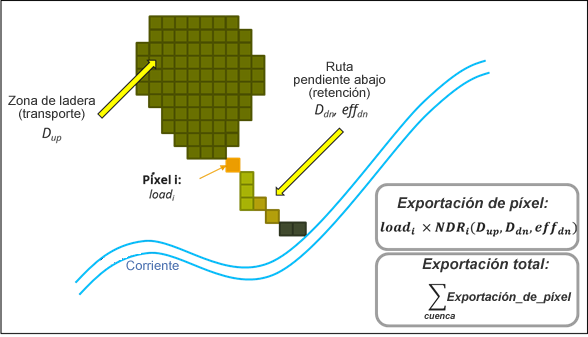
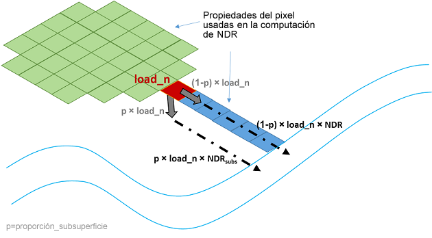
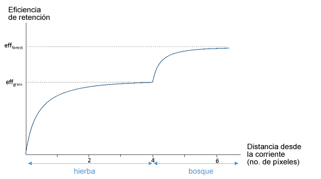
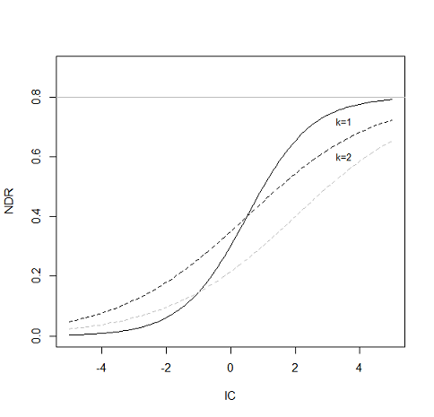

.. _ndr:

****************************************
NDR: Tasa de entrega de nutrientes
****************************************

Resumen
=======

El objetivo del modelo de entrega de nutrientes de InVEST es cartografiar las fuentes de nutrientes de las cuencas hidrográficas y su transporte hacia los cauces. Esta información espacial puede utilizarse para evaluar el servicio de retención de nutrientes que proporciona la vegetación natural. Este servicio es especialmente relevante para los problemas relacionados con la calidad de las aguas superficiales y puede valorarse en términos económicos o sociales, por ejemplo, mediante los costos de tratamiento evitados o la mejora de la seguridad hídrica gracias al acceso a agua potable limpia.

Introducción
============

El cambio de uso del suelo, y en particular su conversión a tierras agrícolas, modifica drásticamente el ciclo natural de los nutrientes. Las fuentes antropogénicas de nutrientes incluyen fuentes puntuales, como los efluentes industriales o las descargas de plantas de tratamiento de aguas, y fuentes difusas, como los fertilizantes utilizados en la agricultura y en las zonas residenciales. Cuando llueve o nieva, el agua fluye sobre el paisaje y transporta contaminantes desde estas superficies hacia arroyos, ríos, lagos y océanos. Esto tiene consecuencias para las personas, pues afecta directamente su salud y bienestar (Keeler et al., 2012), así como para los ecosistemas acuáticos, que tienen una capacidad limitada para adaptarse a estas cargas de nutrientes.

Una forma de reducir la contaminación de fuentes difusas consiste en disminuir los aportes antropogénicos (por ejemplo, mediante una mejor gestión de los fertilizantes). Cuando esta opción no es suficiente, los ecosistemas pueden proporcionar un servicio de depuración al retener o degradar los contaminantes antes de que ingresen a los cauces. Por ejemplo, la vegetación puede eliminar contaminantes al almacenarlos en sus tejidos o devolverlos al ambiente en otra forma. Los suelos también pueden almacenar y retener algunos contaminantes solubles. Los humedales pueden ralentizar el flujo el tiempo suficiente para que la vegetación absorba los contaminantes. La vegetación ribereña es especialmente importante en este sentido, pues a menudo constituye la última barrera antes de que los contaminantes ingresen a un cauce.

Los planificadores del uso del suelo, desde organismos gubernamentales hasta organizaciones ambientales, necesitan información sobre la contribución de los ecosistemas a la mitigación de la contaminación del agua. En concreto, requieren información espacial sobre la exportación de nutrientes y las zonas con mayor capacidad de filtración. El modelo de entrega y retención de nutrientes proporciona esta información para los contaminantes de fuentes difusas. El modelo fue diseñado para nutrientes (nitrógeno y fósforo), pero su estructura puede utilizarse para otros contaminantes (compuestos orgánicos persistentes, patógenos, etc.) si se dispone de datos sobre las tasas de carga y las tasas de filtración del contaminante de interés.

El modelo
=========

Descripción general
-------------------

El modelo utiliza un enfoque sencillo de balance de masas para describir el movimiento de una masa de nutrientes a través del espacio. A diferencia de los modelos de nutrientes más sofisticados, no representa los detalles del ciclo de los nutrientes, sino que describe el flujo de nutrientes a largo plazo, en estado estable, mediante relaciones empíricas. Las fuentes de nutrientes distribuidas por el paisaje, también denominadas cargas de nutrientes, se determinan a partir de un mapa de uso y cobertura del suelo (LULC) y de las tasas de carga asociadas. Posteriormente, las cargas de nutrientes pueden dividirse en fracciones asociadas a sedimentos y disueltas, que serán transportadas, respectivamente, por el flujo superficial y el subsuperficial, hasta llegar a un cauce. El modelado del flujo subsuperficial es opcional: el usuario puede elegir modelar únicamente el flujo superficial. En una segunda etapa, se calculan factores de entrega para cada píxel, basados en las propiedades de los píxeles que pertenecen a una misma trayectoria de flujo (en particular, su pendiente y la eficiencia de retención del uso del suelo). En la salida de la cuenca o subcuenca, la exportación de nutrientes se calcula como la suma de las contribuciones de cada píxel.

|

Representación conceptual del modelo NDR. Cada píxel *i* se caracteriza por su carga de nutrientes, load\ :sub:`i`, y su tasa de entrega de nutrientes (NDR), que es una función del área situada aguas arriba y de la trayectoria de flujo aguas abajo (en particular, de las eficiencias de retención de los tipos de LULC a lo largo de dicha trayectoria). La exportación a escala de píxel se calcula a partir de estos dos factores, y la exportación de nutrientes a escala de cuenca es la suma de las exportaciones de todos los píxeles.

Cargas de nutrientes
--------------------

Las cargas son las fuentes de nutrientes asociadas a cada píxel del paisaje. De acuerdo con la bibliografía sobre coeficientes de exportación (California Regional Water Quality Control Board Central Coast Region, 2013; Reckhow et al., 1980), los valores de carga de cada clase LULC se derivan de mediciones empíricas de exportación de nutrientes (por ejemplo, la exportación de nutrientes procedentes de zonas urbanas, cultivos, etc.). Como alternativa, si se dispone de información sobre la cantidad de nutrientes aplicada (por ejemplo, fertilizantes, residuos ganaderos o deposición atmosférica), es posible utilizarla estimando el uso de nutrientes en el propio píxel y aplicando este factor de corrección para obtener los parámetros de carga. Para más información, consulte la sección Datos necesarios.

A continuación, la carga de cada píxel se modifica para tener en cuenta el potencial local de escorrentía. Las cargas definidas anteriormente a partir del LULC son promedios regionales, pero la contribución de cada píxel dependerá de la cantidad de escorrentía que transporta los nutrientes (Endreny y Wood, 2003; Heathwaite et al., 2005). Como aproximación sencilla, las cargas pueden modificarse de la siguiente manera:

.. math:: modified.load_{x_i}=load_{x_i}\cdot RPI_{x_i}
   :label: ndr_modified_load

donde :math:`RPI_i` es el índice de potencial de escorrentía del píxel :math:`i`, definido como:

.. math:: RPI_i = RP_i/RP_{av}
   :label: ndr_rpi

donde :math:`RP_i` es el indicador indirecto de escorrentía de nutrientes del píxel :math:`i` y :math:`RP_{av}` es el promedio de :math:`RP` en el ráster (o un valor especificado por el usuario). Este enfoque es similar al desarrollado por Endreny y Wood (2003). En la práctica, el ráster RP se define como un índice de flujo rápido (por ejemplo, obtenido del modelo de Rendimiento Hídrico Estacional de InVEST) o como precipitación.

Para cada píxel, las cargas modificadas pueden dividirse en fracciones de nutrientes asociados a sedimentos y nutrientes disueltos. Conceptualmente, la primera representa los nutrientes transportados por la escorrentía superficial o subsuperficial somera, mientras que la segunda representa los nutrientes transportados por el agua subterránea.

.. note::
   Este modelo calcula el componente subsuperficial únicamente para el nitrógeno. No se modela el fósforo subsuperficial porque las partículas de fósforo suelen estar asociadas a los sedimentos y tienen menor probabilidad de ser transportadas por el flujo subsuperficial.

La proporción entre estos dos tipos de fuentes de nutrientes está determinada por el parámetro :math:`proportion\_subsurface\_n`, que cuantifica la relación entre los nutrientes disueltos y la cantidad total de nutrientes. Para un píxel *i*:

.. math:: load_{surf,i} = (1-proportion\_subsurface_i) \cdot modified.load\_n_i
   :label: ndr_surface_load
.. math:: load_{subsurf,i} = proportion\_subsurface_i \cdot modified.load\_n_i
   :label: ndr_subsurface_load

Si no se dispone de información sobre la distribución entre los dos tipos, el valor predeterminado recomendado de :math:`proportion\_subsurface\_n` es 0, lo que significa que todos los nutrientes llegan al cauce mediante el flujo superficial. (Conceptualmente, el flujo superficial puede incluir el flujo subsuperficial somero). Sin embargo, los usuarios deberían explorar la sensibilidad del modelo a este valor para caracterizar la incertidumbre introducida por este supuesto.

Entrega de nutrientes
---------------------

La entrega de nutrientes se basa en el concepto de tasa de entrega de nutrientes (NDR), un enfoque inspirado en el concepto de tasa de entrega de sedimentos revisado por pares (véase el capítulo de la Guía del usuario de InVEST sobre el modelo SDR y Vigiak et al., 2012). El concepto es similar a los enfoques basados en índices de riesgo, populares en el modelado de nutrientes (Drewry et al., 2011), aunque proporciona valores cuantitativos de exportación de nutrientes (por ejemplo, la proporción de la carga de nutrientes que llegará al cauce). Se calculan dos proporciones de entrega: una para los nutrientes transportados por el flujo superficial y otra para los transportados por el flujo subsuperficial.

|
|

Representación conceptual de la entrega de nutrientes en el modelo. Si el usuario decide representar el flujo subsuperficial, la carga de cada píxel, load_n, se divide en dos partes, y la exportación total de nutrientes es la suma de las contribuciones superficial y subsuperficial.

NDR superficial
^^^^^^^^^^^^^^^

La NDR superficial es el producto de un factor de entrega, que representa la capacidad de los píxeles situados aguas abajo para transportar nutrientes sin retenerlos, y un índice topográfico, que representa la posición en el paisaje. Para un píxel *i*:

.. math:: NDR_i = NDR_{0,i}\left(1 + \exp\left(\frac{IC_0-IC_i}{k}\right)\right)^{-1}
   :label: ndr_surface

donde :math:`IC_0` y :math:`k` son parámetros de calibración, :math:`IC_i` es un índice topográfico y :math:`NDR_{0,i}` es la proporción de nutrientes que no es retenida por los píxeles situados aguas abajo (independientemente de la posición del píxel en el paisaje). A continuación se ofrecen detalles sobre el cálculo de cada factor.

:math:`NDR_{0,i}` se basa en la eficiencia máxima de retención del terreno entre un píxel y el cauce (trayectoria aguas abajo, en la Figura 5):

.. math:: NDR_{0,i} = 1 - eff'_i
   :label: ndr_0

A medida que se avanza por una trayectoria de flujo, el algoritmo calcula la retención adicional proporcionada por cada píxel, teniendo en cuenta la distancia total recorrida a través de cada tipo de LULC. Cada píxel adicional del mismo tipo de LULC contribuye con un valor menor a la retención total, hasta alcanzar la eficiencia máxima de retención de ese tipo de LULC (Figura 2). La retención total está limitada por el valor máximo de retención que pueden proporcionar los tipos de LULC a lo largo de la trayectoria de flujo, :math:`eff_{LULC_i}`.

En términos matemáticos:

.. math:: eff'_i =
    \begin{cases}
        eff_{LULC_i}\cdot(1-s_i) & \mathrm{if\ } down_i \mathrm{\ is\ a\ stream\ pixel}\\
        eff'_{down_i}\cdot s_i + eff_{LULC_i}\cdot (1 - s_i) & \mathrm{if\ } eff_{LULC_i} > eff'_{down_i}\\
        eff'_{down_i} & otherwise
    \end{cases}
  :label: ndr_eff

Donde:

 * :math:`eff'_{down_i}` es la retención efectiva aguas abajo en el píxel situado inmediatamente pendiente abajo de :math:`i`,
 * :math:`eff_{LULC_i}` es la eficiencia máxima de retención que puede alcanzar el tipo de LULC del píxel :math:`i`, y
 * :math:`s_i` es el factor de paso definido como:

.. math:: s_i=\exp\left(\frac{-5 \ell_{i_{down}}}{\ell_{LULC_i}}\right)
   :label: ndr_s

Con:

 * :math:`\ell_{i_{down}}` es la longitud de la trayectoria de flujo desde el píxel :math:`i` hasta su vecino situado aguas abajo. Corresponde a la distancia euclidiana entre los centroides de los dos píxeles.
 * :math:`\ell_{LULC_i}` es la longitud de retención del LULC («longitud crítica») del tipo de cobertura del suelo del píxel :math:`i`.

Notas:

Dado que :math:`eff'_i` depende de los píxeles situados aguas abajo, el cálculo se realiza de forma recursiva, comenzando por los píxeles que fluyen directamente hacia los cauces, antes de calcular los píxeles situados aguas arriba.

En la ecuación :eq:`ndr_s`, el factor 5 se basa en el supuesto de que se alcanza la eficiencia máxima cuando se llega al 99 % de su valor (supuesto derivado de la forma exponencial de la función de eficiencia, que implica que el valor máximo no puede alcanzarse con una longitud finita de la trayectoria de flujo).

|

Ilustración del cálculo de la eficiencia de retención a lo largo de una trayectoria de flujo sencilla, compuesta por 4 píxeles de pastizal y 3 píxeles de bosque. Cada píxel adicional de la clase LULC de pastizal contribuye con un porcentaje menor a la eficiencia máxima proporcionada por el pastizal. La forma de las curvas exponenciales está determinada por la eficiencia máxima y la longitud de retención.

|

IC, el índice de conectividad, representa la conectividad hidrológica, es decir, la probabilidad de que los nutrientes de un píxel lleguen al cauce. En este modelo, IC es una función únicamente de la topografía:

.. math:: IC=\log_{10}\left(\frac{D_{up}}{D_{dn}}\right)
   :label: ndr_ic

donde

.. math:: D_{up} = \overline{S}\sqrt{A}
   :label: ndr_d_up

y

.. math:: D_{dn} = \sum_i \frac{d_i}{S_i}
   :label: ndr_d_dn

donde :math:`\overline{S}` es el gradiente medio de la pendiente del área contribuyente situada aguas arriba (m/m), :math:`A` es el área contribuyente situada aguas arriba (m\ :sup:`2`\); :math:`d_i` es la longitud de la trayectoria de flujo a lo largo del píxel *i* según la dirección de mayor pendiente descendente (m) (véanse los detalles en el modelo de sedimentos), y :math:`S_i` es el gradiente de la pendiente del píxel *i*, respectivamente.

Nota: El área contribuyente situada aguas arriba y la trayectoria de flujo aguas abajo se delimitan mediante el algoritmo de dirección de flujo múltiple o el algoritmo de dirección de flujo D8, según la opción seleccionada por el usuario. Para evitar valores infinitos de IC, los valores de pendiente :math:`S` se fuerzan a un mínimo de 0.005 m/m cuando son inferiores a este umbral, calculado a partir del MDE (Cavalli et al., 2013).

El valor de :math:`IC_0` se establece como :math:`IC_0 = \frac{IC_{max}+IC_{min}}{2}`.
Esto hace que la función sigmoide que relaciona NDR con IC esté centrada en la mediana de la distribución de IC y, por tanto, que el valor máximo de IC produzca :math:`NDR=NDR_{max}`. :math:`k` se establece en un valor predeterminado de 2 (véase la teoría del modelo SDR); es un factor empírico que representa la topografía local.

Relación entre NDR y el índice de conectividad IC. El valor máximo de NDR se establece en :math:`NDR_{0}=0.8`. El efecto de la calibración se ilustra estableciendo :math:`k=1` y :math:`k=2` (línea continua y discontinua, respectivamente), y :math:`IC_0=0.5` y :math:`IC_0=2` (líneas discontinuas negra y gris, respectivamente).

NDR subsuperficial
^^^^^^^^^^^^^^^^^^

La expresión de la NDR subsuperficial es una función sencilla de decaimiento exponencial con la distancia al cauce, que alcanza una meseta en el valor correspondiente a la retención máxima de nutrientes subsuperficiales definida por el usuario:

.. math:: NDR_{subs,i} = 1 - eff_{subs}\left(1-e^\frac{-5\cdot\ell}{\ell_{subs}}\right)
   :label: ndr_subsurface

donde

 * :math:`eff_{subs}` es la eficiencia máxima de retención de nutrientes que puede alcanzarse mediante el flujo subsuperficial (es decir, la retención debida a la degradación bioquímica en los suelos),

 * :math:`\ell_{subs}` es la longitud de retención del flujo subsuperficial, es decir, la distancia después de la cual puede suponerse que el suelo retiene los nutrientes a su capacidad máxima,

 * :math:`\ell_i` es la distancia desde el píxel hasta el cauce.

Exportación de nutrientes
^^^^^^^^^^^^^^^^^^^^^^^^^

La exportación de nutrientes de cada píxel *i* se calcula como el producto de la carga y la NDR:

.. math:: x_{exp_i} = load_{surf,i} \cdot NDR_{surf,i} + load_{subs,i} \cdot NDR_{subs,i}
   :label: nutrient_export

La cantidad total de nutrientes en la salida de cada cuenca definida por el usuario es la suma de las contribuciones de todos los píxeles dentro de esa cuenca:

.. math:: x_{exp_{tot}} = \sum_i x_{exp_i}
   :label: total_nutrient_export

Área definida de los resultados
^^^^^^^^^^^^^^^^^^^^^^^^^^^^^^^

Hay tres factores principales que definen el área en la que el modelo produce valores en las capas de salida:
 * Los resultados se limitan al área cubierta por la capa vectorial de entrada de cuencas hidrográficas.
 * Los resultados solo pueden calcularse en los píxeles donde *todos* los rásteres de entrada tienen valores válidos. Si algún ráster de entrada tiene el valor NoData en un píxel, el resultado también será NoData en ese píxel.
 * Los resultados que dependen de la distancia a la red de cauces (como NDR y otros resultados basados en ella) solo se calculan para los píxeles que drenan hacia un cauce.

NDR y varios otros resultados del modelo se definen en función de la distancia al cauce (:math:`d_i`). Por tanto, estos resultados solo están definidos para los píxeles que drenan hacia un cauce del mapa (y que, por tanto, se encuentran dentro de la cuenca hidrográfica de los cauces). Los píxeles que no drenan hacia ningún cauce tendrán valores NoData en estos resultados. Los archivos de salida afectados son: **d_dn.tif**, **dist_to_channel.tif**, **ic_factor.tif**, **ndr_n.tif**, **ndr_p.tif**, **sub_ndr_n.tif**, **n_surface_export.tif**, **n_subsurface_export.tif**, **n_total_export.tif** y **p_surface_export.tif**.

Si observa áreas con valores NoData en estos resultados que no pueden explicarse por la ausencia de datos en las entradas, probablemente se deba a que no están conectadas hidrológicamente con un cauce del mapa. Consulte la :ref:`sección sobre el área definida del SDR <sdr_defined_area>` para obtener información sobre cómo identificar y corregir este problema.

El mapa de cauces del modelo (**stream.tif**) se calcula aplicando un umbral al ráster de acumulación de flujo (**flow_accumulation.tif**) mediante el valor del umbral de acumulación de flujo (TFA):

  .. math::
     :label: ndr_stream

     stream_{TFA,i} = \left\{\begin{array}{lr}
          1, & \text{if } flow\_accum_{i} \geq TFA \\
          0,     & \text{otherwise} \\
          \end{array}\right\}

Evaluación de los servicios de retención de nutrientes
------------------------------------------------------

El modelo NDR no cuantifica directamente la cantidad de nutrientes retenidos en el paisaje. Sin embargo, si dispone de escenarios que se comparan con las condiciones actuales, el servicio de retención de nutrientes puede estimarse calculando la diferencia en la exportación de nutrientes entre el escenario y las condiciones actuales. Esto cuantifica la diferencia en la cantidad de nutrientes que llega a un cauce, en función de los cambios en la cobertura del suelo, el clima, etc., incluidos en el escenario, y permite evaluar los impactos sobre los usos aguas abajo, como el abastecimiento de agua potable.

El cálculo de los servicios de retención de nitrógeno dentro de un único escenario debe realizarse únicamente a escala de cuenca o subcuenca. Utilice el archivo de salida de cuencas .gpkg para cuantificar los servicios de retención de nutrientes a escala de cuenca, restando el resultado *n_total_export* de (*n_surface_load* + *n_subsurface_load*) para el nitrógeno, y *p_surface_export* de *p_surface_load* para el fósforo. Debido al funcionamiento de los algoritmos de retención del modelo, no utilice los rásteres de carga y exportación para realizar este cálculo a escala de píxel. Si calcula modified_load_n - n_total_export para cada píxel, el resultado indica cuánto de la carga de nitrógeno de cada píxel es retenido por los píxeles de su trayectoria de flujo aguas abajo, NO cuánto se retiene en ese mismo píxel.

La valoración monetaria (o no monetaria) de los servicios de retención de nutrientes depende mucho del contexto. Es importante tener en cuenta que la asignación de un valor monetario a cualquier servicio solo debe realizarse con resultados del modelo que hayan sido calibrados y validados. De lo contrario, se desconoce en qué medida el modelo representa el área de interés, lo que puede llevar a una representación incorrecta del valor exacto. Si el modelo no ha sido calibrado, deben utilizarse únicamente resultados relativos (por ejemplo, un aumento del 10 %) y no valores absolutos (como 1523 kg o 42 900 dólares). Para más información sobre la calibración y validación del modelo NDR, consulte :ref:`comparison-to-observed-data`.

Limitaciones y simplificaciones
===============================

El modelo tiene pocos parámetros y los resultados suelen mostrar una elevada sensibilidad a los datos de entrada. Esto implica que los errores en los valores empíricos de los parámetros de carga tendrán un efecto importante en las predicciones. De manera similar, los valores de eficiencia de retención se basan en estudios empíricos, y los factores que afectan estos valores (como la pendiente o la variabilidad intraanual) se promedian. Estos valores incorporan implícitamente información sobre las dinámicas dominantes de los nutrientes, influenciadas por el clima y los suelos. El modelo también supone que, una vez que los nutrientes llegan al cauce, afectan la calidad del agua en la salida de la cuenca; no se representan los procesos que ocurren dentro del cauce. Por último, el efecto de la resolución de la cuadrícula en la formulación de NDR no ha sido estudiado en profundidad.

Se recomienda realizar análisis de sensibilidad para investigar cómo los intervalos de confianza de los parámetros de entrada afectan las conclusiones del estudio (Redhead et al., 2018).

Interpretación del modelo biofísico para la valoración
------------------------------------------------------

Algunos enfoques de valoración, como los que se basan en los cambios en la calidad del agua para una planta de tratamiento, son muy sensibles a las predicciones absolutas del modelo. Por ello, es importante considerar las incertidumbres asociadas al uso de InVEST como herramienta predictiva y minimizar su efecto en la etapa de valoración.

Incertidumbre de los parámetros del modelo
^^^^^^^^^^^^^^^^^^^^^^^^^^^^^^^^^^^^^^^^^^

Las incertidumbres de los parámetros de entrada pueden caracterizarse mediante una revisión bibliográfica (por ejemplo, examinando la distribución de valores de distintos estudios). Una opción para evaluar el impacto de las incertidumbres de los parámetros consiste en realizar análisis de sensibilidad locales o globales, con rangos de parámetros obtenidos de la bibliografía (Redhead et al., 2018). Véase también Hamel y Bryant (2017), que ofrecen orientaciones más generales para evaluar la incertidumbre en los análisis de servicios ecosistémicos. Hamel et al. (2015) describen el proceso para el modelo SDR, que es similar al NDR.

Incertidumbre estructural del modelo
^^^^^^^^^^^^^^^^^^^^^^^^^^^^^^^^^^^^

El modelo InVEST calcula un balance de masas de nutrientes en una cuenca, restando las pérdidas de nutrientes (representadas conceptualmente por los coeficientes de retención) de las fuentes totales de nutrientes. Cuando corresponde, es posible distinguir entre las trayectorias de flujo superficial y subsuperficial, incorporando tres parámetros al modelo. En ausencia de conocimiento empírico, los modeladores pueden suponer que los parámetros de carga y retención superficial representan ambos procesos de transporte. Se recomienda probar y calibrar el modelo, reconociendo dos desafíos principales:

 * Vacíos de conocimiento sobre el transporte de nutrientes: aunque existen pruebas sólidas del impacto del cambio de uso del suelo en la exportación de nutrientes, el modelado de las dinámicas a escala de cuenca sigue siendo complejo (Breuer et al., 2008; Scanlon et al., 2007). Por tanto, la calibración es difícil y no se recomienda sin análisis detallados que proporcionen confianza en la representación de los procesos del modelo (Redhead et al., 2018).

 * Posible contribución de la contaminación de fuentes puntuales: los residuos domésticos e industriales suelen formar parte del balance de nutrientes y deben tenerse en cuenta durante la calibración (por ejemplo, añadiendo las cargas de nutrientes de fuentes puntuales a la exportación de nutrientes modelada y comparando luego la suma con los datos observados).

Datos necesarios
================

.. note:: *Todas las entradas espaciales deben tener exactamente el mismo sistema de coordenadas proyectadas* (con unidades lineales en metros), *no* un sistema de coordenadas geográficas (con unidades en grados).

.. note:: Los resultados solo pueden calcularse en los píxeles donde *todos* los rásteres de entrada tienen valores válidos. Si algún ráster de entrada tiene el valor NoData en un píxel, el resultado también será NoData en ese píxel.

.. note:: Los rásteres de entrada pueden tener diferentes tamaños de celda y se remuestrearán para que coincidan con el tamaño de celda del MDE. Por tanto, todos los resultados del modelo tendrán el mismo tamaño de celda que el MDE.

El modelo ofrece opciones para calcular nitrógeno, fósforo o ambos. Debe proporcionar todas las entradas correspondientes al nutriente o los nutrientes seleccionados.

- :investspec:`ndr.ndr workspace_dir`

- :investspec:`ndr.ndr results_suffix`

- :investspec:`ndr.ndr dem_path` Asegúrese de corregir el MDE rellenando las depresiones y compare los mapas de cauces de salida con los mapas hidrográficos del área. Para garantizar una correcta dirección del flujo, el MDE debe extenderse más allá de las cuencas de interés, en lugar de recortarse por el límite de la cuenca.

- :investspec:`ndr.ndr lulc_path`

- :investspec:`ndr.ndr runoff_proxy_path` Este ráster puede definirse como un índice de flujo rápido (por ejemplo, procedente del modelo de :ref:`Rendimiento Hídrico Estacional <seasonal_water_yield>`) o simplemente como la precipitación anual. Este es :math:`RP`, que se normaliza (dividiéndolo por su valor promedio, especificado por el usuario o calculado automáticamente) para obtener el índice de potencial de escorrentía :math:`RPI` de la ecuación :eq:`ndr_rpi`. No existe un requisito específico para las unidades de esta entrada, ya que el modelo la normaliza antes de utilizarla en los cálculos.

- :investspec:`ndr.ndr watersheds_path`

- :investspec:`ndr.ndr calc_n`
- :investspec:`ndr.ndr calc_p`

- :investspec:`ndr.ndr biophysical_table_path`

    Columnas:

    - :investspec:`ndr.ndr biophysical_table_path.columns.lucode`
    - :investspec:`ndr.ndr biophysical_table_path.columns.load_n`
    - :investspec:`ndr.ndr biophysical_table_path.columns.load_p`

    .. note::
       Las cargas son las fuentes de nutrientes asociadas a cada clase LULC. Este valor representa la carga total procedente de todas las fuentes. Si desea representar distintos niveles de aplicación de fertilizantes, deberá crear clases LULC separadas; por ejemplo, una clase denominada «cultivos: uso elevado de fertilizantes» y otra denominada «cultivos: uso bajo de fertilizantes».

    - :investspec:`ndr.ndr biophysical_table_path.columns.load_type_p`
    - :investspec:`ndr.ndr biophysical_table_path.columns.load_type_n`

    .. note::
       Las fuentes de datos pueden proporcionar valores de carga como tasa de aplicación de nutrientes (por ejemplo, fertilizantes, residuos ganaderos o deposición atmosférica) o como escorrentía de contaminantes medida, es decir, valores empíricos que representan la contribución de una parcela al balance de nutrientes (por ejemplo, la exportación de nutrientes por escorrentía desde zonas urbanas, cultivos, etc.). Estos dos tipos de valores de carga se denominan *application-rate* y *measured-runoff*, respectivamente, en la tabla biofísica. Dado que las ecuaciones del modelo requieren valores de escorrentía medida, si se proporcionan valores de tasa de aplicación, el modelo los ajustará para tener en cuenta la retención de nutrientes que ocurre en el propio píxel, utilizando la tasa de aplicación y el valor de eficiencia de retención (*eff_n* o *eff_p*) correspondiente a ese tipo de cobertura del suelo:

       :math:`loading = application\_rate * (1 - retention\_efficiency)`

       utilizando los campos específicos de la tabla biofísica para el nitrógeno:

       :math:`loading = load\_n * (1 - eff\_n)`

       Tenga en cuenta que puede proporcionar una combinación de valores *measured-runoff* y *application-rate*, y que el modelo solo ajustará los valores *application-rate* como se describe; los valores *measured-runoff* no necesitan ajustarse. Por ejemplo, si la tasa de aplicación de nitrógeno para una clase LULC agrícola es de 10 kg/ha/año y la eficiencia de retención es de 0.4, el modelo ajustará el valor a 6.0 kg/ha/año (= 10 kg/ha/año * (1 - 0.4)). Si dispone de valores medidos de exportación de nutrientes, denominados *measured-runoff* en la tabla biofísica, el modelo los utilizará directamente, sin ajustes.

    - :investspec:`ndr.ndr biophysical_table_path.columns.eff_n`
    - :investspec:`ndr.ndr biophysical_table_path.columns.eff_p`

    .. note::
       La capacidad de retención de nutrientes de un tipo de vegetación se expresa como una proporción de la cantidad de nutrientes procedentes de aguas arriba. Por ejemplo, pueden asignarse valores altos (0.6 a 0.8) a todos los tipos de vegetación natural (como bosques, pastizales naturales, humedales o praderas), lo que indica que se retiene entre el 60 % y el 80 % de los nutrientes.

    - :investspec:`ndr.ndr biophysical_table_path.columns.crit_len_n`
    - :investspec:`ndr.ndr biophysical_table_path.columns.crit_len_p`

    .. note::
       Si los nutrientes recorren una distancia inferior a la longitud de retención, la eficiencia de retención será menor que el valor máximo *eff_x*, siguiendo un decaimiento exponencial (véase la sección Entrega de nutrientes).

    - :investspec:`ndr.ndr biophysical_table_path.columns.proportion_subsurface_n`

    A continuación se presenta un ejemplo de tabla biofísica, tomado de los datos de muestra de InVEST para NDR. Tenga en cuenta que este ejemplo y el resto de los datos de muestra de NDR deben utilizarse únicamente como referencia. Sus clases LULC y los valores biofísicos correspondientes serán diferentes.

    .. csv-table::
       :file: ./ndr/biophysical_table_NDR_gura.csv
       :header-rows: 1
       :name: NDR Biophysical Table Example
       :widths: auto

- :investspec:`ndr.ndr threshold_flow_accumulation` Se utiliza para clasificar los cauces a partir del MDE. Este umbral afecta directamente la representación de la conectividad hidrológica y el resultado de exportación de nutrientes: cuando una trayectoria de flujo llega al cauce, la retención de nutrientes se detiene y se supone que los nutrientes exportados llegan a la salida de la cuenca. Es importante elegir este valor cuidadosamente para que los cauces modelados se aproximen lo más posible a la realidad. Consulte el Apéndice 1 para obtener más información sobre cómo elegir este valor.

- :investspec:`ndr.ndr k_param` El valor predeterminado es 2.

- :investspec:`ndr.ndr runoff_proxy_av` Introducir un promedio personalizado del indicador indirecto de escorrentía, en lugar de utilizar el promedio calculado automáticamente, garantiza la coherencia entre ejecuciones del modelo. Si ejecuta este modelo varias veces con distintas entradas (por ejemplo, con diferentes cuencas o para comparar distintos escenarios climáticos), pero desea mantener una referencia constante para el índice de potencial de escorrentía, especificar un promedio fijo de RP garantiza la comparabilidad (dado que :math:`RPI_i` cambia en función de los píxeles o cuencas incluidos en el ráster :math:`RP`). Tenga en cuenta que el promedio del indicador indirecto de escorrentía debe ser mayor que 0.

- :investspec:`ndr.ndr subsurface_critical_length_n`

.. note::
   Si el nitrógeno disuelto recorre una distancia inferior a su longitud crítica subsuperficial, la eficiencia de retención será menor que el valor de eficiencia máxima de retención subsuperficial definido. Si este valor se establece en una distancia inferior al tamaño del píxel, la eficiencia máxima de retención se alcanzará dentro de un solo píxel.

- :investspec:`ndr.ndr subsurface_eff_n`

- :investspec:`ndr.ndr flow_dir_algorithm` Controla cómo se modela el flujo de agua. Con el algoritmo D8, toda el agua de un píxel determinado fluye hacia el píxel vecino situado en la dirección de mayor pendiente descendente. Con el algoritmo de dirección de flujo múltiple (MFD), el agua de un píxel fluye hacia todos sus vecinos situados aguas abajo, ponderada según la inclinación de la pendiente descendente.

Interpretación de los resultados
================================

.. note:: A partir de InVEST 3.15.0, los resultados ráster de NDR se expresan como valores *por hectárea*.

En los nombres de archivo que aparecen a continuación, «x» representa n (nitrógeno) o p (fósforo), según los nutrientes modelados. La resolución de los rásteres de salida será la misma que la resolución del MDE proporcionado como entrada.

* **Registro de parámetros**: Cada vez que se ejecuta el modelo, se crea un archivo de texto (.txt) en el espacio de trabajo. El archivo enumera los valores de los parámetros y los mensajes de salida de esa ejecución, y se denomina de acuerdo con el servicio, la fecha y la hora. Cuando se comunique con NatCap por errores en la ejecución de un modelo, incluya el registro de parámetros.

* Carpeta **[Workspace]**:

   * **ndr_report.html:** Resumen de una ejecución del modelo, que incluye visualizaciones de los resultados principales, tablas de los resultados calculados e información sobre las entradas del modelo. Se puede acceder al informe desde Workbench o abrirlo con cualquier navegador web. Para ver un ejemplo, consulte el `Informe de ejemplo de NDR <https://storage.googleapis.com/releases.naturalcapitalproject.org/invest-reports/latest/ndr_report_gura.html>`_, generado al ejecutar el modelo NDR con los datos de muestra de NDR.

   * **watershed_results_ndr.gpkg**: archivo vectorial con los resultados agregados del modelo de nutrientes por cuenca. La tabla .dbf contiene la siguiente información para cada cuenca:

      * *p_surface_load*: cargas totales de fósforo (fuentes) en la cuenca, es decir, la suma de la contribución de nutrientes de todos los tipos de LULC superficiales sin filtración por parte del paisaje. [unidades: kg/año]
      * *n_surface_load*: cargas totales de nitrógeno (fuentes) en la cuenca, es decir, la suma de la contribución de nutrientes de todos los tipos de LULC superficiales sin filtración por parte del paisaje. [unidades: kg/año]
      * *n_subsurface_load*: cargas totales de nitrógeno subsuperficial en la cuenca. [unidades: kg/año]
      * *p_surface_export*: exportación total de fósforo desde la cuenca mediante el flujo superficial. [unidades: kg/año] (Ec. :eq:`total_nutrient_export`)
      * *n_surface_export*: exportación total de nitrógeno desde la cuenca mediante el flujo superficial. [unidades: kg/año] (Ec. :eq:`total_nutrient_export`)
      * *n_subsurface_export*: exportación total de nitrógeno desde la cuenca mediante el flujo subsuperficial. [unidades: kg/año] (Ec. :eq:`total_nutrient_export`)
      * *n_total_export*: exportación total de nitrógeno desde la cuenca mediante el flujo superficial y subsuperficial. [unidades: kg/año] (Ec. :eq:`total_nutrient_export`)

   * **stream.tif**: red de cauces creada a partir del MDE, donde 0 representa los píxeles terrestres y 1 representa los píxeles de cauce (Ec. :eq:`ndr_stream`). Compare esta capa con un mapa de cauces del mundo real y ajuste el umbral de acumulación de flujo para que coincida lo más posible con los cauces reales.
   * **p_surface_export.tif**: mapa a escala de píxel que muestra cuánto fósforo de cada píxel llega finalmente al cauce mediante el flujo superficial. [unidades: kg/hectárea/año] (Ec. :eq:`nutrient_export`)
   * **n_surface_export.tif**: mapa a escala de píxel que muestra cuánto nitrógeno de cada píxel llega finalmente al cauce mediante el flujo superficial. [unidades: kg/hectárea/año] (Ec. :eq:`nutrient_export`)
   * **n_subsurface_export.tif**: mapa a escala de píxel que muestra cuánto nitrógeno de cada píxel llega finalmente al cauce mediante el flujo subsuperficial. [unidades: kg/hectárea/año] (Ec. :eq:`nutrient_export`)
   * **n_total_export.tif**: mapa a escala de píxel que muestra cuánto nitrógeno de cada píxel llega finalmente al cauce (la suma de **n_surface_export.tif** y **n_subsurface_export.tif**). [unidades: kg/hectárea/año] (Ec. :eq:`nutrient_export`)

* Carpeta **[Workspace]\\intermediate_outputs**:

   * **crit_len_x.tif**: valores de longitud de retención, crit_len, incluidos en la tabla biofísica.
   * **d_dn.tif**: factor aguas abajo del índice de conectividad (Ec. :eq:`ndr_d_dn`).
   * **d_up.tif**: factor aguas arriba del índice de conectividad (Ec. :eq:`ndr_d_up`).
   * **dist_to_channel.tif**: distancia media pendiente abajo desde un píxel hasta el cauce.
   * **eff_x.tif**: eficiencia bruta de retención de la cobertura del paisaje para el nutriente `x`.
   * **effective_retention_x.tif**: retención efectiva proporcionada por la trayectoria de flujo aguas abajo para cada píxel (Ec. :eq:`ndr_eff`).
   * **flow_accumulation.tif**: acumulación de flujo creada a partir del MDE.
   * **flow_direction.tif**: dirección de flujo creada a partir del MDE.
   * **ic_factor.tif**: índice de conectividad (Ec. :eq:`ndr_ic`).
   * **load_x.tif**: cargas (para el transporte superficial) [unidades: kg/hectárea/año].
   * **modified_load_x.tif**: carga bruta ajustada mediante el índice de potencial de escorrentía. [unidades: kg/hectárea/año]
   * **ndr_x.tif**: valores de NDR (Ec. :eq:`ndr_surface`).
   * **runoff_proxy_index.tif**: valores normalizados de la entrada del indicador indirecto de escorrentía al modelo.
   * **s_accumulation.tif**: parámetro de pendiente de la ecuación IC, descrito en la sección Entrega de nutrientes.
   * **s_bar.tif**: parámetro de pendiente de la ecuación IC, descrito en la sección Entrega de nutrientes.
   * **s_factor_inverse.tif**: parámetro de pendiente de la ecuación IC, descrito en la sección Entrega de nutrientes.
   * **sub_load_n.tif**: cargas de nitrógeno para el transporte subsuperficial [unidades: kg/hectárea/año].
   * **sub_ndr_n.tif**: valores de NDR subsuperficial del nitrógeno.
   * **surface_load_x.tif**: cargas de nutrientes superficiales [unidades: kg/hectárea/año].
   * **thresholded_slope.tif**: ráster con valores de pendiente limitados por umbrales para calcular correctamente IC.
   * **what_drains_to_stream.tif**: mapa de los píxeles que drenan hacia un cauce. Un valor de 1 significa que al menos una parte de la escorrentía de ese píxel drena hacia un cauce de **stream.tif**. Un valor de 0 significa que no drena en absoluto hacia ningún cauce de **stream.tif**.

.. _comparison-to-observed-data:

Calibración/comparación con datos observados
============================================

El capítulo :ref:`calibration_freshwater` de esta Guía ofrece una descripción general de cómo realizar análisis de sensibilidad y calibración.

El modelo InVEST proporciona una evaluación de primer orden de los procesos de retención de nutrientes y puede compararse con observaciones. Las series temporales de concentración de nutrientes utilizadas para validar el modelo deberían abarcar un período suficientemente largo (preferiblemente al menos 10 años) para atenuar el efecto de la variabilidad interanual. Las series temporales también deberían estar relativamente completas a lo largo del año (sin vacíos estacionales importantes) para garantizar la comparación con las cargas anuales totales. Si los datos observados se expresan como series temporales de concentración de nutrientes, deben convertirse en cargas anuales (LOADEST y FLUX32 son dos herramientas de software que facilitan esta conversión). Redhead et al. (2018) ofrecen detalles adicionales sobre los métodos y el desempeño del modelo para predicciones relativas.

Valladares-Castellanos et al. (2024) realizaron un estudio detallado de calibración y validación del modelo NDR en `Puerto Rico <https://doi.org/10.1016/j.scitotenv.2024.175111>`_, utilizando datos abiertos de monitoreo. En el artículo citado presentan su marco metodológico, flujo de trabajo y código R, que pueden adaptarse a otras localidades. Se recomienda su lectura al planificar un proceso propio de calibración y validación.

Si existen represas en los cauces del área de análisis, es posible que estén reteniendo nutrientes y que estos no lleguen a la salida del área de estudio. En este caso, puede ser útil ajustar esta retención al comparar los resultados del modelo con los datos observados. Como ejemplo de cómo se realizó este procedimiento en un estudio del noreste de Estados Unidos, véase Griffin et al. (2020). La metodología de retención por represas se describe en el apéndice de ese artículo y requiere conocer la eficiencia de retención de nutrientes de la(s) represa(s).

Apéndice: Fuentes de datos
==========================

:ref:`Digital Elevation Model <dem>`
------------------------------------

:ref:`Land Use/Land Cover <lulc>`
---------------------------------

:ref:`Watersheds <watersheds>`
------------------------------

:ref:`Flow Direction Algorithm <flow_direction_algorithms>`
-----------------------------------------------------------

:ref:`Threshold Flow Accumulation <tfa>`
----------------------------------------

Indicador indirecto de escorrentía de nutrientes
------------------------------------------------

Puede utilizarse el índice de flujo rápido (por ejemplo, procedente del modelo de Rendimiento Hídrico Estacional de InVEST u otro modelo) o la precipitación media anual. La precipitación media anual puede interpolarse a partir de pluviómetros existentes y de conjuntos de datos globales procedentes de modelos de teledetección para cubrir las zonas remotas. Al considerar los datos de pluviómetros, asegúrese de que proporcionen una buena cobertura del área de interés, especialmente si existen grandes cambios de elevación que generan una distribución heterogénea de la precipitación dentro del AOI. Idealmente, los pluviómetros deberían contar con al menos 10 años de datos continuos, sin vacíos importantes, correspondientes aproximadamente al mismo período que el mapa de uso y cobertura del suelo utilizado.

Si no se dispone de datos de campo, pueden utilizarse datos de precipitación anual de resolución gruesa procedentes de conjuntos de datos globales de libre acceso, como WorldClim (https://www.worldclim.org/) o la Unidad de Investigación Climática (http://www.cru.uea.ac.uk).

Carga de nutrientes
-------------------

Para todos los parámetros de calidad del agua (carga de nutrientes, eficiencia de retención y longitud de retención), debe consultarse la bibliografía local para obtener valores específicos del sitio. La base de datos de parámetros de nutrientes de NatCap ofrece una lista no exhaustiva de referencias locales sobre cargas de nutrientes y eficiencias de retención: https://naturalcapitalalliance.stanford.edu/sites/g/files/sbiybj9321/f/nutrient_db_0212.xlsx. Parn et al. (2012) y Harmel et al. (2007) ofrecen una buena revisión para tierras agrícolas de climas templados.

Las fuentes de datos pueden proporcionar valores de carga como tasa de aplicación de nutrientes (por ejemplo, fertilizantes, residuos ganaderos o deposición atmosférica) o como escorrentía de contaminantes medida, es decir, valores empíricos que representan la contribución de una parcela al balance de nutrientes (por ejemplo, la exportación de nutrientes por escorrentía desde zonas urbanas, cultivos, etc.). Estos dos tipos de valores de carga se denominan *application-rate* y *measured-runoff*, respectivamente, en la tabla biofísica. Dado que las ecuaciones del modelo requieren valores de escorrentía medida, si se proporcionan valores de tasa de aplicación, el modelo los ajustará para tener en cuenta la retención de nutrientes que ocurre en el propio píxel, utilizando la tasa de aplicación y el valor de eficiencia de retención (*eff_n* o *eff_p*) correspondiente a ese tipo de cobertura del suelo:

:math:`loading = application rate * (1 - retention efficiency)`

utilizando los campos específicos de la tabla biofísica para el nitrógeno:

:math:`loading = load\_n * (1 - eff\_n)`

Tenga en cuenta que puede proporcionar una combinación de valores *measured-runoff* y *application-rate*, y que el modelo solo ajustará los valores *application-rate* como se describe; los valores *measured-runoff* no necesitan ajustarse.

Por ejemplo, si la tasa de aplicación de nitrógeno para una clase LULC agrícola es de 10 kg/ha/año y la eficiencia de retención es de 0.4, el modelo ajustará el valor a 6.0 kg/ha/año (= 10 kg/ha/año * (1 - 0.4)). Si dispone de valores medidos de exportación de nutrientes, denominados *measured-runoff* en la tabla biofísica, el modelo los utilizará directamente, sin ajustes.

En el Manual del usuario de EPA PLOAD y en una revisión de Lin (2004) pueden encontrarse ejemplos de coeficientes de exportación («medidas extensivas») para Estados Unidos. Tenga en cuenta que los ejemplos de la guía de EPA están expresados en lbs/ac/año y deben convertirse a kg/ha/año.

Eficiencia de retención
-----------------------

Este valor representa, conceptualmente, la retención máxima de nutrientes que puede esperarse de un tipo determinado de LULC. A los tipos de LULC con vegetación natural (como bosques, pastizales naturales, humedales o praderas) generalmente se les asignan valores altos (>0.8). Se recomienda revisar la bibliografía local y consultar con especialistas en hidrología para seleccionar los valores más pertinentes para este parámetro. La base de datos de parámetros de nutrientes de NatCap ofrece una lista no exhaustiva de referencias locales sobre cargas de nutrientes y eficiencias de retención: https://naturalcapitalalliance.stanford.edu/sites/g/files/sbiybj9321/f/nutrient_db_0212.xlsx. Parn et al. (2012) ofrecen una revisión útil para climas templados. Las revisiones sobre la eficiencia de las franjas ribereñas, aunque corresponden a un caso particular de retención por LULC, también pueden utilizarse como punto de partida (Mayer et al., 2007; Zhang et al., 2009).

Longitud de retención: crit_len_n y crit_len_p
----------------------------------------------

Este valor representa la distancia típica necesaria para alcanzar la eficiencia máxima de retención. Se introdujo en el modelo para eliminar cualquier sensibilidad a la resolución del ráster LULC. La bibliografía sobre la eficiencia de eliminación de contaminantes por franjas ribereñas sugiere que las longitudes de retención oscilan entre 10 y 300 m (Mayer et al., 2007; Zhang et al., 2009). En ausencia de datos locales para usos del suelo que no sean bosques o pastizales, puede establecerse simplemente una longitud de retención constante, igual al tamaño del píxel; esto hará que la eficiencia máxima de retención se alcance en una distancia de un solo píxel. Otra opción es tratar la longitud de retención como un parámetro de calibración. Si no se dispone de otra información, comience con un valor situado en el punto medio del intervalo indicado (es decir, 150 m) y varíelo hacia arriba y hacia abajo durante la calibración para encontrar un ajuste adecuado.

Parámetros subsuperficiales: proportion_subsurface_n, eff_sub, crit_len_sub
---------------------------------------------------------------------------

Estos valores se utilizan para análisis avanzados y deben seleccionarse en consulta con especialistas en hidrología. Parn et al. (2012) proporcionan valores promedio para la distribución de las cargas de N entre la lixiviación y la escorrentía superficial. A partir de Mayer et al. (2007), puede suponerse un promedio global de 200 m para la longitud de retención y de 80 % para la eficiencia de retención de las franjas vegetadas.

Referencias
===========

Breuer, L., Vaché, K.B., Julich, S., Frede, H.-G., 2008. Current concepts in nitrogen dynamics for mesoscale catchments. Hydrol. Sci. J. 53, 1059–1074.

California Regional Water Quality Control Board Central Coast Region, 2013. Total Maximum Daily Loads for Nitrogen Compounds and Orthophosphate for the Lower Salinas River and Reclamation Canal Basin , and the Moro Cojo Slough Subwatershed , Monterey County, CA. Appendix F. Available at: https://www.waterboards.ca.gov/centralcoast/water_issues/programs/tmdl/docs/salinas/nutrients/index.html

Endreny, T.A., Wood, E.F., 2003. Watershed weighting of export coefficients to map critical phosphorous loading areas. J. Am. Water Resour. Assoc. 08544, 165–181.

Robert Griffin, Adrian Vogl, Stacie Wolny, Stefanie Covino, Eivy Monroy, Heidi Ricci, Richard Sharp, Courtney Schmidt, Emi Uchida, 2020. "Including Additional Pollutants into an Integrated Assessment Model for Estimating Nonmarket Benefits from Water Quality," Land Economics, University of Wisconsin Press, vol. 96(4), pages 457-477. DOI: 10.3368/wple.96.4.457

Hamel, P. & Bryant, B. (2017). Uncertainty assessment in ecosystem services analyses: Seven challenges and practical responses. Ecosystem Services, Volume 24. https://doi.org/10.1016/j.ecoser.2016.12.008.

Hamel, P., Chaplin-Kramer, R., Sim, S., Mueller, C., 2015. A new approach to modeling the sediment retention service (InVEST 3.0): Case study of the Cape Fear catchment, North Carolina, USA. Sci. Total Environ. 166–177.

Harmel, D., Potter, S., Casebolt, P., Reckhow, K., 2007. Compilation of measured nutrient load data for agricultural land uses in the United States 76502, 1163–1178.

Heathwaite, A.L., Quinn, P.F., Hewett, C.J.M., 2005. Modelling and managing critical source areas of diffuse pollution from agricultural land using flow connectivity simulation. J. Hydrol. 304, 446–461.

Keeler, B.L., Polasky, S., Brauman, K.A., Johnson, K.A., Finlay, J.C., Neill, A.O., 2012. Linking water quality and well-being for improved assessment and valuation of ecosystem services 109, 18629–18624.

Lin, J.., 2004. Review of published export coefficient and event mean concentration (EMC) data, WRAP Technical Notes Collection (ERDC TN-WRAP-04-3). Vicksburg, MS.

Mayer, P.M., Reynolds, S.K., Mccutchen, M.D., Canfield, T.J., 2007. Meta-Analysis of Nitrogen Removal in Riparian Buffers 1172–1180.

Pärn, J., Pinay, G., Mander, Ü., 2012. Indicators of nutrients transport from agricultural catchments under temperate climate: A review. Ecol. Indic. 22, 4–15.

Reckhow, K.H., Beaulac, M.N., Simpson, J.T., 1980. Modeling Phosphorus loading and lake response under uncertainty: a manual and compilation of export coefficients. EPA 440/5-80-011. US-EPA, Washington, DC.

Redhead, John W.; May, Linda; Oliver, Tom H.; Hamel, Perrine; Sharp, Richard; Bullock, James M.. 2018 National scale evaluation of the InVEST nutrient retention model in the United Kingdom. Science of the Total Environment, 610-611. 666-677. https://doi.org/10.1016/j.scitotenv.2017.08.092

Scanlon, B.R., Jolly, I., Sophocleous, M., Zhang, L., 2007. Global impacts of conversions from natural to agricultural ecosystems on water resources: Quantity versus quality. Water Resour. Res. 43.

Tarboton, D., 1997. A new method for the determination of flow directions and upslope areas in grid digital elevation models. Water Resour. Res. 33, 309–319.

Valladares-Castellanos, M., de Jesús Crespo, R., Xu, Y. J., Douthat, T. H., 2024. A framework for validating watershed ecosystem service models in the United States using long-term water quality data: Applications with the InVEST Nutrient Delivery (NDR) model in Puerto Rico, Science of The Total Environment, Volume 949, 2024, 175111, ISSN 0048-9697, https://doi.org/10.1016/j.scitotenv.2024.175111.

Vigiak, O., Borselli, L., Newham, L.T.H., Mcinnes, J., Roberts, A.M., 2012. Comparison of conceptual landscape metrics to define hillslope-scale sediment delivery ratio. Geomorphology 138, 74–88.

Zhang, X., Liu, X., Zhang, M., Dahlgren, R. a, Eitzel, M., 2009. A review of vegetated buffers and a meta-analysis of their mitigation efficacy in reducing nonpoint source pollution. J. Environ. Qual. 39, 76–84.
