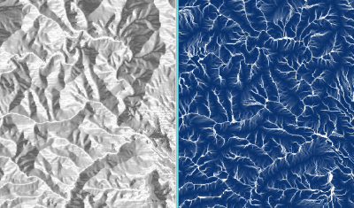

.. _routedem:

********
RouteDEM
********

Resumen
=======

Introducción
============

Los modelos de agua dulce de InVEST se ejecutan sobre un modelo digital de elevación (DEM o MDE). Durante el desarrollo de InVEST, comprobamos que las implementaciones existentes de los algoritmos de dirección y acumulación del flujo presentaban deficiencias. Para responder a esta necesidad, desarrollamos nuestras propias implementaciones de alto rendimiento del algoritmo de dirección del flujo D8 y del flujo fraccional («dirección del flujo múltiple», MFD), combinadas con un algoritmo de resolución de mesetas que permite dirigir el flujo a través de áreas planas (Garbrecht y Martz) y que supera a las implementaciones de TauDEM y GRASS. Consideramos que estas implementaciones son lo suficientemente útiles como para ofrecerlas como una herramienta independiente que permite:

* Rellenar las depresiones hidrológicas.

* Resolver las áreas planas de un DEM para que todas las regiones drenen hacia algún punto.

* Calcular la dirección del flujo sobre un DEM.

* Calcular la acumulación del flujo sobre un DEM.

* Crear cauces a partir de la acumulación del flujo.

* Determinar el orden de corriente de Strahler de los cauces.

* Delimitar subcuencas a partir de los cauces.

Esta herramienta puede ser útil al preparar el DEM para utilizarlo en los modelos de agua dulce. Para estos modelos, se necesitan cauces continuos (no fragmentados) y se debe elegir un valor de acumulación de flujo umbral que genere una red de cauces modelada lo más parecida posible a la red de cauces del mundo real. Con RouteDEM puede probar el DEM, observar cómo lo procesa InVEST y crear rásteres de cauces que le ayuden a elegir un valor umbral adecuado, sin necesidad de ejecutar todo el modelo de agua dulce.

Después de instalar InVEST, encontrará esta herramienta en el menú Inicio, dentro de la carpeta de InVEST, como una utilidad llamada *RouteDEM*.

RouteDEM siempre resolverá las depresiones y las mesetas antes de dirigir el flujo.

Datos necesarios
================

- :investspec:`routedem workspace_dir`

- :investspec:`routedem results_suffix`

- :investspec:`routedem dem_path` El modelo resolverá automáticamente las depresiones hidrológicas y las regiones planas de meseta.

- :investspec:`routedem dem_band_index` Si no se proporciona este valor, se utilizará el índice de banda 1.

- :investspec:`routedem algorithm` Consulte :ref:`Algoritmo de dirección del flujo <flow_direction_algorithms>`.

- :investspec:`routedem calculate_slope`

- :investspec:`routedem calculate_flow_direction` El resultado se guardará en el archivo de salida *flow_direction.tif*.

- :investspec:`routedem calculate_flow_accumulation` El resultado se guardará en el archivo de salida *flow_accumulation.tif*.

- :investspec:`routedem calculate_stream_threshold` El resultado se guardará en el archivo de salida *stream_mask.tif*. Todos los píxeles del ráster de acumulación del flujo cuyo valor sea mayor o igual al **límite umbral de acumulación del flujo** se considerarán parte de un cauce.

- :investspec:`routedem threshold_flow_accumulation`

- :investspec:`routedem calculate_downslope_distance` El resultado se guardará en el archivo *downslope_distance.tif* del espacio de trabajo. La distancia se expresa en número de píxeles. Para convertir esta distancia en píxeles a unidades lineales, multiplique el ráster *downslope_distance.tif* por el tamaño del píxel.

- :investspec:`routedem calculate_stream_order`

- :investspec:`routedem calculate_subwatersheds`

Referencias
===========

Garbrecht, J., Martz, L. W. La asignación de la dirección de drenaje sobre superficies planas en modelos digitales de elevación ráster. *Journal of Hydrology*, volumen 193, números 1–4, 1 de junio de 1997, páginas 204-213, ISSN 0022-1694, http://dx.doi.org/10.1016/S0022-1694(96)03138-1.
(https://www.sciencedirect.com/science/article/abs/pii/S0022169496031381)
