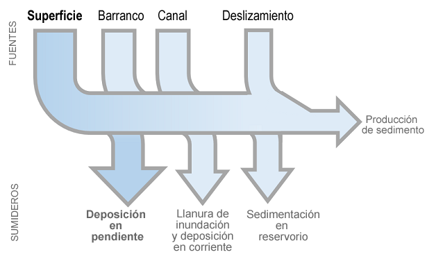
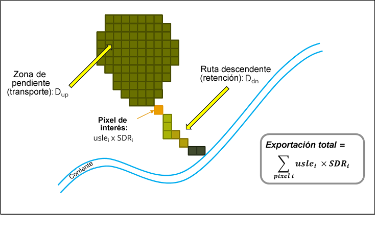
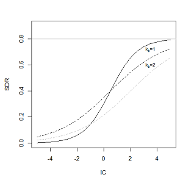
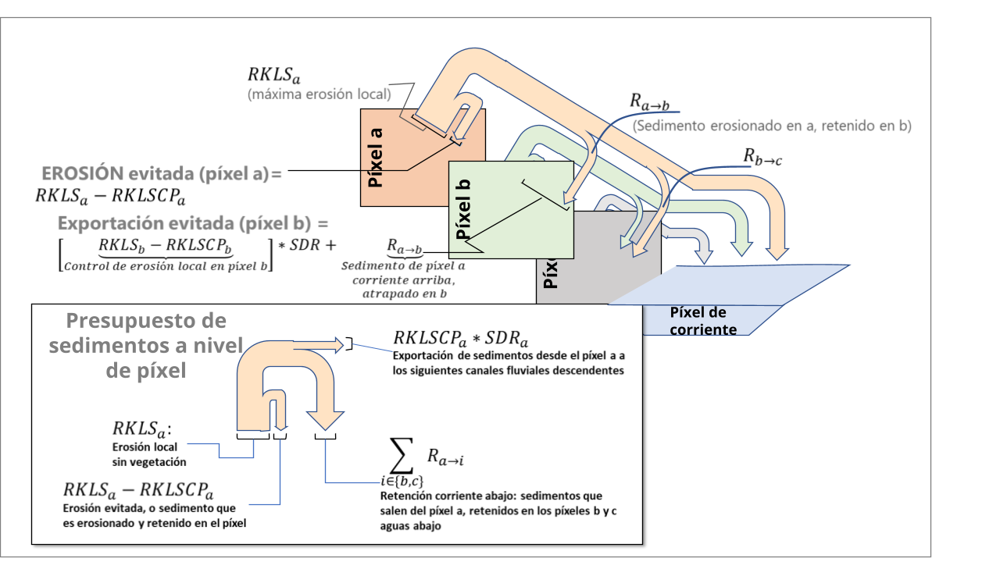
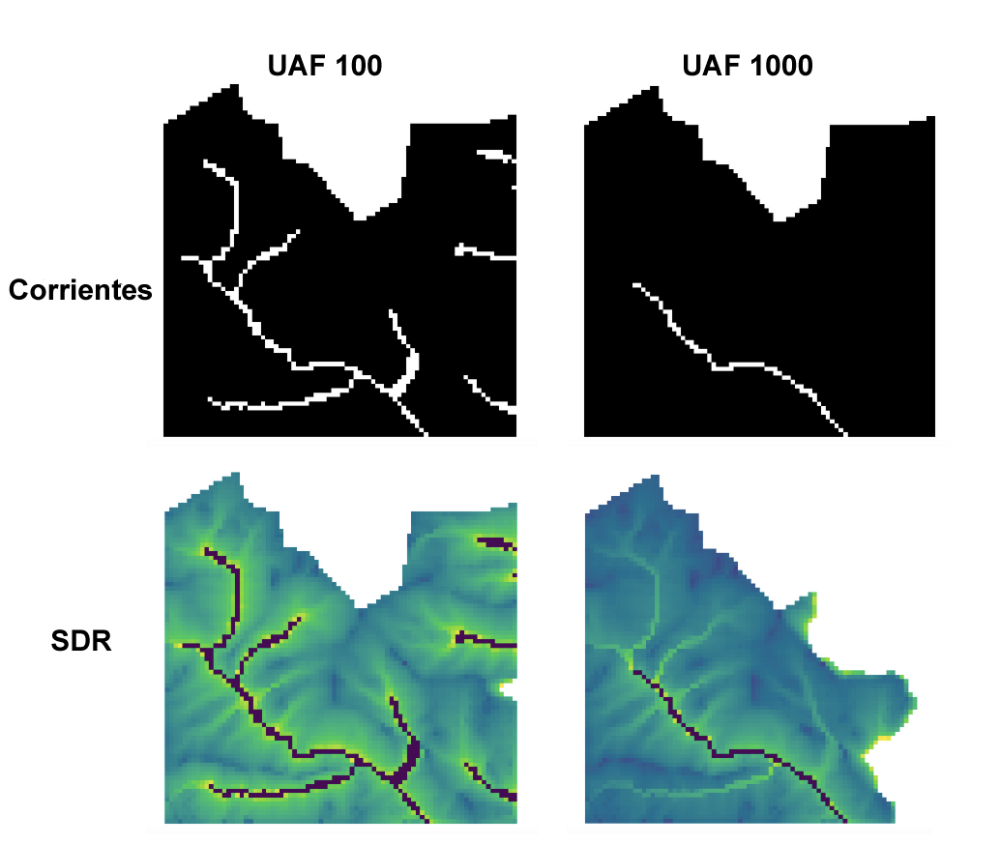

.. _sdr:

**************************************
SDR: Tasa de entrega de sedimentos
**************************************

Resumen
=======

El objetivo del modelo de InVEST de Tasa de entrega de sedimentos (SDR, por sus siglas en inglés) es cuantificar y cartografiar la generación de sedimentos por escorrentía superficial y su transporte hasta los cursos de agua. En muchos lugares del mundo se observan aumentos de las cargas de sedimentos en los cuerpos de agua, lo que afecta considerablemente la calidad del agua y la gestión de los embalses (UNESCO 2009). El servicio de retención de sedimentos que proporciona la vegetación es de gran interés para quienes gestionan el agua y el territorio. Comprender dónde se producen los sedimentos y hacia dónde se transportan permite diseñar mejores estrategias para reducir sus cargas mediante cambios en el uso del suelo y en las prácticas de manejo. Los cambios en la carga de sedimentos pueden afectar el riego aguas abajo, el tratamiento del agua, la recreación y el funcionamiento de los embalses, mientras que la pérdida de suelo puede reducir la productividad agrícola. Estos impactos pueden valorarse económicamente combinando los resultados del modelo SDR de InVEST con información sobre costos de mitigación evitados, costos de reposición o disposición a pagar.

Introducción
============

La erosión y la retención de sedimentos por escorrentía superficial son procesos naturales que regulan la concentración de sedimentos en los cursos de agua. La dinámica de los sedimentos a escala de cuenca está determinada principalmente por el clima (en particular, la intensidad de la lluvia), las propiedades del suelo, la topografía y la vegetación, así como por factores antropogénicos, como las actividades agrícolas o la construcción y operación de represas. Las principales fuentes de sedimentos en una cuenca hidrográfica incluyen la erosión superficial (partículas del suelo desprendidas y transportadas por la lluvia y la escorrentía), la erosión en cárcavas (en canales que concentran el flujo), la erosión de las riberas y la erosión en masa (o deslizamientos; véase Merritt et al. 2003 para una revisión). Los sumideros incluyen la deposición en laderas, llanuras de inundación o dentro de los cauces, así como la retención en embalses artificiales, tal como se resume en la Figura 1. La conversión del uso del suelo y los cambios en las prácticas de manejo pueden modificar drásticamente la cantidad de sedimentos que escurre desde una cuenca. La magnitud de este efecto está determinada principalmente por: i) las fuentes principales de sedimentos (el cambio de uso del suelo tendrá un efecto menor en cuencas donde los sedimentos no proceden principalmente de la escorrentía superficial, sino, por ejemplo, de la erosión glaciar); y ii) la distribución espacial de las fuentes y los sumideros de sedimentos (por ejemplo, el cambio de uso del suelo tendrá un efecto menor si la vegetación amortigua las fuentes de sedimentos).

El modelo SDR de InVEST se centra únicamente en la erosión superficial; no modela la erosión en cárcavas, de riberas ni en masa. Entre sus resultados se incluye la carga anual de sedimentos que llega a los cursos de agua, así como la cantidad de sedimentos erosionados en la cuenca y retenidos por la vegetación y los elementos topográficos. Tenga en cuenta que SDR genera únicamente resultados biofísicos. La valoración del servicio de retención de sedimentos dependerá en gran medida de la aplicación, el contexto y los beneficiarios específicos, y deberá realizarse independientemente de InVEST. Consulte la sección de la Guía del usuario :ref:`quantitative-valuation` que aparece más adelante para obtener orientaciones adicionales.

|
|

*Figura 1. Balance general de sedimentos de una cuenca. El tamaño relativo de las flechas cambia según el entorno. El modelo InVEST se centra en las fuentes y los sumideros asociados a la escorrentía superficial, y no incluye los demás.*

El modelo
=========

Cambios recientes en el modelo SDR
----------------------------------

A partir de la versión 3.12.0 de InVEST, se introdujeron varias revisiones importantes en el modelo SDR para mejorar su facilidad de uso, transparencia y precisión. Estos cambios se resumen aquí y se describen con mayor detalle en las secciones y ecuaciones correspondientes de este capítulo.

* El término «deposición» se cambió por «retención», y el parámetro intermedio :math:`R` se cambió por :math:`T`, para evitar confusiones con el factor R utilizado en la USLE.

* Se actualizaron los cálculos de los parámetros intermedios :math:`R` (ahora :math:`T`, retención) y :math:`F` (flujo). Anteriormente, :math:`R` y :math:`F` se calculaban de manera que los sedimentos erosionados de un píxel (según la Ecuación Universal de Pérdida de Suelo Revisada, RUSLE) podían ser retenidos por la vegetación en ese mismo píxel. Esto es conceptualmente inconsistente: la función de la vegetación para reducir la erosión y la escorrentía de sedimentos de un píxel ya está representada por el factor C de RUSLE (Wischmeier y Smith, 1978). Al permitir la retención inmediata de sedimentos en el mismo píxel, se contabilizaba dos veces el papel de la vegetación. Con el cálculo actualizado, todos los sedimentos que se erosionan de un píxel pasan al siguiente píxel situado pendiente abajo, donde pueden ser retenidos o continuar desplazándose. *Este cambio no afectará las estimaciones de calidad del agua de un escenario determinado en comparación con la formulación anterior del modelo. Sin embargo, sí modificará la atribución espacial de los lugares del paisaje donde se prestan los servicios de retención de sedimentos.* Por ello, es probable que observe diferencias en los resultados respecto de versiones anteriores de InVEST.

* Se añadieron dos nuevos resultados («erosión evitada» y «exportación evitada»), que cuantifican explícitamente el servicio de retención de sedimentos en el paisaje. Anteriormente, no estaba claro qué resultado del modelo, o qué combinación de resultados, debía utilizarse para valorar el servicio ecosistémico.

* Se eliminaron dos índices heredados de retención de sedimentos (*sed_retention.tif* y *sed_retention_index.tif*). Eran únicamente índices (no cantidades) y su utilidad no estaba clara, especialmente en el contexto de los nuevos resultados.

A partir de la versión 3.14.0 de InVEST, se introdujeron dos cambios adicionales en el modelo SDR que permiten ajustar mejor el resultado del factor LS a la bibliografía, pero que, como consecuencia, modifican significativamente muchos de los resultados del modelo. Se prevé que este cambio produzca resultados del factor LS más realistas para muchos usuarios.

* La longitud de aspecto del factor LS se calcula ahora en función de la pendiente en radianes :math:`\alpha`, :math:`|\sin\alpha| + |\cos\alpha|`, en lugar de calcularse como el promedio ponderado de la proporción de flujo que entra en el píxel.

* El área contribuyente aguas arriba del factor LS se calcula ahora como una aproximación del área específica de la cuenca, :math:`\sqrt{n\_upstream\_pixels \cdot pixel\_area}`, en lugar del área absoluta aguas arriba. Este cambio es coherente con las situaciones unidimensionales para las que se desarrollaron y parametrizaron las ecuaciones del factor LS (y la USLE en general), en las que el «área aguas arriba» de la USLE no es un área real, sino una longitud. Por tanto, este cambio en InVEST SDR produce resultados más realistas y se ajusta mejor a la bibliografía y al enfoque LS utilizado en otros paquetes de software. Para un análisis completo de este cambio, consulte el `registro de decisiones de desarrollo de InVEST <https://github.com/natcap/invest/blob/main/doc/decision-records/ADR-0001-Update-SDR-LS-Factor.md>`_.

Entrega de sedimentos
---------------------

El módulo de entrega de sedimentos es un modelo espacialmente explícito que trabaja con la resolución espacial del ráster del modelo digital de elevación (MDE) de entrada. Para cada píxel, el modelo calcula primero la cantidad de pérdida anual de suelo y, a continuación, calcula la relación de entrega de sedimentos (SDR), que es la proporción de la pérdida de suelo que efectivamente llega al curso de agua. Suponemos que, una vez que los sedimentos llegan al curso de agua, son transportados hasta la salida de la cuenca; por tanto, no se modelan los procesos dentro del cauce que podrían aumentar o disminuir las cargas de sedimentos. Este enfoque fue propuesto por Borselli et al. (2008) y ha recibido cada vez más atención (por ejemplo, Cavalli et al., 2013; López-vicente et al., 2013; Sougnez et al., 2011). Consulte la sección de la Guía del usuario :ref:`differences-SDR-Borselli` para obtener más información.

Pérdida anual de suelo
^^^^^^^^^^^^^^^^^^^^^^

La cantidad de pérdida anual de suelo en el píxel :math:`i`, :math:`usle_i` (unidades: :math:`metric\ tons\cdot ha^{-1} yr^{-1}`), se calcula mediante la Ecuación Universal de Pérdida de Suelo Revisada (RUSLE1; Renard et al. 1997):

.. math:: usle_i=R_i\cdot K_i\cdot LS_i\cdot C_i\cdot P_i,
   :label: usle

donde

 * :math:`R_i` es la erosividad de la lluvia (unidades: :math:`MJ\cdot mm (ha\cdot hr\cdot yr)^{-1})`,

 * :math:`K_i` es la erodabilidad del suelo (unidades: :math:`ton\cdot ha\cdot hr (MJ\cdot ha\cdot mm)^{-1}`),

 * :math:`LS_i` es el factor de longitud e inclinación de la pendiente (adimensional),

 * :math:`C_i` es el factor de cobertura y manejo (adimensional),

 * y :math:`P_i` es el factor de prácticas de conservación (Renard et al., 1997; véase también Bhattarai y Dutta, 2006) (adimensional).

El factor :math:`LS_i` se obtiene mediante el método desarrollado por Desmet y Govers (1996) para una superficie bidimensional:

.. math:: LS_i=S_i \frac{(A_{i-in}+D^2)^{m+1}-A_{i-in}^{m+1}}{D^{m+2}\cdot x_i^m\cdot (22.13)^m}
    :label: ls

donde

 * :math:`S_i` es el factor de pendiente para la celda :math:`i` de la cuadrícula, calculado en función de la pendiente. :math:`s` es la pendiente porcentual y :math:`\theta` es la pendiente en grados (Renard et al. 1997):

   .. math::

      S = \left\{\begin{array}{lr}
        10.8\cdot\sin(\theta)+0.03, & \text{where } s < 9\% \\
        16.8\cdot\sin(\theta)-0.50, & \text{where } s \geq 9\% \\
        \end{array}\right\}

 * :math:`A_{i-in}` es una estimación del área específica de la cuenca, calculada como :math:`\sqrt{n\_upstream\_pixels \cdot pixel\_area}`.

 * :math:`D` es la dimensión lineal de la celda de la cuadrícula (:math:`m`).

 * :math:`x_i` es la longitud de aspecto del píxel :math:`i`, calculada mediante:

   .. math:: x_i = | \sin \alpha_i | + | \cos \alpha_i |

   donde :math:`\alpha_i` es el ángulo de la pendiente del píxel :math:`i`, en radianes.

 * :math:`m` es el exponente de longitud de la RUSLE.

El valor de :math:`m`, el exponente de longitud del factor LS, se basa en la USLE clásica, como se explica en Oliveira et al. (2013):

.. math::

   \begin{align*}
   m &=  \left\{\begin{array}{lr}
      0.2, & \text{where } \theta \leq 1\% \\
      0.3, & \text{where } 1\% < \theta \leq 3.5\% \\
      0.4, & \text{where } 3.5\% < \theta \leq 5\% \\
      0.5, & \text{where } 5\% < \theta \leq 9\% \\
      \beta / (1 + \beta), & \text{where } \theta > 9\%
   \end{array}\right\} \\
   \\
   \beta &= \frac{\sin\theta / 0.0896}{3\sin\theta^{0.8} + 0.56}
   \end{align*}

Tasa de entrega de sedimentos
^^^^^^^^^^^^^^^^^^^^^^^^^^^^^^^^^

**Paso 1.** A partir del trabajo de Borselli et al. (2008), el modelo calcula primero el índice de conectividad (:math:`IC`) para cada píxel. El índice de conectividad describe el vínculo hidrológico entre las fuentes de sedimentos (en el paisaje) y los sumideros (como los cursos de agua). Los valores más altos de :math:`IC` indican que una mayor proporción de los sedimentos erosionados en un píxel situado aguas arriba llega a un sumidero pendiente abajo, como un curso de agua (es decir, existe mayor conectividad). La conectividad suele ser alta cuando la trayectoria del flujo entre las fuentes y los sumideros de sedimentos es empinada, corta o tiene escasa vegetación. Los valores más bajos de :math:`IC` (es decir, menor conectividad) se asocian con áreas más vegetadas y pendientes menos pronunciadas.

:math:`IC` es una función tanto del área situada aguas arriba de cada píxel (:math:`D_{up}`) como de la trayectoria del flujo entre el píxel y el curso de agua más cercano (:math:`D_{dn}`). Si el área aguas arriba es grande, tiene una pendiente menor y buena cobertura vegetal (por tanto, un factor C de la USLE bajo), :math:`D_{up}` será bajo, lo que indica un menor potencial de llegada de sedimentos al curso de agua. De manera similar, si la trayectoria pendiente abajo entre el píxel y el curso de agua es larga, tiene una pendiente menor y buena cobertura vegetal, :math:`D_{dn}` será bajo.

:math:`IC` se calcula de la siguiente manera:

.. math:: IC=\log_{10} \left(\frac{D_{up}}{D_{dn}}\right)
    :label: ic

*Figura 2. Enfoque conceptual utilizado en el modelo. La tasa de entrega de sedimentos (SDR) de cada píxel es una función del área aguas arriba y de la trayectoria del flujo pendiente abajo.*
|

Las pendientes con umbral :math:`S_{th}` y los factores de cobertura y manejo con umbral :math:`C_{th}` se utilizan para calcular :math:`D_{up}` y :math:`D_{dn}`. Se establece un límite inferior para evitar valores infinitos de :math:`IC`. También se aplica un límite superior a la pendiente para reducir el sesgo causado por valores muy altos de :math:`IC` en pendientes pronunciadas (Cavalli et al., 2013).

.. math::
   :label: threshold_slope

   S_{th} = \left\{\begin{array}{lr}
        0.005, &\text{for } S<0.005\\
        S,     &\text{for } 0.005\leq S\leq 1\\
        1,     &\text{for } S>1
        \end{array}\right\}

.. math::
   :label: threshold_c

   C_{th} = \left\{\begin{array}{lr}
        0.001, & \text{for } C<0.001\\
        C,     & \text{otherwise}\\
        \end{array}\right\}

:math:`D_{up}` es el componente aguas arriba, definido como:

.. math:: D_{up}=\bar{C}_{th}\bar{S}_{th}\sqrt{A}
    :label: d_up

donde :math:`\bar{C}_{th}` es el factor :math:`C` promedio con umbral del área contribuyente aguas arriba, :math:`\bar{S}_{th}` es el gradiente de pendiente promedio con umbral del área contribuyente aguas arriba (:math:`m/m`) y :math:`A` es el área contribuyente aguas arriba (:math:`m^2`). El área contribuyente aguas arriba se delimita mediante el algoritmo de dirección de flujo múltiple (MFD) o el algoritmo D8, según la opción seleccionada por el usuario.

El componente pendiente abajo :math:`D_{dn}` se define como:

.. math:: D_{dn}=\sum_i\frac{d_i}{C_{th, i} S_{th,i}}
    :label: d_dn

donde :math:`d_i` es la longitud de la trayectoria del flujo a lo largo de la celda *i*, según la dirección de mayor pendiente descendente (:math:`m`) (véase la Figura 2); :math:`C_{th, i}` y :math:`S_{th, i}` son, respectivamente, el factor de cobertura y manejo con umbral y el gradiente de pendiente con umbral de la celda *i*. Nuevamente, la trayectoria del flujo pendiente abajo se determina mediante el algoritmo MFD o D8, según la opción seleccionada por el usuario.

**Paso 2.** A continuación, la relación SDR de un píxel :math:`i` se deriva del índice de conectividad :math:`IC`, siguiendo a Vigiak et al. (2012):

.. math::
    SDR_i = \left\{\begin{array}{lr}
        1 & \text{if } i \text{ is a stream pixel} \\
        \frac{SDR_{max}}{1+\exp\left(\frac{IC_0-IC_i}{k}\right)} & \text{otherwise}\\
        \end{array}\right\}
    :label: sdr

Tenga en cuenta que, como :math:`D_{dn}` es 0 en los cursos de agua, :math:`IC` no está definido y, por tanto, :math:`SDR` tampoco estaría definido si no existiera este caso especial. Es necesario que SDR esté definido en los cursos de agua para los cálculos posteriores, que se realizan de manera recursiva desde el curso de agua hacia aguas arriba. El valor de 1 es razonable intuitivamente, ya que representa una entrega del 100 % de los sedimentos. Como los cálculos del modelo no se realizan dentro de la red de drenaje, suponemos que no se retienen sedimentos cuando el flujo pasa de un píxel del curso de agua a otro.

:math:`SDR_{max}` es la SDR teórica máxima, establecida en un valor promedio de 0,8 (Vigiak et al., 2012), mientras que :math:`IC_0` y :math:`k` son parámetros de calibración que definen la forma de la relación SDR-IC (que es una función creciente). El efecto de :math:`IC_0` y :math:`k` sobre la SDR se ilustra a continuación:

*Figura 3. Relación entre el índice de conectividad IC y la SDR. El valor máximo de SDR se establece en* :math:`SDR_{max}=0.8`. *Los efectos de la calibración se ilustran estableciendo* :math:`k_b=1` *y* :math:`k_b=2` *(líneas continua y discontinua, respectivamente), y* :math:`IC_0=0.5` *y* :math:`IC_0=2` *(líneas discontinuas negra y gris, respectivamente).*
|

Exportación de sedimentos
^^^^^^^^^^^^^^^^^^^^^^^^^

La exportación de sedimentos desde un píxel determinado :math:`i`, :math:`E_i` (unidades: :math:`metric\ tons\cdot ha^{-1} yr^{-1}`), es la cantidad de sedimentos erosionados en ese píxel que efectivamente llega a un curso de agua. La exportación de sedimentos se calcula mediante:

.. math:: E_i=usle_i\cdot SDR_i
    :label: e_i

La exportación total de sedimentos de la cuenca :math:`E` (unidades: :math:`ton\cdot ha^{-1} yr^{-1}`) se calcula mediante:

.. math:: E=\sum_i E_i
    :label: e

:math:`E` es el valor utilizado para fines de calibración y validación, en combinación con otras fuentes de sedimentos, si se dispone de datos.

Retención de sedimentos pendiente abajo
^^^^^^^^^^^^^^^^^^^^^^^^^^^^^^^^^^^^^^^

Este modelo también estima la cantidad de sedimentos que se retienen (depositan/conservan) a lo largo de la trayectoria del flujo pendiente abajo desde la fuente; es decir, los sedimentos que se erosionan y exportan desde un píxel, pero no llegan al curso de agua. Conocer la distribución espacial de esta cantidad permite a los usuarios hacer un seguimiento del cambio neto de sedimentos en un píxel (ganancia o pérdida), lo que puede servir para elaborar índices de degradación del suelo.

La exportación de sedimentos hacia el curso de agua desde el píxel :math:`i` se define en la ecuación :eq:`e_i`. El otro componente del balance de masa de la USLE corresponde a los sedimentos que no llegan al curso de agua. Esta carga de sedimentos debe quedar retenida en algún lugar del paisaje, a lo largo de la trayectoria del flujo hacia el curso de agua, y se define de la siguiente manera:

.. math:: E'_i=usle_i (1-SDR_i)
    :label: eprime

Debido a la naturaleza del cálculo de SDR, la cantidad :math:`E_i` ya considera la trayectoria del flujo pendiente abajo y las propiedades biofísicas que filtran los sedimentos antes de que lleguen al curso de agua. Por tanto, podemos modelar el flujo de :math:`E'_i` pendiente abajo independientemente del flujo de :math:`E_i`.

Para ello, suponemos las siguientes propiedades sobre el comportamiento de :math:`E_i` y SDR en el paisaje:

**Propiedad A**: La SDR aumenta monótonamente a lo largo de una trayectoria de flujo descendente. Al seguir una trayectoria pendiente abajo, el valor de SDR aumenta de manera monótona, ya que la distancia de flujo pendiente abajo disminuye. Tenga en cuenta que, numéricamente, es posible que un píxel pendiente abajo tenga el mismo valor de SDR que un píxel situado aguas arriba. En ese caso, no se produce retención del flujo de sedimentos en el píxel a lo largo de ese tramo.

**Propiedad B**: Todo el flujo de sedimentos que no se exporta en un píxel de borde del curso de agua queda retenido en ese píxel. Si el píxel :math:`i` drena directamente hacia el curso de agua, no existe oportunidad de filtración adicional de :math:`E_i` pendiente abajo. Como :math:`E_i` es el inverso de :math:`E'_i`, se deduce que el flujo procedente de aguas arriba (definido como :math:`F_i` más adelante) debe haber quedado retenido en el píxel.

A partir de estas dos propiedades, observamos que la cantidad de :math:`E_i` retenida en un píxel debe ser función de:

 * la diferencia absoluta entre los valores de SDR del píxel :math:`i` y de los píxeles pendiente abajo hacia los que drena; y
 * la proximidad numérica del valor de SDR del píxel pendiente abajo a 1,0 (el valor del píxel del curso de agua).

Estos mecanismos pueden representarse mediante una interpolación lineal de la diferencia entre el valor de SDR del píxel :math:`i` y el valor de SDR de los píxeles correspondientes pendiente abajo, en relación con la diferencia entre el valor del píxel :math:`i` y un valor teórico máximo de SDR pendiente abajo de 1,0. Formalmente:

.. math:: dT_i=\frac{\left(\sum_{k \in \{directly\ downslope\ from\ i\}}SDR_k\cdot p(i,k)\right) - SDR_i}{1.0-SDR_i}
    :label: dti

:math:`T` representa la retención de sedimentos. La :math:`d` en :math:`dT_i` indica una diferencia delta y :math:`p(i,k)` es la proporción del flujo desde el píxel :math:`i` hasta el píxel :math:`k`. Esta notación busca evocar la idea de una derivada de :math:`T_i`. Obsérvese que se cumplen las condiciones de borde:

 * En el caso de la Propiedad A (cuando el valor pendiente abajo :math:`\left(\sum_{k \in \{directly\ downslope\ from\ i\}}SDR_k\cdot p(i,k)\right)=SDR_i`), el valor de :math:`dT_i=0` indica que ningún flujo :math:`F_i` quedará retenido en el píxel.
 * En el caso de la Propiedad B (cuando :math:`SDR_k=1` pendiente abajo porque se trata de un curso de agua), el valor de :math:`dT_i=1` indica que el flujo restante :math:`F_i` queda retenido en el píxel.

Ahora definimos la cantidad de flujo de sedimentos que queda retenida en cualquier píxel de la trayectoria del flujo, utilizando :math:`dT_i` como un flujo ponderado del flujo procedente de aguas arriba:

.. math:: T_i=dT_i\cdot\left(\sum_{j\in\{pixels\ that\ drain\ to\ i\}}F_j \cdot p(j,i)\right)
    :label: ti

donde :math:`F_i` es la cantidad de flujo de exportación de sedimentos que no llega al curso de agua, definida como:

.. math:: F_i=(1-dT_i)\cdot(\left(\sum_{j\in\{pixels\ that\ drain\ to\ i\}} F_j \cdot p(j,i)\right) + E'_i)
    :label: fi

|
|

*Figura 4. Ilustración de los procesos pertinentes de erosión y deposición de sedimentos, sus interconexiones espaciales y su representación en el modelo. La cantidad máxima de sedimentos que podría erosionarse de un píxel se define como el valor de la USLE en ausencia de vegetación (RKLS). La diferencia entre ese valor y la erosión real con cobertura del suelo y manejo (RKLSCP) indica el papel de esos factores locales en la prevención de la erosión. De los sedimentos que salen de un píxel (RKLSCP), solo una fracción (SDR) llega a un píxel de un curso de agua situado pendiente abajo. El resto* (:math:`RKLSCP*(1-SDR)`) *queda retenido en los píxeles situados pendiente abajo. Por tanto, la vegetación cumple una doble función: (1) evitar la erosión local y (2) retener los sedimentos movilizados aguas arriba. El recuadro inferior indica el destino potencial de los sedimentos erosionados.*

|
|

Indicadores de servicios ecosistémicos
^^^^^^^^^^^^^^^^^^^^^^^^^^^^^^^^^^^^^^

El servicio ecosistémico potencial de control de la erosión que proporciona el paisaje se cuantifica de dos maneras:

* **Erosión evitada**: contribución de la vegetación a la reducción de la erosión en un píxel. En otras palabras, se valora la vegetación por impedir que la erosión ocurra desde el principio. Esto puede utilizarse para cuantificar el servicio ecosistémico desde la perspectiva de la pérdida local de suelo. Se calcula como:

  .. math:: AER_i = RKLS_i - USLE_i
    :label: aer_i

  donde :math:`AER_i` es la cantidad de erosión evitada en el píxel :math:`i`, y la diferencia entre :math:`RKLS_i` y :math:`USLE_i` representa el beneficio de la vegetación y de las buenas prácticas de manejo, ya que RKLS equivale a la USLE sin los factores C (cobertura) y P (prácticas).

* **Exportación evitada**: contribución de la vegetación a la reducción de la erosión en un píxel, así como a la retención de sedimentos procedentes de aguas arriba del píxel, de modo que ninguno de ellos siga desplazándose pendiente abajo hasta llegar a un curso de agua. También puede entenderse como la cantidad total de sedimentos retenidos en el píxel. La *exportación evitada* representa el servicio ecosistémico desde la perspectiva de un usuario del agua situado aguas abajo y se calcula como:

  .. math:: AEX_i = (RKLS_i - USLE_i) \cdot SDR_i + T_i
    :label: aex_i

  donde :math:`AEX_i` es la retención total de sedimentos proporcionada por ese píxel, tanto de fuentes de erosión dentro del propio píxel como de aguas arriba. Al retener estos sedimentos, el píxel contribuye a reducir la cantidad exportada a los cursos de agua. Al igual que en el caso de la *erosión evitada*, la diferencia entre :math:`RKLS_i` y :math:`USLE_i` representa el beneficio de la vegetación y de las buenas prácticas de manejo; al multiplicarla por la relación de entrega de sedimentos :math:`SDR_i`, se cuantifica la cantidad de erosión originada en ese píxel que no llega a un curso de agua. Por último, :math:`T_i` es la cantidad de sedimentos procedentes de aguas arriba que queda retenida en ese píxel, lo que también impide que llegue a un curso de agua.

Para obtener más información sobre el uso de estos indicadores, consulte la siguiente sección :ref:`evaluating_sed_ret_services`.

Cursos de agua y capa opcional de drenaje
^^^^^^^^^^^^^^^^^^^^^^^^^^^^^^^^^^^^^^^^^
El mapa de cursos de agua del modelo es la unión de la capa de cursos de agua calculada y la capa de drenaje de entrada (si se proporciona).
El modelo calcula una capa de cursos de agua (**stream.tif**) aplicando un umbral al ráster de acumulación de flujo (**flow_accumulation.tif**) mediante el valor de acumulación de flujo umbral (TFA):

  .. math::
     :label: sdr_stream

     stream_{TFA,i} = \left\{\begin{array}{lr}
          1, & \text{if } flow\_accum_{i} \geq TFA \\
          0,     & \text{otherwise} \\
          \end{array}\right\}

Si se proporciona la entrada opcional de drenaje, el modelo la incorpora (**stream_and_drainage.tif**):

  .. math:: stream_{drainage,i} = stream_{TFA,i} \text{  OR  } stream_{input,i}
     :label: stream_and_drainage

La capa final de cursos de agua (:math:`stream_{TFA}`, o :math:`stream_{drainage}` si se proporciona la entrada opcional de drenaje) se utiliza para determinar :math:`d_i` (distancia al curso de agua) en los cálculos de SDR.

En algunas situaciones, el índice de conectividad definido por la topografía no representa las trayectorias reales del flujo, que pueden estar influidas por una conectividad artificial. Por ejemplo, es probable que los sedimentos de las áreas urbanas o cercanas a las carreteras sean transportados hacia los cursos de agua con poca retención. El ráster de drenaje (opcional) identifica los píxeles conectados artificialmente a los cursos de agua, independientemente de su posición geográfica (por ejemplo, de su distancia a la red de drenaje). Los píxeles de la capa de drenaje se tratan de manera similar a los píxeles de la red de cursos de agua; en otras palabras, la trayectoria del flujo pendiente abajo termina en los píxeles de la capa de drenaje y la carga de sedimentos correspondiente se suma a la exportación total de sedimentos.

.. _sdr_defined_area:

Área definida de los resultados
^^^^^^^^^^^^^^^^^^^^^^^^^^^^^^^

Hay tres factores principales que definen el área en la que el modelo produce valores en las capas de resultados:
 * Los resultados se limitan al área cubierta por la entrada vectorial de cuencas hidrográficas.
 * Los resultados solo pueden calcularse en los píxeles donde *todos* los rásteres de entrada tienen valores válidos. Si algún ráster de entrada tiene el valor NoData en un píxel, el resultado también será NoData en ese píxel.
 * Los resultados que dependen de la distancia a la red de cursos de agua (como SDR y otros resultados basados en ella) solo se calculan para los píxeles que drenan hacia un curso de agua.

SDR y varios otros resultados del modelo se definen en función de la distancia al curso de agua (:math:`d_i`). Por tanto, estos resultados solo están definidos para los píxeles que drenan hacia un curso de agua (resultado **stream.tif**), según la acumulación de flujo umbral y el MDE proporcionados como entradas. Los píxeles que no drenan hacia ningún curso de agua tendrán valores NoData en estos resultados. Los archivos de resultados afectados son: **d_dn.tif**, **ic.tif**, **e_prime.tif**, **sdr_factor.tif**, **sediment_deposition.tif**, **avoided_erosion.tif** y **sed_export.tif**.

Si observa áreas con valores NoData en estos resultados que no pueden explicarse por la ausencia de datos en las entradas, es probable que no estén conectadas hidrológicamente a un curso de agua del mapa. Esto puede ocurrir si el MDE contiene depresiones o errores, si los límites del mapa no se extienden lo suficiente para incluir los cursos de agua de esa cuenca o si el valor de acumulación de flujo umbral es demasiado alto para reconocerlos. Puede confirmarlo consultando el resultado intermedio **what_drains_to_stream.tif**, que indica qué píxeles drenan hacia un curso de agua. Revise el resultado de cursos de agua (**stream.tif**) y asegúrese de que coincida lo mejor posible con los cursos de agua reales. Consulte la sección :ref:`working-with-the-DEM` de esta Guía del usuario para obtener más información.

**Tenga en cuenta también que muchos resultados de SDR presentan valores NoData donde hay cursos de agua.** Esto se debe a que el modelo no incluye procesos dentro de los cauces y los cálculos se detienen al llegar a un curso de agua, según lo definido por el ráster de salida **stream.tif**. Por tanto, si observa valores NoData que intenta explicar, compárelos con **stream.tif** y compruebe si coinciden. Si es así, se trata del comportamiento esperado y no hay entradas que puedan modificarse para producir valores dentro de los cursos de agua delimitados.

**Ejemplo:** A continuación se presenta un ejemplo del efecto de la acumulación de flujo umbral sobre la extensión definida, en un área con varias cuencas que no están conectadas hidrológicamente. Dentro del área del mapa puede observarse una red conectada de cursos de agua que fluye del noroeste al sureste, así como tres tramos de cursos de agua aislados en el borde derecho del mapa. En los mapas de ejemplo que aparecen a continuación, los píxeles blancos de la fila superior representan los cursos de agua (resultado **stream.tif** de SDR), mientras que la fila inferior muestra SDR (**sdr_factor.tif**). *Observe los píxeles negros de los rásteres SDR: son píxeles NoData, ya que se encuentran dentro de la red de cursos de agua.*

En la columna izquierda, con un valor TFA de 100, hay cursos de agua tanto en la cuenca inferior izquierda como en la superior derecha. El ráster SDR está definido en todos los lugares donde las entradas están definidas, excepto en una pequeña zona del borde derecho que no drena hacia ningún curso de agua.

En la columna derecha, con un valor TFA de 1000, no hay cursos de agua en absoluto en la cuenca superior derecha. Como resultado, los píxeles de esa cuenca no drenan hacia ningún curso de agua y el ráster SDR correspondiente no está definido (presenta valores NoData) en esa zona.

*Figura 5. Ejemplo del efecto del parámetro de acumulación de flujo umbral sobre la extensión del mapa de resultados.*

.. _differences-SDR-Borselli:

Diferencias entre el modelo SDR de InVEST y el enfoque original desarrollado por Borselli et al. (2008)
-------------------------------------------------------------------------------------------------------

El modelo SDR de InVEST se basa en el concepto de conectividad hidrológica, parametrizado por Borselli et al. (2012). Se seleccionó este enfoque porque requiere un número mínimo de parámetros, utiliza datos disponibles a escala mundial y es espacialmente explícito. En un estudio comparativo, Vigiak et al. (2012) señalaron que el enfoque ofrece: «(i) una gran mejora en la predicción de los rendimientos específicos de sedimentos, (ii) facilidad de implementación, (iii) independencia de la escala y (iv) una formulación capaz de considerar las variables del paisaje y la topología, en consonancia con los conceptos de conectividad sedimentológica». El enfoque también se ha utilizado para predecir los efectos del cambio de uso del suelo (Jamshidi et al., 2013).

Los siguientes puntos resumen las diferencias entre InVEST y el modelo de Borselli:

 * En InVEST, el factor de ponderación se implementa directamente como el factor C de la USLE y, por tanto, depende de la cobertura local del suelo (otros investigadores han utilizado una formulación diferente; por ejemplo, un índice de rugosidad basado en un MDE de alta resolución [Cavalli et al., 2013]).

 * El parámetro :math:`SDR_{max}` utilizado por Borselli et al. se establece por defecto en 0,8 para reducir el número de parámetros. Vigiak et al. (2012) proponen definir :math:`SDR_{max}` como la fracción de partículas de la capa superficial del suelo cuyo tamaño es inferior al de la arena gruesa (<1 mm). El usuario puede modificar este valor.

.. _evaluating_sed_ret_services:

Evaluación de los servicios de retención de sedimentos
------------------------------------------------------

Para evaluar el servicio de retención de sedimentos en el área de interés, se proporcionan dos resultados:

* **Erosión evitada** (avoided_erosion.tif): contribución de la vegetación a la reducción de la erosión en un píxel. En otras palabras, se valora la vegetación por impedir que la erosión ocurra desde el principio. Esto representa el servicio ecosistémico desde la perspectiva de la pérdida local de suelo, de interés, por ejemplo, en áreas agrícolas donde es importante conservar la capa superficial del suelo.

* **Exportación evitada** (avoided_export.tif): contribución de la vegetación a evitar la erosión en un píxel, así como a retener los sedimentos originados aguas arriba del píxel, de modo que ninguno de ellos siga desplazándose pendiente abajo hasta llegar a un curso de agua. También puede entenderse como la cantidad total de sedimentos retenidos en el píxel. La *exportación evitada* representa el servicio ecosistémico desde la perspectiva de un usuario del agua situado aguas abajo, que se beneficia de que los sedimentos no lleguen al curso de agua que utiliza para consumo, generación hidroeléctrica u otros usos.

Los indicadores *avoided_erosion.tif* y *avoided_export.tif* pueden utilizarse para identificar lugares del paisaje que capturan o retienen sedimentos, lo que favorece los recursos edáficos locales y la calidad del agua aguas abajo. Esta información puede orientar la selección de áreas prioritarias para las acciones de conservación, de modo que estos servicios se mantengan en el futuro. Sin embargo, es importante tener en cuenta que se retendrá una mayor cantidad de erosión en los lugares donde se produce más erosión. Por tanto, centrarse únicamente en conservar las áreas con alta retención no necesariamente aborda los lugares donde se origina la erosión. El resultado *USLE.tif* puede complementar este análisis al mostrar qué lugares de la cuenca están perdiendo más suelo; el resultado *sed_export.tif* muestra qué áreas aportan más sedimentos a los cursos de agua. Estos son lugares donde puede ser útil orientar las acciones de restauración o mejorar el manejo del suelo.

Si dispone de escenarios que se comparan con las condiciones actuales, también puede cuantificar el servicio de retención de sedimentos calculando la diferencia en la *exportación* de sedimentos entre el escenario y las condiciones actuales. Esto cuantifica la diferencia en la erosión que llega a un curso de agua, según los cambios de cobertura del suelo, clima, etc. incluidos en los escenarios, y ofrece una manera de evaluar los impactos sobre los usos aguas abajo, como los embalses y el abastecimiento de agua potable.

La traducción de los impactos biofísicos de las modificaciones en la entrega de sedimentos a indicadores de bienestar humano depende en gran medida del contexto de toma de decisiones. La erosión del suelo, los sedimentos en suspensión y los sedimentos depositados pueden tener efectos tanto negativos como positivos para distintos usuarios de una cuenca hidrográfica (Keeler et al., 2012). Entre estos efectos se incluyen, entre otros:

 * Reducción de la fertilidad del suelo y de su capacidad para retener agua y nutrientes, con efectos sobre los agricultores.
 * Aumento de los costos de tratamiento del agua para consumo humano.
 * Menor transparencia del agua en los lagos, lo que reduce el valor recreativo.
 * Aumento de los sólidos suspendidos totales, con efectos sobre la salud y la distribución de las especies acuáticas.
 * Aumento de la sedimentación de los embalses, que reduce su rendimiento o incrementa los costos de control de sedimentos.
 * Aumento de la sedimentación en puertos, que exige dragados para mantener la navegación en ríos y estuarios.

La evaluación del servicio implica localizar a los beneficiarios pertinentes en el paisaje y vincularlos con los lugares que contribuyen a la erosión evitada o a la exportación evitada (o al cambio en la exportación de sedimentos). Por ejemplo, para beneficiarios puntuales, como una captación de agua potable, un método consiste en delimitar la cuenca que drena hacia ese punto (mediante una herramienta como :ref:`delineateit`) y luego sumar el ráster de exportación evitada (o el cambio en la exportación de sedimentos, si se trabaja con escenarios) dentro de esa cuenca. Véanse Mandle et al. (2015) y Mandle et al. (2017) para dos ejemplos que aplican este enfoque.

.. _quantitative-valuation:

Valoración cuantitativa
-----------------------

Una consideración importante al asignar un valor monetario a cualquier servicio es que la valoración solo debe realizarse con resultados del modelo que hayan sido calibrados y validados. De lo contrario, se desconoce en qué medida el modelo representa el área de interés, lo que puede conducir a una representación inexacta del valor. Si el modelo no ha sido calibrado, deben utilizarse únicamente resultados relativos (por ejemplo, un aumento del 10 %) y no valores absolutos (como 1.523 toneladas o 42.900 dólares). Consulte la sección :ref:`comparison_with_observations` que aparece más adelante para obtener más información sobre las pruebas de sensibilidad y la calibración.

Retención de sedimentos a nivel de subcuenca
^^^^^^^^^^^^^^^^^^^^^^^^^^^^^^^^^^^^^^^^^^^^

Desde el punto de vista de la valoración, una métrica importante es la diferencia en la retención o exportación entre escenarios. Para evaluar cuantitativamente el servicio de retención, el modelo proporciona información espacial sobre los lugares del paisaje donde quedan retenidos los sedimentos, lo que permite identificar las áreas que retienen sedimentos procedentes de aguas arriba e impiden que lleguen a un curso de agua. De manera similar, la retención de sedimentos proporcionada por distintos escenarios definidos por el usuario puede compararse con la condición de referencia (o entre sí) calculando la diferencia en la exportación de sedimentos entre el escenario y la condición de referencia. Este cambio en la exportación puede representar la variación del servicio de retención de sedimentos debida al posible futuro reflejado en el escenario. Estos resultados de retención pueden valorarse en términos monetarios o no monetarios, según el contexto. Consulte más adelante en esta sección la información sobre los enfoques de valoración.

Fuentes y sumideros adicionales de sedimentos
^^^^^^^^^^^^^^^^^^^^^^^^^^^^^^^^^^^^^^^^^^^^^

Como se señala en las limitaciones del modelo, en los análisis de valoración debe considerarse la omisión de algunas fuentes y sumideros de sedimentos (erosión en cárcavas, erosión de las riberas y erosión en masa). En algunos sistemas, estas otras fuentes de sedimentos pueden ser predominantes, por lo que grandes cambios en la erosión superficial podrían no modificar las concentraciones generales de sedimentos en los cursos de agua. En otras palabras, si la exportación de sedimentos de dos escenarios difiere en un 50 % y la erosión superficial representa el 60 % del balance de sedimentos, el cambio real en la erosión que debería valorarse por la sedimentación evitada en un embalse es del 30 % (50 % × 60 %).

Una dificultad al calcular el balance total de sedimentos es que los cambios en el clima o en el uso del suelo modifican los caudales máximos durante los eventos de lluvia y, por tanto, probablemente afectan la magnitud de la erosión en cárcavas y de las riberas. Aunque la magnitud del cambio en otras fuentes de sedimentos depende mucho del contexto, es probable que tenga la misma dirección que el cambio en la erosión superficial: un mayor transporte superficial de sedimentos suele estar asociado a caudales más altos, que probablemente incrementan la erosión en cárcavas y de las riberas. Por tanto, al comparar escenarios, el cambio absoluto puede servir como límite inferior del impacto total de un cambio determinado en el clima o el uso del suelo.

:ref:`sdr_appendix2` resume las opciones para representar en el modelo las fuentes y los sumideros adicionales de erosión.

Enfoques de costos de reposición y costos evitados frente a enfoques de disposición a pagar
^^^^^^^^^^^^^^^^^^^^^^^^^^^^^^^^^^^^^^^^^^^^^^^^^^^^^^^^^^^^^^^^^^^^^^^^^^^^^^^^^^^^^^^^^^^

En el caso de muchos impactos sobre los servicios ecosistémicos, y en particular de los impactos relacionados con los sedimentos, la valoración monetaria es relativamente sencilla si se considera apropiado utilizar un método de costos de mitigación evitados o de costos de reposición. En esta situación, se supone que los beneficiarios incurren en un costo que depende de la métrica biofísica (por ejemplo, el aumento de los sedimentos en suspensión incrementa los costos de tratamiento). Sin embargo, es importante reconocer que los enfoques de costos evitados o de reposición suponen que las acciones de mitigación valen la pena para quien las realiza. Por ejemplo, si el operador de un embalse considera que los costos asociados al dragado de los sedimentos depositados no justifican los beneficios de recuperar la capacidad de almacenamiento perdida, no es apropiado valorar todos los sedimentos depositados al costo unitario del dragado. De manera similar, un aumento de los sedimentos en suspensión en los suministros de agua potable puede afrontarse aumentando los insumos de tratamiento o cambiando a otra tecnología de tratamiento. Evitar estos costos adicionales podría contabilizarse entonces como un beneficio económico. Sin embargo, en algunos contextos, los usuarios particulares del agua pueden decidir que el aumento del contenido de sedimentos es aceptable, en lugar de incurrir en gastos adicionales de tratamiento. Su situación económica empeora, pero, al no pagar por un tratamiento adicional, el enfoque de costos de reposición se convierte en un límite superior de su pérdida económica. Esta pérdida tampoco queda ya reflejada en el cambio de sus gastos financieros, lo que complica aún más el análisis.

No obstante, este enfoque de límites puede ser totalmente apropiado para una evaluación inicial de la importancia de distintos flujos de beneficios. Por ejemplo, si el enfoque más costoso no tiene un impacto significativo, no es necesario perfeccionar el análisis mediante métodos más detallados, como la disposición a pagar (para los consumidores) o los efectos sobre los ingresos netos (para los productores). Sin embargo, si el impacto es grande y no hay buenas razones para creer que los actores pertinentes llevarán a cabo las actividades de mitigación, lo apropiado es utilizar un enfoque basado en la disposición a pagar. Para una introducción a las técnicas disponibles, consulte http://ecosystemvaluation.org/dollar_based.htm.

Consideraciones temporales
^^^^^^^^^^^^^^^^^^^^^^^^^^

En general, los análisis económicos y financieros utilizan alguna forma de descuento que reconoce el valor temporal del dinero, los beneficios y el uso de los recursos. Los beneficios y costos que se producen en el futuro «cuentan menos» que los beneficios y costos que se generan cerca del presente. Es importante que todo análisis económico o financiero tenga en cuenta que el modelo SDR representa únicamente impactos anuales promedio en condiciones de estado estable. Esto tiene dos implicaciones para la valoración. En primer lugar, los usuarios deben reconocer que los impactos valorados pueden tardar algún tiempo en producirse: los beneficios completos del estado estable no comienzan a acumularse de inmediato, aunque muchos de los costos sí podrían hacerlo. En segundo lugar, el promedio anual implica que las funciones de costos o beneficios que presentan no linealidades en escalas temporales más cortas deberían transformarse (si es posible), o que los resultados de InVEST deberían combinarse con otros análisis estadísticos para representar la variabilidad intraanual o interanual importante.

Limitaciones y simplificaciones
===============================

 * Una de las principales limitaciones del modelo es su dependencia de la USLE (Renard et al., 1997). Esta ecuación se utiliza ampliamente, pero tiene un alcance limitado, ya que solo representa los procesos de erosión superficial (en surcos y entre surcos). Otras fuentes de sedimentos incluyen la erosión en cárcavas, la erosión de las riberas, la erosión en masa por deslizamientos o desprendimientos de rocas y la erosión glaciar. Wilkinson et al. (2014) ofrecen una buena descripción de los procesos de erosión en cárcavas y de las riberas, junto con posibles enfoques de modelado. Los movimientos en masa (deslizamientos) no están representados en el modelo, pero pueden constituir una fuente importante en algunas áreas o bajo determinados cambios de uso del suelo, como la construcción de carreteras.

 * Una consecuencia de lo anterior es que las descripciones del impacto sobre los servicios ecosistémicos (y cualquier valoración posterior) deben considerar la proporción relativa de sedimentos procedentes del modelo respecto del balance total de sedimentos (véase la sección :ref:`evaluating_sed_ret_services`).

 * Además, al ser una ecuación empírica desarrollada en Estados Unidos, la USLE ha mostrado un rendimiento limitado en otras áreas, incluso cuando se centra en la erosión superficial. A partir del conocimiento local, los usuarios pueden modificar la ecuación de pérdida de suelo implementada en el modelo mediante cambios en las entradas R, K, C y P para reflejar los resultados de estudios locales (Sougnez et al., 2011).

 * El modelo es muy sensible a los parámetros *k* e *IC0*, que no se basan en procesos físicos. La bibliografía emergente sobre el enfoque de modelado utilizado en InVEST (Cavalli et al., 2013; López-vicente et al., 2013; Sougnez et al., 2011; Vigiak et al., 2012) ofrece orientaciones para establecer estos parámetros, pero los usuarios deben tener presente esta limitación al interpretar los valores absolutos del modelo.

 * Dada la sencillez del modelo y el reducido número de parámetros, los resultados son muy sensibles a la mayoría de los parámetros de entrada. Por tanto, los errores en los parámetros empíricos de las ecuaciones USLE tendrán un efecto importante en las predicciones. Se recomiendan análisis de sensibilidad para investigar cómo la confianza de los intervalos de los parámetros de entrada afecta las conclusiones del estudio.

Necesidades de datos
====================

.. note:: *Todas las entradas espaciales deben tener exactamente el mismo sistema de coordenadas proyectadas* (con unidades lineales en metros), *no* un sistema de coordenadas geográficas (con unidades en grados).

.. note:: Los rásteres de entrada pueden tener distintos tamaños de celda (píxel) y se remuestrearán para ajustarse al tamaño de celda del MDE. Por tanto, todos los resultados del modelo tendrán el mismo tamaño de celda que el MDE.

.. note:: Los resultados solo se calcularán en los píxeles donde *todos* los rásteres de entrada tengan valores válidos. Si algún ráster de entrada tiene el valor NoData en un píxel, el resultado también será NoData en ese píxel.

- :investspec:`sdr.sdr workspace_dir`

- :investspec:`sdr.sdr results_suffix`

- :investspec:`sdr.sdr dem_path` Asegúrese de que el MDE esté corregido mediante el relleno de depresiones. Compare los mapas de cursos de agua resultantes con los mapas hidrográficos del área y, si es necesario, incorpore los elementos hidrográficos al MDE (se recomienda hacerlo cuando se observen cursos de agua inusuales). Para garantizar un enrutamiento adecuado del flujo, el MDE debe extenderse más allá de las cuencas de interés, en lugar de estar recortado en los límites de las cuencas. Consulte la sección :ref:`working-with-the-DEM` de esta Guía del usuario para obtener más información.

- :investspec:`sdr.sdr erosivity_path` Cuanto mayor sea la intensidad y la duración de la tormenta, mayor será el potencial de erosión.

- :investspec:`sdr.sdr erodibility_path`

- :investspec:`sdr.sdr lulc_path`

- :investspec:`sdr.sdr watersheds_path`

- :investspec:`sdr.sdr biophysical_table_path`

  Columnas:

  - :investspec:`sdr.sdr biophysical_table_path.columns.lucode`
  - :investspec:`sdr.sdr biophysical_table_path.columns.usle_c` Los valores más pequeños (cercanos a 0) indican que es probable que se produzca menos erosión en este tipo de uso/cobertura del suelo. Los valores más cercanos a 1 indican que es probable que este tipo de LULC produzca más erosión.
  - :investspec:`sdr.sdr biophysical_table_path.columns.usle_p` Puede utilizarse un valor de 1 para indicar que no se aplican prácticas de reducción de la erosión (o que no se dispone de información sobre ellas); en este caso, P no tendrá ningún efecto sobre el resultado de la USLE. Los valores inferiores a 1 indican que se aplican prácticas de manejo que reducen la erosión.

- :investspec:`sdr.sdr threshold_flow_accumulation` Este umbral afecta directamente la expresión de la conectividad hidrológica y el resultado de exportación de sedimentos: cuando una trayectoria del flujo llega al curso de agua, se detiene la retención de sedimentos y se supone que los sedimentos exportados llegan a la salida de la cuenca. Es importante elegir cuidadosamente este valor para que los cursos de agua modelados se aproximen lo más posible a la realidad. Consulte :ref:`sdr_appendix1` y :ref:`working-with-the-DEM` para obtener más información.

- :investspec:`sdr.sdr k_param` Es :math:`k` en la ecuación :eq:`sdr`. Valor predeterminado: 2.
- :investspec:`sdr.sdr ic_0_param` Es :math:`IC_0` en la ecuación :eq:`sdr`. Valor predeterminado: 0,5.

- :investspec:`sdr.sdr sdr_max` Es :math:`SDR_{max}` en la ecuación :eq:`sdr`. Es una función de la textura del suelo. Más específicamente, se define como la fracción de partículas de la capa superficial del suelo cuyo tamaño es inferior al de la arena gruesa (1000 μm; Vigiak et al., 2012). Este parámetro puede utilizarse para la calibración en estudios avanzados. Su valor predeterminado es 0,8.

- :investspec:`sdr.sdr l_max` Los valores de :math:`L` que superen este límite se ajustan a este valor. Su valor predeterminado es 122, aunque en la bibliografía se encuentran valores razonables entre 122 y 333 (véanse Desmet y Govers, 1996; Renard et al., 1997).

- :investspec:`sdr.sdr drainage_path` Puede utilizarse para incluir drenajes conectados artificialmente al curso de agua (mediante carreteras, tuberías de aguas pluviales, etc.). Al igual que en la red natural de cursos de agua, el enrutamiento del flujo se detendrá en estos píxeles «conectados artificialmente» y se supondrá que los sedimentos exportados correspondientes llegan a la salida de la cuenca.

- :investspec:`sdr.sdr flow_dir_algorithm` Controla cómo se modela el flujo de agua. Con el algoritmo D8, toda el agua de un píxel determinado fluye hacia el píxel vecino situado en la dirección de mayor pendiente descendente. Con el algoritmo de dirección de flujo múltiple (MFD), el agua de un píxel fluye hacia todos sus vecinos situados pendiente abajo, con una ponderación determinada por la inclinación de cada pendiente.

Interpretación de los resultados
================================

.. note:: Muchos de los rásteres de salida de SDR presentan valores NoData donde hay cursos de agua. Esto es intencional. Consulte la sección «Área definida de los resultados» de este capítulo para obtener más información.

.. note:: La resolución de los rásteres de salida será la misma que la resolución del MDE proporcionado como entrada.

.. note:: A partir de InVEST 3.15.0, los resultados ráster de SDR se expresan como valores *por hectárea*. Para convertir los valores por hectárea en valores por píxel, ajuste el resultado según el tamaño de los píxeles en relación con una hectárea. Por ejemplo: si *1 píxel = 900 m2*, la conversión de toneladas métricas por hectárea (t/ha) a toneladas métricas por píxel (t/píxel) sería: *(t/ha x 1/10000 ha/m2 x 900 m2/píxel)* o *(valor por hectárea x (900/10000))*. El número será menor cuando el tamaño del píxel sea inferior a una hectárea.

* Carpeta **[Workspace]**:

    * **Registro de parámetros**: Cada vez que se ejecuta el modelo, se crea un archivo de texto (.txt) en el espacio de trabajo. Este archivo enumera los valores de los parámetros y los mensajes de salida de esa ejecución, y se denomina según el servicio, la fecha y hora y el sufijo. Si se comunica con NatCap por errores durante la ejecución de un modelo, incluya el registro de parámetros.

    * **sdr_report.html:** Resumen de una ejecución del modelo, que incluye visualizaciones de los resultados principales, tablas de resultados calculados e información sobre las entradas del modelo. Se puede acceder al informe desde Workbench o abrirlo con cualquier navegador web. Como ejemplo, consulte el `informe de muestra de SDR <https://storage.googleapis.com/releases.naturalcapitalproject.org/invest-reports/latest/sdr_report_gura.html>`_, generado mediante la ejecución del modelo SDR con los datos de muestra de SDR.

    * **rkls.tif** (tipo: ráster; unidades: toneladas métricas/hectárea/año): pérdida potencial total de suelo en la cobertura original del suelo, calculada mediante la ecuación RKLS. Equivale a la pérdida de suelo en suelo desnudo (ecuación :eq:`usle`, sin aplicar los factores :math:`C` ni :math:`P`).

    * **sed_export.tif** (tipo: ráster; unidades: toneladas métricas/hectárea/año): cantidad total de sedimentos exportados desde cada píxel que llega al curso de agua (ecuación :eq:`e_i`).

    * **sed_deposition.tif** (tipo: ráster; unidades: toneladas métricas/hectárea/año): cantidad total de sedimentos depositados en el píxel procedentes de fuentes aguas arriba, como resultado de la retención (ecuación :eq:`ti`).

    * **stream.tif** (tipo: ráster): red de cursos de agua creada mediante la dirección y la acumulación del flujo derivadas del MDE y de la acumulación de flujo umbral. Los valores 1 representan cursos de agua y los valores 0 representan píxeles que no corresponden a cursos de agua. Compare esta capa con un mapa de cursos de agua reales y ajuste la acumulación de flujo umbral para que el mapa coincida lo más posible con los cursos de agua reales. Consulte la sección :ref:`working-with-the-DEM` de la Guía del usuario para obtener más información.

    * **stream_and_drainage.tif** (tipo: ráster): si se proporciona una capa de drenaje, este ráster representa la unión de esa capa con la capa de cursos de agua calculada (ecuación :eq:`stream_and_drainage`). Los valores 1 representan cursos de agua y los valores 0 representan píxeles que no corresponden a cursos de agua.

    * **usle.tif** (tipo: ráster; unidades: toneladas métricas/hectárea/año): pérdida potencial total de suelo en la cobertura original, calculada mediante la ecuación USLE (ecuación :eq:`usle`).

    * **avoided_erosion.tif** (tipo: ráster; unidades: toneladas métricas/hectárea/año): contribución de la vegetación a evitar la erosión del suelo en cada píxel (ecuación :eq:`aer_i`).

    * **avoided_export.tif** (tipo: ráster; unidades: toneladas métricas/hectárea/año): contribución de la vegetación a impedir que la erosión llegue a un curso de agua. Combina la retención local de sedimentos en el píxel con la retención de la erosión procedente de aguas arriba (ecuación :eq:`aex_i`).

    * **watershed_results_sdr.shp**: tabla que contiene valores biofísicos para cada cuenca, con los siguientes campos:

        * **sed_export** (unidades: toneladas métricas/cuenca/año): cantidad total de sedimentos exportados al curso de agua por cuenca. Debe compararse con cualquier carga de sedimentos observada en la salida de la cuenca. El conocimiento del régimen hidrológico de la cuenca y de la contribución de los sedimentos superficiales o transportados por escorrentía laminar al rendimiento total de sedimentos ayuda a ajustar y calibrar este modelo (ecuación :eq:`e`, con la suma calculada sobre el área de la cuenca).

        * **usle_tot** (unidades: toneladas métricas/cuenca/año): cantidad total de pérdida potencial de suelo en cada cuenca, calculada mediante la ecuación USLE (suma de USLE de :eq:`usle` sobre el área de la cuenca).

        * **avoid_exp** (unidades: toneladas métricas/cuenca/año): suma de la exportación evitada en la cuenca (suma de :math:`AEX_i` de :eq:`aex_i` sobre el área de la cuenca).

        * **avoid_eros** (unidades: toneladas métricas/cuenca/año): suma de la erosión local evitada en la cuenca (suma de :math:`AER_i` de :eq:`aer_i` sobre el área de la cuenca).

        * **sed_dep** (unidades: toneladas métricas/cuenca/año): cantidad total de sedimentos depositados en el paisaje en cada cuenca, que no llegan al curso de agua (suma de :math:`T_i` de :eq:`ti` sobre el área de la cuenca).

* Carpeta **[Workspace]\\intermediate_outputs**:

    * **cp.tif**: factor :math:`C\cdot P` (ecuación :eq:`usle`), obtenido al asignar los valores *usle_c* y *usle_p* de la tabla biofísica al ráster LULC.

    * **d_dn.tif**: componente pendiente abajo del índice de conectividad (ecuación :eq:`d_dn`).

    * **d_up.tif**: componente aguas arriba del índice de conectividad (ecuación :eq:`d_up`).

    * **e_prime.tif**: deposición de sedimentos pendiente abajo; cantidad de sedimentos de un píxel determinado que no llega a un curso de agua (ecuación :eq:`eprime`). Unidades: toneladas métricas/hectárea/año.

    * **f.tif**: flujo de sedimentos que no llega al curso de agua (ecuación :eq:`fi`). Unidades: toneladas métricas/hectárea/año.

    * **flow_accumulation.tif**: acumulación de flujo, derivada de la dirección del flujo.

    * **flow_direction.tif**: dirección del flujo. Nota: en el modo MFD, los valores de los píxeles no deben interpretarse directamente. Cada número de 32 bits consta de ocho números de 4 bits. Cada número de 4 bits representa la proporción del flujo que se dirige hacia uno de los ocho píxeles vecinos. En el modo D8, los valores de los píxeles representan hacia cuál de los píxeles vecinos (numerados de 0 a 7) fluye el agua.

    * **ic.tif**: índice de conectividad (ecuación :eq:`ic`).

    * **ls.tif**: factor LS para la USLE (ecuación :eq:`ls`).

    * **pit_filled_dem.tif**: MDE después de rellenar las depresiones.

    * **s_accumulation.tif**: acumulación de flujo ponderada por la pendiente con umbral. Se utiliza para calcular *s_bar*.

    * **s_bar.tif**: gradiente de pendiente promedio con umbral del área contribuyente aguas arriba (:math:`\bar{S}_{th}` en la ecuación :eq:`d_up`).

    * **s_inverse.tif**: inverso de la pendiente con umbral (:math:`1/S_{th}` en la ecuación :eq:`d_dn`).

    * **sdr_factor.tif**: tasa de entrega de sedimentos (ecuación :eq:`sdr`).

    * **slope.tif**: pendiente porcentual, calculada a partir del MDE con depresiones rellenadas. Un valor de 100 equivale a una pendiente de 45 grados.

    * **slope_threshold.tif**: pendiente porcentual, limitada para que no sea inferior a 0,005 ni superior a 1 (ecuación :eq:`threshold_slope`). Un valor de 1 equivale a una pendiente de 45 grados.

    * **w_threshold.tif**: factor de cobertura y manejo, limitado para que no sea inferior a 0,001 (ecuación :eq:`threshold_c`).

    * **w_accumulation.tif**: acumulación de flujo ponderada por el factor de cobertura y manejo con umbral. Se utiliza para calcular *w_bar*.

    * **w_bar.tif**: factor de cobertura y manejo promedio con umbral del área contribuyente aguas arriba (:math:`\bar{C}_{th}` en la ecuación :eq:`d_up`).

    * **w.tif**: factor de cobertura y manejo obtenido al asignar *usle_c* de la tabla biofísica al ráster LULC.

    * **what_drains_to_stream.tif**: mapa de los píxeles que drenan hacia un curso de agua. Un valor de 1 significa que al menos una parte de la escorrentía de ese píxel drena hacia un curso de agua de **stream.tif**. Un valor de 0 significa que no drena en absoluto hacia ningún curso de agua de **stream.tif**.

    * **weighted_avg_aspect.tif**: orientación promedio ponderada por la dirección del flujo (:math:`x` en la ecuación :eq:`ls`).

    * **ws_inverse.tif**: inverso del factor de cobertura y manejo con umbral multiplicado por la pendiente con umbral (:math:`1/(C_{th} \cdot S_{th})` en la ecuación :eq:`d_dn`).

.. _comparison_with_observations:

Calibración/comparación con datos observados
============================================

El capítulo :ref:`calibration_freshwater` de esta Guía ofrece una descripción general de cómo realizar análisis de sensibilidad y calibración.

El rendimiento de sedimentos (*sed_export.tif*, ráster, y *sed_export*, columna de la tabla de cuencas) que predice el modelo puede compararse con las observaciones disponibles. Estas pueden consistir en la acumulación de sedimentos en un embalse o en series temporales de sólidos suspendidos totales (SST) o turbidez. En el primer caso, las unidades son las mismas que las del modelo InVEST (toneladas métricas por año). En el caso de las series temporales, los datos de concentración deben convertirse en cargas anuales (LOADEST y FLUX32 son dos aplicaciones de software que facilitan esta conversión). Las series temporales de carga de sedimentos utilizadas para validar el modelo deben abarcar un período razonablemente largo (preferiblemente de al menos 10 años) para atenuar el efecto de la variabilidad interanual. Las series también deben ser relativamente completas a lo largo del año (sin vacíos estacionales importantes) para garantizar la comparación con las cargas anuales totales.

En el sitio web de la FAO puede encontrarse una base de datos mundial de rendimientos de sedimentos de grandes ríos: http://www.fao.org/nr/water/aquastat/sediment/index.stm.
Como alternativa, para cuencas grandes pueden utilizarse modelos mundiales de sedimentos para estimar el rendimiento de sedimentos. de Vente et al. (2013) realizaron una revisión de estos modelos.

Al comparar los resultados modelados con las observaciones, es fundamental recordar que el modelo representa únicamente la erosión superficial. Como se indica en la Introducción, otras tres fuentes de sedimentos pueden contribuir al balance de sedimentos: la erosión en cárcavas, la erosión de las riberas y la erosión en masa. Es necesario determinar la importancia relativa de estos procesos en un paisaje determinado para interpretar adecuadamente el modelo.

Si hay represas en los cursos de agua del área de análisis, es posible que estén reteniendo sedimentos y que estos no lleguen a la salida del área de estudio. En ese caso, puede ser útil ajustar esta retención al comparar los resultados del modelo con los datos observados. Para ver un ejemplo de cómo se hizo esto en un estudio del noreste de Estados Unidos, consulte Griffin et al. (2020). La metodología de retención por represas se describe en el apéndice del artículo y requiere conocer la eficiencia de retención de sedimentos de la(s) represa(s).

Para obtener información más detallada sobre la comparación con observaciones y la calibración asociada, consulte Hamel et al. (2015). Para orientaciones generales sobre la evaluación de la incertidumbre en el análisis de servicios ecosistémicos, consulte Hamel y Bryant (2017).

¿Qué ocurre si, a pesar de realizar el proceso de análisis de sensibilidad y calibración, los valores calibrados siguen siendo inaceptablemente diferentes de los datos observados?

* Recuerde que el modelo SDR solo considera la erosión superficial y que es posible que otras fuentes de sedimentos sean predominantes en su paisaje. Consulte el :ref:`sdr_appendix2` de este capítulo para obtener más información.

* Revise las unidades de las entradas del modelo y las unidades de los valores observados, y asegúrese de que todas sean correctas.

* Es posible que el modelo SDR simplemente no sea adecuado para su paisaje. Por ejemplo, la USLE no representa bien las pendientes extremadamente pronunciadas; por tanto, si su área es muy montañosa, quizá necesite utilizar otro modelo para obtener resultados más precisos.

.. _sdr_appendix1:

Apéndice 1: Fuentes de datos
============================

:ref:`Modelo digital de elevación <dem>`
----------------------------------------

:ref:`Uso/cobertura del suelo <lulc>`
-------------------------------------

:ref:`Cuencas hidrográficas <watersheds>`
-----------------------------------------

:ref:`Algoritmo de dirección del flujo <flow_direction_algorithms>`
-------------------------------------------------------------------

:ref:`Acumulación de flujo umbral <tfa>`
----------------------------------------

Índice de erosividad de la lluvia (R)
-------------------------------------

R debe obtenerse de valores publicados, ya que su cálculo es muy laborioso. Para calcularlo, R equivale al promedio anual de los valores EI, donde E es la energía cinética de la lluvia (en :math:`MJ\cdot ha^{-1}`) e I30 es la intensidad máxima de lluvia en 30 minutos (en mm.hr-1). Renard y Freimund (1994) ofrecen una revisión de las relaciones entre la precipitación y el índice de erosividad en distintas partes del mundo.

En el Boletín de Suelos 70 de la FAO (Roose, 1996) pueden encontrarse orientaciones generales para calcular el índice R: http://www.fao.org/3/t1765e/t1765e0e.htm. También es posible que se hayan desarrollado ecuaciones de R específicas para una zona o un país, por lo que vale la pena realizar una búsqueda bibliográfica.

La Comisión Europea ofrece un mapa mundial de erosividad de la lluvia (30 segundos de arco, aproximadamente 1 km en el ecuador): https://esdac.jrc.ec.europa.eu/content/global-rainfall-erosivity.

En Estados Unidos, pueden encontrarse mapas nacionales del índice de erosividad en los sitios web del Departamento de Agricultura de Estados Unidos (USDA) y de la Agencia de Protección Ambiental (EPA). El USDA publicó un manual de pérdida de suelo (https://www3.epa.gov/npdes/pubs/ruslech2.pdf) que contiene un mapa impreso del índice de erosividad para cada región. Para utilizar estos mapas es necesario crear una nueva clase de entidad lineal en un SIG y convertirla a formato ráster. Tenga en cuenta que también es necesario convertir las unidades: se debe multiplicar por 17,02 para convertir las unidades habituales de Estados Unidos a MJ.mm.(ha.h.yr)-1, como se detalla en el Apéndice A del manual RUSLE del USDA (Renard et al., 1997).

La EPA ha creado un mapa digital disponible en https://archive.epa.gov/esd/archive-nerl-esd1/web/html/wemap_mm_sl_rusle_r_qt.html. El mapa está en formato shapefile y debe convertirse a ráster, junto con el correspondiente ajuste de unidades.

Puede encontrar datos de erosividad de la lluvia (factor R) preparados para InVEST en NatCap Data Hub: https://data.naturalcapitalalliance.stanford.edu/dataset/?_tags_limit=0&tags=EROSIVITY

Erodabilidad del suelo (K)
--------------------------

La textura es el principal factor que afecta a K, pero también contribuyen el perfil del suelo, la materia orgánica y la permeabilidad. La erodabilidad varía desde 70/100 para el suelo más frágil hasta 1/100 para el más estable (en unidades habituales de Estados Unidos). Normalmente se mide en parcelas de referencia sin vegetación, de 22,2 m de longitud y con pendientes del 9 %, labradas en la dirección de la pendiente y sin aporte de materia orgánica durante tres años.

El Centro Europeo de Datos de Suelos (ESDAC) ofrece un conjunto de datos mundial sobre erosión del suelo, que contiene una capa global de erodabilidad (Kfactor), aunque su resolución es gruesa: 25 km. https://esdac.jrc.ec.europa.eu/content/global-soil-erosion. También proporciona una capa de erodabilidad más detallada para gran parte de Europa: https://esdac.jrc.ec.europa.eu/content/soil-erodibility-k-factor-high-resolution-dataset-europe.

Los datos generales mundiales sobre suelos están disponibles en el Programa de la Base de Datos de Suelos y Terrenos (SOTER) (https://data.isric.org:443/geonetwork/srv/eng/catalog.search). Este programa ofrece algunas bases de datos de suelos específicas para determinadas áreas, así como SoilGrids a escala mundial (https://www.isric.org/explore/soilgrids). No proporciona un mapa de erodabilidad ya preparado, pero los rásteres de arena, limo, arcilla, materia orgánica, etc. pueden utilizarse para calcularla. Existen diversas ecuaciones para calcular la erodabilidad, que requieren distintos tipos de datos de entrada. A continuación se presentan algunos ejemplos.

La siguiente ecuación puede utilizarse para calcular K cuando la fracción de limo no supera el 70 % (Wischmeier y Smith, 1978):

.. math:: K = \frac{2.1\cdot 10^{-4}(12-a)M^{1.14}+3.25(b-2)+2.5(c-3)}{759}
    :label: k-factor-wischmeier-and-smith-1978

En esta ecuación, K = factor de erodabilidad del suelo (:math:`t\cdot ha\cdot hr\cdot (MJ\cdot mm\cdot ha)^{-1}`); M = (limo (%) + arena muy fina (%))(100-arcilla (%)); a = materia orgánica (%); b = código de estructura: (1) muy estructurada o particulada, (2) bastante estructurada, (3) ligeramente estructurada y (4) compacta; c = código de permeabilidad del perfil: (1) rápida, (2) de moderada a rápida, (3) moderada, (4) de moderada a lenta, (5) lenta y (6) muy lenta.

Renard et al. (1997) presentan una formulación alternativa para calcular K:

.. math::  K = 7.594 \left \{ 0.0034+0.0405 exp\left[-\frac{1}{2}\left(\frac{log(Dg + 1.659)}{0.7101}\right)^2 \right] \right \}
   :label: k-factor-renard-1997

En esta ecuación, :math:`Dg` es el diámetro geométrico medio de las partículas, calculado mediante:

.. math:: Dg = exp \left( 0.01 \sum f_i \ln m_i \right)
   :label: k-factor-renard-1997-Dg

donde:

* :math:`f_i` es la fracción de partículas primarias de cada tamaño, expresada en porcentaje;
* :math:`m_i` es la media aritmética de los límites de tamaño de las partículas de esa clase.

El programa Erosion/Productivity Impact Calculator («EPIC»), publicado por Sharpley y Williams (1990), ofrece otra formulación del factor K:

.. math:: K = A \cdot B \cdot C \cdot D
   :label: k-factor-epic-1991

donde:

.. math:: A = \left( 0.2 + 0.3exp\left[ -0.0256SAN(1-\frac{SIL}{100}) \right]  \right)
   :label: K-factor-epic-1991-A

.. math:: B = \left( \frac{SIL}{CLA + SIL} \right)^{0.3}
   :label: K-factor-epic-1991-B

.. math:: C = \left( 1.0 - \frac{0.25C}{C+exp(3.72-2.95C)} \right)
   :label: K-factor-epic-1991-C

.. math:: D = \left( 1.0 - \frac{0.7 SN_1}{SN_1+exp(-5.51+22.9SN_1)} \right)
   :label: K-factor-epic-1991-D

donde:

* :math:`SAN` es el contenido de arena del suelo, en %;
* :math:`SIL` es el contenido de limo del suelo, en %;
* :math:`CLA` es el contenido de arcilla del suelo, en %;
* :math:`C` es el contenido de carbono orgánico del suelo, en %;
* :math:`SN_1` se calcula mediante :math:`1-(SAN/100)`.

Cuando no se dispone de información sobre la permeabilidad y la estructura del perfil, la erodabilidad del suelo puede estimarse a partir de la textura y del contenido de materia orgánica, según el trabajo de Wischmeier, Johnson y Cross (1971), citado en Roose (1996). La ficha técnica de OMAFRA resume estos valores en la siguiente tabla (https://files.ontario.ca/omafra-universal-soil-loss-equation-23-005-en-2023-03-02.pdf, Tabla 2):

.. csv-table::
  :file: sdr/soil_data.csv
  :header-rows: 1
  :name: OMAFRA Fact Sheet

**Los valores de erodabilidad del suelo (K) de esta tabla están expresados en las unidades habituales de Estados Unidos y requieren la conversión de 0,1317 mencionada anteriormente.** Los valores se basan en la ficha técnica de OMAFRA. Las clases texturales del suelo pueden derivarse de las directrices de la FAO para la descripción de suelos (FAO, 2006, Figura 4).

En Estados Unidos, los datos gratuitos de suelos están disponibles en las bases de datos gSSURGO, SSURGO y gNATSGO del NRCS: https://www.nrcs.usda.gov/wps/portal/nrcs/main/soils/survey/geo/. También se proporcionan herramientas de ArcGIS (Soil Data Viewer para SSURGO y Soil Data Development Toolbox para gNATSGO) que ayudan a procesar estas bases de datos y convertirlas en datos espaciales que el modelo pueda utilizar. Soil Data Development Toolbox (disponible en https://www.nrcs.usda.gov/resources/data-and-reports/gridded-soil-survey-geographic-gssurgo-database) es la herramienta más sencilla de utilizar y se recomienda especialmente si trabaja con ArcGIS Desktop (no funciona en ArcGIS Pro ni en QGIS) y necesita procesar datos de suelos de Estados Unidos. Otra opción es SSURGO Portal (https://www.nrcs.usda.gov/resources/data-and-reports/ssurgo-portal), una nueva aplicación (beta) independiente de ArcGIS.

Tenga en cuenta que puede ser necesario convertir las unidades: se debe multiplicar por 0,1317 para convertir las unidades habituales de Estados Unidos a :math:`ton\cdot ha\cdot hr\cdot (ha\cdot MJ\cdot mm)^{-1}`, como se detalla en el Apéndice A del manual RUSLE del USDA (Renard et al., 1997).

Un caso especial es el valor K de los cuerpos de agua, para los cuales los mapas de suelos pueden no indicar ningún tipo de suelo. Puede utilizarse un valor de 0, suponiendo que no se produce pérdida de suelo en los cuerpos de agua.

En ocasiones, los mapas de suelos también pueden presentar vacíos en lugares que no son cuerpos de agua (como los glaciares). En estos casos, consulte un mapa de cobertura del suelo para determinar qué ocurre en el paisaje. Si se trata de un lugar donde es poco probable que se produzca erosión (como afloramientos rocosos), puede utilizarse un valor de 0. Sin embargo, si el área parece ser un lugar donde debería haber datos de suelos, puede utilizar una función SIG de vecino más cercano o asignar manualmente a esas áreas el tipo de suelo dominante que las rodea.

Puede encontrar conjuntos de datos de erodabilidad del suelo (K) preprocesados y preparados para InVEST en NatCap Data Hub: https://data.naturalcapitalalliance.stanford.edu/dataset/?_tags_limit=0&tags=ERODIBILITY

Coeficientes P y C
------------------

El factor de cobertura y manejo, C, representa el cultivo y el manejo especificados en relación con un barbecho continuo labrado. El factor de prácticas de conservación, P, representa los efectos del arado en contorno, los cultivos en franjas o las terrazas en relación con la agricultura en hileras rectas, pendiente arriba y abajo. Estos valores deberán obtenerse mediante una búsqueda bibliográfica. En internet pueden encontrarse varias referencias sobre la estimación de estos factores:

 * USDA: manual RUSLE (Renard et al., 1997).

 * OMAFRA: ficha técnica USLE http://www.omafra.gov.on.ca/english/engineer/facts/12-051.htm.

 * Organización de las Naciones Unidas para la Alimentación y la Agricultura http://www.fao.org/3/T1765E/t1765e0c.htm.

Parámetros de calibración :math:`IC_0` y :math:`k_b`
----------------------------------------------------

:math:`IC_0` y :math:`k_b` son parámetros de calibración que definen la relación entre el índice de conectividad y la tasa de entrega de sedimentos (SDR). Vigiak et al. (2012) sugieren que :math:`IC_0` es independiente del paisaje y que el modelo es más sensible a :math:`k_b`. Los avances en la ciencia del modelado de sedimentos deberían mejorar nuestra comprensión de la conectividad hidrológica y ayudar a perfeccionar estas orientaciones. Mientras tanto, siguiendo a otros autores (Jamshidi et al., 2013), recomendamos establecer estos parámetros en sus valores predeterminados (:math:`IC_0` = 0,5 y :math:`k_b` = 2) y utilizar únicamente :math:`k_b` para la calibración (Vigiak et al., 2012).

Para obtener información más detallada sobre el análisis de sensibilidad y la calibración, consulte Hamel et al. (2015).

.. _sdr_appendix2:

Apéndice 2: Representación de fuentes y sumideros adicionales de sedimentos
===========================================================================

El modelo InVEST predice la entrega de sedimentos únicamente a partir de la erosión superficial y, por tanto, omite otras fuentes y sumideros de sedimentos (por ejemplo, erosión en cárcavas, de riberas, deslizamientos, deposición en los cauces, etc.), que pueden afectar el enfoque de valoración. La incorporación de estos elementos al balance de sedimentos requiere un buen conocimiento de la dinámica de los sedimentos del área y suele exceder el alcance de las evaluaciones de servicios ecosistémicos. Las formulaciones generales para representar la deposición dentro de los cauces o la formación de cárcavas siguen siendo un campo de investigación activo, y quienes desarrollan modelos reconocen sistemáticamente las grandes incertidumbres en la representación de estos procesos (Hughes y Prosser, 2003; Wilkinson et al., 2014). Consultar la bibliografía local para estimar la importancia relativa de las fuentes y los sumideros adicionales es un enfoque más práctico para evaluar sus efectos sobre la valoración.

.. csv-table::
  :file: sdr/sources_sinks.csv
  :header-rows: 1
  :name: Sources and Sinks of Sediment

Si le interesa modelar los procesos de deposición o erosión de sedimentos dentro de los cauces, existen dos posibilidades: CASCADE (Schmitt, 2016) o Czuba (2018). Ambos marcos de modelado son de código abierto y resultan adecuados si le interesan redes fluviales completas. Si le interesa más la deposición o erosión en un tramo de cauce más pequeño, una opción es BASEMENT (https://basement.ethz.ch/).

Referencias
===========

Bhattarai, R., Dutta, D., 2006. Estimation of Soil Erosion and Sediment Yield Using GIS at Catchment Scale. Water Resour. Manag. 21, 1635–1647.

Borselli, L., Cassi, P., Torri, D., 2008. Prolegomena to sediment and flow connectivity in the landscape: A GIS and field numerical assessment. Catena 75, 268–277.

Cavalli, M., Trevisani, S., Comiti, F., Marchi, L., 2013. Geomorphometric assessment of spatial sediment connectivity in small Alpine catchments. Geomorphology 188, 31–41.

Czuba, J.A., 2018. A Lagrangian framework for exploring complexities of mixed-size sediment transport in gravel-bedded river networks. Geomorphology 321, 146–152. https://doi.org/10.1016/j.geomorph.2018.08.031

Desmet, P.J.J., Govers, G., 1996. A GIs procedure for automatically calculating the USLE LS factor on topographically complex landscape units.
 J. Soil 51, 427–433.

De Vente J, Poesen J, Verstraeten G, Govers G, Vanmaercke M, Van Rompaey, A., Boix-Fayos C., 2013. Predicting soil erosion and sediment yield at regional scales: Where do we stand? Earth-Science Rev. 127 16–29

FAO, 2006. Guidelines for soil description - Fourth edition. Rome, Italy.

Griffin, R., Vogl, A., Wolny, S., Covino, S., Monroy, E., Ricci, H., Sharp, R., Schmidt, C., Uchida, E., 2020. "Including Additional Pollutants into an Integrated Assessment Model for Estimating Nonmarket Benefits from Water Quality," Land Economics, University of Wisconsin Press, vol. 96(4), pages 457-477. DOI: 10.3368/wple.96.4.457

Hamel, P. & Bryant, B. (2017). Uncertainty assessment in ecosystem services analyses: Seven challenges and practical responses. Ecosystem Services, Volume 24. https://doi.org/10.1016/j.ecoser.2016.12.008.

Hamel, P., Chaplin-Kramer, R., Sim, S., Mueller, C., 2015. A new approach to modeling the sediment retention service (InVEST 3.0): Case study of the Cape Fear catchment, North Carolina, USA. Science of the Total Environment 524–525 (2015) 166–177.

Hughes, A.O., Prosser, I.P., 2003. Gully and Riverbank erosion mapping for the Murray-Darling Basin. Canberra, ACT.

Jamshidi, R., Dragovich, D., Webb, A.A., 2013. Distributed empirical algorithms to estimate catchment scale sediment connectivity and yield in a subtropical region. Hydrol. Process.

Lopez-vicente, M., Poesen, J., Navas, A., Gaspar, L., 2013. Predicting runoff and sediment connectivity and soil erosion by water for different land use scenarios in the Spanish Pre-Pyrenees. Catena 102, 62–73.

Mandle, L., Tallis, H., Sotomayor, L., Vogl, A.L., 2015. Who loses? Tracking ecosystem service redistribution from road development and mitigation in the Peruvian Amazon. Frontiers in Ecology and the Environment, 13(6), pp.309-315. https://doi.org/10.1890/140337

Mandle, L., Wolny, S., Bhagabati, N., Helsingen, H., Hamel, P., Bartlett, R., Dixon, A., Horton, R., Lesk, C., Manley, D., De Mel, M., 2017. Assessing ecosystem service provision under climate change to support conservation and development planning in Myanmar, PloS one, 12(9), p.e0184951. https://doi.org/10.1371/journal.pone.0184951

Merritt, W.S., Letcher, R.A., Jakeman, A.J., 2003. A review of erosion and sediment transport models. Environmental Modelling & Software, 18(8-9), 761-799.

Oliveira, A.H., Silva, M.A. da, Silva, M.L.N., Curi, N., Neto, G.K., Freitas, D.A.F. de, 2013. Development of Topographic Factor Modeling for Application in Soil Erosion Models, in: Intechopen (Ed.), Soil Processes and Current Trends in Quality Assessment. p. 28.

Pelletier, J.D., 2012. A spatially distributed model for the long-term suspended sediment discharge and delivery ratio of drainage basins. Journal of Geophysical Research, 117, 1–15.

Renard, K., Foster, G., Weesies, G., McCool, D., Yoder, D., 1997. Predicting Soil Erosion by Water: A Guide to Conservation Planning With the Revised Universal Soil Loss Equation (RUSLE). U.S. Department of Agriculture, Agriculture Handbook No. 703.

Renard, K., Freimund, J., 1994. Using monthly precipitation data to estimate the R-factor in the revised USLE. J. Hydrol. 157, 287–306.

Roose, 1996. Land husbandry - Components and strategy. Soils Bulletin 70. Rome, Italy.

Schmitt, R.J.P., Bizzi, S., Castelletti, A., 2016. Tracking multiple sediment cascades at the river network scale identifies controls and emerging patterns of sediment connectivity. Water Resour. Res. 3941–3965. https://doi.org/10.1002/2015WR018097

Sharpley, A.N, and J.R Williams, eds. 1990. EPIC--Erosion/Productivity Impact Calculator: 1. Model Documentation. U.S. Department of Agriculture Technical Bulletin No. 1768. 235 pp.

Sougnez, N., Wesemael, B. Van, Vanacker, V., 2011. Low erosion rates measured for steep, sparsely vegetated catchments in southeast Spain. Catena 84, 1–11.

Vigiak, O., Borselli, L., Newham, L.T.H., Mcinnes, J., Roberts, A.M., 2012. Comparison of conceptual landscape metrics to define hillslope-scale sediment delivery ratio. Geomorphology 138, 74–88.

Wilkinson, S.N., Dougall, C., Kinsey-Henderson, A.E., Searle, R.D., Ellis, R.J., Bartley, R., 2014. Development of a time-stepping sediment budget model for assessing land use impacts in large river basins. Sci. Total Environ. 468-469, 1210–24.

Wischmeier W.H., Jonhson C.B. and Cross B.V. 1971. A soil erodibility nomograph for farmland and construction sites. J. Soil and Water Conservation 26(5): 189-192.

Wischmeier W.H., Smith D.D. 1978. Predicting rainfall erosion losses: A guide to conservation planning. U.S. Department of Agriculture Agriculture, Handbook No. 282.
