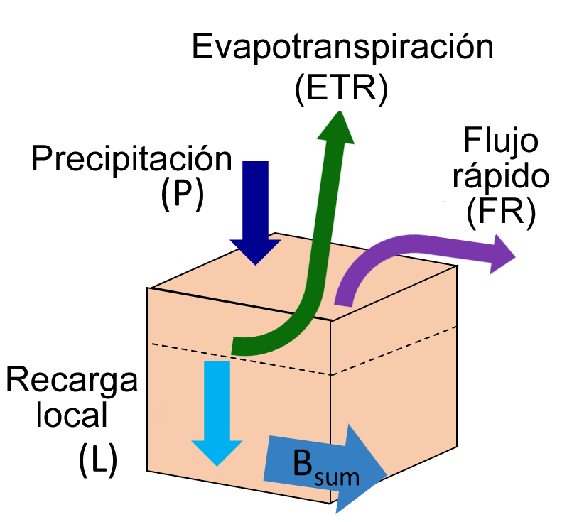
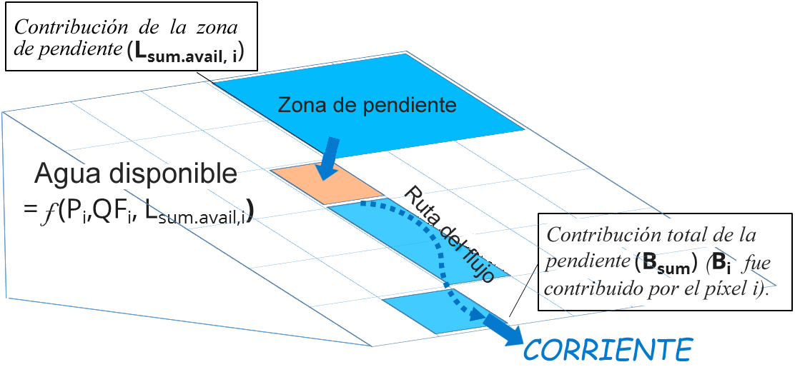

.. _seasonal_water_yield:

******************************
Rendimiento Hídrico Estacional
******************************

Resumen
=======

Existe una gran demanda de herramientas que permitan estimar el efecto de la gestión del paisaje sobre el servicio de suministro de agua, para usos como el riego, el consumo doméstico y la generación hidroeléctrica. Aunque el modelo de Rendimiento Hídrico Anual de InVEST proporciona una estimación del rendimiento hídrico total de una cuenca, muchas aplicaciones requieren conocer los caudales estacionales, especialmente durante la estación seca. Esto exige comprender los procesos hidrológicos de una cuenca, en particular la distribución entre el flujo rápido (que ocurre durante los eventos de lluvia o poco después de ellos) y el flujo base (que ocurre durante el tiempo seco). En climas muy estacionales, es probable que el flujo base tenga un valor mayor que el flujo rápido, a menos que exista una capacidad de almacenamiento significativa (por ejemplo, un gran embalse). El modelo de Rendimiento Hídrico Estacional de InVEST busca orientar sobre la contribución de las parcelas de terreno a la generación tanto de flujo base como de flujo rápido. El modelo calcula índices espaciales que cuantifican la contribución relativa de una parcela de terreno a la generación de ambos tipos de flujo. Actualmente, no existen estimaciones cuantitativas del flujo base, sino únicamente de las contribuciones relativas de los píxeles; se está desarrollando una herramienta independiente para abordar esta cuestión.

Introducción
============

Comprender el efecto de la gestión del paisaje sobre el flujo estacional es de importancia fundamental para el manejo de cuencas hidrográficas. La contribución de una parcela determinada al caudal de una corriente depende de varios factores ambientales, entre ellos el clima, el suelo, la vegetación, la pendiente y la posición a lo largo de la trayectoria del flujo (que determina si el píxel puede recibir agua de las zonas situadas aguas arriba o si el agua recargada puede posteriormente perderse por evapotranspiración).

El agua que fluye por el paisaje se evapora, se transpira, se extrae mediante un pozo o sale de la cuenca como flujo de agua subterránea profunda o como caudal superficial. Si consideramos un píxel individual y su valor con respecto al rendimiento hídrico, podemos distinguir dos enfoques:

- El primero atribuye al píxel el volumen neto de agua que genera, equivalente a la precipitación que recibe menos las pérdidas por evapotranspiración en ese píxel. Según este esquema, la evapotranspiración real puede ser mayor que la precipitación si el sitio recibe agua procedente de zonas situadas aguas arriba. Por tanto, la generación neta puede ser negativa. Este enfoque no considera el destino final del agua generada en ese píxel; es decir, no toma en cuenta si el agua efectivamente llega a la corriente o si se evapora o se extrae en algún punto de su recorrido.

- El segundo enfoque atribuye al terreno el agua que efectivamente llega a la corriente. Por tanto, si una parcela genera agua que posteriormente se evapora, se considera que su contribución es nula.

El primer enfoque pone mayor énfasis en el uso y la cobertura del suelo de un sitio, puesto que se centra en la generación neta de ese píxel. Considera el aporte de agua procedente de los píxeles situados aguas arriba, pero no toma en cuenta los efectos aguas abajo. Representa el *potencial* de generación de caudal (no la generación efectiva de flujo).

El segundo enfoque pone mayor énfasis en la posición topográfica de un píxel, ya que esta determina la posibilidad de que el agua generada en ese píxel sea consumida antes de convertirse en caudal. Representa el caudal real generado por un píxel. Dado que el caudal real no puede ser menor que cero, este enfoque, a diferencia del primero, produce índices mayores o iguales a cero.

Utilizamos ambos conceptos para desarrollar un conjunto de tres índices: uno para el flujo rápido, uno para la recarga (que representa el «flujo base potencial») y uno para el flujo base real. En este contexto, el flujo base se define como la generación de caudal con tiempos de residencia en la cuenca de meses a años, mientras que el flujo rápido representa la generación de caudal con tiempos de residencia en la cuenca de horas a días.

El modelo
=========

Flujo rápido
------------

El *flujo rápido* (QF) se calcula mediante un método que combina el método del Número de Curva (CN) del Servicio de Conservación de Recursos Naturales (NRCS) con una distribución exponencial de las profundidades mensuales de precipitación, tal como se describe en Guswa et al. 2018. Los eventos mensuales de lluvia hacen que la precipitación caiga sobre el paisaje. Las propiedades del suelo y de la cobertura del terreno determinan qué cantidad de lluvia escurre rápidamente por la superficie (produciendo flujo rápido) y qué cantidad se infiltra en el suelo (produciendo recarga local). El número de curva es una forma sencilla de representar estas propiedades del suelo y de la cobertura del terreno: los valores más altos de CN indican un mayor potencial de escorrentía (por ejemplo, suelos arcillosos y poca cobertura vegetal), mientras que los valores más bajos indican una mayor probabilidad de infiltración (por ejemplo, suelos arenosos y una cobertura vegetal natural densa).

Para calcular el flujo rápido, utilizamos la profundidad media de los eventos, :math:`\frac{P_{i,m}}{n_{i,m}}`, y suponemos una distribución exponencial de las profundidades diarias de precipitación en los días lluviosos,

.. math:: f\left( p \right) = \frac{1}{a_{i,m}}exp\left( - \frac{p}{a_{i,m}} \right)

Donde :math:`a_{i,m} = \frac{P_{i,m}}{n_{m}}/25.4` y

- :math:`a_{i,m}` es la profundidad media de lluvia en un día lluvioso en el píxel *i* durante el mes *m* [in],

- :math:`n_{i,m}` es el número de eventos en el píxel *i* durante el mes *m* [-],

- :math:`P_{i,m}` es la precipitación mensual del píxel *i* en el mes *m* [mm].

El flujo rápido de los píxeles ubicados en los cauces se establece igual a la precipitación sobre ese píxel, lo que supone que no hay infiltración y que toda el agua se convierte en escorrentía.

.. math:: \text{QF}_{stream,m} = \ P_{stream,m}

En los demás casos, puede demostrarse, a partir de la distribución exponencial, que la escorrentía mensual :math:`\text{QF}_{i,m}` es

.. math:: \text{QF}_{i,m} = n_{m} \times \left( \left( a_{i,m} - S_{i} \right)\exp\left( - \frac{0.2S_{i}}{a_{i,m}} \right) + \frac{S_{i}^{2}}{a_{i,m}}\exp\left( \frac{0.8S_{i}}{a_{i,m}} \right)E_{1}\left( \frac{S_{i}}{a_{i,m}} \right) \right) \times \left( 25.4\ \left\lbrack \frac{\text{mm}}{\text{in}} \right\rbrack \right)
	:label: (swy. 1)

donde

- :math:`S_{i}` es la retención potencial máxima, :math:`\frac{1000}{\text{CN}_{i}} - 10` [in]

- :math:`\text{CN}_{i}` es el número de curva del píxel *i* [in\ :sup:`-1`\], tabulado en función del uso y la cobertura local del suelo (LULC) y del tipo de suelo *(véase el Apéndice I para consultar una plantilla de esta tabla)*,

- :math:`E_{1}` es la función integral exponencial, :math:`E_{1}(x) = \int_{x}^{\infty}{\frac{e^{-t}}{t}\text{dt}}`.

- y :math:`25.4` es un factor de conversión de pulgadas (utilizadas por la ecuación) a milímetros (utilizados por el modelo).

(véase Guswa et al. 2018).

Algunos casos especiales se manejan de manera específica:

- Cuando :math:`S_{i} = 0`, el término :math:`E_{1}` tiende a infinito. En este caso, :math:`\text{QF}_{i,m}` se establece en cero.
- Para evitar problemas de inestabilidad numérica cuando el resultado de `\exp` se vuelve muy grande, si :math:`\frac{S_{i}}{a_{i,m}} > 100`, se redondea :math:`\text{QF}_{i,m}` hacia abajo a cero.
- Con ciertas combinaciones de datos de entrada, es posible que la ecuación de :math:`\text{QF}_{i,m}` anterior arroje un número negativo pequeño. En estos casos, :math:`\text{QF}_{i,m}` se redondea a cero.

Así, el flujo rápido anual :math:`\text{QF}_{i}` se puede calcular sumando los valores mensuales de :math:`\text{QF}_{i,m}`,

.. math:: \text{QF}_{i} = \sum_{m = 1}^{12}{QF_{i,m}}
	:label: (swy. 2)

Recarga local
-------------

La *recarga local*, o contribución potencial al flujo base, de un píxel se calcula a partir del balance hídrico local. La precipitación que no se convierte en flujo rápido y que no es evapotranspirada por la vegetación de un píxel puede infiltrarse en el suelo y convertirse en recarga local. La recarga local puede ser negativa si un píxel no recibe suficiente agua propia para satisfacer los requerimientos de su vegetación (determinados por su factor de cultivo *Kc*), por lo que también utiliza agua generada en zonas situadas aguas arriba (lo que se denomina «subsidio aguas arriba»). El índice de recarga local se calcula a escala anual, pero utiliza valores derivados de los balances hídricos mensuales.

Para un píxel *i*, la recarga local derivada del balance hídrico anual es (Figura 1):

.. math:: L_{i} = P_{i} - \text{QF}_{i} - \text{AET}_{i}
	:label: (swy. 3)

Donde la evapotranspiración real anual AET es la suma de la AET mensual:

.. math:: \text{AET}_{i} = \sum_{\text{months}}^{}\text{AET}_{i,m}
	:label: (swy. 4)

Para cada mes, :math:`\text{AET}_{i,m}` está limitada por la demanda (evapotranspiración potencial - PET) o por el agua disponible (según Allen et al. 1998):

.. math:: \text{AET}_{i,m} = min(\text{PET}_{i,m}\ ;\ P_{i,m} - \text{QF}_{i,m} + \alpha_{m}\beta_{i}L_{sum.avail,i})
	:label: (swy. 5)

Donde :math:`\text{PET}_{i,m}` es la evapotranspiración potencial mensual,

.. math:: \text{PET}_{i,m} = K_{c,i,m} \times ET_{0,i,m}
	:label: (swy. 6)

:math:`L_{sum.avail,i}` se define de manera recursiva mediante (Figura 2),

.. math:: L_{sum.avail,i} = \sum_{j \in \{ neighbor\ pixels\ draining\ to\ pixel\ i\}}^{}{p_{\text{ij}} \cdot \left( L_{avail,j} + L_{sum.avail,j} \right)}
	:label: (swy. 7)

donde :math:`p_{\text{ij}}\ \in \lbrack 0,1\rbrack` es la proporción del flujo de la celda *i* a la celda *j*, y :math:`L_{avail,i}` es la recarga disponible para un píxel, que corresponde a :math:`L_{i}` cuando :math:`L_{i}` es negativo, y a una proporción :math:`\gamma` de :math:`L_{i}` cuando es positivo (véase a continuación la definición de :math:`\gamma`):

.. math:: L_{avail,i}\ = min(\gamma L_{i},L_{i})
	:label: (swy. 8)

En las ecuaciones anteriores:

- :math:`P_{i}` y :math:`P_{i,m}` son la precipitación anual y mensual, respectivamente [mm].

- :math:`\text{QF}_{i}` y :math:`\text{QF}_{i,m}` son los índices de flujo rápido definidos anteriormente [mm].

- :math:`ET_{0,i,m}` es la evapotranspiración de referencia del mes *m* [mm].

- :math:`K_{c,i,m}` es el factor de cultivo mensual para el LULC del píxel.

- :math:`\alpha_{m}` es la fracción de la recarga anual disponible aguas arriba que está disponible en el mes *m* (el valor predeterminado es 1/12).

- :math:`\beta_{i}` es la fracción del subsidio aguas arriba que está disponible para la evapotranspiración aguas abajo (el valor predeterminado es 1; véase el Apéndice II para obtener más información).

- γ es la fracción de la recarga del píxel que está disponible para los píxeles situados aguas abajo (el valor predeterminado es 1).

Atribución de la recarga
------------------------

El flujo base total, :math:`Q_b` (en mm), es el promedio de las recargas locales contribuyentes (negativas o positivas) en la cuenca,

.. math:: Q_{b} = \frac{\sum_{k \in \left\{ \text{pixels in catchment} \right\}}^{}L_{k}}{n_{\text{pixels in catchment}}}
	:label: (swy. 9)

El valor de atribución a un píxel es la contribución relativa de la recarga local :math:`L` de ese píxel al flujo base :math:`Q_b`:

.. math:: V_{R,i} = \frac{L_{i}}{{Q_{b} \times n}_{\text{pixels in catchment}}}
	:label: (swy. 10)

|

*Figura 1. Balance hídrico a escala de píxel para calcular la recarga local (Ec. 3), donde Bsum es el flujo que efectivamente llega a la corriente.*

|

*Figura 2. Encauzamiento a escala de ladera para calcular la evapotranspiración real (en función de las variables climáticas de cada píxel y de la contribución aguas arriba; véase la Ec. 5) y el flujo base (en función de Bsum, el flujo que efectivamente llega a la corriente; véanse las Ecs. 11-14).*

|
|

Flujo base
----------

El índice de flujo base representa la contribución de un píxel al flujo base (es decir, al agua que llega a la corriente durante la estación seca). Si la recarga local es negativa, el píxel no contribuyó al flujo base y, por tanto, :math:`B` se establece en cero. Si el píxel contribuyó a la recarga de agua subterránea, entonces :math:`B` es una función de la cantidad de flujo que sale del píxel y de la contribución relativa de ese píxel a la recarga.

Para un píxel que no es adyacente al cauce, el flujo base acumulado, :math:`B_{sum,i}`, es proporcional al flujo base acumulado que sale de los píxeles adyacentes situados aguas abajo, menos el flujo base acumulado que se generó en ese mismo píxel aguas abajo (Figura 2):

.. math::
   B_{sum,i} = L_{sum,i}\sum_{j \in \{\text{cells to which cell i pours}\}}^{}\begin{Bmatrix}
   p_{\text{ij}}\left( 1 - \frac{L_{avail,j}}{L_{sum,j}} \right)\frac{B_{sum,j}}{L_{sum,j} - L_{j}}\ \text{   if }j\text{ is a nonstream pixel} \\
   p_{\text{ij}}\ \text{   if }j\text{ is a stream pixel} \\
   \end{Bmatrix}
 :label: (swy. 11)

En la salida de la cuenca (o en cualquier píxel adyacente a la corriente), la suma de la generación de flujo base :math:`B_{sum,i}` de todos los píxeles situados aguas arriba es igual a la suma de la generación local de esos mismos píxeles (porque ya no existe otra oportunidad para que el flujo lento sea consumido antes de llegar a la corriente):

.. math:: B_{sum,outlet} = L_{sum,outlet}
	:label: (swy. 12)

donde :math:`L_{sum,i}` es la recarga acumulada aguas arriba, definida por

.. math:: L_{sum,i} = L_{i} + \sum_{j,\ all\ pixels\ draining\ to\ pixel\ i}^{}{L_{sum,j} \cdot p_{\text{ji}}}
	:label: (swy. 13)

y el flujo base, :math:`B_{i}`, puede derivarse directamente de la proporción del flujo base acumulado que sale de la celda *i*, con respecto a la recarga disponible para la recarga acumulada aguas arriba:

.. math:: B_{i} = max\left(B_{sum,i} \cdot \frac{L_{i}}{L_{sum,i}}, 0\right)
	:label: (swy. 14)

Limitaciones y simplificaciones
===============================

Al igual que todos los modelos de InVEST, el modelo de Rendimiento Hídrico Estacional utiliza un enfoque simplificado para estimar el flujo rápido y el flujo base, y no incluye muchas de las complejidades que ocurren cuando el agua se desplaza por el paisaje. El flujo rápido se basa principalmente en el número de curva, que no toma en cuenta la topografía. En cuanto al flujo base, aunque el modelo utiliza un enfoque basado en procesos físicos, las ecuaciones son extremadamente simplificadas tanto en la escala espacial como en la temporal, lo que incrementa considerablemente la incertidumbre de los valores absolutos obtenidos. Por ello, no recomendamos utilizar los valores absolutos, sino los valores relativos a lo largo del paisaje (en los que suponemos que las simplificaciones tienen menor importancia, porque se aplican a todo el paisaje).

Datos necesarios
================

.. note:: *Todas las entradas espaciales deben tener exactamente el mismo sistema de coordenadas proyectadas* (con unidades lineales en metros), *no un sistema de coordenadas geográficas* (con unidades en grados).

.. note:: Las entradas ráster pueden tener diferentes tamaños de celda y se remuestrearán para que coincidan con el tamaño de celda del MDE. Por lo tanto, todos los resultados del modelo tendrán el mismo tamaño de celda que el MDE.

- :investspec:`seasonal_water_yield.seasonal_water_yield workspace_dir`

- :investspec:`seasonal_water_yield.seasonal_water_yield results_suffix`

- :investspec:`seasonal_water_yield.seasonal_water_yield precip_raster_table` Se recomienda encarecidamente utilizar las mismas capas de precipitación que se emplearon para crear los rásteres de entrada de evapotranspiración. Si estos se basan en fuentes diferentes de datos de precipitación, se introduce otra fuente de incertidumbre en los datos y la falta de correspondencia podría afectar los componentes del balance hídrico calculados por el modelo.

  Columnas:

  - :investspec:`seasonal_water_yield.seasonal_water_yield precip_raster_table.columns.month`
  - :investspec:`seasonal_water_yield.seasonal_water_yield precip_raster_table.columns.path`

- :investspec:`seasonal_water_yield.seasonal_water_yield et0_raster_table` Se recomienda encarecidamente que los rásteres de entrada de evapotranspiración se basen en los mismos datos de precipitación que se ingresan en el modelo. Si se basan en fuentes diferentes de datos de precipitación, se introduce otra fuente de incertidumbre en los datos y la falta de correspondencia podría afectar los componentes del balance hídrico calculados por el modelo.

  Columnas:

  - :investspec:`seasonal_water_yield.seasonal_water_yield et0_raster_table.columns.month`
  - :investspec:`seasonal_water_yield.seasonal_water_yield et0_raster_table.columns.path`

- :investspec:`seasonal_water_yield.seasonal_water_yield dem_raster_path`

- :investspec:`seasonal_water_yield.seasonal_water_yield lulc_raster_path`

- :investspec:`seasonal_water_yield.seasonal_water_yield soil_group_path` Tenga en cuenta que no se aceptan valores distintos de 1, 2, 3 y 4 (como 13 y 14). Para obtener más información, consulte el Apéndice de fuentes de datos de este capítulo.

- :investspec:`seasonal_water_yield.seasonal_water_yield aoi_path`

- :investspec:`seasonal_water_yield.seasonal_water_yield biophysical_table_path` Una tabla .csv (valores separados por comas) que contiene información del modelo correspondiente a cada una de las clases de uso del suelo del ráster LULC. *Todas las clases LULC del ráster LULC DEBEN tener valores correspondientes en esta tabla.* Cada fila corresponde a una clase de uso/cobertura del suelo y las columnas deben denominarse y definirse de la siguiente manera:

  Columnas:

  - :investspec:`seasonal_water_yield.seasonal_water_yield biophysical_table_path.columns.lucode`
  - :investspec:`seasonal_water_yield.seasonal_water_yield biophysical_table_path.columns.cn_[SOIL_GROUP]` En concreto, los nombres de las columnas deben ser "CN_A", "CN_B", "CN_C" y "CN_D".
  - :investspec:`seasonal_water_yield.seasonal_water_yield biophysical_table_path.columns.kc_[MONTH]` En concreto, los nombres de las columnas deben ser "kc_1", "kc_2" ... "kc_12".

.. csv-table:: **Ejemplo de tabla biofísica**
      :file: ./seasonal_water_yield/biophysical_table_gura_SWY.csv
      :header-rows: 1
      :name: SWY-biophysical-table

- :investspec:`seasonal_water_yield.seasonal_water_yield rain_events_table_path` Un evento de lluvia se define como una precipitación >0.1 mm.

  Columnas:

  - :investspec:`seasonal_water_yield.seasonal_water_yield rain_events_table_path.columns.month`
  - :investspec:`seasonal_water_yield.seasonal_water_yield rain_events_table_path.columns.events`

   *Ejemplo de tabla de eventos de lluvia.*

   === =======
   mes eventos
   === =======
   1   9
   2   9
   3   13
   4   21
   5   20
   6   10
   7   11
   8   12
   9   9
   10  14
   11  21
   12  13
   === =======

|

- :investspec:`seasonal_water_yield.seasonal_water_yield threshold_flow_accumulation`
- :investspec:`seasonal_water_yield.seasonal_water_yield alpha_m` Valor predeterminado: 1/12.
- :investspec:`seasonal_water_yield.seasonal_water_yield beta_i` Valor predeterminado: 1.
- :investspec:`seasonal_water_yield.seasonal_water_yield gamma` Valor predeterminado: 1.

- :investspec:`seasonal_water_yield.seasonal_water_yield flow_dir_algorithm` Controla cómo se modela el flujo de agua. Con el algoritmo D8, toda el agua de un píxel determinado fluye hacia el píxel vecino que se encuentra en la dirección de mayor pendiente descendente. Con el algoritmo de dirección de flujo múltiple (MFD), el agua de un píxel fluye hacia todos sus vecinos situados aguas abajo, ponderada según la inclinación de la pendiente descendente.

Opciones avanzadas del modelo
-----------------------------

La tabla mensual de eventos de lluvia es una forma sencilla de proporcionar datos sobre los eventos de lluvia. Esto supone que existe un único valor para toda la cuenca, lo que puede no ser cierto en áreas extensas o en zonas con precipitaciones muy variables espacialmente.

Para representar la variabilidad en el número de eventos de lluvia, es posible ingresar un mapa de zonas climáticas y el número de eventos de lluvia asociado a cada zona.

**Entradas**

- :investspec:`seasonal_water_yield.seasonal_water_yield user_defined_climate_zones`

- :investspec:`seasonal_water_yield.seasonal_water_yield climate_zone_table_path`

   Columnas:

   - :investspec:`seasonal_water_yield.seasonal_water_yield climate_zone_table_path.columns.cz_id`
   - :investspec:`seasonal_water_yield.seasonal_water_yield climate_zone_table_path.columns.[MONTH]`

   *Ejemplo de tabla de eventos de lluvia por zona climática.*

   ===== === === === === === === === === === === === ===
   cz_id ene feb mar abr may jun jul ago sep oct nov dic
   ===== === === === === === === === === === === === ===
   1     9   9   13  21  20  10  11  12  9   14  21  13
   2     9   9   12  19  18  10  10  11  9   12  19  11
   ===== === === === === === === === === === === === ===

|

- :investspec:`seasonal_water_yield.seasonal_water_yield climate_zone_raster_path`

|

El modelo calcula secuencialmente la capa de recarga local y, a continuación, la capa de flujo base a partir de la recarga local. En lugar de que InVEST calcule la recarga local, esta capa podría obtenerse de otro modelo (por ejemplo, RHESSys). Para calcular la contribución al flujo base a partir de una capa de recarga propia, es posible omitir la primera parte del modelo e ingresar directamente un mapa de recarga local.

**Entradas**

- :investspec:`seasonal_water_yield.seasonal_water_yield user_defined_local_recharge`
- :investspec:`seasonal_water_yield.seasonal_water_yield l_path`

|

El parámetro *alpha* representa la variabilidad temporal de la contribución del agua disponible aguas arriba a la evapotranspiración de un píxel. En la parametrización predeterminada, su valor se establece en 1/12, suponiendo que el suelo amortigua la liberación de agua y que la contribución mensual equivale exactamente a 1\\12\ :sup:`avo` de la contribución anual.

Para permitir que el subsidio aguas arriba varíe temporalmente, el usuario puede proporcionar una tabla de valores mensuales de *alpha*.

**Entradas**

- :investspec:`seasonal_water_yield.seasonal_water_yield monthly_alpha`
- :investspec:`seasonal_water_yield.seasonal_water_yield monthly_alpha_path`

   Columnas:

   - :investspec:`seasonal_water_yield.seasonal_water_yield monthly_alpha_path.columns.month`
   - :investspec:`seasonal_water_yield.seasonal_water_yield monthly_alpha_path.columns.alpha`

Interpretación de los resultados
================================

La resolución de los rásteres de salida será la misma que la resolución del MDE proporcionado como entrada.

* Carpeta **[Workspace]**:

 * **Registro de parámetros**: Cada vez que se ejecuta el modelo, se crea un archivo de texto (.txt) en el espacio de trabajo. El archivo enumera los valores de los parámetros y los mensajes de salida de esa ejecución, y se denomina de acuerdo con el servicio, la fecha y la hora. Cuando se comunique con NatCap por errores en la ejecución de un modelo, incluya el registro de parámetros.

 * **seasonal_water_yield_report_[Suffix].html:** Resumen de una ejecución del modelo, que incluye visualizaciones de los resultados principales, tablas de los resultados calculados e información sobre las entradas del modelo. Se puede acceder al informe desde Workbench o abrirlo con cualquier navegador web. Para ver un ejemplo, consulte el `Informe de ejemplo de Rendimiento Hídrico Estacional <https://storage.googleapis.com/releases.naturalcapitalproject.org/invest-reports/latest/seasonal_water_yield_report_gura.html>`_, generado al ejecutar el modelo SWY con los datos de muestra de SWY.

 * **B_[Suffix].tif** (tipo: ráster; unidades: mm/año, pero debe interpretarse como valores relativos, no absolutos): mapa de los valores de flujo base :math:`B`, que representan la contribución de un píxel al flujo de liberación lenta (que no es evapotranspirado antes de llegar a la corriente).

 * **B_sum_[Suffix].tif** (tipo: ráster; unidades: mm/año, pero debe interpretarse como valores relativos, no absolutos): mapa de los valores :math:`B_{\text{sum}}`, que representan el flujo que atraviesa un píxel, aportado por todos los píxeles situados aguas arriba, y que no es evapotranspirado antes de llegar a la corriente.

 * **CN_[Suffix].tif** (tipo: ráster): mapa de los valores del número de curva.

 * **L_avail_[Suffix].tif** (tipo: ráster; unidades: mm/año, pero debe interpretarse como valores relativos, no absolutos): mapa de la recarga local disponible :math:`L_{\text{avail}}`.

 * **L_[Suffix].tif** (tipo: ráster; unidades: mm/año, pero debe interpretarse como valores relativos, no absolutos): mapa de los valores de recarga local :math:`L`.

 * **L_sum_avail_[Suffix].tif** (tipo: ráster; unidades: mm/año, pero debe interpretarse como valores relativos, no absolutos): mapa de los valores :math:`L_{\text{sum.avail}}`, que representan el agua disponible para un píxel, aportada por todos los píxeles situados aguas arriba y disponible para la evapotranspiración de ese píxel.

 * **L_sum_[Suffix].tif** (tipo: ráster; unidades: mm/año, pero debe interpretarse como valores relativos, no absolutos): mapa de los valores :math:`L_{\text{sum}}`, que representan el flujo que atraviesa un píxel, aportado por todos los píxeles situados aguas arriba y disponible para la evapotranspiración de los píxeles situados aguas abajo.

 * **P_[Suffix].tif** (tipo: ráster; unidades: mm/año): precipitación total de todos los meses sobre ese píxel.

 * **QF_[Suffix].tif** (tipo: ráster; unidades: mm/año): mapa de los valores del flujo rápido anual (QF).

 * **stream_[Suffix].tif** (tipo: ráster): red de drenaje generada a partir del MDE de entrada y del umbral de acumulación de flujo. Los valores 1 representan corrientes y los valores 0 representan píxeles que no pertenecen a corrientes.

 * **Vri_[Suffix].tif** (tipo: ráster; unidades: mm/año): mapa de los valores de recarga (contribución positiva o negativa) a la recarga total.

 * **aggregated_results_swy_[Suffix].shp**: tabla que contiene valores biofísicos para cada cuenca, con los siguientes campos:

    * **qb** (unidades: mm/año, pero debe interpretarse como valores relativos, no absolutos): valor medio de recarga local dentro de la cuenca.

    * **vri_sum** (unidades: mm/año): contribución total a la recarga (positiva o negativa) dentro de la cuenca. Corresponde a la suma de los valores de los píxeles de ``Vri_[Suffix].tif`` dentro de la cuenca.

    * **geom_id**: número de identificación (ID) único de la cuenca.

 * **monthly_quickflow_baseflow_[Suffix].csv**: tabla de los valores mensuales promedio de flujo base, flujo rápido y precipitación para cada cuenca (o entidad geográfica) dentro del AOI. Este archivo CSV solo se crea si no se proporcionó un ráster de recarga local como entrada del modelo. Incluye los siguientes campos:

    * **geom_id**: ID único de la cuenca. Corresponderá a la columna ``geom_id`` de ``aggregated_results_swy_[Suffix].shp``.

    * **month**: valores numéricos del 1 al 12 correspondientes a cada mes, de enero (1) a diciembre (12).

    * **quickflow** (unidades: metros cúbicos/mes): valor promedio del flujo rápido para ese mes en la cuenca.

    * **baseflow** (unidades: metros cúbicos/mes): valor promedio del flujo base para ese mes en la cuenca. Dado que el flujo base se calcula a escala anual, los valores de cada cuenca se distribuyen uniformemente a lo largo del año (promedio anual dividido para 12).

    * **precipitation** (unidades: metros cúbicos/mes): valor promedio de precipitación para ese mes en la cuenca. Los valores se basan en los rásteres mensuales de precipitación de entrada alineados.

* Carpeta **[Workspace]\\intermediate_outputs**:

 * **aet_[Suffix].tif** (tipo: ráster; unidades: mm/año): mapa de la evapotranspiración real (AET).

 * **qf_1_[Suffix].tif...qf_12_[Suffix].tif** (tipo: ráster; unidades: mm/mes): mapas del flujo rápido mensual (1 = enero... 12 = diciembre).

 * **Si_[Suffix].tif** (tipo: ráster; unidades: pulgadas): retención potencial máxima, utilizada en el cálculo del flujo rápido. (Tenga en cuenta que la unidad se convierte a mm en la Ec. :eq:`(swy. 1)`).

Calibración/comparación con datos observados
============================================

El capítulo :ref:`calibration_freshwater` de esta Guía ofrece una descripción general de cómo realizar análisis de sensibilidad y calibración.

Siempre se recomienda validar el modelo con datos observados, si es posible. La validación con el modelo SWY suele consistir en comparar el caudal total mensual o anual observado con la suma del flujo rápido y el flujo base modelados. Sin embargo, el modelo solo proporciona resultados del flujo base a escala anual y cuantifica de manera muy simplificada un proceso muy complejo, por lo que conviene reconocer la elevada incertidumbre de los valores de flujo base. Además, si se comparan con valores mensuales de caudal observados, es necesario distribuir el flujo base anual entre los meses. InVEST lo hace de una manera muy básica, dividiendo el flujo base para 12, lo que añade otro nivel de incertidumbre.

Al intentar validar cuantitativamente el flujo rápido, o una combinación de flujo rápido y flujo base, tenga en cuenta que, dado que los resultados están expresados en milímetros (mm), si simplemente sumáramos estas láminas y luego multiplicáramos el resultado por toda el área, el valor probablemente sería varios órdenes de magnitud demasiado grande y no representaría correctamente el volumen total de agua. En su lugar, utilice el valor medio de B o Qf en toda la cuenca. Esto es lo que representan los valores proporcionados en ``monthly_quickflow_baseflow_[Suffix].csv``.

Para cada cuenca proporcionada como entrada, estos valores se calculan de la siguiente manera:

* Para cada ráster mensual de flujo rápido y de precipitación:

  1. Los valores de los píxeles en mm se convierten a m (valor*0.001 m/mm), lo que produce valores en m / píxel.
  2. Estos valores de profundidad (m / píxel) del paso (1) se multiplican por el área del píxel (en m2), lo que produce valores en m3 / píxel.
  3. Dentro de cada cuenca, se suman los valores de volumen resultantes (m3 / píxel) del paso (2), lo que produce valores en m3 / cuenca. Para los valores de flujo rápido y precipitación, estos son los valores mensuales promedio finales de la cuenca.

* Para el ráster anual de flujo base:

  1. Los valores de los píxeles en mm se convierten a m (valor*0.001 m/mm), lo que produce valores en m / píxel.
  2. Estos valores de profundidad (m / píxel) del paso (1) se multiplican por el área del píxel (en m2), lo que produce valores en m3 / píxel.
  3. Dentro de cada cuenca, se suman los valores de volumen resultantes (m3 / píxel) del paso (2), lo que produce valores en m3 / cuenca.
  4. Los valores en m3 / cuenca se dividen para 12 meses / año con el fin de obtener estimaciones mensuales simples del flujo base. Para el flujo base, estos son los valores mensuales promedio finales de la cuenca.

Véase también el artículo de Hamel et al. (2020), que presenta un ejemplo de calibración del modelo de Rendimiento Hídrico Estacional con datos observados y otros modelos hidrológicos. Para obtener orientaciones más generales sobre la evaluación de la incertidumbre en los análisis de servicios ecosistémicos, véase Hamel y Bryant (2017).

Apéndice 1: Fuentes de datos y orientaciones para la selección de parámetros
============================================================================

:ref:`Precipitation <precipitation>`
------------------------------------

:ref:`Evapotranspiration <et0>`
-------------------------------

:ref:`Digital Elevation Model <dem>`
------------------------------------

:ref:`Land Use/Land Cover <lulc>`
---------------------------------

:ref:`Soil Groups <soil_groups>`
---------------------------------

:ref:`Watersheds <watersheds>`
------------------------------

:ref:`Curve Number <cn>`
------------------------

:ref:`Kc <kc>`
--------------

:ref:`Rain Events <rain_events>`
--------------------------------

:ref:`Threshold Flow Accumulation <tfa>`
----------------------------------------

:ref:`Flow Direction Algorithm <flow_direction_algorithms>`
-----------------------------------------------------------

Zonas climáticas
----------------
Los datos de zonas climáticas están disponibles en el `sitio de clasificación climática de Köppen-Geiger <http://koeppen-geiger.vu-wien.ac.at/present.htm>`_.

También puede encontrar datos de zonas climáticas preparados para InVEST en el NatCap Data Hub: https://data.naturalcapitalalliance.stanford.edu/dataset/?_tags_limit=0&tags=CLIMATE+ZONES

alpha_m
-------

Valor predeterminado: 1/12. Véase el Apéndice 2.

beta_i
------

Valor predeterminado: 1. Véase el Apéndice 2.

gamma
-----

Valor predeterminado: 1. Véase el Apéndice 2.

|
|

Apéndice 2: Parámetros *alpha*, *beta* y *gamma*: definición y valores alternativos
===================================================================================

:math:`\alpha` (alfa) y :math:`\beta_{i}` (beta) representan la fracción de la recarga anual procedente de los píxeles situados aguas arriba que está disponible para que un píxel situado aguas abajo la utilice en la evapotranspiración durante un mes determinado. Se espera que el producto :math:`\alpha \times \beta_{i}` sea <1, ya que parte del agua procedente de aguas arriba puede no estar disponible, bien porque sigue trayectorias de flujo profundo o porque el momento de la oferta no coincide con el de la demanda (evapotranspiración).

:math:`\alpha` es una función de la estacionalidad de la precipitación: la recarga de un mes determinado puede ser utilizada por las áreas situadas aguas abajo durante meses posteriores, dependiendo de los tiempos de tránsito en el subsuelo. En la parametrización predeterminada, su valor se establece en 1/12, suponiendo que el suelo amortigua la liberación de agua y que la contribución mensual equivale exactamente a una doceava parte de la contribución anual. Una hipótesis alternativa consiste en establecer los valores según la precipitación mensual del mes anterior, relativa a la precipitación total: P\ :sub:`m-1`/P\ :sub:`annual`.

:math:`\beta_{i}` es una función de la topografía y los suelos locales: para una cantidad determinada de recarga procedente de aguas arriba, la cantidad de agua utilizada por un píxel depende de la capacidad de almacenamiento. También depende de las características del área situada aguas arriba: el uso del subsidio aguas arriba está condicionado por la forma y el área de la zona de contribución (es decir, es menos probable que se pierda la recarga procedente del píxel inmediatamente superior al píxel de interés que la procedente de píxeles mucho más alejados).

En la parametrización predeterminada, :math:`\beta` se establece en 1 para todos los píxeles. Una alternativa consiste en establecer :math:`\beta_{i}` como TI, el índice de humedad topográfica de un píxel, definido como :math:`ln(\frac{A}{\text{tan}\beta}`) (u otra formulación que incluya el tipo y la profundidad del suelo).

γ (gamma) representa la fracción de la recarga del píxel que está disponible para los píxeles situados aguas abajo. Es una función de las propiedades del suelo y, posiblemente, de la topografía. En la parametrización predeterminada, γ es constante en todo el paisaje y desempeña una función similar a la de :math:`\alpha`.

En la práctica
--------------

Las opciones anteriores se proporcionan principalmente con fines de investigación. En la práctica, sugerimos que, en climas muy estacionales, *alpha* se establezca según los valores de precipitación mensual antecedente, en relación con la precipitación total: P\ :sub:`m-1`/P\ :sub:`annual`.

A continuación, ofrecemos dos opciones para abordar la incertidumbre en torno a los valores de los parámetros:

1. Verificación de la evapotranspiración real con observaciones

El modelo produce la evapotranspiración real a escala anual: los usuarios pueden ajustar los parámetros para que coincidan con la evapotranspiración real observada (por ejemplo, a partir de MODIS, https://www.ntsg.umt.edu/project/modis/mod16.php). En lo que sigue, "_mod" representa la AET modelada y "_obs" representa la AET observada.

* Si AET\_mod > AET\_obs, el modelo sobreestima la evapotranspiración. Esto puede corregirse reduciendo los valores de *Kc*, reduciendo los valores de *gamma* o *beta*, o ambas cosas (de modo que haya menos agua disponible para cada píxel).

* Si AET\_mod < AET\_obs, el modelo subestima la evapotranspiración. Esto puede corregirse aumentando los valores de *Kc* (y aumentando los valores de *gamma* o *beta* si todavía no han alcanzado su máximo de 1).

Si se dispone de valores mensuales de AET, se puede realizar una calibración más detallada modificando el parámetro estacional alpha.

2. Modelación por conjuntos

El modelo puede ejecutarse bajo diferentes supuestos y los resultados pueden compararse para estimar el efecto del error de los parámetros. Los rangos de los parámetros pueden determinarse a partir de supuestos sobre la proporción del subsidio aguas arriba disponible para un píxel determinado; para obtener resultados preliminares, pueden establecerse en los límites máximos (0 y 1).

Referencias
===========

Allen, R.G., Pereira, L.S., Raes, D., Smith, M., 1998. Crop evapotranspiration - Guidelines for computing crop water requirements, FAO Irrigation and drainage paper 56. Rome, Italy.

Guswa, A. J., Hamel, P., &amp; Meyer, K. (2018). Curve number approach to estimate monthly and annual direct runoff. Journal of Hydrologic Engineering, 23(2). https://doi.org/10.1061/(asce)he.1943-5584.0001606

Hamel, P. & Bryant, B. (2017). Uncertainty assessment in ecosystem services analyses: Seven challenges and practical responses. Ecosystem Services, Volume 24. https://doi.org/10.1016/j.ecoser.2016.12.008.

Hamel, P., Valencia, J., Schmitt, R., Shrestha, M., Piman, T., Sharp, R.P., Francesconi, W., Guswa, A.J., 2020. Modeling seasonal water yield for landscape management: Applications in Peru and Myanmar. Journal of Environmental Management 270, 110792. https://doi.org/10.1016/j.jenvman.2020.110792

NRCS-USDA, 2007. National Engineering Handbook. United States Department of Agriculture,
https://www.nrcs.usda.gov/wps/portal/nrcs/detailfull/national/water/?cid=stelprdb1043063.
