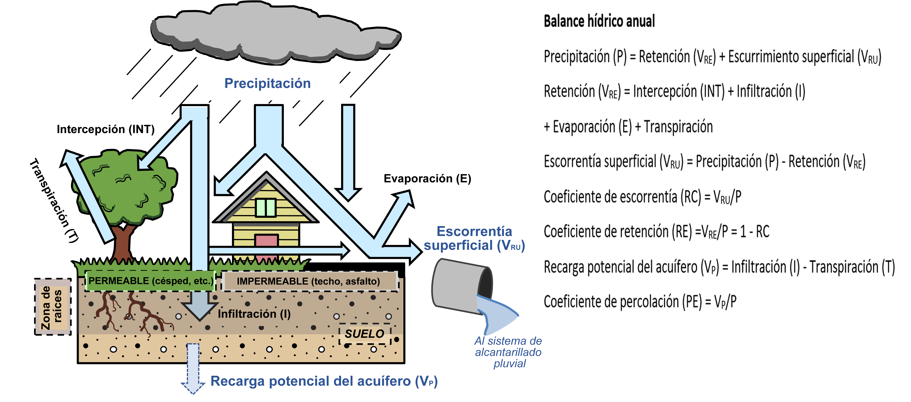
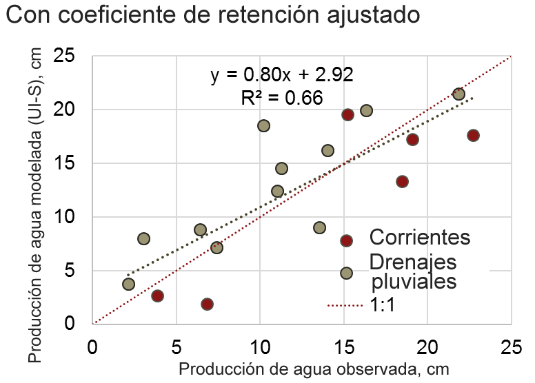
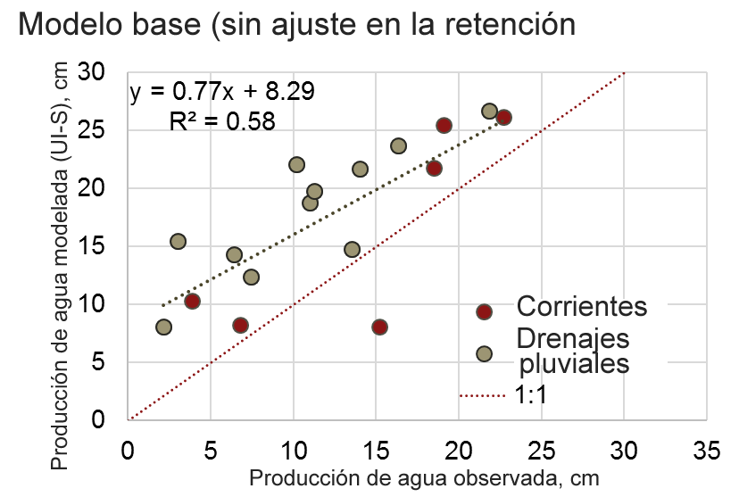

.. _stormwater:

************************************
Retención de aguas pluviales urbanas
************************************

Introducción
============

Las entidades de planificación consideran cada vez más la gestión del agua urbana en sus estrategias para abordar problemas como el cambio climático, el riesgo de inundaciones o el crecimiento de la población, al tiempo que protegen el medio ambiente. El modelo de InVEST de retención de escorrentía pluvial puede apoyar este esfuerzo al proporcionar información sobre dos servicios ecosistémicos relacionados con la gestión de las aguas pluviales: la retención de escorrentía y la recarga de aguas subterráneas. (La reducción del riesgo de inundación se evalúa en otro modelo de InVEST, :ref:`Mitigación del riesgo de inundación urbana <ufrm>`). La retención de escorrentía tiene dos aspectos: la cantidad y la calidad de la escorrentía. En concreto, corresponde a la retención de las aguas pluviales (escorrentía generada por la lluvia) por parte de los usos del suelo permeables, lo que resulta beneficioso dados los efectos perjudiciales de la descarga de aguas pluviales contaminadas en los ríos o el océano. La recarga de aguas subterráneas es un servicio relacionado, que corresponde a la percolación de las aguas pluviales más allá de la zona radicular, con la posibilidad de recargar las aguas subterráneas para usos humanos y no humanos. Un resultado secundario del modelo es una estimación de la escorrentía superficial, es decir, la parte de las aguas pluviales que no queda retenida en el paisaje y se exporta junto con los nutrientes o contaminantes asociados. Estos componentes principales del balance hídrico urbano se ilustran en :numref:`hydro-schematic`.

El modelo estima la retención, la recarga de aguas subterráneas y la escorrentía superficial a escala anual, y no para un único evento de tormenta. Esta es la principal diferencia entre los modelos de InVEST de Retención de aguas pluviales y de Mitigación del riesgo de inundación: el primero está diseñado para evaluar los servicios hidrológicos generales que proporciona el paisaje en respuesta a la precipitación de un año, cuando las principales preocupaciones de planificación se relacionan con la calidad del agua superficial y el abastecimiento de agua; el segundo está diseñado para evaluar los servicios que proporciona el paisaje en respuesta a un único evento de tormenta grande («extremo»), cuando la principal preocupación es la inundación.

El modelo
=========

El modelo calcula el volumen anual de retención de aguas pluviales y los beneficios asociados para la calidad del agua (es decir, el transporte evitado de nutrientes o contaminantes hacia lagos, ríos o estuarios que reciben la escorrentía). El valor del servicio de retención puede calcularse utilizando el costo de reposición de la infraestructura de aguas pluviales. De manera opcional, el modelo también puede proporcionar estimaciones de la posible recarga de aguas subterráneas al acuífero, así como de las aguas pluviales exportadas mediante la escorrentía superficial (en forma de volumen y masa de contaminantes o nutrientes). A continuación, en :numref:`hydro-schematic`, se presenta un resumen del balance hídrico de precipitación y escorrentía urbana, que ilustra estos flujos principales de agua.

.. _hydro-schematic:

   **Principales flujos hidrológicos del balance de aguas pluviales urbanas**, que ilustran los destinos potenciales de la precipitación cuando cae sobre superficies permeables (suelo o vegetación, como césped y árboles) e impermeables (tejados y superficies pavimentadas). La recarga potencial del acuífero se estima durante los períodos secos como la diferencia entre el volumen de lluvia infiltrada y el volumen de agua transpirada por la vegetación en la profundidad del suelo donde se encuentra la mayor parte de las raíces de las plantas.

Estimación de la retención, la recarga y la escorrentía de aguas pluviales
^^^^^^^^^^^^^^^^^^^^^^^^^^^^^^^^^^^^^^^^^^^^^^^^^^^^^^^^^^^^^^^^^^^^^^^^^^

El modelo requiere valores de los coeficientes anuales de escorrentía (:math:`RC`) y, de manera opcional, de las relaciones de percolación (:math:`PE`) para cada tipo de uso/cobertura del suelo (LULC) en la tabla biofísica. El coeficiente de escorrentía se define como la relación entre la escorrentía superficial anual y la precipitación anual, con un valor entre 0 y 1; la relación de percolación es la relación entre la percolación anual hacia las aguas subterráneas («recarga potencial del acuífero») y la precipitación anual (:numref:`hydro-schematic`). Estos coeficientes suelen depender de la cobertura del suelo y de las propiedades edáficas de una cuenca hidrográfica. Consulte `Orientaciones para las entradas`_ para obtener más detalles sobre cómo determinar estos valores.

Para cada clase de LULC :math:`x`, el coeficiente de retención de aguas pluviales :math:`RE_x` se calcula como:

.. math:: RE_x=1-RC_x

A partir de los rásteres de LULC y de grupos hidrológicos de suelos, el modelo asigna los coeficientes de retención de aguas pluviales (:math:`RE_i`) a cada píxel :math:`i`. A continuación, calcula :math:`V_{RE,i}`, el volumen retenido (:math:`m3/yr`) en cada píxel :math:`i`, como:

.. math:: V_{RE_i}=0.001\cdot P_i\cdot RE_i\cdot pixel.area

donde :math:`P_i` es la precipitación anual (:math:`mm/yr`) y :math:`pixel.area` es el área del píxel en :math:`m^2`.

El volumen de escorrentía :math:`V_{RU}` (:math:`m^3/yr`) se calcula a partir de los coeficientes de escorrentía (:math:`RU` o :math:`RC`): si se selecciona la opción Ajustar los coeficientes de retención (véase más adelante), los coeficientes de escorrentía pueden diferir de los valores :math:`RC` de entrada, ya que se derivan de los coeficientes de retención (ajustados) mediante la siguiente ecuación:

.. math:: RU_x=1-RE_x

.. math:: V_{RU,i}=0.001\cdot P_i\cdot RU_i\cdot pixel.area

De manera opcional, si el usuario ha definido relaciones de percolación, el modelo asigna estos valores a cada píxel :math:`i` según los rásteres de LULC y de grupos hidrológicos de suelos, y calcula :math:`V_{P}`, el volumen de agua que percola a través del suelo para recargar el acuífero (:math:`m^3/yr`) en cada píxel :math:`i`:

.. math:: V_{P,i}=0.001\cdot P_i\cdot PE_i\cdot pixel.area

donde :math:`PE_i` es la relación de percolación anual («recarga potencial del acuífero»; :numref:`hydro-schematic`).

Ajuste del coeficiente de retención para superficies impermeables directamente conectadas (opcional)
^^^^^^^^^^^^^^^^^^^^^^^^^^^^^^^^^^^^^^^^^^^^^^^^^^^^^^^^^^^^^^^^^^^^^^^^^^^^^^^^^^^^^^^^^^^^^^^^^^^^

La retención en un píxel determinado, al menos cuando se considera a escala agregada de subcuenca, debería verse afectada por la retención en los píxeles situados aguas arriba y aguas abajo. (Por ejemplo, el modelo de InVEST de relación de entrega de nutrientes tiene esto en cuenta mediante la delimitación de trayectorias de flujo y un marco de longitud de retención, algo que no resulta tan factible en una red de drenaje urbano debido a la forma en que los sumideros de aguas pluviales modifican las trayectorias del flujo superficial y subsuperficial). Para considerar esta retención de la escorrentía que fluye hacia los píxeles circundantes, el modelo de aguas pluviales utiliza opcionalmente una modificación sencilla de la retención. El coeficiente de retención, :math:`RE_{i}`, del píxel :math:`i` se ajusta al alza en función del valor de retención de los píxeles vecinos dentro de un determinado radio de retención. El ajuste, :math:`C_{i}`, se aplica a la escorrentía no retenida de un píxel determinado, de la siguiente manera:

.. math:: RE^{adj}_{i} = RE_{i} + (1 - RE_{i})\cdot C_{i}
   :label: adjusted_retention_coefficient

donde :math:`RE^{adj}_{i}` es el coeficiente de retención ajustado, y el factor de ajuste :math:`C_{i}` tiene uno de los siguientes valores:

0, si el píxel :math:`i` está cerca de un área impermeable directamente conectada y/o de una carretera.

Un píxel está «cerca» de un área impermeable directamente conectada si su punto central se encuentra dentro de un radio :math:`l` del punto central de un píxel cuya clase LULC está marcada como conectada (tiene un 1 en la columna ``is_connected`` de la tabla biofísica).

Un píxel está «cerca» de una carretera si su punto central se encuentra dentro de un radio :math:`l` del punto central de un píxel de carretera (determinado mediante la rasterización de un vector de ejes viales).

:math:`R_{mean,i}`, en los demás casos,

donde :math:`R_{mean,i}` es el coeficiente de retención promedio del píxel :math:`i` y de sus píxeles vecinos válidos. Los píxeles «vecinos» son aquellos que no se encuentran a una distancia superior al radio de retención :math:`l` de :math:`i`, medida entre sus puntos centrales.

En otras palabras, el terreno circundante no proporciona retención adicional si el píxel se considera directamente conectado, es decir, si está cerca de un uso del suelo urbano denso o de vías que, en la mayoría de las áreas urbanas, están conectadas directamente a la red de drenaje mediante cunetas o tuberías subterráneas. En los demás casos, el coeficiente de retención del píxel aumenta en proporción a la retención proporcionada por sus píxeles vecinos.

**Nota 1 sobre la conectividad:** La consideración de la conectividad con la red de drenaje es algo subjetiva, pero debería estar determinada por la capa de cobertura del suelo utilizada. Por tanto, la determinación de la «conectividad» queda a criterio del usuario, ya que las capas de uso/cobertura del suelo pueden tener más o menos detalle según la disponibilidad de datos. La caracterización predeterminada de la conectividad (véase la tabla de ejemplo en `Orientaciones para las entradas`_ más adelante) se basa en la Base de Datos Nacional de Cobertura del Suelo de Estados Unidos (NLCD) y en supuestos sobre la conectividad de sus categorías de mayor «desarrollo». Más específicamente, la NLCD tiene categorías generales de intensidad de desarrollo (abierto, bajo, medio y alto) que son esencialmente intervalos de impermeabilidad. Se supuso que las categorías de desarrollo «alto» y «medio» probablemente estarían completamente conectadas a los sistemas de alcantarillado pluvial (es decir, recibirían un valor de 1 en la columna ``is_connected`` de la tabla biofísica), debido a que presentan más del 50 % de impermeabilidad según la especificación de la NLCD. Las categorías de desarrollo bajo y abierto tienen una menor impermeabilidad (menos del 50 %) y pueden incluir algunos tipos de cobertura, como los parques, que no están conectados y/o proporcionan mayor retención; por ello, se supusieron efectivamente desconectadas (valor 0 en ``is_connected``). Por último, el uso de una **capa lineal opcional de carreteras**, un conjunto de datos habitualmente disponible para las ciudades, permite clasificar adicionalmente los píxeles con conexión directa a la red de drenaje pluvial (un cálculo que el modelo realiza internamente).

**Nota 2 sobre el radio de retención:** El radio de retención :math:`l` es la distancia desde un píxel dentro de la cual se comprueba la conectividad con la red de drenaje pluvial y/o se considera la retención adicional. Otra manera de interpretar este parámetro es como la distancia máxima sobre el terreno que la escorrentía podría recorrer en una cuenca urbana antes de encontrar pavimento conectado o infiltrarse por completo; esta distancia puede variar ligeramente según el uso del suelo. Por ejemplo, si la profundidad de un lote residencial típico es de 40 m, la distancia máxima de drenaje dentro de la parcela hasta la calle (frente) o el callejón (parte posterior) es de aproximadamente 20 m. Por tanto, 20 m (o menos) podría ser un radio de retención adecuado para un uso del suelo predominantemente residencial de alta densidad.

**Otras consideraciones:** Este enfoque genera retención adicional en grandes áreas permeables, como terrenos agrícolas, parques, campos de golf y cementerios, y debería mejorar la precisión en cuencas más urbanizadas, donde el supuesto de conexión directa de las vías es más probable debido a la prevalencia de carreteras con bordillos, cunetas y tuberías. Sin embargo, el enfoque puede «corregir en exceso» (subestimar) la retención en cuencas más rurales, especialmente en aquellas con carreteras que cuentan principalmente con cunetas, donde el supuesto de conexión directa de las vías puede no cumplirse debido a la retención adicional que podría producirse en las cunetas por un mayor tiempo de permanencia y/o infiltración. Además, se reconoce que este enfoque puede introducir cierto error al utilizar un radio de retención, en lugar de considerar la conectividad o la retención únicamente en la dirección pendiente abajo (la dirección en la que se desplazaría el agua); no obstante, es probable que la eficiencia de este enfoque compense las posibles imprecisiones. En el Apéndice se presenta una prueba sencilla del ajuste para cuencas aforadas del área metropolitana de Minneapolis-St. Paul, Minnesota (Estados Unidos). (Este estudio solo consideró las ocho celdas adyacentes en lugar de un radio; el modelo utiliza un radio para reducir la dependencia del tamaño de píxel).

Cálculo de los beneficios para la calidad del agua de la retención de aguas pluviales (opcional)
^^^^^^^^^^^^^^^^^^^^^^^^^^^^^^^^^^^^^^^^^^^^^^^^^^^^^^^^^^^^^^^^^^^^^^^^^^^^^^^^^^^^^^^^^^^^^^^^

El posible impacto de la retención de aguas pluviales sobre la calidad del agua se determina como la masa de contaminantes asociada con las aguas pluviales retenidas, es decir, la cantidad de carga contaminante cuya descarga se evita. La carga anual de contaminantes evitada, en :math:`kg/yr`, se calcula para cada píxel :math:`i` como el producto del volumen retenido (:math:`m^3/yr`) y la concentración media del evento (:math:`EMC`) de un contaminante, en :math:`mg/L`:

.. math:: Avoided.load_i=0.001\cdot V_{RE,i}\cdot EMC

De manera similar, la carga anual de contaminantes (:math:`kg/yr`) exportada por la escorrentía superficial se calcula a partir del volumen de escorrentía:

.. math:: Load_i=0.001\cdot V_{RU,i}\cdot EMC

Las EMC de cada contaminante se asignan a las clases de uso del suelo mediante la tabla biofísica. El nitrógeno y el fósforo son contaminantes de interés habituales, pero pueden utilizarse otros contaminantes de las aguas pluviales (como sedimentos, metales o compuestos orgánicos) si se proporcionan sus valores de EMC en la tabla biofísica. Si no se incluye ningún contaminante, se omite este paso.

Valoración del servicio de retención de aguas pluviales (opcional)
^^^^^^^^^^^^^^^^^^^^^^^^^^^^^^^^^^^^^^^^^^^^^^^^^^^^^^^^^^^^^^^^^^

En un informe dirigido a los gobiernos locales puede encontrarse una revisión de los métodos de valoración más comunes del servicio de retención de aguas pluviales (Catchlove, 2020). Si existen regulaciones sobre aguas pluviales, el usuario puede evaluar el valor de la retención tomando como referencia el volumen objetivo de retención. El valor económico puede calcularse si se dispone del valor promedio de los dispositivos de retención (moneda/volumen).

.. math:: Retention.cost=PR\cdot V_{RE}
   :label: retention-value

Donde PR es el costo de reposición de la retención de aguas pluviales (moneda por volumen, por ejemplo, :math:`$/m^3`). Por ejemplo, Simpson y McPherson (2007) estiman este valor en :math:`$1.59/m^3` para áreas urbanas de la región de la bahía de San Francisco (California, Estados Unidos).

El modelo puede generar el volumen potencial de recarga de aguas subterráneas (:math:`V_{P}`), que también puede servir como una valoración de la retención. Sin embargo, actualmente el modelo no estima la carga de contaminantes asociada con este volumen de recarga, ya que no incluye el transporte ni la transformación de contaminantes en el subsuelo.

Agregación a escala de cuenca hidrográfica (opcional)
^^^^^^^^^^^^^^^^^^^^^^^^^^^^^^^^^^^^^^^^^^^^^^^^^^^^^

Los usuarios pueden proporcionar un archivo vectorial de polígonos que delimite las áreas sobre las que se agregarán los datos (generalmente cuencas hidrográficas o cuencas de drenaje sanitario). El modelo agregará los rásteres de salida para calcular:

- Relación promedio de retención de aguas pluviales (promedio de los valores :math:`RE`).
- Volumen total de retención, :math:`m^3` (suma de los valores :math:`V_{RE}`).
- Carga total retenida de cada contaminante, :math:`kg/yr` (suma de los valores :math:`Avoided.load`).
- Volumen total de escorrentía, :math:`m^3` (suma de los valores :math:`V_{RU}`).
- Carga total de cada contaminante, :math:`kg/yr` (suma de los valores :math:`Load`).
- Volumen total de recarga potencial, :math:`m^3` (suma de :math:`V_{P}`, si se proporcionan relaciones de percolación).
- Costo total de reposición, en unidades monetarias (suma del costo de reposición de los servicios de retención, si se especifica un valor).

Necesidades de datos
====================

- :investspec:`stormwater workspace_dir`

- :investspec:`stormwater results_suffix`

- :investspec:`stormwater lulc_path`

- :investspec:`stormwater soil_group_path`

- :investspec:`stormwater precipitation_path`

- :investspec:`stormwater biophysical_table`

  Columnas:

    - :investspec:`stormwater biophysical_table.columns.lucode`
    - :investspec:`stormwater biophysical_table.columns.is_connected`
    - :investspec:`stormwater biophysical_table.columns.rc_a`
    - :investspec:`stormwater biophysical_table.columns.rc_b`
    - :investspec:`stormwater biophysical_table.columns.rc_c`
    - :investspec:`stormwater biophysical_table.columns.rc_d`
    - :investspec:`stormwater biophysical_table.columns.pe_a`
    - :investspec:`stormwater biophysical_table.columns.pe_b`
    - :investspec:`stormwater biophysical_table.columns.pe_c`
    - :investspec:`stormwater biophysical_table.columns.pe_d`
    - :investspec:`stormwater biophysical_table.columns.emc_[POLLUTANT]`

- :investspec:`stormwater adjust_retention_ratios`

- :investspec:`stormwater retention_radius`

- :investspec:`stormwater road_centerlines_path`

- :investspec:`stormwater replacement_cost` Disponible en estudios nacionales o regionales (por ejemplo, `informe de la EPA para Estados Unidos: <https://www3.epa.gov/npdes/pubs/usw_d.pdf>`_). Valor representativo de 1,59 USD/m3 según Simpson y McPherson (2007).

- :investspec:`stormwater aggregate_areas_path` Las cuencas hidrográficas pueden obtenerse mediante el modelo DelineateIt.

Interpretación de los resultados
================================

Resultados finales
^^^^^^^^^^^^^^^^^^

Nota: salvo que se indique lo contrario, todas las relaciones (por ejemplo, la relación de retención) o los coeficientes (por ejemplo, los coeficientes de escorrentía), tanto a nivel de píxel como en forma de promedios de una cuenca, se expresan como decimales con valores entre 0 y 1.

- **retention_ratio.tif**: ráster derivado del ráster LULC y de las columnas `RC_x` de la tabla biofísica, donde el valor de cada píxel representa la relación de retención de aguas pluviales de esa zona.

- **adjusted_retention_ratio.tif** (solo si se selecciona «ajustar las relaciones de retención»): ráster de las relaciones de retención ajustadas, calculadas según la ecuación :eq:`adjusted_retention_coefficient` a partir de los resultados intermedios «retention_ratio», «ratio_average», «near_road» y «near_impervious_lulc».

- **retention_volume.tif**: mapa ráster de los volúmenes de retención en :math:`m^3/yr`.

- **percolation_ratio.tif**: (si se proporcionan datos de percolación) mapa ráster de las relaciones de percolación, derivadas del cruce de los rásteres LULC y de grupos de suelos con la tabla biofísica.

- **percolation_volume.tif**: (si se proporcionan datos de percolación) mapa ráster de los volúmenes de percolación (recarga potencial del acuífero) en :math:`m^3/yr`.

- **runoff_ratio.tif**: ráster derivado del ráster de la relación de retención, donde el valor de cada píxel representa la relación de escorrentía de aguas pluviales de esa zona. Es el inverso de «retention_ratio.tif» (:math:`runoff = 1 - retention`).

- **runoff_volume.tif**: mapa ráster de los volúmenes de escorrentía en :math:`m^3/yr`.

- **retention_value.tif**: (si se proporcionan datos de valoración) mapa ráster del valor del agua retenida en cada píxel, en :math:`currency/yr`, según la ecuación :eq:`retention-value`.

- **aggregate.gpkg**: (si se proporciona un vector de agregación) mapa vectorial de datos agregados. Es idéntico al vector de entrada de áreas de agregación, pero cada polígono recibe campos adicionales con los datos agregados:

    - **mean_retention_ratio**: relación de retención promedio en este polígono.

    - **total_retention_volume**: volumen total de retención en este polígono, en :math:`m^3/yr`.

    - **mean_runoff_ratio**: coeficiente de escorrentía promedio en este polígono.

    - **total_runoff_volume**: volumen total de escorrentía en este polígono, en :math:`m^3/yr`.

    - **mean_percolation_ratio** (si se proporcionan relaciones de percolación): relación promedio de percolación (recarga) en este polígono.

    - **total_percolation_volume** (si se proporcionan relaciones de percolación): volumen total de recarga potencial del acuífero en este polígono, en :math:`m^3/yr`.

    - **p_total_avoided_load** (para cada contaminante :math:`p`): cantidad total de contaminante cuya descarga se evita (retenida) en este polígono, en :math:`kg/yr`.

    - **p_total_load** (para cada contaminante :math:`p`): cantidad total de contaminante en la escorrentía de este polígono, en :math:`kg/yr`.

    - **total_retention_value** (si se proporcionan datos de valoración): valor total del volumen de agua retenido en este polígono, en :math:`currency/yr`.

Resultados intermedios
^^^^^^^^^^^^^^^^^^^^^^
- **lulc_aligned.tif**: copia del ráster de entrada de grupos de suelos, recortada a la intersección de los tres rásteres de entrada.

- **soil_group_aligned.tif**: copia del ráster de entrada de grupos de suelos, alineada con el ráster LULC y recortada a la intersección de los tres rásteres de entrada.

- **precipitation_aligned.tif**: copia del ráster de entrada de precipitación, alineada con el ráster LULC y recortada a la intersección de los tres rásteres de entrada.

- **reprojected_centerlines.gpkg**: copia del vector de ejes viales de entrada, reproyectada a la proyección del ráster LULC.

- **rasterized_centerlines.tif**: versión rasterizada del vector de ejes viales reproyectado, donde 1 significa que el píxel corresponde a una carretera y 0 que no corresponde.

- **is_connected_lulc.tif**: ráster binario derivado del ráster LULC y de la columna `is_connected` de la tabla biofísica, donde 1 significa que el píxel tiene un tipo de LULC impermeable directamente conectado y 0 que no lo tiene.

- **road_distance.tif**: ráster derivado del mapa rasterizado de ejes viales, donde el valor de cada píxel es su distancia mínima a un píxel de carretera (medida entre puntos centrales).

- **connected_lulc_distance.tif**: ráster derivado del mapa `is_connected_lulc`, donde el valor de cada píxel es su distancia mínima a un píxel de LULC impermeable conectado (medida entre puntos centrales).

- **near_road.tif**: ráster binario derivado del mapa `road_distance`, donde 1 significa que el píxel se encuentra dentro del radio de retención de un píxel de carretera y 0 que no se encuentra dentro de ese radio.

- **near_connected_lulc.tif**: ráster binario derivado del mapa `connected_lulc_distance`, donde 1 significa que el píxel se encuentra dentro del radio de retención de un píxel de LULC impermeable conectado y 0 que no se encuentra dentro de ese radio.

- **search_kernel.tif**: ráster binario que representa el núcleo de búsqueda convolucionado con el ráster `retention_ratio` para calcular la relación de retención promedio dentro del radio de retención de cada píxel.

- **ratio_average.tif**: ráster donde el valor de cada píxel es el promedio de los píxeles de su vecindad en el mapa `retention_ratio`, calculado mediante la convolución del núcleo de búsqueda con el ráster de relación de retención.

.. _Orientaciones para las entradas:

Apéndice 1: Fuentes de datos y orientaciones para la selección de parámetros
============================================================================

:ref:`Uso/cobertura del suelo <lulc>`
^^^^^^^^^^^^^^^^^^^^^^^^^^^^^^^^^^^^^

:ref:`Precipitación <precipitation>`
^^^^^^^^^^^^^^^^^^^^^^^^^^^^^^^^^^^^

:ref:`Grupos de suelos <soil_groups>`
^^^^^^^^^^^^^^^^^^^^^^^^^^^^^^^^^^^^^

Coeficientes de escorrentía y relaciones de recarga
^^^^^^^^^^^^^^^^^^^^^^^^^^^^^^^^^^^^^^^^^^^^^^^^^^^^

**Uso de datos publicados:** Los coeficientes de escorrentía se presentan habitualmente en estudios de cuencas de distintos tamaños y contextos de uso del suelo (desde urbanos hasta rurales). En algunos casos, estos estudios pueden estar disponibles para los lugares donde se aplicará el modelo de Retención de aguas pluviales, y los coeficientes de escorrentía publicados podrían utilizarse directamente en lugar de los valores predeterminados. Sin embargo, si los estudios disponibles no especifican estos valores según el uso del suelo, será difícil implementarlos en el modelo y quizá sea necesario utilizar valores predeterminados o estimaciones aproximadas de los coeficientes de escorrentía. A continuación, los resultados del modelo podrían contrastarse con los valores publicados como paso de calibración. Si se conocen los coeficientes de escorrentía en función del tipo de LULC, pero no para cada grupo hidrológico de suelos (HSG), como ocurre con frecuencia, especifique el mismo valor :math:`RC` para cada HSG dentro de un tipo de LULC determinado (es decir, `RC_A`, `RC_B`, `RC_C` y `RC_D` tendrán el mismo valor en una fila de la tabla biofísica). NO deje celdas vacías en la tabla biofísica ni elimine las columnas obligatorias (:math:`lucode`, :math:`RC_x`, :math:`PE_x`).

**Otros métodos para estimar los coeficientes de escorrentía:** Si no se encuentran coeficientes de escorrentía para cada tipo de LULC en estudios anteriores, pueden determinarse mediante los siguientes enfoques:

- la calculadora de escorrentía de aguas pluviales de la EPA de Estados Unidos (https://swcweb.epa.gov/stormwatercalculator/);

- cualquier modelo de lluvia-escorrentía (a escala mensual o diaria) que calcule la escorrentía de aguas pluviales y la evapotranspiración real (en mm/año) para clases generales de cobertura del suelo (por ejemplo, el software SWMM; véase el ejemplo siguiente);

- el enfoque mensual utilizado en el modelo de InVEST de rendimiento hídrico estacional. El modelo requiere valores mensuales de precipitación y evapotranspiración (ET) para un sitio representativo del paisaje, así como valores del número de curva (CN) para el método del número de curva del SCS (NRCS-USDA, 2004).

Tenga en cuenta que los coeficientes de escorrentía para las coberturas permeables y el suelo desnudo deben definirse para cada grupo hidrológico de suelos (aunque todos tengan el mismo valor). El valor de `RC` para el agua se establece en 1.

**Estimación de los coeficientes de escorrentía (y las relaciones de percolación) a partir de un modelo SWMM:** SWMM puede utilizarse para estimar los coeficientes de escorrentía de un área de estudio mediante una implementación sencilla del modelo, que combine tipos básicos de cobertura del suelo y los cuatro grupos hidrológicos de suelos (A, B, C y D). El enfoque se describe en la información complementaria (SI) de Hamel et al. (2021):

«El modelo [SWMM] constaba de varias cuencas sintéticas (de 100 m de longitud y 10 m de ancho), cada una con una cobertura uniforme del suelo compuesta por superficies desnudas (sin vegetación), permeables (con vegetación) o impermeables; estas dos últimas categorías incluían casos con y sin dosel arbóreo (por ejemplo, “superficie permeable sin cobertura arbórea”), para un total de cinco cuencas sintéticas. Se incluyó un conjunto de estas cinco cuencas para cada uno de los cuatro grupos hidrológicos de suelos (HSG; es decir, A, B, C o D), para un total de 20 cuencas sintéticas. Ejecutamos el modelo SWMM en una simulación continua de 10 años (2008-2017) con datos climáticos locales del Aeropuerto Internacional de Minneapolis-St. Paul, utilizando modelos de infiltración de Horton y de enrutamiento superficial mediante ondas cinemáticas, con el deshielo y el transporte en el acuífero habilitados. Se definieron acuíferos separados para cada clase de suelo (que diferían únicamente en la capacidad de infiltración), y las condiciones iniciales de humedad del suelo fueron promedio, aunque el uso de una simulación continua de 10 años debería reducir los efectos de este supuesto. Los coeficientes de escorrentía resultantes para las clases básicas de cobertura del suelo [...] se determinaron como el promedio de todo el período de 10 años (en lugar de calcular el promedio de 10 coeficientes anuales)».

La relación de percolación (:math:`PE`), una estimación de la recarga potencial de aguas subterráneas, también se estimó a partir de estos modelos SWMM mediante el cálculo de la diferencia entre la lluvia infiltrada y la evapotranspiración total de la vegetación, y la normalización de esta diferencia por la precipitación total.

El siguiente paso consistió en asignar o agregar los coeficientes de escorrentía de estos tipos básicos de cobertura del suelo de SWMM («SW_Type» en la tabla de ejemplo siguiente) para obtener valores de coeficientes de escorrentía de todas las clases de cobertura del ráster LULC de entrada (en este caso, los datos de cobertura del suelo NLCD). Para algunas clases, la asignación fue sencilla: por ejemplo, las clases NLCD «matorral», «pastizal» y «pastura/heno» recibieron los coeficientes de escorrentía de «superficie permeable sin dosel arbóreo» (`SW_Type`=3). Las clases que combinan tipos básicos de cobertura (impermeable + permeable, con dosel + abierta), como las clases «desarrolladas» de NLCD, requirieron agregar los valores de SW_Type a partir de supuestos sobre la impermeabilidad y la cobertura de dosel. Supusimos una impermeabilidad correspondiente al punto medio del intervalo definido por NLCD y, además, una cobertura arbórea del 50 % para los tipos básicos de cobertura. Por ejemplo, la clase NLCD «urbano de alta intensidad» representa áreas urbanas con un 80-100 % de superficie total impermeable (valor nominal del 90 %): se le asignó un coeficiente de retención ponderado con un 90 % de superficie impermeable, la mitad con cobertura arbórea (es decir, 45 % «impermeable sin dosel» (`SW_Type`=1) y 45 % «impermeable sin dosel» (`SW_Type`=2)), y un 10 % de superficie permeable, la mitad con cobertura arbórea (es decir, 5 % «permeable sin dosel» (`SW_Type`=3) y 5 % «permeable con dosel» (`SW_Type`=4)). Este enfoque produjo coeficientes de escorrentía de entre 0,76 y 0,79 para los cuatro tipos de HSG. Las relaciones de percolación (:math:`PE`) se asignaron a las clases de uso del suelo mediante el mismo enfoque.

Ejemplo de tabla de coeficientes de escorrentía y relaciones de percolación con valores especificados según el tipo básico de cobertura del suelo de SWMM (`SW_Type`) y el grupo hidrológico de suelos A/B/C/D (para superficies permeables y suelo desnudo). Los valores se derivan de simulaciones SWMM con 10 años de datos meteorológicos horarios (2008-2017) del Aeropuerto de Minneapolis-St. Paul, Minnesota, Estados Unidos.

.. csv-table:: **Ejemplo de coeficientes de escorrentía y percolación**
      :file: ./stormwater/example_coefficients.csv
      :header-rows: 1

Concentraciones medias de contaminantes por evento
^^^^^^^^^^^^^^^^^^^^^^^^^^^^^^^^^^^^^^^^^^^^^^^^^^^

El usuario puede especificar concentraciones medias de contaminantes por evento (EMC) para cualquier contaminante de interés. Las EMC se presentan habitualmente en estudios y bases de datos de cuencas hidrográficas (por ejemplo, https://bmpdatabase.org), pero, si están disponibles, sería más preciso especificar aquí las concentraciones ponderadas por volumen de estudios anteriores. Esto se debe a que los valores de EMC utilizados por el modelo se aplican a los valores anuales de escorrentía.

Los valores predeterminados de nitrógeno y fósforo para las clases de uso del suelo urbanas específicas de NLCD se proporcionan en la tabla biofísica de ejemplo anterior y se obtuvieron de la Base de Datos Nacional de Calidad de Aguas Pluviales de Estados Unidos (bmpdatabase.org/nsqd.html), que incluye datos de más de 7.000 muestras recogidas en más de 500 sitios durante los últimos 30 años en todo Estados Unidos, así como de algunos resúmenes anteriores sobre usos del suelo menos desarrollados (Lin, 2004; King y Balogh, 2011). Nota: Pitt et al. (2018) encontraron que las EMC de esta base de datos estaban significativamente afectadas por el uso del suelo, la región y la estación.

Estos datos se presentan con clasificaciones genéricas de uso del suelo (por ejemplo, «residencial», «comercial» e «industrial») y deben adaptarse a los tipos de LULC proporcionados por el usuario. A menudo, puede utilizarse un subconjunto de estos datos que contenga información sobre la impermeabilidad total de las cuencas monitoreadas para agrupar los sitios según su impermeabilidad, de manera similar al enfoque (descrito anteriormente) utilizado para agregar los coeficientes de escorrentía de los tipos básicos de cobertura del suelo de SWMM a clases más complejas de los datos de cobertura del suelo NLCD. Las concentraciones de nitrógeno y fósforo para las clases no urbanas pueden obtenerse de resúmenes bibliográficos, por ejemplo, Line et al. (2002), Maestre y Pitt (2005), Lin (2004), Tetra Tech (2010) y King et al. (2011).

Se recomienda a los usuarios utilizar los resultados de estudios locales u otros valores pertinentes de la bibliografía, según corresponda (por ejemplo, http://dcstormwaterplan.org/wp-content/uploads/AppD_EMCs_FinalCBA_12222014.pdf). Normalmente, las concentraciones de contaminantes se presentan como concentraciones medias por evento (EMC). Los datos de EMC son aceptables para el enfoque aproximado de estimación de cargas utilizado por el modelo, pero el uso de concentraciones ponderadas por volumen, si están disponibles, proporcionaría resultados más precisos, dado que las cargas de contaminantes se estiman multiplicando el volumen de retención (o de escorrentía) por una concentración característica.

Representación de técnicas de retención de aguas pluviales
~~~~~~~~~~~~~~~~~~~~~~~~~~~~~~~~~~~~~~~~~~~~~~~~~~~~~~~~~~~~
Las técnicas individuales de retención de aguas pluviales, como los filtros biológicos, las celdas de biorretención o las zanjas de infiltración, pueden representarse mediante una categoría LULC única, con un coeficiente de escorrentía negativo que corresponda a la profundidad de la escorrentía de la cuenca que capturan, dividida por la profundidad de precipitación sobre el píxel. Para ello es necesario conocer el área de captación de las técnicas.

Apéndice 2: Evaluación del ajuste del coeficiente de retención
==============================================================

**Justificación:** Una preocupación principal del enfoque basado en cuadrículas para modelar la escorrentía es que, al agregar los resultados a escala de cuenca o de sitio de estudio, las cargas de escorrentía y retención se calculan como la suma de las cargas generadas en cada píxel; es decir, se supone que la escorrentía generada en cada píxel entra en la red de drenaje de la cuenca, sin posibilidad de quedar retenida mientras se desplaza por ella. Este supuesto es razonable en áreas muy desarrolladas, donde la longitud de la trayectoria del flujo (es decir, la distancia que recorre la escorrentía superficial antes de entrar en un sumidero de aguas pluviales) probablemente no es mayor que el tamaño de los píxeles (30 m en NLCD/C-CAP de Estados Unidos). Este también era el supuesto implícito en el modelo SWMM tal como se implementó para estimar los coeficientes de escorrentía, en el que toda la escorrentía se dirigía directamente hacia la salida. Sin embargo, en áreas con importantes espacios verdes, como parques, cementerios y campos de golf, y posiblemente fuera del núcleo urbano, donde el desarrollo residencial puede ser menos denso, la «conexión directa» de todas las celdas de la cuadrícula daría lugar a una sobreestimación de las cargas y los volúmenes, ya que la infiltración en áreas permeables situadas entre los píxeles permeables y la red de drenaje pluvial podría proporcionar retención adicional de la escorrentía. Además, la ausencia de enrutamiento impide cualquier análisis contextual en el modelo de aguas pluviales: la escorrentía generada en un píxel (o en un conjunto de píxeles que conforman una parcela de interés, como un campo de golf) no se ve afectada por el terreno circundante ni afecta a los píxeles situados aguas abajo o a su alrededor. La configuración o ubicación de los usos del suelo dentro de la cuenca de interés no influye en el resultado; solo importa la cantidad total de cada uso del suelo.

Para probar el modelo de Retención de aguas pluviales se utilizaron datos de descarga de 18 cuencas ubicadas en el área metropolitana de Minneapolis-St. Paul, Minnesota, Estados Unidos (área metropolitana de las «Ciudades Gemelas» o TCMA). Estos datos fueron recopilados por varios organismos estatales y estaban disponibles públicamente. Los sitios podían clasificarse aproximadamente según el régimen de flujo y el tipo de sistema monitoreado:

- Grandes colectores de aguas pluviales monitoreados por varias organizaciones de gestión de cuencas (Mississippi Watershed Management Organization, www.mwmo.org; Capitol Region Watershed District, www.capitolregionwd.org/monitoring-research/data/; South Washington Watershed District, wq.swwdmn.org), en los que se monitoreaba la descarga anualmente y ya se habían determinado los volúmenes medios anuales de flujo de tormenta [n=10 sitios, más un sitio fluvial monitoreado como parte de los permisos de aguas pluviales].

- Sitios de aforo de ríos, monitoreados por Metropolitan Council Environmental Services (https://eims.metc.state.mn.us) y mantenidos por varios distritos locales de cuencas, en los que se determinaron las descargas anuales totales (flujo base + flujo de tormenta) para períodos de más de 10 años [n=6 sitios].

En los sitios de aforo de ríos (Grupo 2), donde se ha realizado monitoreo durante todo el año por períodos de entre 6 y 30 años (según el sitio o el componente), los datos son generalmente de alta calidad y las áreas de drenaje son conocidas. Sin embargo, los volúmenes de flujo incluyen el flujo base, lo que no permite una comparación directa con el modelo de Retención de aguas pluviales, aunque los sitios se probaron igualmente como estudio de caso. Solo se incluyeron los datos de los últimos 10 años para que la clasificación del uso del suelo utilizada para ejecutar el modelo de Retención de aguas pluviales (NLCD de Estados Unidos, derivada en 2013) fuera aproximadamente contemporánea con los datos de aforo; algunas de las cuencas habían experimentado un desarrollo considerable durante los 20 a 30 años anteriores.

**Datos de entrada:** se incluyeron la clasificación de cobertura del suelo NLCD de Estados Unidos a 30 m, los grupos hidrológicos de suelos (HSG) del estudio de suelos NRCS-USDA, los ejes viales del estado de Minnesota (gisdata.mn.gov), las delimitaciones de drenaje y los datos de precipitación de Metropolitan Council y de los respectivos distritos de cuencas, además de datos adicionales de precipitación del Aeropuerto Internacional de Minneapolis-St. Paul (obtenidos del Midwest Regional Climate Center, mrcc.purdue.edu).

**Resultados:** Los resultados de la aplicación del modelo de Retención de aguas pluviales a los 18 sitios de aforo de TCMA, tanto con el ajuste de retención como sin él, se muestran en las figuras siguientes. En general, la versión básica del modelo tendió a sobreestimar los volúmenes de escorrentía observados, tanto en los ríos como en los colectores de aguas pluviales. La precisión de la simulación de los volúmenes de escorrentía mejoró considerablemente en términos generales al utilizar el ajuste de retención, aunque esta mejora se debió principalmente a los colectores de aguas pluviales. Como estos sitios eran generalmente más urbanos (desarrollados), el ajuste de retención parece ser un método eficaz para mejorar la simulación de una conectividad relativamente compleja en cuencas urbanas, uno de los principales objetivos del desarrollo del modelo de Retención de aguas pluviales como alternativa al modelo NDR.

En las cuencas menos desarrolladas (es decir, los sitios fluviales), se esperaba que la subestimación de la retención (sobreestimación de la escorrentía) pudiera deberse al supuesto de conexión directa de las vías; sin embargo, el modelo parece haber sobreestimado la retención (subestimado la escorrentía) en las cuencas rurales. Dos factores podrían haber contribuido a este problema: (1) los datos fluviales incluían el flujo base, que no es predicho por el modelo de Retención de aguas pluviales (que solo incluye la escorrentía superficial), por lo que se espera que los volúmenes simulados sean inferiores a los observados; y (2) la presencia de drenajes subterráneos agrícolas en tierras de cultivo (o campos de golf) podría hacer que algunas coberturas permeables estén más «directamente conectadas» de lo que predeciría el ajuste de retención aproximado.

   Comparación del rendimiento hídrico modelado y observado (cm) en los sitios fluviales y de colectores de aguas pluviales del área metropolitana de las Ciudades Gemelas, utilizando los coeficientes de retención ajustados.

   Comparación del rendimiento hídrico modelado y observado (cm) en los sitios fluviales y de colectores de aguas pluviales del área metropolitana de las Ciudades Gemelas, utilizando los coeficientes de retención predeterminados.

.. csv-table:: **Parámetros RMSE y MAE para los modelos básico y ajustado**
   :file: ./stormwater/base_vs_adjusted.csv
   :header-rows: 1

Apéndice 3: Diferencias entre InVEST y otros modelos
====================================================

A diferencia de los modelos de InVEST de Rendimiento hídrico y Relación de entrega de nutrientes existentes, el modelo de Retención de aguas pluviales se ocupa principalmente de la escorrentía superficial, y no de la escorrentía total (superficial y subsuperficial), y está diseñado para aplicarse en cuencas urbanas y en desarrollo. El modelo utiliza conjuntos de datos ráster derivados de satélites y ampliamente disponibles, como la cobertura del suelo y la elevación, junto con entradas del usuario en forma de subcuencas objetivo o límites jurisdiccionales para agregar métricas (datos espaciales) y, de manera opcional, parámetros de escorrentía y calidad del agua específicos del lugar (datos tabulares). En este sentido, el modelo es muy similar a otras herramientas, como iTree y OpenNSPECT.

OpenNSPECT (Open-source Nonpoint Source Pollution and Erosion Comparison Tool; https://coast.noaa.gov/digitalcoast/tools/opennspect.html) es una herramienta de escenarios de calidad del agua desarrollada en 2014 por la Administración Nacional Oceánica y Atmosférica de Estados Unidos (NOAA).

Fue diseñada para evaluar rápidamente escenarios de impactos del cambio de uso del suelo y del clima sobre las cargas de agua, nutrientes y sedimentos en cuencas en desarrollo. Las entradas están principalmente en formato ráster e incluyen cobertura del suelo C-CAP o NLCD (resolución de 30 m), elevación (hasta 1 m de resolución) y grupo hidrológico de suelos (estudios de suelos del USDA), así como precipitación a escala de evento o anual (reticulada o basada en estaciones). La escorrentía se genera en cada píxel mediante el método del número de curva del SCS, teniendo en cuenta la cobertura del suelo y el tipo de suelo (grupo hidrológico), e incluyendo una modificación para la escorrentía anual. La masa de nutrientes (carga) exportada desde cada píxel se determina como el producto de este volumen de escorrentía y una concentración media de nutrientes en la escorrentía (nitrógeno o fósforo) característica del tipo de cobertura del suelo del píxel. A partir de los datos de elevación se deriva un ráster de dirección del flujo, que se utiliza para generar trayectorias de flujo y delimitar cuencas de drenaje, a través de las cuales se enrutan y agregan los volúmenes de escorrentía y las cargas de nutrientes.

El enfoque general para modelar la escorrentía y la calidad del agua en el modelo propuesto es casi idéntico al de OpenNSPECT, con las siguientes diferencias:

La escorrentía se genera en cada píxel a partir de coeficientes de escorrentía (profundidad de escorrentía dividida por la profundidad de lluvia), en lugar del número de curva. Los coeficientes de escorrentía son una función de la cobertura del suelo y del grupo hidrológico de suelos, y están prescritos por el modelo, pero el usuario puede modificarlos a partir de los resultados de otros modelos (por ejemplo, SWMM), datos hidrológicos locales, números de curva modificados, etc.

El modelo estima la recarga potencial de aguas subterráneas mediante un parámetro de relación de percolación, que también está prescrito por el modelo sobre la base de simulaciones SWMM en cuencas de prueba, pero que el usuario puede modificar.

Para obtener recursos adicionales sobre estudios hidrológicos, consulte Beck et al. (2017).

Referencias
===========

Arkema, K. K., Griffin, R., Maldonado, S., Silver, J., Suckale, J., & Guerry, A. D. (2017). Linking social, ecological, and physical science to advance natural and nature-based protection for coastal communities. https://doi.org/10.1111/nyas.13322

Beck, N. G., Conley, G., Kanner, L., & Mathias, M. (2017). An urban runoff model designed to inform stormwater management decisions. Journal of Environmental Management, 193: 257-269. https://doi.org/10.1016/j.jenvman.2017.02.007.

Balbi, M., Lallemant, D., & Hamel, P. (2017). A flood risk framework for ecosystem services valuation: a proof-of-concept.

Hamel, P., Guerry, A.D., Polasky, S. et al. (2021). Mapping the benefits of nature in cities with the InVEST software. npj Urban Sustain 1, 25. https://doi.org/10.1038/s42949-021-00027-9

King, K.W. and Balogh, J. (2011). Stream water nutrient enrichment in a mixed-use watershed. J. Environ. Monit, 13: 721-731.

Lin, J.P. (2004). Review of published export coefficient and event mean concentration (emc) data. Wetlands Regulatory Assistance Program. ERDC TN-WRAP-04-3. Sep 2004.

Line, D.E., White, N.M., Osmond, D.L., Jennings, G.D. and Mojonnier, C.B. (2002). Water Environment Research, 74(1): 100-110.

Maestre, A. and Pitt, R. (2005). The National Stormwater Quality Database, Version 1.1: A Compilation and Analysis of NPDES Stormwater Monitoring Information. Center for Watershed Protection; Ellicott City, MD. Sep 4, 2005.

NRCS-USDA. (2004). Chapter 10. Estimation of Direct Runoff from Storm Rainfall. In United States Department of Agriculture (Ed.), Part 630 Hydrology. National Engineering Handbook. Retrieved from http://www.nrcs.usda.gov/wps/portal/nrcs/detailfull/national/water/?cid=stelprdb1043063

Pitt, R., Maestre, A. & Clary, J. (2018). The National Stormwater Quality Database (NSQD), Ver 4.02. Retrieved from http://www.bmpdatabase.org/Docs/NSQD_ver_4_brief_Feb_18_2018.pdf

Sahl, J. (2015). Economic Valuation Approaches for Ecosystem Services: a literature review to support the development of a modeling framework for valuing urban stormwater management services.

Simpson, J.R. and McPherson, E.G. (2007). San Francisco Bay Area State of the Urban Forest Final Report. Center for Urban Forest Research, USDA Forest Service Pacific Southwest Research Station. Davis, CA. Dec 2007: 92 pp.

Tetra Tech, Inc. (2010). Stormwater Best Management Practices (BMP) Performance Analysis. Prepared for U.S. E.P.A. Region 1. Fairfax, VA. 232 pp.
