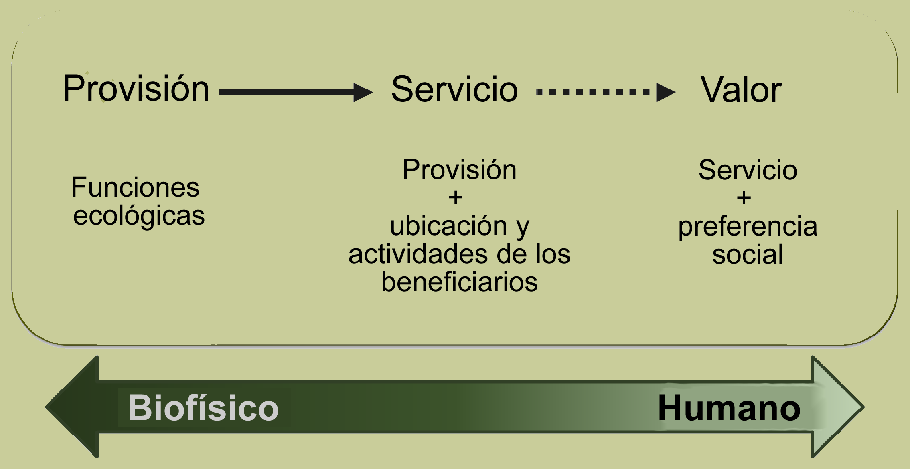
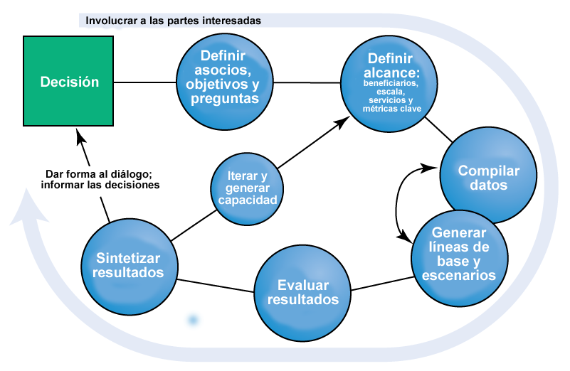

.. _the-need-for:

****************************************************************************************
Por qué necesitamos herramientas para cartografiar y valorar los servicios ecosistémicos
****************************************************************************************

Introducción
============

Los ecosistemas, cuando se gestionan adecuadamente, generan un flujo de servicios vitales para la humanidad, entre ellos la producción de bienes (por ejemplo, alimentos), procesos que sustentan la vida (como la purificación del agua) y condiciones que enriquecen la vida (como la belleza y las oportunidades de recreación), además de la conservación de opciones (por ejemplo, la diversidad genética para usos futuros). A pesar de su importancia, este capital natural se comprende poco, se monitorea escasamente y, en muchos casos, experimenta una degradación y un agotamiento acelerados. Para incorporar la comprensión de los valores de la naturaleza en la toma de decisiones, la Alianza por el Capital Natural desarrolla modelos que cuantifican y cartografían los valores de los servicios ecosistémicos. El conjunto de modelos es especialmente adecuado para realizar análisis de múltiples servicios y objetivos. Los modelos actuales, que requieren relativamente pocos datos en comparación con herramientas más complejas, permiten identificar áreas donde las inversiones podrían mejorar el bienestar humano y el de la naturaleza. Seguimos perfeccionando los modelos existentes y desarrollando otros nuevos.

Utilizamos la definición de servicios ecosistémicos de la Evaluación de los Ecosistemas del Milenio (2005): «los beneficios que las personas obtienen de los ecosistemas». Los ecosistemas incorporan componentes tanto bióticos como abióticos; por ello, consideramos equivalentes los términos «servicios ecosistémicos» y «servicios ambientales». El capital natural está constituido por los componentes vivos y no vivos de los ecosistemas que contribuyen a la provisión de servicios ecosistémicos. Los activos de capital adoptan muchas formas, entre ellas el capital manufacturado (por ejemplo, edificios y máquinas), el capital humano (conocimientos, experiencia y salud), el capital social (relaciones e instituciones) y el capital natural.

¿Quién debería utilizar InVEST?
===============================

InVEST está diseñado para aportar información a las decisiones sobre la gestión de los recursos naturales. En esencia, proporciona información sobre cómo es probable que los cambios en los ecosistemas se traduzcan en cambios en los flujos de beneficios para las personas. Quienes toman decisiones —desde gobiernos hasta organizaciones sin fines de lucro y empresas— suelen gestionar tierras y aguas para múltiples usos y, por tanto, deben evaluar inevitablemente las compensaciones entre esos usos. El diseño modular de InVEST, que permite analizar múltiples servicios, ofrece una herramienta eficaz para explorar los posibles resultados de distintas alternativas de gestión y escenarios climáticos, así como para evaluar las compensaciones entre sectores y servicios. Por ejemplo, las instituciones gubernamentales podrían utilizar InVEST para determinar cómo gestionar tierras, costas y áreas marinas con el fin de proporcionar una gama deseable de beneficios a las personas, o para diseñar programas de permisos y mitigación que mantengan los beneficios que la naturaleza aporta a la sociedad. Las organizaciones de conservación podrían utilizar InVEST para armonizar mejor sus misiones de protección de la biodiversidad con actividades que mejoren los medios de vida de las personas. Las empresas, como las de bienes de consumo, energías renovables y servicios de agua, también podrían utilizar InVEST para decidir dónde y cómo invertir en capital natural, a fin de garantizar que sus cadenas de suministro sean sostenibles y seguras.

InVEST puede ayudar a responder preguntas como las siguientes:

+ ¿Dónde se originan los servicios ecosistémicos y dónde se consumen?
+ ¿Cómo afecta un plan propuesto de manejo forestal a la biodiversidad, la calidad del agua y la recreación?
+ ¿Qué tipos de políticas de gestión costera y pesquera generarían los mejores resultados en materia de pesca sostenible, protección de las costas y recreación?
+ ¿Qué partes de una cuenca hidrográfica proporcionan los mayores beneficios en términos de secuestro de carbono, biodiversidad y turismo?
+ ¿Dónde tendría la reforestación los mayores beneficios para la calidad del agua aguas abajo, al tiempo que mantendría o minimizaría las pérdidas en los flujos de agua?
+ ¿Cómo afectarán el cambio climático y el crecimiento de la población a los servicios ecosistémicos y la biodiversidad?
+ Además de asegurar emplazamientos para instalaciones de energía renovable y la obtención de alimentos mediante la pesca y la acuicultura, ¿qué beneficios aporta a la sociedad la planificación espacial marina?

Introducción a InVEST
=====================

InVEST es una herramienta para explorar cómo es probable que los cambios en los ecosistemas se traduzcan en cambios en los beneficios que reciben las personas.

InVEST suele utilizar un enfoque basado en funciones de producción para cuantificar y valorar los servicios ecosistémicos. Una función de producción especifica la cantidad de servicios ecosistémicos que proporciona el ambiente en función de su estado y sus procesos. Una vez definida una función de producción, podemos cuantificar el impacto de los cambios en la tierra o en el agua sobre el nivel de producción de servicios ecosistémicos.

InVEST utiliza un marco sencillo que distingue entre «oferta, servicio y valor» para vincular las funciones de producción con los beneficios que reciben las personas (Figura 1).

   Cadena de provisión de servicios ecosistémicos, que vincula la función ecológica con los servicios ecosistémicos y los beneficios que reciben las personas

La «oferta» representa lo que el ecosistema puede proporcionar potencialmente (es decir, lo que su estructura y funcionamiento pueden ofrecer). Por ejemplo, podría tratarse de la atenuación del oleaje y la consiguiente reducción de la erosión y las inundaciones en la costa, proporcionadas por una determinada ubicación y densidad de bosque de manglar. El «servicio» incorpora la demanda y, por tanto, utiliza información sobre los beneficiarios de ese servicio (por ejemplo, dónde vive la gente, la ubicación de sitios culturales importantes, la infraestructura, etc.). El «valor» incluye las preferencias sociales y permite calcular indicadores económicos y sociales (por ejemplo, los daños evitados por la erosión y las inundaciones, o el número de personas afectadas).

El conjunto de herramientas de InVEST descrito en esta guía incluye modelos para cuantificar, cartografiar y valorar los beneficios que proporcionan los sistemas terrestres, de agua dulce y marinos. Agrupamos los modelos de InVEST en dos categorías principales: 1) modelos de servicios ecosistémicos de soporte y finales, y 2) herramientas adicionales para apoyar el análisis de los servicios. Los servicios de soporte sustentan otros servicios ecosistémicos, pero no proporcionan beneficios directos a las personas. Los servicios finales proporcionan beneficios directos a las personas. En el caso de los servicios finales, siempre que es posible, distinguimos entre su oferta biofísica y el servicio que reciben las personas. Para algunos servicios finales, modelamos directamente el servicio, sin modelar por separado la oferta. Las herramientas de soporte incluyen funciones para delimitar cuencas hidrográficas, realizar procesos hidrológicos sobre un modelo digital de elevación y crear escenarios que pueden utilizarse como datos de entrada para InVEST.

Servicios ecosistémicos de soporte:
^^^^^^^^^^^^^^^^^^^^^^^^^^^^^^^^^^^

+ Polinización de cultivos

+ Calidad del hábitat

+ Evaluación del riesgo para el hábitat

Servicios ecosistémicos finales:
^^^^^^^^^^^^^^^^^^^^^^^^^^^^^^^^

+ Rendimiento hídrico anual

+ Almacenamiento y secuestro de carbono

+ Carbono azul costero

+ Vulnerabilidad costera

+ Producción de cultivos

+ Efecto de borde del carbono forestal

+ Relación de entrega de nutrientes

+ Producción de energía eólica marina

+ Calidad escénica

+ Relación de entrega de sedimentos

+ Rendimiento hídrico estacional

+ Enfriamiento urbano

+ Mitigación del riesgo de inundaciones urbanas

+ Acceso urbano a la naturaleza

+ Retención de aguas pluviales urbanas

+ Visitación: recreación y turismo

+ Producción de energía undimotriz

Herramientas adicionales de apoyo:
^^^^^^^^^^^^^^^^^^^^^^^^^^^^^^^^^^

+ DelineateIT

+ RouteDEM

+ Generador de escenarios basado en la proximidad

Uso de InVEST para orientar las decisiones
==========================================

Es más probable que la información sobre los cambios en los servicios ecosistémicos marque una diferencia cuando las preguntas surgen de quienes toman decisiones y de los actores interesados, y no de científicos y analistas. Hemos comprobado que InVEST es más eficaz cuando se utiliza como parte de un proceso de toma de decisiones. La Alianza por el Capital Natural ha utilizado InVEST en más de 60 países. Consulte la sección «Dónde trabajamos» del sitio web de NatCap (https://naturalcapitalalliance.stanford.edu/projects) para ver el mapa y la descripción más recientes de nuestros proyectos. A partir de nuestra experiencia en la aplicación de InVEST y en el apoyo a procesos de toma de decisiones, hemos observado cómo esta herramienta encaja en el contexto más amplio de un enfoque de capital natural.

Nuestro enfoque (Figura 2) comienza con una serie de consultas a los actores interesados. Mediante el diálogo, se identifican las preguntas de interés para los responsables de formular políticas, las comunidades y los grupos de conservación. Estas preguntas pueden referirse a la provisión actual de servicios en un paisaje y a cómo podrían verse afectados esos servicios por nuevos programas, políticas y condiciones futuras. Para las preguntas relacionadas con el futuro, los actores interesados elaboran *escenarios* con el fin de explorar las consecuencias que los cambios previstos podrían tener sobre los recursos naturales. Estos escenarios suelen incluir un mapa del uso y la cobertura futuros del suelo o, en el caso de los modelos marinos, un mapa de los usos futuros de las zonas costeras y oceánicas y de los hábitats costeros y marinos. Los modelos biofísicos y económicos evalúan el valor de los servicios ecosistémicos de estos escenarios y generan varios tipos de resultados. Después de las consultas con los actores interesados y del desarrollo de escenarios, InVEST puede estimar la cantidad de servicios ecosistémicos que se proporcionan en el paisaje actual o bajo escenarios futuros. Los modelos de InVEST tienen una base espacial explícita: utilizan mapas como fuentes de información y producen mapas como resultados. InVEST presenta los resultados en términos biofísicos, ya sea como cantidades absolutas o magnitudes relativas (por ejemplo, toneladas de sedimentos retenidos o porcentaje de cambio en la retención de sedimentos), o en términos económicos (por ejemplo, el valor del secuestro de carbono).

   Etapas de un enfoque de capital natural para orientar la toma de decisiones.

La extensión espacial de los análisis también es flexible, lo que permite abordar preguntas a escala local, regional o mundial. Los resultados de InVEST pueden compartirse con los actores interesados y las personas responsables de tomar decisiones que elaboraron los escenarios, para aportar información a las decisiones que se avecinan. El uso de InVEST es un proceso iterativo: los actores interesados pueden optar por crear nuevos escenarios a partir de la información que revelan los modelos, hasta identificar soluciones adecuadas para las acciones de gestión.

La tabla siguiente presenta algunos ejemplos concretos de cómo puede utilizarse este enfoque general para orientar distintos tipos de decisiones. Las columnas de esta tabla corresponden a las etapas del enfoque de capital natural ilustradas en la Figura 2.

.. csv-table::
   :file: ./the_need_for/decision_context_table.csv
   :header-rows: 1

Un trabajo en desarrollo
========================

InVEST es un producto de software gratuito, distribuido bajo la licencia de código abierto Apache 2.0 (https://www.apache.org/licenses/).

El desarrollo de InVEST es un esfuerzo continuo de la Alianza por el Capital Natural. Publicamos versiones actualizadas del conjunto de herramientas aproximadamente cada tres meses. Estas versiones pueden incluir actualizaciones científicas, mejoras de rendimiento y funcionalidades, correcciones de errores o modelos nuevos. Como nota histórica, los modelos originales de InVEST se desarrollaron dentro de ArcGIS, pero actualmente todos los modelos existen en una versión independiente que puede ejecutarse directamente desde los sistemas operativos Windows o Mac, sin depender de otros programas.

Una nota sobre la numeración de las versiones de InVEST: los cambios en el número entero reflejan modificaciones importantes. Por ejemplo, el paso de la versión 2.6.0 a la 3.0.0 indica la transición de los módulos de ArcGIS a una versión independiente. El incremento del dígito situado después del primer decimal indica nuevas funcionalidades importantes (por ejemplo, la incorporación de un nuevo modelo) o revisiones importantes. El tercer decimal refleja revisiones menores de funcionalidades o correcciones de errores que no incorporan nuevas funciones.

Esta guía
=========

Esta guía le ayudará a comprender los fundamentos de los modelos de InVEST y a comenzar a utilizarlos. El siguiente capítulo le guiará por el proceso de instalación y proporcionará información general sobre la herramienta y su interfaz.

Los capítulos restantes presentan los modelos de servicios ecosistémicos. Cada capítulo:

+ presenta brevemente un servicio y sugiere posibles usos de los resultados de InVEST;

+ explica cómo funciona el modelo, incluidas las simplificaciones, los supuestos y las limitaciones importantes;

+ describe los datos necesarios para ejecutar el modelo, aspecto fundamental porque el significado y el valor de los resultados de InVEST dependen de los datos de entrada;

+ proporciona instrucciones paso a paso para introducir los datos e interactuar con la herramienta;

+ ofrece orientación para interpretar los resultados de InVEST;

+ incluye un apéndice con información sobre fuentes de datos pertinentes y recomendaciones para preparar los datos (esta sección varía entre capítulos y se irá mejorando con el tiempo a partir de los aportes de los usuarios).

Gran parte de la teoría relacionada con los fundamentos científicos de muchos de estos modelos puede consultarse en el libro *Natural Capital: The Theory & Practice of Mapping Ecosystem Services* (Oxford University Press). Sin embargo, los modelos aplicados y analizados en ese libro no son idénticos a los que se presentan en el conjunto de herramientas de InVEST; esta guía del usuario ofrece la descripción más actualizada de las versiones vigentes de los modelos.
