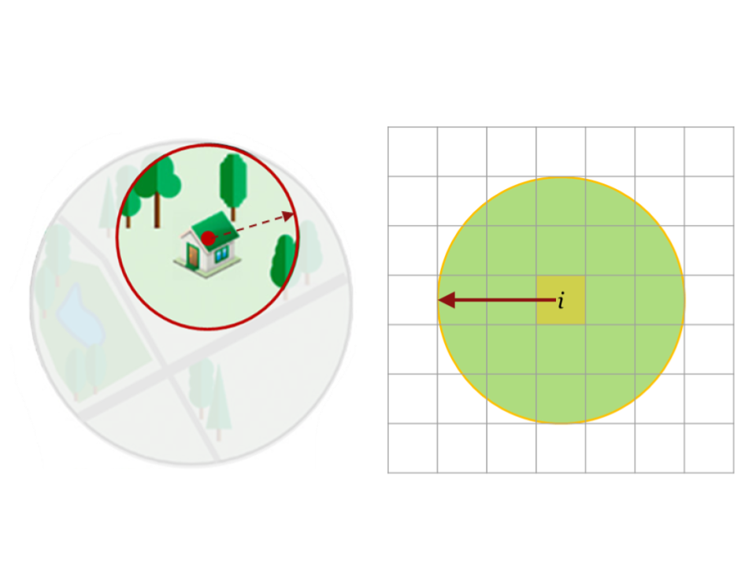
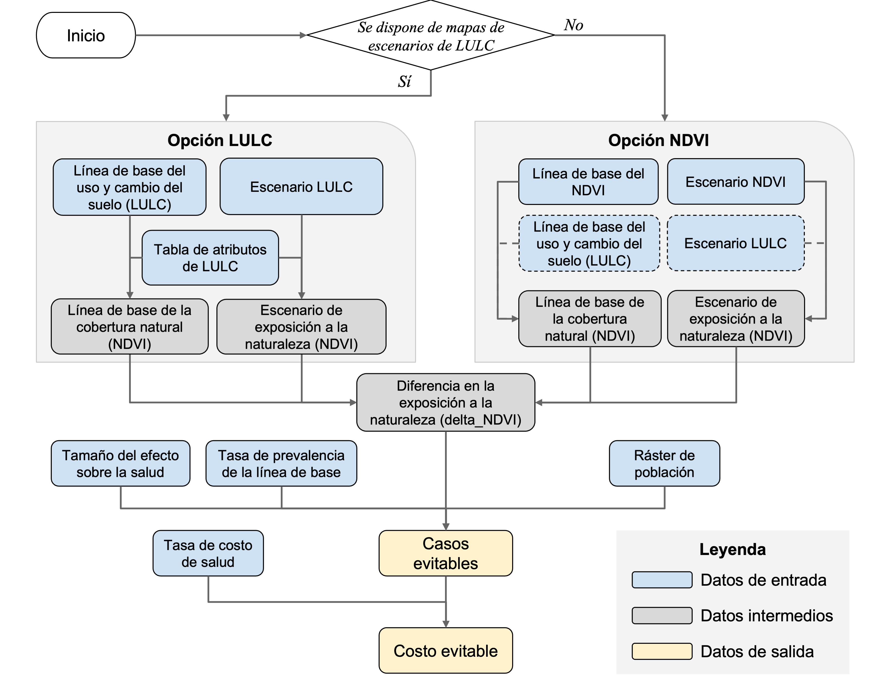

.. _urban_mental_health:

*******************
Salud mental urbana
*******************

Resumen
=======

La naturaleza en las áreas urbanas ofrece importantes oportunidades de recreación y proporciona una amplia gama de beneficios para la salud física, social y psicológica (Bratman et al. 2019; Li et al. 2025). El Modelo de Salud Mental Urbana se desarrolló para abordar una brecha importante en la evaluación de cómo los cambios en la infraestructura verde urbana pueden influir en los resultados de salud mental a escala poblacional y reducir los costos sociales asociados con los trastornos mentales. Junto con otros modelos Urban InVEST, como Enfriamiento Urbano, Mitigación del Riesgo de Inundaciones Urbanas, Acceso a la Naturaleza Urbana y Retención de Aguas Pluviales Urbanas, este modelo amplía la suite Urban InVEST al proporcionar estimaciones espacialmente explícitas de los beneficios relacionados con la salud mental. De este modo, contribuye a diseñar estrategias de reverdecimiento urbano más focalizadas, equitativas y costo-efectivas.

Introducción
============

La naturaleza urbana puede favorecer la recuperación psicológica y la regulación fisiológica a corto plazo, al ofrecer oportunidades para el contacto cotidiano y breve con entornos naturales. Estos beneficios pueden producirse por múltiples vías, entre ellas la reducción del estrés, la recuperación de la atención, la regulación del estado de ánimo y los efectos fisiológicos mediados por la exposición a la luz, la calidad del aire, la comodidad percibida y las interacciones microbianas. Los efectos de la exposición a la naturaleza pueden reflejarse en mejoras de la salud mental, como la reducción del estrés, la ansiedad y la depresión, así como en indicadores fisiológicos, entre ellos la variabilidad de la frecuencia cardíaca, la presión arterial y los niveles de cortisol.

Dado que los mecanismos que vinculan la naturaleza urbana con la salud humana son complejos y todavía no se comprenden plenamente, este modelo se centra específicamente en resultados de salud mental prevenibles, como la depresión y la ansiedad, cuyos efectos pueden cuantificarse y expresarse en términos de casos prevenibles o costos sociales evitables. En particular, el modelo utiliza el verdor del entorno residencial —uno de los indicadores de exposición a la naturaleza más estudiados— para representar los beneficios de la naturaleza urbana sobre la salud mental. El modelo también reconoce que la exposición a la naturaleza es solo uno de los numerosos factores que influyen en los resultados de salud, los cuales también están determinados por condiciones sociales, económicas y ambientales más amplias. Aunque es una representación simplificada, el modelo se diseñó con suficiente flexibilidad para admitir diversas aplicaciones y necesidades de modelización.

El modelo
=========

El Modelo de Salud Mental Urbana estima, a escala de píxel, el número de casos de trastornos mentales prevenibles bajo distintos escenarios de reverdecimiento urbano. A partir de la disponibilidad actual de datos y de la viabilidad del modelo, se centra en la exposición residencial a la naturaleza y utiliza escenarios de uso del suelo para caracterizar los cambios en la exposición al verdor y sus posibles efectos sobre los resultados de salud mental.

La exposición residencial a la naturaleza se define aquí como el verdor promedio del entorno cercano a una residencia que puede contribuir a generar beneficios para la salud mental. Esta exposición suele medirse mediante el índice de vegetación de diferencia normalizada (NDVI, por sus siglas en inglés; para más detalles, consulte la `descripción general del NDVI de NASA EarthData <https://www.earthdata.nasa.gov/topics/land-surface/normalized-difference-vegetation-index-ndvi>`__) o el porcentaje de áreas verdes dentro de una distancia determinada. En este modelo se utiliza el NDVI promedio como principal indicador indirecto de exposición. Esta elección es importante porque las evaluaciones de impacto sobre la salud deberían utilizar una métrica de exposición lo más coherente posible con la empleada para derivar la relación exposición-respuesta subyacente (Giannico et al. 2024). La mayoría de los estudios incluidos en los metaanálisis (Rojas-Rueda et al. 2019; Liu et al. 2023) utilizaron el NDVI como indicador indirecto de exposición a la naturaleza, generalmente a partir de valores medios anuales.

Para mantener la coherencia con esos tamaños de efecto a escala anual (definidos aquí como la magnitud del impacto de la exposición al NDVI sobre un resultado de salud mental), recomendamos que los usuarios proporcionen datos anuales de NDVI siempre que sea posible. Sin embargo, si los usuarios disponen de tamaños de efecto derivados de NDVI estacional, pueden utilizar en su lugar datos de NDVI específicos para cada estación. Debe tenerse en cuenta que algunos resultados de salud mental, especialmente los trastornos mentales, reflejan exposiciones a más largo plazo y pueden no responder de manera marcada a cambios de corto plazo o a variaciones muy pronunciadas del verdor. Por esta razón, el modelo es más adecuado para comparar condiciones entre años, incluso cuando se utilizan datos de NDVI estacional.

Figura 1. La exposición residencial a la naturaleza se estima como el NDVI promedio dentro de una distancia de amortiguamiento (o radio de búsqueda) definida alrededor de cada residencia (ilustración adaptada de Labib et al. 2021).

Opciones del modelo
-------------------

Los escenarios de uso del suelo son fundamentales para comprender cómo los cambios alternativos en el uso del suelo y las modificaciones asociadas del verdor pueden afectar los beneficios para la salud mental. Para aprovechar mejor el conocimiento científico existente y facilitar la comunicación con los responsables de la formulación de políticas, se incluyeron dos opciones de escenarios de uso del suelo (Figura 2).

Figura 2. Diagrama de flujo que ilustra los principales pasos computacionales del Modelo de Salud Mental Urbana, desde el procesamiento de los datos de entrada hasta la estimación de los casos prevenibles (o adicionales) y los cambios correspondientes en los costos de salud. Nota: el NDVI se utiliza como indicador indirecto de exposición a la naturaleza. El recuadro de líneas discontinuas señala los datos de entrada opcionales.

Uso y cobertura del suelo (LULC)
~~~~~~~~~~~~~~~~~~~~~~~~~~~~~~~~

La primera opción de escenarios de uso del suelo se basa en mapas de uso y cobertura del suelo (LULC), que también utilizan habitualmente otros modelos InVEST y las prácticas reales de planificación urbana. Para estimar la diferencia en la exposición a la naturaleza, los usuarios deben proporcionar el mapa LULC de referencia y un mapa LULC correspondiente a un escenario futuro o contrafactual. La diferencia se medirá mediante valores de NDVI, a partir de una correspondencia estadística entre los tipos de cobertura del suelo y los valores de NDVI (por ejemplo, los bosques suelen presentar valores de NDVI más altos que los terrenos desnudos y las áreas construidas). Por tanto, los usuarios deben proporcionar una tabla de atributos LULC que especifique los valores medios o medianos de NDVI para cada tipo de LULC.

NDVI
~~~~

La segunda opción es similar a la opción LULC, pero se diferencia en que los usuarios proporcionan rásteres de NDVI tanto para las condiciones de referencia como para las del escenario futuro o contrafactual. El modelo utiliza directamente estos rásteres para calcular la exposición en el entorno cercano, sin requerir una conversión de LULC a NDVI.

La siguiente sección explica la estructura del modelo, los datos de entrada necesarios y los resultados que se obtienen para su interpretación.

Estimación de la exposición a la naturaleza (NE)
------------------------------------------------

Para estimar los cambios en el riesgo o los beneficios para la salud derivados de modificaciones del paisaje —por ejemplo, las impulsadas por la planificación del uso del suelo o por cambios en la cobertura—, es necesario evaluar la exposición a la naturaleza tanto en las condiciones de referencia como en las del escenario.

La exposición de referencia a la naturaleza corresponde al nivel real de verdor, medido como el NDVI promedio dentro de un radio de búsqueda (o distancia de amortiguamiento) definido por el usuario alrededor de cada residencia (en este modelo se utiliza el píxel de población como indicador indirecto de la residencia). Dado que los espacios azules pueden aportar beneficios potenciales para la salud mental, sería ideal incluirlos en las evaluaciones de exposición para captar de manera más completa las diversas contribuciones de los entornos naturales al bienestar humano. Sin embargo, los cuerpos de agua suelen presentar valores negativos de NDVI y actualmente no existe suficiente evidencia científica empírica para derivar un tamaño de efecto fiable de la exposición a espacios azules utilizando el NDVI como indicador indirecto. En consecuencia, la versión actual del modelo ofrece la opción de excluir (enmascarar) los píxeles clasificados como cuerpos de agua de la evaluación de la exposición al verdor. No obstante, si los usuarios disponen de tamaños de efecto sólidos y revisados por pares que relacionen la exposición a espacios azules basada en NDVI con resultados de salud, pueden optar por conservar los cuerpos de agua en una ejecución y un análisis separados.

La exposición a la naturaleza bajo un escenario puede estimarse mediante una de las dos opciones que se describen a continuación. Ambas están diseñadas para aprovechar el mejor conocimiento científico disponible y, al mismo tiempo, facilitar la comunicación con los responsables de formular políticas. Cada opción se detalla en las subsecciones siguientes.

Estimación de NE [opción 1]: conversión de LULC a NDVI mediante una tabla de atributos
~~~~~~~~~~~~~~~~~~~~~~~~~~~~~~~~~~~~~~~~~~~~~~~~~~~~~~~~~~~~~~~~~~~~~~~~~~~~~~~~~~~~~~

El primer enfoque estima la exposición a la naturaleza bajo un escenario utilizando mapas de uso y cobertura del suelo (LULC), ampliamente empleados en otros modelos InVEST y en aplicaciones reales de planificación urbana. Para aplicar este método, los usuarios deben proporcionar tanto un mapa LULC de referencia como un mapa LULC del escenario (por ejemplo, que represente condiciones futuras o contrafactuales). El cambio en la exposición a la naturaleza (:math:`\Delta NE`) se deriva entonces convirtiendo las categorías LULC en los valores de NDVI correspondientes, a partir de relaciones estadísticas entre los tipos de cobertura del suelo y el NDVI. El usuario puede establecer esta relación antes de ejecutar el modelo, o el propio modelo puede calcularla automáticamente si se proporciona un mapa de NDVI. Por ejemplo, las áreas boscosas suelen presentar valores de NDVI más altos que los terrenos desnudos o las áreas construidas.

Para realizar esta conversión, los usuarios deben proporcionar una tabla de atributos LULC que asigne un valor medio o mediano de NDVI a cada tipo de LULC (véase un ejemplo en la Tabla 1). A partir de esta tabla, el modelo calcula :math:`NE_{baseline}` y :math:`NE_{scenario}` a partir de los respectivos mapas LULC, lo que permite estimar :math:`\Delta NE` y reflejar los cambios proyectados en el paisaje.

Los escenarios basados en LULC suelen incluir no solo la conversión hacia áreas verdes, sino también la transformación de terrenos naturales o vacantes en áreas construidas. En estos casos, el modelo permite valores negativos de :math:`\Delta NE`, que representan posibles disminuciones de la exposición a la naturaleza. Esto permite a los responsables de formular políticas evaluar no solo los posibles beneficios para la salud del reverdecimiento urbano, sino también los riesgos para la salud asociados con cambios de uso del suelo que reducen el acceso a espacios verdes.

Tabla 1. Ejemplo de tabla de atributos de uso y cobertura del suelo (LULC).

====== ============================ ======= =======
lucode luc_desc                     exclude ndvi
====== ============================ ======= =======
11     Aguas abiertas               1       -0.1437
21     Desarrollo, espacio abierto  0       0.5873
22     Desarrollo, intensidad baja  0       0.3773
23     Desarrollo, intensidad media 0       0.2305
24     Desarrollo, intensidad alta  0       0.1040
31     Estéril (roca/arena/arcilla) 0       0.1700
41     Bosque deciduo               0       0.7493
42     Bosque siempreverde          0       0.6956
43     Bosque mixto                 0       0.6931
52     Arbustos/matorrales          0       0.6074
71     Pastizal/herbáceo            0       0.5289
81     Pasto/heno                   0       0.5167
82     Cultivos                     0       0.4255
90     Humedales boscosos           1       0.5779
95     Hum. herbáceos emergentes    1       0.2792
====== ============================ ======= =======

Nota: el campo `exclude` identifica las clases LULC que deben excluirse (enmascararse, mediante el valor 1) de la evaluación de la exposición al verdor. Recomendamos excluir los cuerpos de agua, ya que suelen presentar valores negativos de NDVI y actualmente no existe evidencia empírica suficiente para establecer un tamaño de efecto fiable de la exposición a espacios azules utilizando el NDVI como indicador indirecto. El campo `ndvi` especifica el valor medio o mediano de NDVI asociado con cada clase LULC. Los usuarios pueden derivar estos valores superponiendo un ráster LULC y un ráster NDVI del mismo período (por ejemplo, del mismo año o estación de crecimiento) para garantizar la coherencia temporal.

Estimación de NE [opción 2]: uso directo de NDVI de dos momentos
~~~~~~~~~~~~~~~~~~~~~~~~~~~~~~~~~~~~~~~~~~~~~~~~~~~~~~~~~~~~~~~~

El segundo enfoque es similar a la opción LULC, pero presenta una diferencia clave: los usuarios proporcionan directamente los rásteres de NDVI correspondientes tanto a las condiciones de referencia como a las del escenario futuro o contrafactual. Esta opción resulta especialmente útil cuando se desea utilizar datos históricos u observados para evaluar los posibles beneficios o riesgos para la salud asociados con cambios pasados o proyectados en el paisaje.

Los valores de :math:`NE_{baseline}` y :math:`NE_{scenario}` basados en NDVI se calculan como el NDVI promedio dentro de un radio de búsqueda definido por el usuario alrededor de cada píxel de población. Luego, el modelo calcula el cambio en la exposición a la naturaleza (:math:`\Delta NE`) que se utilizará para estimar los impactos sobre la salud de la transformación del paisaje.

El agua y otras clases de cobertura del suelo pueden enmascararse de la misma manera que en la opción 1, es decir, mediante una tabla de atributos LULC proporcionada por el usuario, un mapa LULC de referencia y un mapa LULC alternativo (opcional). Si no se proporcionan datos LULC, se enmascararán los píxeles de NDVI con valores inferiores a 0 para excluir los cuerpos de agua del análisis (ya que los valores de NDVI del agua suelen ser inferiores a 0).

Evaluación del impacto sobre la salud
-------------------------------------

El modelo realiza una evaluación cuantitativa del impacto sobre la salud a escala de píxel para estimar el número de casos prevenibles de problemas de salud mental resultantes de cambios en la exposición a la naturaleza. En concreto, compara la exposición en un escenario de referencia con la de un escenario contrafactual o de reverdecimiento objetivo.

Para estimar los casos prevenibles (:math:`PC`), el modelo calcula primero los casos de referencia (:math:`BC`) para cada unidad espacial (por ejemplo, región, distrito o sector censal), utilizando recuentos observados de casos o tasas de prevalencia. Si solo se dispone de tasas de prevalencia de referencia, los usuarios deben proporcionar datos ráster espacializados de población para derivar las estimaciones de casos de referencia.

Para cada píxel, el modelo calcula el cambio en la exposición a la naturaleza (:math:`\Delta NE`) restando la exposición de referencia (:math:`NE_{baseline}`) del valor correspondiente al escenario contrafactual o de reverdecimiento objetivo (:math:`NE_{scenario}`). Luego aplica una función dosis-respuesta, expresada como riesgo relativo (:math:`RR`) por unidad de cambio en la exposición (por ejemplo, :math:`RR_{0.1NE}`), para cuantificar el impacto sobre la salud.

A partir de ello se calculan la fracción prevenible (:math:`PF`) y el número asociado de casos prevenibles (:math:`PC`). Pueden incorporarse intervalos de confianza alrededor de :math:`RR` para representar la incertidumbre. Las siguientes ecuaciones detallan la formulación matemática completa de este proceso.

.. math:: PC = PF \times BC = PF \times (BIR \times POP)
	:label: (umh. 1)

.. math:: PF = 1 - RR
	:label: (umh. 2)

.. math:: RR = \exp \left(\ln(RR_{0.1NE}) \times 10 \times \Delta NE \right)
	:label: (umh. 3)

.. math:: NE = NE_{scenario} - NE_{baseline}
	:label: (umh. 4)

donde:

- :math:`PC`: casos prevenibles.
- :math:`PF`: fracción prevenible.
- :math:`BC`: casos de referencia. De forma predeterminada, se calculan utilizando la tasa de prevalencia de referencia y los datos de población proporcionados por el usuario.
- :math:`BIR`: tasa de prevalencia de referencia. Dato de entrada proporcionado por los usuarios, generalmente obtenido de organismos nacionales o locales de salud, como los Centros para el Control y la Prevención de Enfermedades de Estados Unidos (CDC). Estas tasas suelen derivarse de estadísticas basadas en encuestas y están disponibles para distintos niveles espaciales (por ejemplo, región, distrito o sector censal). Si los datos se proporcionan en formato tabular y no como archivos shapefile, los usuarios deben unirlos a las unidades espaciales correspondientes antes de utilizarlos como entrada del modelo.
- :math:`POP`: población. Conjunto de datos ráster proporcionado por el usuario que representa el número de habitantes por píxel en el área de estudio. Los píxeles sin población deben tener asignado el valor 0.
- :math:`RR`: riesgo relativo o razón de riesgos. Un valor inferior a 1 (:math:`RR` < 1) indica que la exposición a la naturaleza está asociada con una reducción del riesgo de enfermedad mental (efecto protector), mientras que un valor superior a 1 (:math:`RR` > 1) indica un aumento del riesgo (asociación adversa).
- :math:`NE`: exposición a la naturaleza. En este modelo se utiliza el NDVI como indicador indirecto. :math:`NE_{baseline}` es proporcionado por el usuario como dato de entrada y representa los niveles de exposición de referencia. :math:`NE_{scenario}` suele calcularse dentro del modelo a partir del mapa de uso y cobertura del suelo (LULC) del escenario proporcionado por el usuario, lo que permite evaluar los cambios de exposición bajo distintas estrategias de reverdecimiento (véase la sección Estimación de la exposición a la naturaleza para más detalles).
- :math:`RR_{0.1NE}`: riesgo relativo por cada aumento de 0,1 unidades de :math:`NE`. De forma predeterminada, el modelo utiliza el riesgo relativo asociado con un incremento de 0,1 en la exposición a la naturaleza basada en NDVI. Los usuarios deben proporcionar este valor a partir de estudios empíricos o metaanálisis pertinentes para el resultado de salud seleccionado. En los datos de ejemplo, los tamaños de efecto para depresión y ansiedad se derivaron de un metaanálisis de Liu et al. (2023).

Si no se dispone del riesgo relativo, pero sí de otras métricas de tamaño de efecto, como la razón de momios (:math:`OR`), un método de uso frecuente para aproximar el :math:`RR` a partir de un :math:`OR` se basa en una fórmula propuesta por Zhang y Yu (1998). Esta fórmula requiere conocer o estimar el riesgo de referencia (la prevalencia del resultado en el grupo de referencia o no expuesto).

.. math:: RR = \frac{OR}{1 - p_0 + (p_0 \cdot OR)}
	:label: (umh. 5)

Donde :math:`p_0` es el riesgo de referencia. En este contexto, corresponde a la probabilidad de presentar un trastorno mental en una población sin exposición a la naturaleza o con una exposición muy limitada.

Estimación de los costos de salud
---------------------------------

Para cuantificar el valor económico de la mejora de los resultados de salud mental, el modelo estima los costos de salud evitados asociados con el número de casos prevenibles identificados en la evaluación del impacto sobre la salud.

Para cada unidad espacial o píxel, el modelo multiplica el número estimado de casos prevenibles (:math:`PC`) por el costo correspondiente por caso (por ejemplo, en dólares estadounidenses ajustados por paridad de poder adquisitivo [PPA] o en unidades de moneda local), como se muestra en la siguiente ecuación. Este costo puede basarse en cualquier estimación disponible para el usuario. El costo social utilizado en los datos de ejemplo representa la carga económica promedio de un caso de un resultado específico de salud mental (por ejemplo, depresión o ansiedad), e incluye los costos directos de atención sanitaria, las pérdidas de productividad y otros costos sociales. Si los usuarios no pueden acceder a estimaciones de costos sociales, pueden especificar cualquier otro tipo de estimación disponible.

.. math:: Avoided Cost = Preventable Cases \times Health Cost Rate
	:label: (umh. 6)

.. note:: Un valor negativo de «Avoided Cost» (costo evitado) indica un «Additional Cost» (costo adicional) en comparación con la condición de referencia.

Los usuarios deben proporcionar una tasa de costo de salud que indique estimaciones del costo por caso específicas para cada enfermedad y, cuando estén disponibles, para cada país o región. Un metaanálisis mundial (Christensen et al. 2020) presenta los costos sociales de los trastornos mentales en más de 30 países. Por ejemplo, el costo social por paciente en Estados Unidos se estimó en USD 11 000 PPA para 2018. Cuando existan datos más detallados o locales, se recomienda recopilarlos para aumentar la precisión. Si no se dispone de datos desagregados, los promedios nacionales o regionales pueden servir como sustitutos razonables. Dado que el modelo se centra en estudios urbanos y que los datos de costos de salud a escala submunicipal son limitados, la versión actual admite datos de costos uniformes a escala de ciudad. Sin embargo, los usuarios pueden proporcionar datos de costos diferentes para distintas ciudades, lo que permite realizar comparaciones entre diversos contextos geográficos y económicos. Este paso permite evaluar no solo las implicaciones de los escenarios de reverdecimiento urbano para la salud, sino también sus posibles beneficios económicos adicionales, y respalda los análisis de costo-beneficio para la formulación de políticas y la planificación.

Limitaciones y simplificaciones
===============================

La exposición a la naturaleza puede caracterizarse de varias maneras, entre ellas la disponibilidad, la accesibilidad o proximidad (por ejemplo, según la estimación del modelo `Acceso a la Naturaleza Urbana <https://naturalcapitalalliance.stanford.edu/invest/urban-nature-access>`_) y la intensidad del contacto con la naturaleza. Este modelo se centra principalmente en el verdor residencial, que representa la dimensión de disponibilidad de la exposición a la naturaleza y es uno de los indicadores más estudiados en la literatura sobre naturaleza urbana y salud mental. En consecuencia, el modelo actual no considera: (1) la exposición a espacios azules, como los cuerpos de agua, ni sus posibles efectos sobre la salud mental; y (2) otras dimensiones de la exposición a la naturaleza, incluidas la accesibilidad y la intensidad del contacto, porque la evidencia disponible que relaciona estas métricas con los resultados de salud mental sigue siendo más limitada.

Además, el radio de búsqueda utilizado para calcular el verdor residencial se basa en la distancia euclidiana (en línea recta). El modelo no considera carreteras, barreras u otras restricciones reales para caminar o desplazarse que puedan influir en la forma en que las personas acceden efectivamente a la naturaleza cercana.

En términos más generales, la exposición a la naturaleza representa solo uno de los numerosos factores que determinan los resultados de salud mental. La salud mental también está influida por una amplia gama de factores sociales, económicos y ambientales. Por tanto, este modelo ofrece una representación simplificada de una de las vías mediante las cuales la naturaleza urbana puede contribuir a la salud mental. A pesar de esta simplificación, el modelo se diseñó con flexibilidad para responder a diversos casos de uso y necesidades de modelización.

Datos necesarios
================

- :investspec:`urban_mental_health workspace_dir`

- :investspec:`urban_mental_health results_suffix`

- :investspec:`urban_mental_health aoi_path`

- :investspec:`urban_mental_health population_raster`

- :investspec:`urban_mental_health search_radius`

- :investspec:`urban_mental_health effect_size`

- :investspec:`urban_mental_health baseline_prevalence_vector`

- :investspec:`urban_mental_health health_cost_rate`

- :investspec:`urban_mental_health model_option`

- :investspec:`urban_mental_health ndvi_base`

- :investspec:`urban_mental_health ndvi_alt`

- :investspec:`urban_mental_health lulc_base`

- :investspec:`urban_mental_health lulc_alt`

- :investspec:`urban_mental_health lulc_attr_csv`

  Columnas:

  - :investspec:`urban_mental_health lulc_attr_csv.columns.lucode`

  - :investspec:`urban_mental_health lulc_attr_csv.columns.exclude`

  - :investspec:`urban_mental_health lulc_attr_csv.columns.ndvi`

Resultados del modelo
=====================

.. note:: Si se utiliza la opción de modelo «NDVI», los resultados se alinearán con la cuadrícula del ráster NDVI de referencia y el tamaño de píxel objetivo se derivará de ese ráster. Si se utiliza la opción «LULC», el ráster LULC de referencia servirá como ráster de alineación y definirá el tamaño de píxel objetivo. En ambos casos, el AOI proporciona la proyección y la extensión objetivo.

Carpeta de resultados
---------------------

* **InVEST-urban-mental-health-log-....txt:** archivo de registro (*log*) que se genera durante cada ejecución de InVEST. Detalla los parámetros de entrada utilizados y registra todos los errores que puedan haberse producido. Si publica una consulta sobre la ejecución de un modelo en community.naturalcapitalalliance.org, asegúrese de adjuntar este archivo de registro.

* **urban_mental_health_report.html:** resumen de la ejecución del modelo, que incluye visualizaciones de los principales resultados, tablas de resultados calculados e información sobre los datos de entrada. El informe puede consultarse en Workbench o abrirse con cualquier navegador web. Como ejemplo, consulte el `Informe de muestra de Salud Mental Urbana <https://storage.googleapis.com/releases.naturalcapitalproject.org/invest-reports/latest/urban_mental_health_report.html>`_, generado al ejecutar el modelo con los datos de muestra de Salud Mental Urbana.

* **preventable_cases.tif** (ráster, recuento): estimaciones de casos prevenibles a escala de píxel.

* **preventable_cost.tif** (ráster, unidad monetaria): estimaciones de costos prevenibles a escala de píxel. Los datos de ejemplo utilizan el costo social por caso, expresado en USD PPA de 2018. Los usuarios pueden personalizar la unidad monetaria y el año de referencia en la tabla de tasas de costos de salud para ajustarlos mejor a las prioridades de las políticas locales y a las condiciones económicas.

* **preventable_cases_cost_sum.gpkg** (GeoPackage): total agregado de casos prevenibles y de costos prevenibles por subregión (por ejemplo, sector censal o código postal) dentro del área de interés. La entrada del área de interés se utiliza para esta agregación. Las unidades de casos y costos son las mismas que las de `preventable_cases.tif` y `preventable_cost.tif`.

* **preventable_cases_cost_sum.csv** (CSV): total agregado de casos prevenibles y de costos prevenibles por subregión (por ejemplo, sector censal o código postal) dentro del área de interés, con una fila adicional que presenta los totales para toda el área de interés (por ejemplo, una ciudad). Las unidades de casos y costos son las mismas que las de `preventable_cases.tif` y `preventable_cost.tif`.

Carpeta intermedia
------------------

La carpeta intermedia contiene conjuntos de datos temporales y procesados que se generan durante la ejecución del modelo. Estos archivos se utilizan para alinear las entradas, calcular la exposición al verdor del entorno, estimar las condiciones de salud de referencia y derivar los cambios asociados con los escenarios. Su finalidad principal es facilitar la solución de problemas, el control de calidad y la comprensión de los pasos intermedios del modelo.

* **baseline_cases.tif** (ráster, recuento): número de casos de referencia a escala de píxel antes de aplicar el escenario alternativo de verdor.

* **baseline_prevalence.tif** (ráster, %): tasa de prevalencia de referencia a escala de píxel utilizada para estimar el número de casos de referencia.

* **kernel.tif** (ráster): núcleo de distancia decreciente o del entorno utilizado para calcular la exposición al verdor dentro del radio de búsqueda especificado.

* **lulc_base_aligned.tif** (ráster): ráster LULC de referencia alineado con la cuadrícula de trabajo del modelo.

* **lulc_alt_aligned.tif** (ráster): ráster LULC del escenario alternativo alineado con la cuadrícula de trabajo del modelo.

* **lulc_to_ndvi_map.csv** (CSV): tabla de consulta que relaciona cada clase LULC con el valor NDVI asignado y la configuración de exclusión.

* **ndvi_base_aligned.tif** (ráster): ráster NDVI de referencia alineado con la cuadrícula de trabajo del modelo.

* **ndvi_alt_aligned_masked.tif** (ráster): ráster NDVI del escenario alternativo después de enmascarar las clases LULC excluidas.

* **ndvi_base_aligned_masked.tif** (ráster): ráster NDVI de referencia después de enmascarar las clases LULC excluidas.

* **ndvi_base_buffer_mean.tif** (ráster): superficie de verdor del entorno de referencia, calculada como el NDVI medio dentro del radio de búsqueda especificado. Representa la exposición de referencia a la naturaleza.

* **ndvi_alt_buffer_mean.tif** (ráster): superficie de verdor del entorno del escenario alternativo, calculada como el NDVI medio dentro del radio de búsqueda especificado. Representa la exposición a la naturaleza del escenario.

* **ndvi_base_buffer_mean_clipped.tif** (ráster): superficie de verdor del entorno de referencia —es decir, la exposición a la naturaleza— recortada a la extensión del análisis.

* **ndvi_alt_buffer_mean_clipped.tif** (ráster): superficie de verdor del entorno del escenario alternativo —es decir, la exposición a la naturaleza— recortada a la extensión del análisis.

* **delta_ndvi.tif** (ráster): cambio en el NDVI a escala de píxel, utilizado como indicador indirecto de la exposición a la naturaleza, entre los escenarios alternativo y de referencia. Se calcula restando ndvi_base_buffer_mean_clipped.tif de ndvi_alt_buffer_mean_clipped.tif.

* **population_aligned.tif** (ráster, recuento): ráster de población alineado con la cuadrícula de trabajo del modelo.

* **population_aligned_clipped.tif** (ráster, recuento): ráster de población recortado a la extensión del análisis.

Apéndice: fuentes de datos
==========================

:ref:`Uso y cobertura del suelo <lulc>`
---------------------------------------

NDVI
----

El NDVI con una resolución de 30 m puede derivarse de las colecciones de imágenes Landsat mediante Google Earth Engine. Los usuarios también pueden utilizar imágenes Sentinel-2 o MODIS (espectrorradiómetro de imágenes de resolución moderada) para generar rásteres de NDVI.

Ráster de población
-------------------

Existen varios conjuntos de datos regionales y mundiales que estiman el tamaño y la densidad de la población con alta resolución, por ejemplo:

- `Datos mundiales de población de WorldPop con resolución de 100 m <https://hub.worldpop.org/geodata/listing?id=135>`_.
- `Datos mundiales de densidad de población de Meta/CIESIN <https://dataforgood.facebook.com/dfg/tools/high-resolution-population-density-maps>`_

Radio de búsqueda
-----------------

Un enfoque habitual para evaluar la exposición a la naturaleza o a espacios verdes consiste en estimar la disponibilidad de vegetación (por ejemplo, el verdor) dentro de zonas de amortiguamiento (radio de búsqueda) alrededor de los lugares donde las personas viven o pasan tiempo. Los usuarios deben definir este radio según los patrones de movilidad humana del área de estudio o utilizar parámetros aplicados en estudios empíricos. Por ejemplo, Zare Sakhvidi et al. (2025) ofrecen orientación metodológica para seleccionar tamaños de zona de amortiguamiento adecuados (véase `"Orientación metodológica para seleccionar zonas de amortiguamiento en estudios sobre espacios verdes y salud" <https://doi.org/10.1016/j.lanplh.2025.101370>`_).

Tamaño del efecto sobre la salud
--------------------------------

El tamaño del efecto sobre la salud es específico para cada indicador y representa la relación entre la exposición a la naturaleza y el resultado de salud mental. Se expresa como riesgo relativo asociado con un aumento de 0,1 en el NDVI. En los datos de ejemplo, el tamaño del efecto para la depresión se derivó de un metaanálisis de Liu et al. (2023). Si el usuario dispone de un tamaño de efecto expresado como razón de momios (OR), un método de uso frecuente para aproximar el riesgo relativo a partir de un OR se basa en una fórmula propuesta por Zhang y Yu (1998). Esta fórmula requiere conocer o estimar el riesgo de referencia (la prevalencia del resultado en el grupo de referencia o no expuesto). Consulte la sección Evaluación del impacto sobre la salud para más detalles.

Prevalencia de referencia
-------------------------

La prevalencia de referencia representa la tasa de un resultado específico de salud mental (por ejemplo, depresión o ansiedad) en las unidades administrativas del área de estudio. Estos datos permiten al modelo estimar los casos prevenibles mediante la comparación de las tasas actuales con las proyectadas bajo escenarios de mejora de la exposición a la naturaleza.

Tasa de costos de salud
-----------------------

La tasa de costos de salud representa estimaciones del costo por caso específicas para cada enfermedad y, cuando están disponibles, para cada país o región. Un metaanálisis mundial (Christensen et al. 2020) presenta los costos sociales de los trastornos mentales en más de 30 países. Por ejemplo, el costo social por paciente en Estados Unidos se estimó en USD 11 000 PPA para 2018.

Referencias
===========

Bratman, G.N., Anderson, C.B., Berman, M.G., et al. (2019). Nature and mental health: An ecosystem service perspective. Science Advances, 5:eaax0903. https://doi.org/10.1126/sciadv.aax0903

Christensen, M.K., Lim, C.C.W., Saha, S., et al. (2020). The cost of mental disorders: a systematic review. Epidemiology and Psychiatric Sciences, 29:e161. https://doi.org/10.1017/S204579602000075X

Giannico, O.V., Sardone, R., Bisceglia, L., et al. (2024). The mortality impacts of greening Italy. Nature Communications, 15:10452. https://doi.org/10.1038/s41467-024-54388-7

Labib, S.M., Huck, J.J., Lindley, S. (2021). Modelling and mapping eye-level greenness visibility exposure using multi-source data at high spatial resolutions. Science of The Total Environment, 755:143050. https://doi.org/10.1016/j.scitotenv.2020.143050

Li, Y., Mao, Y., Mandle, L., et al. (2025). Acute mental health benefits of urban nature. Nature Cities, 2:720-731. https://doi.org/10.1038/s44284-025-00286-y

Liu, Z., Chen, X., Cui, H., et al. (2023). Green space exposure on depression and anxiety outcomes: A meta-analysis. Environmental Research, 231:116303. https://doi.org/10.1016/j.envres.2023.116303

Rojas-Rueda, D., Nieuwenhuijsen, M.J., Gascon, M., et al. (2019). Green spaces and mortality: a systematic review and meta-analysis of cohort studies. The Lancet Planetary Health, 3:e469-e477. https://doi.org/10.1016/S2542-5196(19)30215-3

Zare Sakhvidi, M., Browning, M., Samuelsson, K., et al. (2025). Methodological guidance for selecting buffers in greenspace-health studies. The Lancet Planetary Health, 9:e101370. https://doi.org/10.1016/j.lanplh.2025.101370

Zhang, J., & Yu, K.F. (1998). What's the Relative Risk? A Method of Correcting the Odds Ratio in Cohort Studies of Common Outcomes. JAMA, 280:1690-1691. https://doi.org/10.1001/jama.280.19.1690
