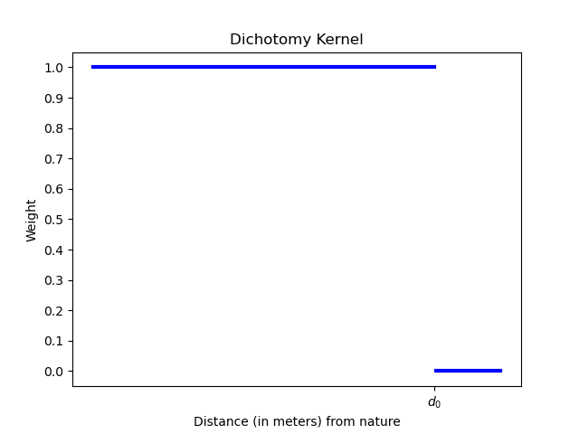
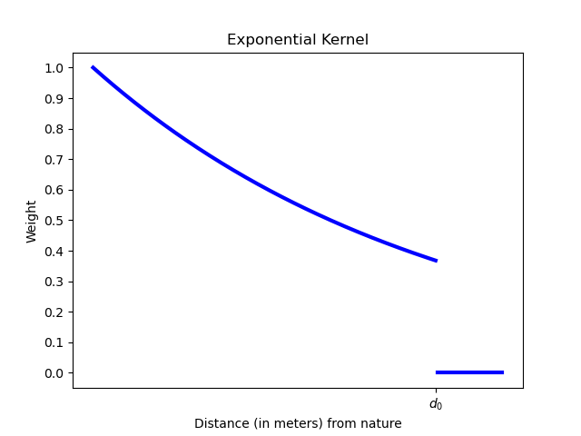
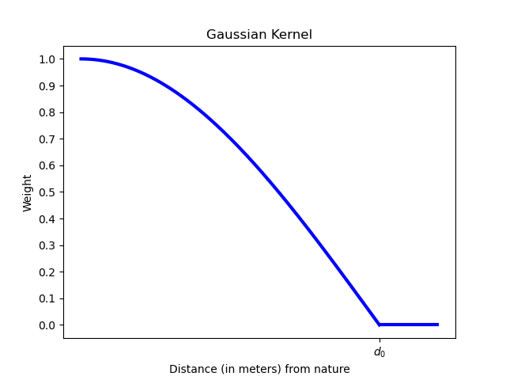
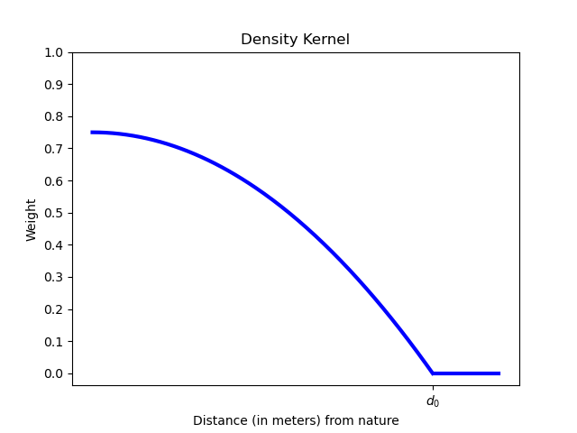
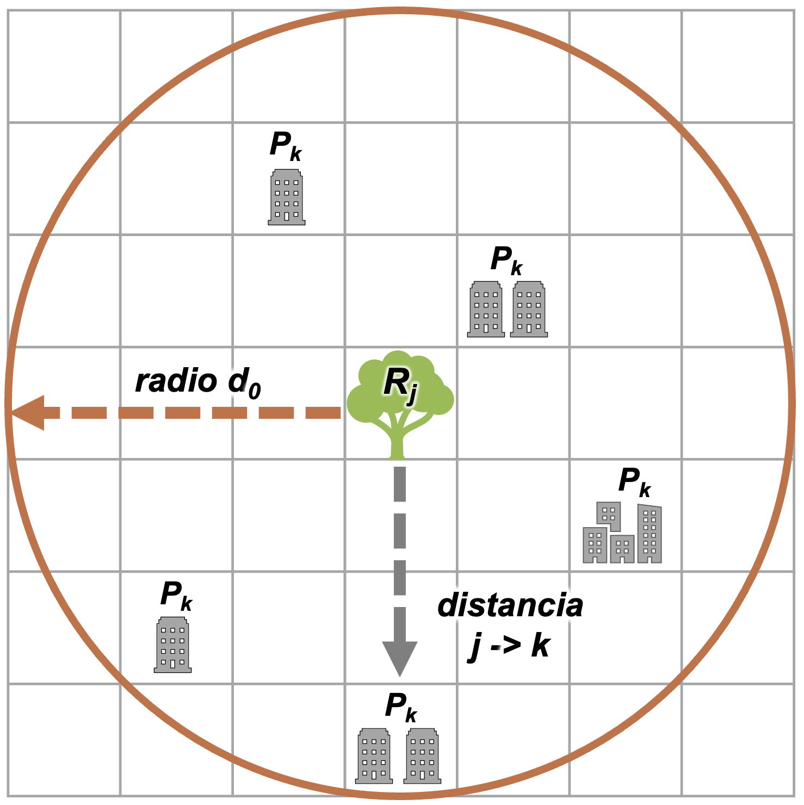
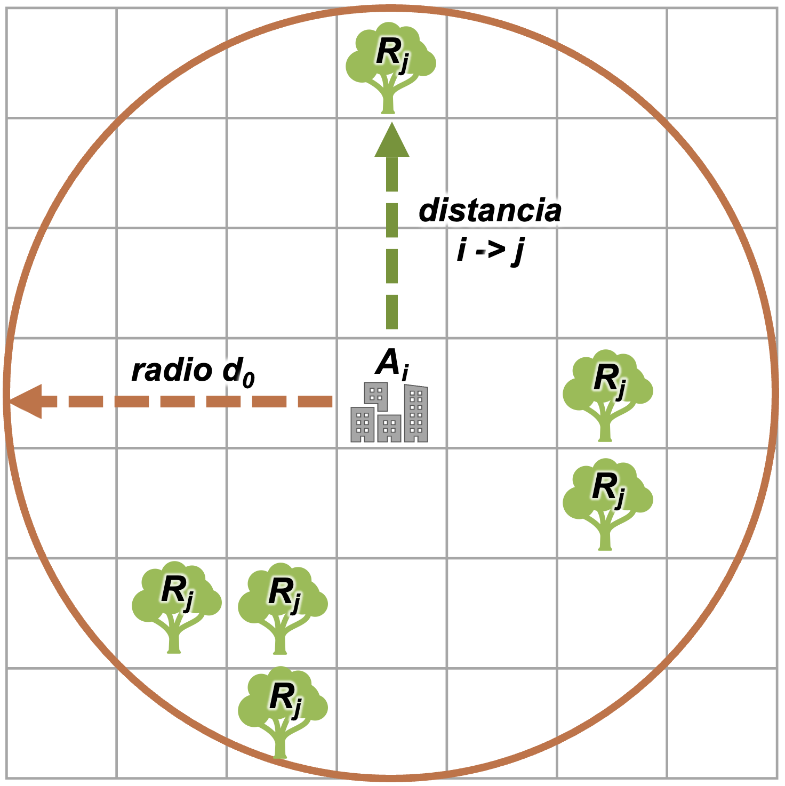
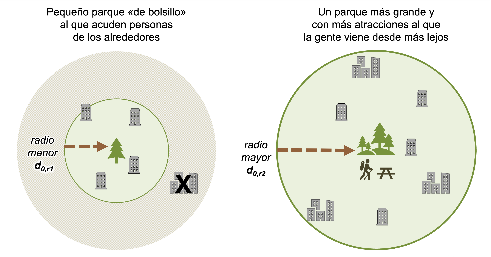
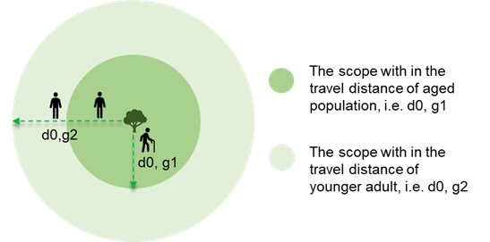
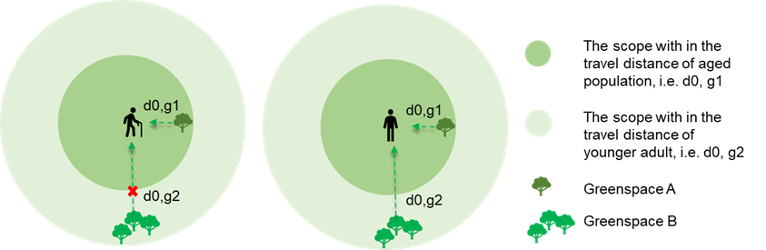

=============================
Acceso a la naturaleza urbana
=============================

Resumen
=======

La naturaleza en las áreas urbanas ofrece importantes oportunidades para la recreación. El modelo de acceso a la naturaleza urbana proporciona una medida tanto de la oferta de naturaleza urbana como de la demanda de naturaleza por parte de la población urbana y, en última instancia, calcula el equilibrio entre la oferta y la demanda. Tanto la naturaleza urbana como la población pueden dividirse opcionalmente en distintos grupos. La oferta se determina según el tipo, tamaño, proximidad y calidad de la naturaleza urbana accesible por persona con fines recreativos. La demanda se determina como la cantidad de espacio natural por persona que suelen exigir las políticas o normas. El balance cuantifica en qué medida la oferta satisface la demanda a escala individual, administrativa y de ciudad.

Introducción
============

La naturaleza en las áreas urbanas ofrece importantes oportunidades para la recreación, junto con beneficios sociales, psicológicos y para la salud física (Bratman et al., 2019; Keeler et al., 2019; Remme et al., 2021). Como revisan Liu et al. (2022), la evaluación de la recreación basada en la naturaleza requiere comprender: i) la «oferta» de naturaleza urbana, que depende a su vez de la disponibilidad y la calidad; y ii) la «demanda» de naturaleza urbana, que depende de las preferencias de las personas o de los requisitos de las políticas.

Este modelo de InVEST sigue la estructura descrita en Liu et al. (2022), al evaluar la oferta y la demanda de naturaleza urbana y el balance local entre ambas, que identifica áreas con un excedente o déficit (balance positivo o negativo, respectivamente) de naturaleza urbana respecto de un estándar de política pública (Liu et al., 2022). Para ello, el modelo se centra en el acceso a la naturaleza en las áreas urbanas. Como puede modelar la oferta, la demanda y el balance de muchos tipos de naturaleza urbana, como parques, espacios verdes, humedales y costas, aquí nos referimos a él como modelo de acceso a la naturaleza urbana. Corresponde al usuario elegir qué componentes de la naturaleza urbana incluir en su análisis.

El modelo predeterminado evalúa la oferta, la demanda y el balance generales de naturaleza urbana para el conjunto de la población urbana. Además, pueden utilizarse tres extensiones opcionales del modelo básico para obtener resultados más detallados:

- La oferta, la demanda y el balance de naturaleza urbana pueden resumirse para distintos grupos de la población (por ejemplo, diferentes grupos de edad, niveles de ingreso, grupos raciales o étnicos, etc.), lo que puede ser importante para considerar la equidad. Véase :ref:`una-summarize-by-population-groups`.

- Para comprender con mayor detalle la oferta de naturaleza urbana, el usuario puede proporcionar opcionalmente información más detallada sobre la distancia que probablemente recorrerán las personas para utilizar distintos tipos de naturaleza urbana. Por ejemplo, las personas pueden desplazarse más lejos para visitar parques grandes que para visitar pequeños parques de barrio. Véase :ref:`una-radii-per-urban-nature-class`.

- Para comprender con mayor detalle la oferta de naturaleza urbana a distintos grupos de población, el usuario puede proporcionar opcionalmente información sobre la distancia que probablemente recorrerán los distintos grupos para llegar a la naturaleza urbana. Por ejemplo, las personas que tienen automóvil pueden desplazarse más lejos para recrearse que quienes dependen del transporte público. Véase :ref:`una-radii-per-population-group`.

El modelo
=========

El modelo calcula el acceso a la naturaleza urbana a partir de la ubicación y cantidad de naturaleza urbana, la ubicación y el número de personas, y la necesidad o demanda de naturaleza urbana por persona. El área de naturaleza urbana en el píxel :math:`j` se representa como :math:`S_j`. Los valores de :math:`S_j` se expresan en metros cuadrados, y la proporción del área de un píxel cubierta por naturaleza urbana se define en la Tabla de atributos de uso/cobertura del suelo (LULC). La población del píxel :math:`i` se representa mediante :math:`P_i`. Los requerimientos de naturaleza urbana por persona se especifican como :math:`g_{cap}` y suelen basarse en objetivos de política pública. En conjunto, estos componentes se utilizan para calcular las tres métricas principales siguientes, que se describen con mayor detalle en :ref:`una-running-the-default-model`:

- **Oferta de naturaleza urbana:** cantidad de naturaleza urbana proporcionada a la población residente en un píxel.

- **Demanda de naturaleza urbana:** cantidad de naturaleza urbana requerida o demandada por la población de un píxel.

- **Balance de naturaleza urbana:** diferencia entre la naturaleza urbana proporcionada a un píxel y la que demanda la población de ese píxel.

Función de decaimiento
----------------------

Las personas utilizan con mayor frecuencia las áreas naturales que están más cerca de sus hogares (Andkjaer y Arvidsen, 2015). Esta frecuencia disminuye a medida que aumenta la distancia. Esto se denomina «decaimiento de la distancia». El modelo describe este decaimiento de la distancia entre la naturaleza urbana y la población mediante la función de decaimiento :math:`f\left( d_{ij} \right)`, donde :math:`d_{ij}` es la distancia entre un píxel de naturaleza y un píxel de población, y :math:`d_{0}` es una distancia de búsqueda definida por el usuario, dentro de la cual se buscan los píxeles de naturaleza. La distancia de búsqueda es siempre euclidiana (distancia en línea recta entre los puntos centrales de los píxeles A y B) y supone que los píxeles son cuadrados.

  .. figure:: ./urban_nature_access/decay_function_intro.png
          :align: center
          :figwidth: 400px

Este modelo ofrece varias funciones de decaimiento de la distancia entre las que el usuario puede elegir, definidas e ilustradas con mayor detalle a continuación. La opción **dicotomía** considera que todos los píxeles situados dentro de una distancia de búsqueda determinada desde un píxel tienen la misma accesibilidad. Esta opción se recomienda cuando una política sobre naturaleza urbana o espacios verdes establece como objetivo una cantidad determinada de naturaleza dentro de una distancia específica de las residencias. Por ejemplo, los Países Bajos establecieron el objetivo de contar con al menos :math:`60m^2` de naturaleza urbana por persona en un radio de 500 m de los hogares (Roo et al., 2011).

Para los estudios que consideran el decaimiento del servicio de naturaleza urbana y representan de manera más realista la probabilidad de visitar estos espacios, la función de decaimiento debe ajustarse a los datos de visitas disponibles. Por ello, se ofrecen tres funciones adicionales de decaimiento de la distancia: **exponencial, gaussiana** y **de densidad**. Todas asignan mayor ponderación a la naturaleza urbana situada más cerca de las personas, lo que refleja la mayor probabilidad de que visiten los espacios naturales más próximos.

Dicotomía
---------

El núcleo dicotómico considera que todos los píxeles situados dentro de la distancia de búsqueda :math:`d_{0}` de un píxel con naturaleza tienen la misma accesibilidad.

.. math::

        \begin{align*}
        f(d_{ij}, d_0) &= \left\{\begin{array}{lr}
                1 & \text{if} d_{ij} \leq d_0 \\
                0 & \text{if} d_{ij} > d_0 \\
        \end{array}\right\} \\
        \end{align*}

Exponencial
-----------

Función de decaimiento exponencial ponderada por la distancia, según la cual las personas tienen mayor probabilidad de visitar la naturaleza más cercana a ellas, y esa probabilidad disminuye exponencialmente hasta alcanzar el radio máximo :math:`d_{0}`.

.. math::

        \begin{align*}
        f(d_{ij}, d_0) &= \left\{\begin{array}{lr}
                e^{(-d_{ij}/d_0)} & \text{if} d_{ij} \leq d_0 \\
                0 & \text{if} d_{ij} \gt d_0 \\
        \end{array}\right\} \\
        \end{align*}

..
  Potencia
  ********

  El núcleo de potencia requiere que el usuario defina su propia tasa de decaimiento, determinada por la selección del parámetro :math:`\beta`.

  .. math::

          \begin{align*}
          f(d_{ij}, d_0) &= \left\{\begin{array}{lr}
                  d_{ij}^{(-\beta)} & \text{if} d_{ij} \leq d_0 \\
                  0 & \text{if} d_{ij} \gt d_0 \\
          \end{array}\right\} \\
          \end{align*}

  .. figure:: ../en/urban_nature_access/kernel-power.png
          :align: center
          :figwidth: 500px

Gaussiana
---------

Función de decaimiento ponderada por la distancia, según la cual las personas tienen mayor probabilidad de visitar la naturaleza más cercana a ellas, y esa probabilidad disminuye según una distribución normal («gaussiana») con una sigma de 3, hasta alcanzar el radio máximo :math:`d_{0}`.

.. math::

        \begin{align*}
        f(d_{ij}, d_0) &= \left\{\begin{array}{lr}
                \frac{e^{-\frac{1}{2}\left ( \frac{d_{ij}}{d_0} \right )^2}-e^{-\frac{1}{2}}}{1-e^{-\frac{1}{2}}} & \text{if} d_{ij} \leq d_0 \\
                0 & \text{if} d_{ij} \gt d_0 \\
        \end{array}\right\} \\
        \end{align*}

Densidad
--------

Función de decaimiento ponderada por la distancia, según la cual las personas tienen mayor probabilidad de visitar la naturaleza más cercana a ellas, y esa probabilidad disminuye más rápidamente a medida que la distancia se aproxima al radio de búsqueda :math:`d_{0}`.

.. math::

        \begin{align*}
        f(d_{ij}, d_0) &= \left\{\begin{array}{lr}
                \frac{3}{4}\left(1-\left(\frac{d_{ij}}{d_{0}}\right)^{2}\right) & \text{if} d_{ij} \leq d_0 \\
                0 & \text{if} d_{ij} \gt d_0 \\
        \end{array}\right\} \\
        \end{align*}

.. _una-running-the-default-model:

Ejecución del modelo predeterminado
-----------------------------------

El modelo predeterminado supone un radio de desplazamiento uniforme («radio de búsqueda») definido por el usuario; es decir, solo la naturaleza situada a una distancia de X metros del hogar de una persona contribuye a su beneficio recreativo.

Cálculo de la oferta de naturaleza urbana
~~~~~~~~~~~~~~~~~~~~~~~~~~~~~~~~~~~~~~~~~

El cálculo de la oferta de naturaleza urbana para cada píxel de población utiliza el método de área de captación flotante de dos pasos (2SFCA) (Mao y Nekorchuk, 2013; Xing et al., 2018). Dado un píxel de naturaleza urbana :math:`j`, se buscan todos los píxeles de población dentro del radio de búsqueda :math:`d_{0}`. La relación naturaleza urbana/población :math:`R_{j}` para este píxel se calcula dividiendo el área del píxel de naturaleza :math:`S_{j}` por la población total dentro del radio de búsqueda, ponderada según la ponderación basada en la distancia del núcleo de búsqueda seleccionado. A continuación, centrando el análisis en cada píxel del ráster de población, se buscan todos los píxeles naturales dentro de su área de captación ponderada por la distancia. Se suman todos los valores de :math:`R_{j}` de estos píxeles naturales para calcular la oferta de naturaleza urbana por persona :math:`A_{i}` para cada píxel de población. Adoptamos este enfoque para calcular la oferta, en lugar de considerar simplemente la cantidad de naturaleza dentro de un radio alrededor del hogar, porque el enfoque basado en la gravedad tiene en cuenta la disponibilidad ponderada de la naturaleza. En otras palabras, el método 2SFCA considera el contexto en el que muchas personas utilizan los espacios verdes, algo habitual en las ciudades.

Esto puede comprenderse gráficamente de la siguiente manera:

        Paso 1: localización de las poblaciones dentro del radio de búsqueda de la naturaleza urbana.

        Paso 2: localización de la naturaleza urbana dentro del radio de búsqueda de las poblaciones.

De manera más formal, la relación naturaleza urbana/población :math:`R_{j}` se define como:

.. math::
        \begin{align*}
        R_j &= \left\{\begin{array}{lr}
                \frac{S_j}{\sum_{k \in \left\{d_{jk} \leq d_0  \right\}} P_k \cdot f(d_{jk})} & \text{if} P_k \cdot f(d_{jk}) >= 1 \\
                S_j & \text{otherwise} \\
        \end{array}\right\} \\
        \end{align*}

donde:

- :math:`R_{j}` es la relación naturaleza urbana/población del píxel de naturaleza :math:`j`.
- :math:`S_{j}` es el área de naturaleza en el píxel :math:`j`.
- :math:`d_{0}` es el radio de búsqueda.
- :math:`k` es el píxel de población situado dentro del radio de búsqueda del píxel natural :math:`j`.
- :math:`d_{jk}` es la distancia entre el píxel natural :math:`j` y el píxel de población :math:`k`.
- :math:`P_{k}` es la población del píxel :math:`k`.
- :math:`f(d)` es la función de decaimiento seleccionada.

A continuación, la relación naturaleza urbana/población se pondera mediante la función de decaimiento seleccionada y se suma dentro del radio de búsqueda para obtener la oferta de espacios verdes, :math:`A_{i}`:

.. math::

        A_i = \sum_{j \in \left\{d_{ij} \leq d_0  \right\}} R_j \cdot f(d_{ij})

donde:

- :math:`i` es cualquier píxel del ráster de población.
- :math:`A_{i}` es la cantidad de naturaleza urbana proporcionada al píxel :math:`i` por persona (metros cuadrados por persona).
- :math:`d_{ij}` es la distancia entre el píxel :math:`i` y el píxel natural :math:`j`.
- :math:`d_{0}` es el radio de búsqueda.

Cálculo de la demanda de naturaleza urbana
~~~~~~~~~~~~~~~~~~~~~~~~~~~~~~~~~~~~~~~~~~

Derivada de la capa de población y de la demanda de naturaleza urbana definida por el usuario, esta métrica mide la cantidad de naturaleza urbana accesible necesaria para satisfacer adecuadamente las necesidades de todas las personas de cada píxel.

.. math::
        demand_{i} = P_{i} \cdot g_{cap}

donde:

- :math:`i` es un píxel.
- :math:`demand_{i}` es el área de naturaleza urbana requerida (en metros cuadrados) por la población residente en el píxel :math:`i` para satisfacer plenamente sus necesidades de naturaleza urbana.
- :math:`P_{i}` es la población (personas por píxel) del píxel :math:`i`.
- :math:`g_{cap}` es el requerimiento de naturaleza urbana por persona definido por el usuario (metros cuadrados por persona).

Cálculo del balance de naturaleza urbana
~~~~~~~~~~~~~~~~~~~~~~~~~~~~~~~~~~~~~~~~

Los documentos de planificación local o los objetivos de planificación urbana suelen establecer que cada residente de una región debe disponer de una determinada cantidad de naturaleza, :math:`g_{cap}`. El balance de oferta/demanda de naturaleza urbana por persona :math:`SUP\_ DEM_{i,cap}` en el píxel :math:`i` se define evaluando el balance entre la naturaleza urbana proporcionada y el objetivo de planificación de naturaleza (a menudo espacios verdes) por persona y por píxel:

.. math::
        SUP\_DEM_{i,cap} = A_i - g_{cap}

Para determinar el balance correspondiente a todas las personas de cada píxel, :math:`SUP\_ DEM_{i,cap}` se multiplica por la población :math:`P_{i}` del píxel :math:`i`:

.. math::

        SUP\_DEM_{i} = SUP\_DEM_{i,cap} \cdot P_i

Cálculo de la naturaleza urbana accesible
~~~~~~~~~~~~~~~~~~~~~~~~~~~~~~~~~~~~~~~~~

A menudo resulta útil calcular el área total dentro del radio de búsqueda indicado, mediante:

.. math::
        accessible_{i} = \sum_{j \in \left\{d_{ij} \leq d_{0} \right\}}{S_j \cdot f(d_{ij})}

donde :math:`accessible_{i}` es el área total de naturaleza urbana accesible al píxel :math:`i` dentro del radio de búsqueda :math:`d_0`, ponderada por la función de decaimiento.

Agregación de resultados en unidades administrativas
~~~~~~~~~~~~~~~~~~~~~~~~~~~~~~~~~~~~~~~~~~~~~~~~~~~~

El usuario debe proporcionar un vector con los límites de las unidades administrativas, que pueden representar cualquier nivel de división territorial de interés. Estos límites son necesarios para obtener mediciones a escala administrativa.

El balance de oferta/demanda a escala administrativa es la suma del balance de cada píxel :math:`i` dentro del límite administrativo :math:`adm`:

.. math::

        SUP\_DEM_{adm} = \sum_{i \in \left\{adm \right\}} SUP\_DEM_i

:math:`SUP\_ DEM_{adm}` indica cuánta naturaleza urbana, en metros cuadrados, presenta una oferta insuficiente o excedentaria en una unidad administrativa.

El balance promedio de oferta/demanda de naturaleza urbana por persona también se calcula a escala administrativa:

.. math::

        SUP\_DEM_{adm,cap} = \frac{SUP\_DEM_{adm}}{P_{adm}}

donde :math:`P_{adm}` es la población total dentro del límite administrativo.

Cuando :math:`SUP\_ DEM_{i,cap} < 0` en un píxel determinado :math:`i`, indica que las personas de ese píxel tienen una oferta insuficiente de naturaleza urbana. La suma de estas poblaciones en todos los píxeles de una unidad administrativa proporciona el número de personas de esa unidad administrativa con un déficit de naturaleza urbana, :math:`Pund_{adm}`, en relación con la cantidad recomendada de naturaleza urbana :math:`g_{cap}`:

.. math::
        Pund_{adm} = \sum_{i \in \{adm\}}
                \left\{
                        \begin{array}{lr}
                        P_{i} & \text{if} SUP\_DEM_{i,cap} < 0 \\
                        0 & \text{otherwise} \\
                        \end{array}
                \right\}

De manera similar, se aplica el mismo razonamiento para encontrar el número de personas con un excedente de naturaleza urbana en una unidad administrativa, :math:`Povr_{adm}`, en relación con la cantidad recomendada de naturaleza urbana :math:`g_{cap}`:

.. math::
        Povr_{adm} = \sum_{i \in \{adm\}}
                \left\{
                        \begin{array}{lr}
                        P_{i} & \text{if} SUP\_DEM_{i,cap} > 0 \\
                        0 & \text{otherwise} \\
                        \end{array}
                \right\}

.. _una-radii-per-urban-nature-class:

Ejecución del modelo con radios definidos para cada clase de naturaleza urbana
------------------------------------------------------------------------------

La naturaleza urbana presenta distintos tipos. Los parques pequeños de barrio ofrecen oportunidades de recreación cercanas y convenientes, mientras que los parques municipales atraen a personas de lugares más distantes. Si el usuario dispone de datos para separar los tipos de naturaleza urbana y ajustar la distancia de desplazamiento para cada uno, la accesibilidad de cada tipo de naturaleza urbana al píxel :math:`i` puede calcularse utilizando el radio específico de cada clase. El usuario proporciona al modelo estos tipos de naturaleza urbana y sus radios de búsqueda asociados mediante la tabla de atributos de uso/cobertura del suelo (LULC). Cada tipo de clasificación LULC marcado como naturaleza urbana se calcula por separado para obtener resultados más detallados sobre la naturaleza urbana accesible de cada tipo. Corresponde al usuario decidir cómo dividir los tipos de naturaleza urbana.

Si :math:`r` es el tipo de naturaleza urbana, :math:`j` es un píxel de naturaleza urbana del tipo :math:`r` y :math:`d_{0,r}` es el radio de búsqueda para el tipo de naturaleza urbana :math:`r`, entonces la relación naturaleza urbana/población para este tipo se calcula dividiendo el área de esta naturaleza urbana por la población dentro del radio, ponderada por la función de decaimiento ponderada por la distancia seleccionada por el usuario:

.. math::
        R_{j,r} = \frac{S_{j,r}}{
                        \sum_{k \in \{d_{kj} \leq d_{0,r}\}}{P_k \cdot f(d_{jk})}
                }

La accesibilidad del tipo de naturaleza urbana :math:`r`, :math:`A_{i,r}`, al píxel :math:`i` se calcula sumando los valores :math:`R_{j,r}` ponderados por la distancia dentro del radio de búsqueda:

.. math::
        A_{i,r} = \sum_{j \in d_{ij} \leq d_{0,r}}{R_{j,r} \cdot f(d_{ij})}

La cantidad total de naturaleza urbana proporcionada al píxel :math:`i`, :math:`A_{i}`, se calcula sumando los valores :math:`A_{i,r}` de todos los tipos de naturaleza urbana:

.. math::
        A_i = \sum_{r=1}^{r}{A_{i,r}}

La naturaleza urbana accesible en este modo se calcula mediante:

.. math::
        accessible_{i,r} = \sum_{j \in \left\{d_{ij} \leq d_{0,r} \right\}}{S_{j,r} \cdot f(d_{ij})}

donde :math:`accessible_{i,r}` es el área total de naturaleza urbana de la clase :math:`r` accesible dentro del radio de búsqueda, ponderada por la función de decaimiento. :math:`S_{j,r}` es el área de naturaleza urbana en el píxel :math:`j` de la clase de naturaleza urbana :math:`r`.

Los demás pasos y resultados son los mismos que en el modelo básico.

.. _una-summarize-by-population-groups:

Ejecución del modelo con resultados resumidos por grupos de población
---------------------------------------------------------------------
El usuario tiene la opción de proporcionar características de la población que indiquen la proporción de la población total que pertenece a un grupo de población determinado dentro de cada unidad administrativa. Algunos ejemplos de grupos de población pueden ser los intervalos de edad o de ingresos. El usuario decidirá cómo dividir la población según la disponibilidad de datos y el objetivo del estudio.

Para analizar el balance entre oferta y demanda de determinados grupos dentro de la población general, se realiza un cálculo adicional para cada grupo :math:`gn`, dada la proporción del grupo en la población total de una unidad administrativa, :math:`Rp,gn`.

Para la población con oferta insuficiente del grupo :math:`gn` y de la unidad administrativa :math:`adm`, se define:

.. math::
        Pund_{adm,gn} = Pund_{adm} \cdot Rp,gn

Y para la población con oferta excedentaria del grupo :math:`gn` y de la unidad administrativa :math:`adm`:

.. math::
        Povr_{adm,gn} = Povr_{adm} \cdot Rp,gn

El usuario puede realizar análisis de correlación adicionales entre las características de la población y los resultados anteriores para determinar si ciertos grupos de personas están asociados con déficits o excedentes de oferta de naturaleza urbana en distintos niveles.

.. _una-radii-per-population-group:

Ejecución del modelo con radios definidos para cada grupo de población
----------------------------------------------------------------------

El radio de búsqueda tiene un impacto importante en la oferta de naturaleza urbana, y los distintos grupos de población tienen radios diferentes. Por ejemplo, las personas que disponen de automóvil pueden desplazarse más lejos para recrearse, mientras que las personas mayores quizá recorran distancias más cortas (Liu et al., 2022). El usuario define este radio de búsqueda específico para cada grupo, :math:`d_{0,gn}`, junto con la proporción de la población total de una unidad administrativa que pertenece a ese grupo. Con estos dos datos específicos de cada grupo, puede obtenerse la naturaleza urbana proporcionada a cada grupo en un píxel, :math:`A_{i,gn}`.

En primer lugar, el área de naturaleza urbana se distribuirá entre la población situada dentro de su radio de búsqueda, :math:`R_{j}`. Como los distintos grupos tienen radios diferentes (véase la figura siguiente), la población total atendida es la suma de cada grupo dentro de su respectivo radio de búsqueda. La población del píxel :math:`i` está compuesta por distintos grupos. El tamaño del grupo :math:`gn` en el píxel :math:`i` se calcula mediante:

.. math::
        P_{i,gn} = P_i \cdot Rp,gn

donde :math:`P_{i}` es la población del píxel :math:`i`, y :math:`Rp,gn` es la proporción de este grupo en la población total de cada unidad administrativa.

.. math::
        R_j  = \frac{S_j}{
                        \sum_{gn=1}^{gn} \left( \sum_{k \in \{d_{kj} \leq d_{0,gn} \}}{ P_{k,gn} \cdot f(d_{jk})} \right)
                }

   La naturaleza urbana proporciona servicios a las personas mayores dentro de d0, g1 (el radio de este grupo de población), y a las personas más jóvenes dentro de d0, g2 (el radio de ese grupo de población).

La oferta de naturaleza urbana al grupo :math:`gn` en el píxel :math:`i` se calcula mediante (y se ejemplifica conceptualmente en la figura siguiente):

.. math::
        A_{i,gn} = \sum_{j \in \{d_{ij} \leq d_{0,gn}\}} R_j \cdot f(d_{ij})

   La población de mayor edad solo recibe servicios de los espacios verdes situados dentro de d0, g1, es decir, del espacio verde A; las personas más jóvenes reciben servicios de los espacios verdes situados dentro de d0, g2, es decir, de los espacios verdes A y B.

La oferta promedio de naturaleza urbana por persona para el píxel :math:`i` se calcula mediante una suma ponderada de :math:`A_{i,gn}`:

.. math::
        A_i = \sum_{n=1}^{n}{A_{i,gn} \cdot Rp,gn}

El balance de naturaleza urbana por persona en el píxel :math:`i`, :math:`SUP\_ DEM_{i,cap}`, se define evaluando la diferencia entre la naturaleza urbana proporcionada al píxel :math:`i` y el objetivo de planificación definido por el usuario para la naturaleza urbana por persona, :math:`g_{cap}`:

.. math::
        SUP\_DEM_{i,cap} = A_i - g_{cap}

El balance de naturaleza urbana por persona del grupo :math:`gn` en el píxel :math:`i` (:math:`SUP\_ DEM_{i,cap,gn}`) se define evaluando la diferencia entre la naturaleza urbana proporcionada al grupo :math:`gn` en el píxel :math:`i` y el objetivo de planificación de naturaleza urbana por persona, :math:`g_{cap}`:

.. math::
        SUP\_DEM_{i,cap,gn} = A_{i,gn} - g_{cap}

:math:`P_{i,gn}` es la población del grupo :math:`gn` en el píxel :math:`i`. La población del grupo :math:`gn` en el píxel :math:`i`, multiplicada por el balance de naturaleza urbana por persona del mismo grupo (:math:`SUP\_ DEM_{i,cap,gn}`), proporciona el balance entre oferta y demanda de área de naturaleza urbana de ese grupo en el píxel :math:`i`. La suma del balance entre oferta y demanda de todos los grupos en el píxel *i* genera el balance entre oferta y demanda para todas las personas del píxel *i* (:math:`SUP\_ DEM_{i}`).

.. math::
        SUP\_DEM_i = \sum_{gn=1}^{gn}{SUP\_DEM_{i,cap,gn} \cdot P_{i,gn}}

La suma del balance entre oferta y demanda de cada píxel dentro de las unidades administrativas dará como resultado el balance entre oferta y demanda a escala administrativa.

.. math::
        SUP\_DEM_{adm} = \sum_{i=1}^{i}{SUP\_DEM_i}

Para obtener el balance entre oferta y demanda de naturaleza urbana por persona a escala administrativa, el balance entre oferta y demanda de naturaleza urbana de la unidad administrativa :math:`SUP\_ DEM_{adm}` se divide por la población total de la unidad administrativa :math:`P_{adm}`:

.. math::
        SUP\_DEM_{adm,cap} = \frac{SUP\_DEM_{adm}}{P_{adm}}

Para calcular el balance promedio de oferta y demanda por persona del grupo :math:`gn` dentro de una unidad administrativa :math:`adm`, el modelo multiplica el balance de espacios verdes :math:`SUP\_ DEM_{i,cap,gn}` por la población del grupo :math:`gn` en el píxel :math:`i`, luego suma los resultados de todos los píxeles de :math:`adm` y divide el total por la población del grupo :math:`gn` dentro de :math:`adm`.

.. math::
        SUP\_DEM_{adm,cap,gn} = \frac{
                        \sum_{i \in \{adm\}}{SUP\_DEM_{i,cap,gn} \cdot P_{i,gn}}
                }{
                        P_{adm,gn}
                }

Para analizar el balance entre oferta y demanda de determinados grupos dentro de la población general, se realiza un cálculo adicional.

La población del grupo :math:`gn` que tiene un déficit de naturaleza urbana dentro de la unidad administrativa :math:`adm` se expresa como:

.. math::
        Pund_{adm,gn} = \sum_{i \in \{adm\}}
                \left\{
                        \begin{array}{lr}
                        P_{i,gn} & \text{if} SUP\_DEM_{i,cap,gn} < 0 \\
                        0 & \text{otherwise} \\
                        \end{array}
                \right\}

La población total con oferta insuficiente dentro de la unidad administrativa :math:`adm` se expresa como:

.. math::
        Pund_{adm} = \sum_{gn=1}^{gn}{Pund_{adm,gn}}

La población del grupo :math:`gn` que tiene un excedente de naturaleza urbana dentro de la unidad administrativa :math:`adm` se expresa como:

.. math::
        Povr_{adm,gn} = \sum_{i \in \{adm\}}
                \left\{
                        \begin{array}{lr}
                        P_{i,gn} & \text{if} SUP\_DEM_{i,cap,gn} > 0 \\
                        0 & \text{otherwise} \\
                        \end{array}
                \right\}

La población total con oferta excedentaria dentro de la unidad administrativa :math:`adm` se expresa como:

.. math::
        Povr_{adm} = \sum_{gn=1}^{gn}{Povr_{adm,gn}}

La naturaleza urbana accesible en este modo se calcula mediante:

.. math::
        accessible_{i,gn} = \sum_{j \in \left\{d_{ij} \leq d_0 \right\}} S_{j,gn} \cdot f(d_{ij})

donde :math:`accessible_{i,gn}` es el área total de naturaleza urbana accesible al grupo de población :math:`gn` dentro del radio de búsqueda, ponderada por la función de decaimiento. :math:`S_{j,gn}` es el área de naturaleza urbana en el píxel :math:`j` accesible al grupo :math:`gn`.

Limitaciones y simplificaciones
===============================

Las distancias de búsqueda (radios) son euclidianas (en línea recta); el modelo no considera las carreteras ni otras restricciones reales para caminar o desplazarse.

El modelo no considera el tamaño total de los parches de espacios verdes; solo evalúa las distintas clases de espacios verdes y sus atributos por píxel. Una solución alternativa consiste en definir distintas clases de uso del suelo según el tamaño, como «parques pequeños» y «parques grandes». Luego puede definirse un radio de visita diferente para cada clase de tamaño.

La demanda utiliza un cálculo genérico (m² por persona), mientras que las ciudades suelen adoptar distintos enfoques para cuantificarla. Además, no existen métricas internacionales oficiales de demanda que puedan aplicarse fácilmente, por lo que se requiere conocimiento local.

Los resultados del modelo pueden utilizarse como indicadores indirectos de los beneficios recreativos y para la salud, pero no constituyen un indicador ideal de la complejidad de las relaciones entre las personas y la naturaleza.

Necesidades de datos
====================

.. note::
    Se proporcionan datos de muestra para ofrecer ejemplos de los requisitos y del formato.

.. note::
    Todas las entradas espaciales deben utilizar el mismo sistema de coordenadas proyectadas y unidades lineales en metros. Los resultados se remuestrearán para que coincidan con la resolución cuadrada y la proyección espacial de LULC.

- :investspec:`urban_nature_access workspace_dir`

- :investspec:`urban_nature_access results_suffix`

- :investspec:`urban_nature_access lulc_raster_path`

- :investspec:`urban_nature_access lulc_attribute_table`

   Columnas:

   - :investspec:`urban_nature_access lulc_attribute_table.columns.lucode`
   - :investspec:`urban_nature_access lulc_attribute_table.columns.urban_nature`
   - :investspec:`urban_nature_access lulc_attribute_table.columns.search_radius_m`

- :investspec:`urban_nature_access population_raster_path`

- :investspec:`urban_nature_access admin_boundaries_vector_path`

      Campos:

      - :investspec:`urban_nature_access admin_boundaries_vector_path.fields.pop_[POP_GROUP]`

      Ejemplo de tabla de atributos de un vector de límites administrativos con tres geometrías:

      +--------------+----------------+
      | **pop_male** | **pop_female** |
      +==============+================+
      | 0.56         | 0.44           |
      +--------------+----------------+
      | 0.42         | 0.58           |
      +--------------+----------------+
      | 0.38         | 0.62           |
      +--------------+----------------+

- :investspec:`urban_nature_access urban_nature_demand`

- :investspec:`urban_nature_access decay_function`

- :investspec:`urban_nature_access search_radius_mode`

- :investspec:`urban_nature_access aggregate_by_pop_group`

- :investspec:`urban_nature_access search_radius`

- :investspec:`urban_nature_access population_group_radii_table`

    Columnas:

    - :investspec:`urban_nature_access population_group_radii_table.columns.pop_group`

    - :investspec:`urban_nature_access population_group_radii_table.columns.search_radius_m`

    Ejemplo de una tabla que corresponde a los grupos del vector de límites administrativos anterior:

    +---------------+---------------------+
    | **pop_group** | **search_radius_m** |
    +===============+=====================+
    | pop_male      | 900                 |
    +---------------+---------------------+
    | pop_female    | 1200                |
    +---------------+---------------------+

..
    - :investspec:`urban_nature_access decay_function_power_beta`

Interpretación de los resultados
================================

- **InVEST-urban-nature_access-log-….txt:** cada vez que se ejecuta el modelo, se crea un archivo de texto (.txt) en el espacio de trabajo. El archivo enumera los valores de los parámetros y los mensajes de salida de esa ejecución, y se denomina según el servicio, la fecha y la hora. Si se comunica con NatCap por errores durante la ejecución de un modelo, incluya el registro de parámetros.

- **urban_nature_access_report.html:** resumen de una ejecución del modelo, que incluye visualizaciones de los resultados principales, tablas de resultados calculados e información sobre las entradas del modelo. Se puede acceder al informe desde Workbench o abrirlo con cualquier navegador web. Como ejemplo, consulte el `informe de muestra de Acceso a la naturaleza urbana <https://storage.googleapis.com/releases.naturalcapitalproject.org/invest-reports/latest/urban_nature_access_report.html>`_, generado mediante la ejecución del modelo UNA con los datos de muestra de UNA.

Carpeta de resultados
---------------------

- **output/urban_nature_supply_percapita.tif**: oferta calculada de naturaleza urbana. Unidades: naturaleza urbana proporcionada al píxel *i* por persona (metros cuadrados por persona).

- **outputs/urban_nature_demand.tif**: área de naturaleza urbana requerida por la población residente en cada píxel para satisfacer plenamente sus necesidades de naturaleza urbana. Los valores más altos indican una mayor demanda de naturaleza urbana accesible en el área circundante. Unidades: metros cuadrados de naturaleza urbana por píxel.

- **output/urban_nature_balance_percapita.tif**: valor del balance de naturaleza urbana por persona a nivel de píxel. Los valores positivos indican una oferta excedentaria de naturaleza urbana respecto de la demanda establecida. Los valores negativos indican una oferta insuficiente de naturaleza urbana respecto de la demanda establecida. Este resultado es de especial interés para interpretar dónde las personas sufren una mayor privación de naturaleza. Unidades: metros cuadrados de déficit o excedente de naturaleza urbana por persona.

- **outputs/urban_nature_balance_totalpop.tif**: balance de naturaleza urbana para la población total de un píxel. Los valores positivos indican una oferta excedentaria de naturaleza urbana respecto de la demanda establecida. Los valores negativos indican una oferta insuficiente de naturaleza urbana respecto de la demanda establecida. Este resultado es especialmente pertinente para comprender la cantidad total de déficit de naturaleza que experimenta la población de un píxel determinado. Unidades: metros cuadrados de déficit o excedente de naturaleza urbana por píxel.

- **output/admin_boundaries.gpkg**: copia del vector de límites administrativos del usuario con una sola capa.

   - SUP_DEMadm_cap: balance promedio de oferta/demanda de naturaleza urbana disponible por persona dentro de esta unidad administrativa.

   - Pund_adm: población total dentro de la unidad administrativa que tiene una oferta insuficiente de naturaleza urbana.

   - Povr_adm: población total dentro de la unidad administrativa que tiene una oferta excedentaria de naturaleza urbana.

   Si el usuario ha seleccionado la agregación de resultados por grupos de población y ha elegido ejecutar el modelo con radios de búsqueda definidos como una distancia uniforme o por clase de naturaleza urbana, se crearán los siguientes campos adicionales:

   - Pund_adm_[POP_GROUP]: población total perteneciente al grupo de población POP_GROUP dentro de esta unidad administrativa que tiene una oferta insuficiente de naturaleza urbana.

   - Povr_adm_[POP_GROUP]: población total perteneciente al grupo de población POP_GROUP dentro de esta unidad administrativa que tiene una oferta excedentaria de naturaleza urbana.

   Si el usuario ha elegido ejecutar el modelo con radios de búsqueda definidos para cada grupo de población, se crearán los siguientes campos adicionales:

   - Pund_adm_[POP_GROUP]: véase la descripción anterior.

   - Povr_adm_[POP_GROUP]: véase la descripción anterior.

   - SUP_DEMadm_cap_[POP_GROUP]: balance promedio de oferta/demanda de naturaleza urbana disponible por persona del grupo de población POP_GROUP dentro de esta unidad administrativa.

   Tenga en cuenta que el campo ``SUP_DEMadm_cap_[POP_GROUP]`` solo se crea si el usuario eligió ejecutar el modelo con radios de búsqueda definidos para cada grupo de población.

Los demás archivos del directorio de resultados varían según el modo de radio de búsqueda seleccionado:

Radio de búsqueda uniforme
~~~~~~~~~~~~~~~~~~~~~~~~~~

- **output/accessible_urban_nature.tif**: área de naturaleza urbana accesible dentro del radio de búsqueda proporcionado, ponderada por la función de decaimiento. Unidades: metros cuadrados.

Radios de búsqueda definidos para cada clase de naturaleza urbana
~~~~~~~~~~~~~~~~~~~~~~~~~~~~~~~~~~~~~~~~~~~~~~~~~~~~~~~~~~~~~~~~~~

- **output/accessible_urban_nature_lucode_[LUCODE].tif**: área de naturaleza urbana de la clase LUCODE dentro del radio de búsqueda proporcionado para ese código LUCODE, ponderada por la función de decaimiento. Unidades: metros cuadrados.

Radios de búsqueda definidos para cada grupo de población
~~~~~~~~~~~~~~~~~~~~~~~~~~~~~~~~~~~~~~~~~~~~~~~~~~~~~~~~~

- **output/accessible_urban_nature_to_[POP_GROUP].tif**: área de naturaleza urbana accesible al grupo de población POP_GROUP, dado el radio de búsqueda de ese grupo, ponderada por la función de decaimiento. Unidades: metros cuadrados.

Carpeta de archivos intermedios
-------------------------------

Estos archivos se generan en todos los modos de radio de búsqueda:

- **intermediate/aligned_lulc.tif**: copia del ráster de uso/cobertura del suelo del usuario. Si el ráster LULC proporcionado por el usuario tiene píxeles no cuadrados, se remuestrearán para convertirlos en píxeles cuadrados.

- **intermediate/aligned_population.tif**: ráster de población del usuario, alineado con la misma resolución y dimensiones que el ráster LULC alineado. Unidades: personas por píxel.

- **intermediate/undersupplied_population.tif**: cada píxel representa la población que, dentro de la población total, experimenta un déficit de naturaleza urbana. Unidades: personas por píxel.

- **intermediate/oversupplied_population.tif**: cada píxel representa la población que, dentro de la población total, experimenta un excedente de naturaleza urbana. Unidades: personas por píxel.

Los demás archivos del directorio de resultados intermedios varían según el modo de radio de búsqueda seleccionado:

Radio de búsqueda uniforme
~~~~~~~~~~~~~~~~~~~~~~~~~~

- **intermediate/distance_weighted_population_within_[SEARCH_RADIUS].tif**: suma de la población dentro del radio de búsqueda SEARCH_RADIUS, ponderada por la función de decaimiento del usuario. Unidades: personas por píxel.

- **intermediate/urban_nature_area.tif**: los valores de los píxeles representan el área de naturaleza urbana (en metros cuadrados) representada en cada píxel. Unidades: metros cuadrados.

- **intermediate/urban_nature_population_ratio.tif**: relación naturaleza urbana/población calculada.

Radios de búsqueda definidos para cada clase de naturaleza urbana
~~~~~~~~~~~~~~~~~~~~~~~~~~~~~~~~~~~~~~~~~~~~~~~~~~~~~~~~~~~~~~~~~

- **intermediate/distance_weighted_population_within_[SEARCH_RADIUS].tif**: suma de la población dentro del radio de búsqueda SEARCH_RADIUS, ponderada por la función de decaimiento del usuario. Unidades: personas por píxel.

- **intermediate/urban_nature_area_[LUCODE].tif**: los valores de los píxeles representan el área de naturaleza urbana (en metros cuadrados) representada en cada píxel para la clase de naturaleza urbana correspondiente. Unidades: metros cuadrados.

- **intermediate/urban_nature_population_ratio_lucode_[LUCODE].tif**: relación naturaleza urbana/población calculada para la clase de naturaleza urbana representada por el código LULC LUCODE. Unidades: metros cuadrados por persona.

- **intermediate/urban_nature_supply_percapita_lucode_[LUCODE].tif**: naturaleza urbana proporcionada a las poblaciones por la clase LULC LUCODE. Unidades: metros cuadrados por persona.

Radios de búsqueda definidos para cada grupo de población
~~~~~~~~~~~~~~~~~~~~~~~~~~~~~~~~~~~~~~~~~~~~~~~~~~~~~~~~~

- **output/urban_nature_balance_[POP_GROUP].tif**: los valores positivos de los píxeles indican una oferta excedentaria de naturaleza urbana respecto de la demanda establecida para el grupo de población POP_GROUP. Los valores negativos indican una oferta insuficiente de naturaleza urbana respecto de la demanda establecida para ese grupo de población. Unidades: metros cuadrados de naturaleza urbana por persona.

- **intermediate/urban_nature_area.tif**: los valores de los píxeles representan el área de espacios verdes (en metros cuadrados) representada en cada píxel. Unidades: metros cuadrados.

- **intermediate/population_in_[POP_GROUP].tif**: cada píxel representa la población de un píxel que pertenece al grupo de población POP_GROUP. Unidades: personas por píxel.

- **intermediate/proportion_of_population_in_[POP_GROUP].tif**: cada píxel representa la proporción de la población total que pertenece al grupo de población POP_GROUP. Unidades: proporción entre 0 y 1.

- **intermediate/distance_weighted_population_in_[POP_GROUP].tif**: cada píxel representa el número total de personas dentro del radio de búsqueda de este grupo de población POP_GROUP, ponderado por la función de decaimiento seleccionada por el usuario. Unidades: personas por píxel.

- **intermediate/distance_weighted_population_all_groups.tif**: población total, ponderada por la función de decaimiento correspondiente. Unidades: personas por píxel.

- **intermediate/urban_nature_supply_percapita_to_[POP_GROUP].tif**: oferta de naturaleza urbana para el grupo de población POP_GROUP. Unidades: metros cuadrados por persona.

- **intermediate/undersupplied_population_[POP_GROUP].tif**: cada píxel representa la población del grupo POP_GROUP que experimenta un déficit de naturaleza urbana. Unidades: personas por píxel.

- **intermediate/oversupplied_population_[POP_GROUP].tif**: cada píxel representa la población del grupo POP_GROUP que experimenta un excedente de naturaleza urbana. Unidades: personas por píxel.

Apéndice: Fuentes de datos
==========================

:ref:`Uso/cobertura del suelo <lulc>`
-------------------------------------

Ráster de población
-------------------

Existen múltiples conjuntos de datos regionales y mundiales que estiman el tamaño y la densidad de la población a alta resolución, como los siguientes:

   - Datos mundiales de población de WorldPop:
     https://www.worldpop.org/methods/populations/

   - Datos mundiales de densidad de población de Meta/CIESIN:
     https://dataforgood.facebook.com/dfg/tools/high-resolution-population-density-maps

   - Datos europeos de población a 100 m:
     https://www.eea.europa.eu/data-and-maps/data/population-density-disaggregated-with-corine-land-cover-2000-2

Datos de espacios verdes urbanos
--------------------------------

Existen múltiples conjuntos de datos regionales y mundiales que ayudan a definir la naturaleza urbana, entre ellos:

   - Ciudades latinoamericanas:
     https://www.nature.com/articles/s41597-022-01701-y

   - Ciudades europeas: https://land.copernicus.eu/local/urban-atlas

   - Datos mundiales:

       - http://data.ess.tsinghua.edu.cn/
       - https://www.openstreetmap.org/

   (Para una comparación, véase: https://www.sciencedirect.com/science/article/abs/pii/S1618866722001819)

Demanda de naturaleza urbana
----------------------------

No existe un estándar mundial establecido para la demanda de naturaleza urbana. Un valor sugerido con frecuencia es de 9 m², que a menudo se atribuye incorrectamente a la OMS (véase https://www.researchgate.net/post/I-see-many-studies-citing-WHO-for-their-international-minimum-standard-for-green-space-9m2-per-capita-But-where-is-the-actual-study/4 para un análisis de este valor). Entre los artículos que ofrecen resúmenes de los valores de demanda y analizan estos valores se incluyen Liu et al. (2022), Liu et al. (2021) y Badiu et al. (2016).

Referencias
===========

Andkjaer S., Arvidsen J. 2015. Places for active outdoor recreation - a
scoping review. Journal of Outdoor Recreation and Tourism, *12*, 25-46.
https://doi.org/10.1016/j.jort.2015.10.001

Badiu, D.L., Ioja, C.I., Patroescu, M., Breuste, J., Artmann, M., Nita,
M.R., Gradinaru, S.R., Hossu, C.A., Onose, D.A. 2016. Is urban green
space per capita a valuable target to achieve cities’ sustainability
goals? Romania as a case study. Ecological Indicators *70*, 53-66.
https://doi.org/10.1016/j.ecolind.2016.05.044

Bratman, G. N., Anderson, C. B., Berman, M. G., Cochran, B., De Vries,
S., Flanders, J., ... & Daily, G. C. 2019. Nature and mental health: An
ecosystem service perspective. Science advances, *5*\ (7), eaax0903.
https://doi.org/10.1126/sciadv.aax0903

Keeler, B. L., Hamel, P., McPhearson, T., Hamann, M. H., Donahue, M. L.,
Meza Prado, K. A., ... & Wood, S. A. 2019. Social-ecological and
technological factors moderate the value of urban nature. Nature
Sustainability, *2*\ (1), 29-38.
https://doi.org/10.1038/s41893-018-0202-1

Liu, H., Remme, R.P., Hamel, P., Nong, H., Ren, H., 2020. Supply and
demand assessment of urban recreation service and its implication for
greenspace planning-A case study on Guangzhou. Landsc. Urban Plan. 203,
103898. https://doi.org/10.1016/j.landurbplan.2020.103898

Liu H., Hamel P., Tardieu L., Remme R.P., Han B., Ren H., 2022. A
geospatial model of nature-based recreation for urban planning: Case
study of Paris, France. Land Use Policy,
https://doi.org/10.1016/j.landusepol.2022.106107.

Mao L. and Nekorchuk D., 2013. Measuring spatial accessibility to health
care for populations with multiple transportation modes. Health & Place
24, 115–122. https://doi.org/10.1016/j.healthplace.2013.08.008

Remme, R. P., Frumkin, H., Guerry, A. D., King, A. C., Mandle, L.,
Sarabu, C., ... & Daily, G. C. 2021. An ecosystem service perspective on
urban nature, physical activity, and health. Proceedings of the National
Academy of Sciences, *118*\ (22), e2018472118.
https://doi.org/10.1073/pnas.2018472118

Roo, M. D., Kuypers, V. H. M., & Lenzholzer, S. 2011. *The green city
guidelines: techniques for a healthy liveable city*. The Green City.
http://library.wur.nl/WebQuery/wurpubs/fulltext/178666

Xing L.J, Liu Y.F, Liu X.J., 2018. Measuring spatial disparity in
accessibility with a multi-mode method based on park green spaces
classification in Wuhan, China. Applied Geography 94, 251–261.
https://doi.org/10.1016/j.apgeog.2018.03.014
