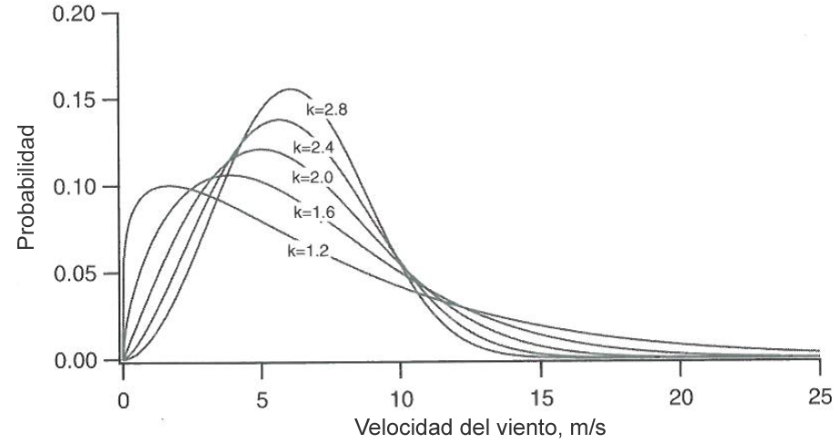
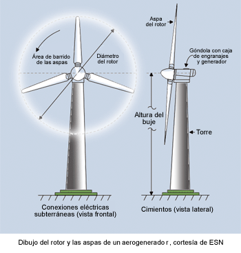
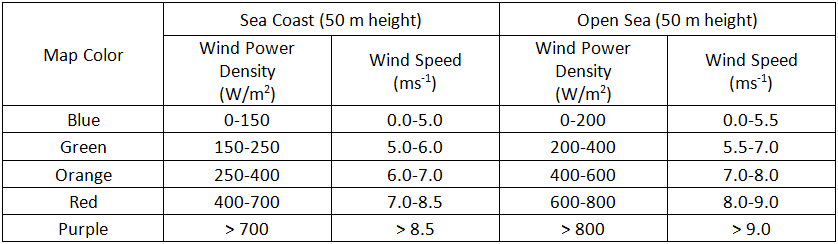
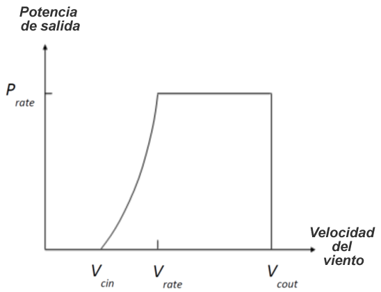
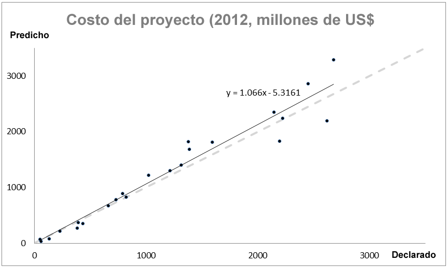

.. _wind-energy:

***********************************
Producción de energía eólica marina
***********************************

Resumen
=======

La energía eólica marina está despertando un interés creciente en todo el mundo. En enero de 2013 había 5.400 megavatios (MW) instalados y la tasa de crecimiento era de alrededor del 25 % anual (GWEC, 2013). La mayor constancia de los vientos marinos y la proximidad a los centros costeros de demanda de energía son dos de las principales razones por las que los desarrolladores de energía eólica están dirigiendo su atención hacia el mar. El objetivo del modelo de energía eólica marina de InVEST es proporcionar mapas espaciales de la disponibilidad del recurso energético, el potencial de generación de energía y, de manera opcional, el valor de la generación, para que los usuarios puedan evaluar decisiones de emplazamiento, compensaciones entre usos y otras cuestiones relacionadas con la planificación espacial marina. El modelo se desarrolló para ofrecer la máxima flexibilidad: puede ejecutarse con datos y parámetros predeterminados, pero también permite incorporar información actualizada sobre turbinas y cimentaciones, conexiones a la red y valores de parámetros adecuados al contexto del usuario. Los resultados incluyen el potencial de energía eólica, la generación de energía, las emisiones de carbono evitadas, el valor presente neto y el costo nivelado de la energía, todos calculados a escala de parque eólico.

Las referencias científicas revisadas por pares para este modelo son http://dx.doi.org/10.1016/j.aquaculture.2014.10.035 para el componente financiero y http://dx.doi.org/10.1016/j.marpol.2015.09.024 para el componente físico.

Introducción
============

Este modelo de energía eólica proporciona una interfaz fácilmente reproducible para evaluar la viabilidad de la energía eólica en una región bajo distintos escenarios de diseño de parques. Los resultados son mapas ráster cuyos valores en cada punto representan el valor agregado de un parque centrado en ese punto. Esto permite analizar detalladamente las decisiones de emplazamiento a una escala fina, aunque supone asumir que las condiciones son suficientemente simétricas alrededor del punto central, de modo que este represente las condiciones medianas de todas las turbinas del parque. Dado que el usuario puede seleccionar el número de turbinas del parque y los mapas ráster no indican su tamaño, el modelo también genera un polígono representativo (de tipo polilínea) en un punto de datos de viento seleccionado aleatoriamente, que indica las dimensiones del parque.

Para ejecutar el modelo, se solicita introducir información en la interfaz gráfica. Esta incluye datos sobre las condiciones del viento, el tipo de turbina, el número de turbinas, el área de interés, etc. Para facilitar su uso, el modelo incluye tablas `.csv` con datos predeterminados de dos turbinas marinas comunes: de 3,6 MW y de 5,0 MW. También se incluyen dos conjuntos de datos de velocidad del viento: uno mundial y otro que cubre el Atlántico noroccidental. Por último, se proporciona una tabla con valores predeterminados que suelen modificarse con menor frecuencia y que se utilizan para parametrizar distintas partes del modelo, denominada archivo «Global Wind Energy Parameters». Estos archivos `.csv` son datos de entrada obligatorios y pueden modificarse si se desean utilizar otros valores, editándolos directamente con un editor de texto o Microsoft Excel. Al modificarlos, se recomienda guardar una copia del archivo `.csv` predeterminado para no perder los valores originales.

El modelo
=========

Potencial de energía eólica
---------------------------

El modelo estima la densidad de potencia eólica (potencial de energía eólica) para identificar las zonas marinas con mayor potencial energético. La densidad de potencia eólica :math:`PD (Wm^{-2})` en una ubicación determinada puede aproximarse como función de las estadísticas del viento (Elliott et al., 1986):

.. math:: \frac{1}{2}\rho\sum^c_{j=1}f(V_j)V_j^3
   :label: wind_power_density

donde :math:`\rho` es la densidad media del aire (:math:`kg\,m^{-3}`), :math:`j` es el índice de la clase de velocidad del viento, :math:`c` es el número de clases de velocidad, :math:`V_j` es la velocidad del viento de la clase :math:`j` (:math:`ms^{-1}`), y :math:`f(V_j)` es la función de densidad de probabilidad de :math:`V_j`. En el análisis de datos de viento se utilizan comúnmente dos distribuciones de probabilidad: 1) Rayleigh y 2) Weibull (Manwell et al. 2009). La distribución de Weibull puede representar mejor una mayor variedad de regímenes de viento (Celik 2003; Manwell et al. 2009) y se expresa como:

.. math:: f(V_j) = \frac{k}{\lambda}\left(\frac{V_j}{\lambda}\right)^{k-1}e^{-\left(\frac{V_j}{\lambda}\right)^k}
   :label: weibull_dist

donde :math:`k` y :math:`\lambda` son, respectivamente, los factores de forma y escala. El factor de forma, :math:`k`, determina la forma de la función de densidad de probabilidad de Weibull (:numref:`weibull-fig`). La función presenta un pico más pronunciado a medida que aumenta :math:`k`, lo que indica velocidades del viento más constantes alrededor de la velocidad media. Por el contrario, la función se vuelve más suave a medida que disminuye :math:`k`, lo que indica una mayor variación de la velocidad del viento y una frecuencia más alta de velocidades bajas y altas. El modelo requiere que los datos de velocidad del viento se introduzcan mediante los parámetros estimados de Weibull, en lugar de utilizar datos brutos de velocidad del viento. Para los datos de ejemplo utilizamos una función de MATLAB, `wblfit`, para estimar :math:`k` y :math:`\lambda` a la altura de referencia de la velocidad del viento (la altura a la que se observaron o estimaron las velocidades). Esta función devuelve las estimaciones de máxima verosimilitud de los parámetros de la distribución de Weibull a partir de los valores de la serie temporal del viento. El procedimiento se realizó para cada punto de observación de la velocidad del viento. Para más información sobre la función `wblfit`, consulte https://kr.mathworks.com/help/stats/wblfit.html. También puede realizarse en R (véase este tutorial: https://stats.stackexchange.com/questions/60511/weibull-distribution-parameters-k-and-c-for-wind-speed-data).

.. _weibull-fig:

   Ejemplo de la función de densidad de probabilidad de Weibull con distintos factores de forma (:math:`k`), donde la velocidad media del viento = :math:`6 ms^{-1}` (Manwell et al., 2009).

La densidad de potencia eólica se calcula a la altura de buje :math:`Z` (m) de una turbina eólica (:numref:`weibull-fig`), lo que significa que todas las variables de las ecuaciones :eq:`wind_power_density` y :eq:`weibull_dist` deben convertirse a los valores correspondientes a esa altura. La densidad media del aire :math:`\rho` se estimó como :math:`\rho=1.225-(1.194\cdot 10^{-4})Z`, una aproximación del perfil de densidad del aire de la Atmósfera Estándar de Estados Unidos (National Oceanic and Atmospheric Administration, 1976). Para estimar la velocidad del viento (:math:`V`) a la altura de buje :math:`Z` se aplicó la ley potencial del perfil del viento (Elliott et al., 1986):

.. math:: \frac{V}{V_r} = \left(\frac{Z}{Z_r}\right)^\alpha

donde :math:`V` es la velocidad del viento (:math:`ms^{-1}`) a la altura de buje :math:`Z` (m) de una turbina, y :math:`V_r` es la velocidad del viento (:math:`ms^{-1}`) a la altura de referencia :math:`Z_r` (m), donde se obtienen los datos del viento. :math:`\alpha` es el exponente de la ley potencial, un coeficiente derivado empíricamente que varía según la estabilidad de la atmósfera. En condiciones de estabilidad neutra, :math:`\alpha` es aproximadamente 1/7 (0,143) para las superficies terrestres, valor ampliamente aplicable para ajustar la velocidad del viento sobre tierra (Elliott et al., 1986). El exponente de la ley potencial tiene un valor diferente sobre las superficies oceánicas. Hsu et al. (1994) encontraron que :math:`\alpha = 0.11\pm0.03` sobre superficies oceánicas en condiciones de estabilidad atmosférica casi neutra. El modelo de energía eólica utiliza :math:`\alpha = 0.11` como valor predeterminado para ajustar la velocidad del viento sobre el océano. El perfil del viento en la capa límite atmosférica puede aproximarse con mayor precisión mediante la ecuación logarítmica del perfil del viento, que considera la rugosidad de la superficie y la estabilidad atmosférica (Manwell et al. 2009).

.. _wind-turbine-fig:

   Esquema de una turbina eólica (https://www.daviddarling.info/encyclopedia/H/AE_hub_height.html)

Los resultados de densidad de potencia eólica (PD) proporcionan información sobre la idoneidad del recurso eólico para un proyecto de desarrollo. Pacific Northwest Laboratories clasificó la densidad de potencia eólica y la velocidad del viento en siete clases, con base en el Atlas Eólico de Estados Unidos (:numref:`wind-power-density-fig`) (Manwell et al. 2009). Las áreas clasificadas como clase 4 o superior se consideran adecuadas para la mayoría de los proyectos de energía eólica. Las áreas de clase 3 son adecuadas si se utilizan turbinas grandes. Las clases 1 y 2 rara vez se consideran adecuadas desde el punto de vista del potencial energético. Los recursos eólicos varían considerablemente en el espacio y en Europa se desarrolló una clasificación más detallada de la densidad de potencia eólica para cinco condiciones topográficas: terreno protegido, llanura abierta, costa, mar abierto, colinas y crestas (:numref:`wind-power-density-fig`) (Manwell et al. 2009). La clasificación del recurso eólico para la costa y el mar abierto puede proporcionar información más adecuada sobre la idoneidad de los proyectos de energía eólica marina.

.. _wind-power-density-fig:

   Clases de densidad de potencia eólica (PD) y velocidad del viento según el Atlas Eólico Europeo (modificado de la Tabla 2.6 de Manwell et al. 2009).

Generación de energía
---------------------

La cantidad de energía que puede aprovecharse de una turbina eólica en una ubicación determinada depende tanto de las características de la turbina como de las condiciones del viento (Pallabazzer 2003; Jafarian y Ranjbar 2010). El modelo cuantifica la energía aprovechable a partir de la curva de potencia de salida de la turbina y de las estadísticas de velocidad del viento. La :numref:`power-output-curve-fig` muestra la curva de potencia de salida de una turbina eólica (de control por paso de pala). La turbina comienza a generar energía a la velocidad de arranque (:math:`V_{cin}`). La potencia de salida aumenta hasta alcanzar la potencia nominal (:math:`P_{rate}`) a medida que la velocidad del viento aumenta hasta la velocidad nominal (:math:`V_{rate}`). La turbina continúa produciendo la potencia máxima (es decir, :math:`P_{rate}`) hasta que la velocidad del viento alcanza la velocidad de corte (:math:`V_{cout}`). Si la velocidad supera la velocidad de corte, la turbina deja de generar energía por razones de seguridad. Actualmente operan en el mundo más de 74 parques eólicos marinos y la información tecnológica específica de las turbinas de cada parque está disponible en LORC Knowledge (2012).

.. _power-output-curve-fig:

   Curva de potencia de salida (P) de una turbina eólica (de control por paso de pala) en función de la velocidad del viento (V) (modificada de la Fig. 1 de Pallabazzer 2003).

Para ofrecer flexibilidad ante distintos tipos de turbinas sin exigir que el usuario introduzca manualmente una curva de potencia, estimamos la potencia de salida :math:`P` (kW) de una turbina mediante un enfoque de modelización polinómica (Jafarian y Ranjbar 2010):

.. math:: P(V) = \left\{\begin{array}{ll} 0 & V < V_{cin} \mathrm{\ or\ } V>V_{cout}\\
              P_{rate} & V_{rate} < V < V_{cout}\\
	      (V^m - V^m_{in})/(V^m_{rate} - V^m_{in}) & V_{cin} \leq V \leq V_{rate}\\
	      \end{array}\right.

donde :math:`m` es un exponente de la curva de potencia de salida (generalmente 1 o 2). Con este enfoque, la energía generada, :math:`O` (MWh), por una turbina puede calcularse mediante:

.. math:: O = nday\cdot \frac{\rho}{\rho_0} P_{rate}\left(\int^{V_rate}_{V_{cin}} \frac{V^m - V^m_{cin}}{V^m_r-V^m_{cin}} f(V)dV
     + \int^{V_{cout}}_{V_{rate}} f(V) dV\right)(1- lossrate)

donde :math:`nday` es el número de días del período de generación (por ejemplo, :math:`nday = 365` días para la generación anual), :math:`\rho_0` es la densidad del aire de la atmósfera estándar (por ejemplo, :math:`1.225 kg m^{-3}` al nivel del mar según la atmósfera estándar de Estados Unidos), y :math:`lossrate` es un valor decimal que representa las pérdidas de energía debidas a una combinación de tiempo de inactividad, eficiencia de conversión de energía y pérdidas en la red eléctrica (el valor predeterminado es 0,05). Todos estos parámetros se incluyen en el archivo `.csv` de parámetros globales y el usuario puede modificar sus valores predeterminados. La generación total de energía del parque equivale a la generación de cada turbina multiplicada por el número de turbinas, :math:`n`:

.. math:: E = nO

El software InVEST incluye información técnica y financiera predeterminada sobre dos tamaños comunes de turbinas: 3,6 MW y 5,0 MW. La información de cada turbina se encuentra en archivos `.csv` del directorio `\Input` y constituye una entrada obligatoria del modelo. El usuario puede utilizar los datos predeterminados, editar un archivo o crear uno nuevo para evaluar distintos tamaños de turbina o actualizar características específicas. Los archivos deben conservar el mismo formato: solo es seguro modificar los valores de los parámetros. Se recomienda guardar las modificaciones en archivos `.csv` nuevos, en lugar de sobrescribir los datos predeterminados.

Carbono evitado
---------------

Dado que las turbinas eólicas no generan gases de efecto invernadero durante la producción de energía, el usuario puede estar interesado en evaluar la cantidad de emisiones de dióxido de carbono que se evitarían al construir un parque eólico en lugar de una planta convencional de generación de energía. Para convertir la energía eólica libre de carbono en una cantidad representativa de emisiones anuales de :math:`\mathrm{CO}_2` evitadas, utilizamos el siguiente factor de conversión predeterminado: :math:`6.8956\cdot 10 ^{-4} \mathrm{metric\ tons\ CO}_2/kWh`.

Este valor se obtiene de la EPA (https://www.epa.gov/energy/greenhouse-gases-equivalencies-calculator-calculations-and-references) y se basa en datos de 2007. Consulte su sitio web para conocer las limitaciones de este enfoque. El valor representa las emisiones de carbono del conjunto de fuentes de energía de Estados Unidos y puede no ser apropiado para su contexto. Puede modificarse en el archivo `.csv` de parámetros globales.

Valor de la energía
-------------------

El valor de la energía eólica se mide como los ingresos netos antes de impuestos, descontados, que la generación de energía proporcionaría a un desarrollador u operador durante la vida útil prevista del parque eólico. El valor presente neto (https://en.wikipedia.org/wiki/Net_present_value) (NPV) de la energía para un parque determinado es:

.. math:: NPV = \sum^T_{t=1}(R_t-C_t)(1+i)^{-t}

donde :math:`R_t` son los ingresos brutos obtenidos en el año :math:`t`, y :math:`C_t` son los costos agregados en el año :math:`t`. :math:`T` representa la vida útil esperada del parque eólico (en años), y :math:`i` es la tasa de descuento o costo promedio ponderado de capital (WACC). Para este modelo, :math:`R_t` se calcula como el precio de la energía multiplicado por la energía producida en el año :math:`t`.

Los costos se dividen en costos de capital iniciales (CAPEX), costos anuales de operación y mantenimiento (O&M) y costos de desmantelamiento al final de la vida útil. El modelo utiliza estimaciones de costos por unidad de capacidad instalada o por unidad de longitud de cable, según corresponda. Los parámetros y sus valores predeterminados se incluyen en el archivo `.csv` de parámetros globales y pueden modificarse para representar las condiciones locales.

**Costos de capital (CAPEX):** incluyen el costo de las turbinas, las cimentaciones, la instalación, los cables internos del parque y la transmisión eléctrica hasta la costa. Los costos de transmisión dependen de la distancia a la costa, la capacidad de generación del parque y la tecnología de transmisión utilizada. El modelo considera las opciones de corriente alterna (AC) y corriente continua (DC), con parámetros de costos distintos.

**Costos de operación y mantenimiento (O&M):** se calculan como un porcentaje de los costos de capital originales. Las estimaciones de la literatura sitúan estos costos entre el 3 % y el 3,5 % anual. El valor predeterminado utilizado en este modelo es 3,5 % y puede modificarse, junto con los demás costos de esta sección, editando el archivo `.csv` de parámetros globales.

Precios de la energía
^^^^^^^^^^^^^^^^^^^^^

Este modelo está diseñado para aceptar un precio unitario fijo por kilovatio-hora (kWh) de energía durante la vida útil del parque eólico, O bien una tabla `.csv` en la que se especifique el precio por kWh para cada año de vida del parque. En algunos lugares, los operadores de parques eólicos reciben una tarifa subsidiada, conocida como tarifa de alimentación (*feed-in tariff*), que garantiza un precio determinado por su energía durante un período específico. En otros lugares, deben negociar con los proveedores de energía y las comisiones de servicios públicos para obtener un contrato de compraventa de energía (*power purchase agreement*). Estos contratos establecen un precio unitario para la energía suministrada y pueden incluir tarifas variables a lo largo del tiempo, por lo que la flexibilidad de la tabla de precios resulta esencial.

Costo nivelado de la energía
----------------------------

El costo nivelado de la energía (https://en.wikipedia.org/wiki/Cost_of_electricity_by_source) (LCOE) es el precio unitario que tendría que recibirse por la energía para que el valor presente del proyecto fuera igual a cero. Por tanto, representa el precio mínimo por kWh que un desarrollador de un parque eólico podría recibir antes de considerar que el proyecto deja de ser rentable. El resultado del modelo se expresa en moneda/kWh y se calcula como:

.. math:: LCOE = \frac{\sum^T_{t=1}\frac{O\&M\cdot CAPEX}{(1+i)^t}+\frac{D\cdot CAPEX}{(1+i)^T}+CAPEX}{\sum^T_{t=1}\frac{E_t}{(1+i)^t}}

donde :math:`CAPEX` son los gastos de capital iniciales, :math:`O\&M` es el parámetro de operación y mantenimiento, :math:`D` es el parámetro de desmantelamiento, :math:`E_t` es la energía anual producida en kWh, :math:`i` es la tasa de descuento o WACC, y :math:`t` es el paso temporal anual, donde :math:`t=\{1\ldots T\}`.

Validación
----------

Modelo de costos de capital
^^^^^^^^^^^^^^^^^^^^^^^^^^^

Dado que los gastos de capital representan la mayor proporción de los costos y que buena parte de los costos complementarios son fracciones fijas de los costos de capital, es fundamental validar el modelo frente a los costos declarados de parques eólicos marinos de todo el mundo. Para ello recopilamos datos de https://www.4coffshore.com/ y https://www.lorc.dk/offshore-wind-farms-map/statistics sobre los costos de capital y los diseños declarados de parques en construcción o actualmente operativos. Limitamos la recopilación a los parques que utilizan turbinas de 3,6 MW y 5,0 MW, para los cuales se proporcionan datos predeterminados en el modelo InVEST. Los costos de capital declarados y recopilados de 4Coffshore se actualizaron a dólares estadounidenses de 2012, utilizando la información de cierre financiero proporcionada por esa fuente como referencia para la fecha en que se recopiló la estimación de costos. Para generar las predicciones, introdujimos el diseño de cada parque en el modelo InVEST, utilizando los parámetros de costos predeterminados apropiados para todos los componentes. La mayoría de los parques cuentan con sus propios equipos de transmisión eléctrica, aunque algunos parques en aguas profundas comienzan a utilizar subestaciones marinas centralizadas que agrupan la energía para transportarla desde varios parques. Para predecir los costos de transmisión eléctrica de estos parques, primero fue necesario estimar el costo de toda la subestación marina y luego asignar una parte proporcional del costo de capital a cada parque según su contribución relativa a la capacidad de energía exportada. Por ejemplo, una subestación marina con una capacidad de exportación de 800 MW conectada al Parque A (200 MW) y al Parque B (600 MW) asignaría el 25 % de los costos de capital al Parque A y el 75 % al Parque B. Los resultados de la validación muestran una correlación muy alta entre las predicciones y los costos de capital declarados para las turbinas de 3,6 MW y 5,0 MW, utilizando los datos predeterminados (véase la Figura 5.6).

.. _project-costs-fig:

   Costos de capital predichos frente a costos de capital declarados.

Desde la publicación de este modelo a principios de 2013, se lo ha comparado con otros enfoques de modelización. Se señalan a continuación como referencia:

1. El modelo InVEST se comparó con las estimaciones del National Renewable Energy Laboratory (NREL) y de una empresa consultora en un informe de la Universidad de California, Santa Bárbara, que evaluó el costo nivelado de la energía eólica en Bermudas. InVEST se situó a menos del 3 % de la estimación del NREL y a menos del 12 % de la estimación de la empresa consultora. http://trapdoor.bren.ucsb.edu/research/2014Group_Projects/documents/BermudaWind_Final_Report_2014-05-07.pdf

Limitaciones y simplificaciones
===============================

Producción de energía
---------------------

La calidad de los datos de entrada sobre el viento determina la precisión de los resultados del modelo. Por tanto, los usuarios deben comprender la calidad de esos datos para interpretar correctamente los resultados. Los datos predeterminados de viento son más apropiados para aplicaciones a escala mundial y regional, con resoluciones espaciales de 4 o 60 minutos.

La energía eólica aprovechada representa la producción media de energía durante un período determinado, según la curva de potencia de salida de una turbina. Los usuarios pueden considerar información tecnológica adicional específica, como la disponibilidad del equipo, la eficiencia de conversión de energía y los factores direccionales, aplicando factores de ajuste a la producción de energía aprovechada.

Valoración de la energía
------------------------

Como demuestra la sección de validación, el modelo y los datos predeterminados predicen de manera fiable los costos de capital a partir de las entradas proporcionadas. Los ingresos están vinculados a la producción de energía y al precio introducido por el usuario. Podrían obtenerse proyecciones de costos más fiables en el espacio mediante:

 * la creación de una función de costos de cimentación que considere los mayores costos en aguas más profundas;
 * la variación de los costos de instalación en función de la geología del fondo marino.

Estas características se están explorando para futuras actualizaciones del modelo, en función de la disponibilidad de datos.

El modelo puede generar resultados de valoración para turbinas flotantes, pero no fue diseñado específicamente para esta tarea. Para obtener resultados, el usuario debe introducir valores razonables para las restricciones de profundidad y distancia, así como costos de «cimentación» equivalentes al costo unitario del conjunto de equipos necesarios para mantener flotante una turbina. El modelo de costos de transmisión eléctrica se derivó utilizando tecnologías adecuadas para profundidades de aproximadamente 60 metros y distancias de hasta 200 kilómetros de la costa, por lo que probablemente generará proyecciones de costos menos precisas fuera de esos límites.

Datos necesarios
================

- :investspec:`wind_energy workspace_dir`

- :investspec:`wind_energy results_suffix`

- :investspec:`wind_energy wind_data_path`

  Columnas:

  - :investspec:`wind_energy wind_data_path.columns.long`
  - :investspec:`wind_energy wind_data_path.columns.lati`
  - :investspec:`wind_energy wind_data_path.columns.lam`
  - :investspec:`wind_energy wind_data_path.columns.k`
  - :investspec:`wind_energy wind_data_path.columns.ref`

- :investspec:`wind_energy aoi_vector_path` El modelo recortará y proyectará los resultados al AOI. El AOI debe cubrir una parte del polígono terrestre para calcular correctamente las distancias.

- :investspec:`wind_energy bathymetry_path` Debe cubrir al menos toda la extensión del área de interés.

- :investspec:`wind_energy land_polygon_vector_path` El AOI debe cubrir una parte de este polígono terrestre para calcular correctamente las distancias. Este polígono costero y el área cubierta por el AOI constituyen la base de los cálculos de distancia para la transmisión eléctrica de los parques eólicos.

- :investspec:`wind_energy global_wind_parameters_path` Los valores predeterminados proporcionados en los datos de muestra se revisan en la sección **El modelo** de esta guía. Recomendamos considerar cuidadosamente cualquier modificación de estos valores. **Nota:** los valores monetarios predeterminados de estos parámetros (véase la Tabla 3) están expresados en dólares estadounidenses. Si utiliza otra moneda para los demás parámetros de valoración de este modelo (costo del tipo de cimentación, etc.), también deberá modificar los parámetros globales de energía eólica utilizando un tipo de cambio apropiado.

  Columnas:

  - :investspec:`wind_energy global_wind_parameters_path.rows.air_density`
  - :investspec:`wind_energy global_wind_parameters_path.rows.exponent_power_curve`
  - :investspec:`wind_energy global_wind_parameters_path.rows.decommission_cost`
  - :investspec:`wind_energy global_wind_parameters_path.rows.operation_maintenance_cost`
  - :investspec:`wind_energy global_wind_parameters_path.rows.miscellaneous_capex_cost`
  - :investspec:`wind_energy global_wind_parameters_path.rows.installation_cost`
  - :investspec:`wind_energy global_wind_parameters_path.rows.infield_cable_length`
  - :investspec:`wind_energy global_wind_parameters_path.rows.infield_cable_cost`
  - :investspec:`wind_energy global_wind_parameters_path.rows.mw_coef_ac`
  - :investspec:`wind_energy global_wind_parameters_path.rows.mw_coef_dc`
  - :investspec:`wind_energy global_wind_parameters_path.rows.cable_coef_ac`
  - :investspec:`wind_energy global_wind_parameters_path.rows.cable_coef_dc`
  - :investspec:`wind_energy global_wind_parameters_path.rows.ac_dc_distance_break`
  - :investspec:`wind_energy global_wind_parameters_path.rows.time_period`
  - :investspec:`wind_energy global_wind_parameters_path.rows.carbon_coefficient`
  - :investspec:`wind_energy global_wind_parameters_path.rows.air_density_coefficient`
  - :investspec:`wind_energy global_wind_parameters_path.rows.loss_parameter`

Propiedades de las turbinas
---------------------------

- :investspec:`wind_energy turbine_parameters_path` Los datos de muestra incluyen estos parámetros para dos opciones de modelos de turbina: 3,6 MW y 5,0 MW. Puede crear una nueva clase de turbina (o modificar las clases existentes) siguiendo las convenciones de formato del archivo actual e introduciendo sus propios parámetros. Se recomienda no sobrescribir los archivos `.csv` predeterminados existentes. Estos archivos se encuentran en el directorio `WindEnergy\input` de los datos de muestra de InVEST y se denominan:

  * 3,6 MW: `3_6_turbine.csv`
  * 5,0 MW: `5_0_turbine.csv`

  Columnas:

  - :investspec:`wind_energy turbine_parameters_path.rows.hub_height`
  - :investspec:`wind_energy turbine_parameters_path.rows.cut_in_wspd`
  - :investspec:`wind_energy turbine_parameters_path.rows.rated_wspd`
  - :investspec:`wind_energy turbine_parameters_path.rows.cut_out_wspd`
  - :investspec:`wind_energy turbine_parameters_path.rows.turbine_rated_pwr`
  - :investspec:`wind_energy turbine_parameters_path.rows.turbine_cost`

- :investspec:`wind_energy number_of_turbines`
- :investspec:`wind_energy min_depth`
- :investspec:`wind_energy max_depth`
- :investspec:`wind_energy min_distance`
- :investspec:`wind_energy max_distance`

Valoración
----------

- :investspec:`wind_energy valuation_container`

- :investspec:`wind_energy foundation_cost` El costo de una cimentación depende del tipo seleccionado, que a su vez depende de diversos factores, entre ellos la profundidad y la turbina elegida. Puede utilizarse cualquier moneda, siempre que sea coherente en todas las entradas de valoración.

- :investspec:`wind_energy discount_rate` La tasa de descuento refleja las preferencias por los beneficios inmediatos frente a los futuros (por ejemplo, ¿una persona preferiría recibir 10 dólares hoy o 10 dólares dentro de cinco años?).

- :investspec:`wind_energy grid_points_path` Para los cálculos se utiliza la distancia más corta entre los puntos correspondientes.

  Columnas:

  - :investspec:`wind_energy grid_points_path.columns.id`
  - :investspec:`wind_energy grid_points_path.columns.type`
  - :investspec:`wind_energy grid_points_path.columns.lati`
  - :investspec:`wind_energy grid_points_path.columns.long`

  Ejemplo:

  .. csv-table::
    :file: ../../invest-sample-data/WindEnergy/input/NE_sub_pts_modified.csv
    :header-rows: 1
    :widths: auto

- :investspec:`wind_energy avg_grid_distance`

- :investspec:`wind_energy price_table`

- :investspec:`wind_energy wind_schedule`

  Columnas:

  - :investspec:`wind_energy wind_schedule.columns.year`
  - :investspec:`wind_energy wind_schedule.columns.price` Puede utilizarse cualquier moneda, siempre que sea coherente en todas las entradas de valoración.

- :investspec:`wind_energy wind_price` Puede utilizarse cualquier moneda, siempre que sea coherente en todas las entradas de valoración.

- :investspec:`wind_energy rate_change`

Interpretación de los resultados
================================

Resultados del modelo
---------------------

Carpeta de resultados
^^^^^^^^^^^^^^^^^^^^^

* `wind_energy_points.shp`: shapefile de ESRI que resume los resultados del modelo para cada punto. Este shapefile contiene únicamente los puntos que se determinaron como ubicaciones válidas según la profundidad del océano y la distancia a la costa. Además de los campos incluidos en el archivo CSV de entrada de datos de viento (long, lati, lam, k, ref), se proporcionan los siguientes campos:

  * **ref_lam**: factor de escala de Weibull a la altura de buje de referencia en este punto.
  * **Dens_W/m2** (unidades: W/m²): densidad de potencia en este punto.
  * **Harv_MWhr** (unidades: MWhr/año): energía estimada que puede aprovecharse de un parque eólico centrado en este punto.
  * **DepthVal** (unidades: metros): profundidad del océano en este punto.
  * **DistVal** (unidades: metros): distancia desde este punto hasta la costa.
  * **CO2_Tons** (unidades: toneladas métricas/año): emisiones de carbono evitadas por un parque centrado en este punto. Se incluye solo si se ejecuta la valoración.
  * **Level_Cost** (unidades: moneda de entrada del modelo/kWhr): precio de la energía necesario para que el valor presente de un parque centrado en este punto sea igual a cero. Se incluye solo si se ejecuta la valoración.
  * **NPV** (unidades: moneda de entrada del modelo): valor presente neto de un parque centrado en este punto. Se incluye solo si se ejecuta la valoración.

Carpeta intermedia
^^^^^^^^^^^^^^^^^^

* `carbon_emissions_tons.tif`: archivo ráster GeoTIFF que representa las toneladas de emisiones de carbono evitadas por año por un parque construido con centro en un píxel.

* `example_size_and_orientation_of_a_possible_wind_farm.shp`: shapefile de ESRI que representa el límite exterior de un parque eólico de muestra. La ubicación de este polígono es aleatoria y su finalidad es dar al usuario una idea de la escala del posible parque eólico.

* `harvested_energy_MWhr_per_yr.tif`: archivo ráster GeoTIFF que representa la energía anual aprovechada de un parque centrado en ese píxel.

* `levelized_cost_price_per_kWh.tif`: archivo ráster GeoTIFF que representa el precio unitario de la energía necesario para que el valor presente del parque centrado en ese píxel sea igual a cero. Los valores se expresan en la unidad monetaria utilizada como entrada del modelo.

* `npv.tif`: archivo ráster GeoTIFF que representa el valor presente neto de un parque centrado en ese píxel.

* `unmasked_wind_energy_points.shp`: shapefile de ESRI que representa cada punto de datos de viento del archivo CSV de puntos de entrada. Este shapefile proporciona los valores de densidad de potencia (W/m²) de todos los puntos, así como los valores de energía anual aprovechada y un campo que indica si un punto fue excluido mediante una máscara debido a la profundidad o a la distancia en el resultado final.

Apéndice: fuentes de datos
==========================

Datos de series temporales de viento
------------------------------------

El Servicio Meteorológico Nacional de la NOAA proporciona resultados de reanálisis retrospectivo (*hindcast*) para series temporales de viento: https://polar.ncep.noaa.gov/. La resolución espacial de los resultados del modelo varía entre 4 y 60 minutos, según los sistemas de cuadrícula mundial y regional. Los resultados del modelo se han guardado en intervalos de 3 horas desde 1999 hasta el presente. Los resultados se han validado con datos de boyas oceánicas en numerosos lugares y proporcionan información de buena calidad sobre el viento.

Parámetros de las turbinas
--------------------------

LORC proporciona información sobre los parámetros de las turbinas eólicas marinas que están actualmente en funcionamiento en el mundo: https://www.lorc.dk/offshore-wind-farms-map/list?sortby=InstalledCapacity&sortby2=&sortorder=desc

Valoración
----------

Las fuentes de datos se citan en gran medida en las secciones anteriores, excepto las cifras derivadas de comunicados de prensa. Estos comunicados se localizaron mediante una búsqueda exhaustiva en Google con las palabras clave «offshore wind energy» y «contract», además de varias combinaciones relacionadas. Todos los costos se registraron y actualizaron en su moneda original y se convirtieron a dólares estadounidenses al tipo de cambio al contado del 30 de marzo de 2012.

Este archivo (https://www.dropbox.com/s/p4l36pbanl334c2/Wind_Sources.zip?dl=0) contiene un archivo comprimido con las fuentes citadas para los costos y una hoja de cálculo que vincula cada cifra de costos con el comunicado de prensa, las actas de congreso u otra fuente pertinente.

Referencias
===========

AWS Truewind. 2010. New York’s Offshore Wind Energy Development Potential in the Great Lakes. Feasibility Study for New York State Energy Research and Development Authority.

Blanco, M. 2009. The Economics of Wind Energy. Renewable and Sustainable Energy Reviews, 13, 1372-82. http://dx.doi.org/10.1016/j.rser.2008.09.004

Boccard, N. 2010. Economic Properties of Wind Power: A European Assessment. Energy Policy, 38, 3232-3244. http://dx.doi.org/10.1016/j.enpol.2009.07.033

Carbon Trust. 2008. Offshore Wind Power: Big Challenge, Big Opportunity. Report on behalf of the Government of the United Kingdom.

Celik, A. N. 2003. A statistical analysis of wind power density based on the Weibull and Rayleigh models at the southern of Turkey. Renewable Energy 29:509-604. http://dx.doi.org/10.1016/j.renene.2003.07.002

Elliott, D. L., C. G. Holladay, W. R. Barchet, H. P. Foote, and W. F. Sandusky. 1986. Wind energy resource atlas of the United States. DOE/CH 10093-4. Solar Technical Information Program, Richland, Washington.

Global Wind Energy Council (GWEC). 2013. Global Wind Statistics, 2012. Accessed at: http://www.gwec.net/wp-content/uploads/2013/02/GWEC-PRstats-2012_english.pdf

Griffin, R., Buck, B., and Krause, G. 2015a. Private incentives for the emergence of co-production of offshore wind energy and mussel aquaculture. Aquaculture, 346, 80-89. http://dx.doi.org/10.1016/j.aquaculture.2014.10.035

Griffin, R., Chaumont, N., Denu, D., Guerry, A., Kim, C., and Ruckelshaus, M. 2015b. Incorporating the visibility of coastal energy infrastructure into multi-criteria siting decisions. Marine Policy, 62, 218-223. http://dx.doi.org/10.1016/j.marpol.2015.09.024

Hsu, S. A., E. A. Meindl, and D. B. Gilhousen. 1994. Determining the power-law wind-profile exponent under near-neutral stability conditions at sea. Journal of applied meteorology 33:757-765. http://dx.doi.org/10.1175/1520-0450(1994)033%3C0757:DTPLWP%3E2.0.CO;2

Jacquemin, J., Butterworth, D., Garret, C., Baldock, N., and A. Henderson. 2011. Inventory of location specific wind energy cost. WP2 Report D2.2. Spatial deployment of offshore wind energy in Europe (Wind-Speed). Garrad Hassan & Partners Ltd. Supported by Intelligent Energy Europe.

Jafarian, M., and A. M. Ranjbar. 2010. Fuzzy modeling techniques and artificial neural networks to estimate annual energy output of a wind turbine. Renewable Energy 35:2008-2014. http://dx.doi.org/10.1016/j.renene.2010.02.001

Kaiser, M. and B. Snyder. 2012. Offshore wind capital cost estimation in the U.S. Outer Continental Shelf: A reference class approach. Marine Policy, 36, 1112-1122. http://dx.doi.org/10.1016/j.marpol.2012.02.001

Levitt, A., Kempton, W., Smith, A., Musial, W., and J. Firestone. 2011. Pricing offshore wind energy. Energy Policy, 39, 6408-6421. http://dx.doi.org/10.1016/j.enpol.2011.07.044

Lorc Knowledge. 2012. List of offshore wind farms. https://www.lorc.dk/offshore-wind-farms-map/list Accessed at December 31, 2012.

Manwell, J. F., J. G. Mcgowan, and A. L. Rogers. 2009. Wind energy explained: Theory, design and application. John Wiley & Sons Ltd., West Sussex, United Kingdom.

National Oceanic and Atmospheric Administration. 1976. U. S. Standard Atmosphere. NOAA- S/T76-1562, Washington, DC.

Pallabazzer, R. 2003. Provisional estimation of the energy output of wind generators. Renewable Energy, 29, 413-420. http://dx.doi.org/10.1016/S0960-1481(03)00197-6

Samoteskul, K., Firestone, J., Corbett, J., and J. Callahan. 2014. Changing vessel routes could significantly reduce the cost of future offshore wind projects. Journal of Environmental Management, 141, 146-154. http://dx.doi.org/10.1016/j.jenvman.2014.03.026

UMaine. 2011. Maine deepwater offshore wind report. https://composites.umaine.edu/research/offshore-wind-report/
